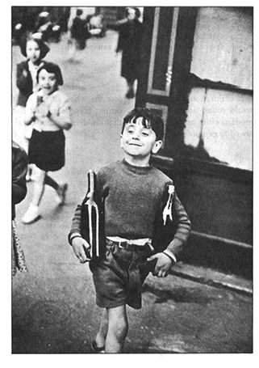
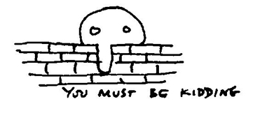
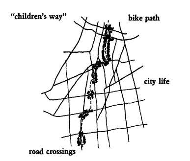

<section class="pattern-plate" aria-labelledby="t-children-in-the-city">
<a href="/patterns">A Pattern Language</a> · <a href="/patterns#towns">Towns</a> · Pattern 57 · p. 293
<h1 class="pattern-title" id="t-children-in-the-city">Children In The City</h1><figure class="pattern-figure pl-figure"></figure><nav class="pattern-links" aria-label="Connections"><h2>Links to</h2><ul><li><a href="/patterns/network-of-learning">18 Network Of Learning</a></li><li><a href="/patterns/parallel-roads">23 Parallel Roads</a></li><li><a href="/patterns/promenade">31 Promenade</a></li><li><a href="/patterns/work-community">41 Work Community</a></li><li><a href="/patterns/university-as-a-marketplace">43 University As A Marketplace</a></li><li><a href="/patterns/looped-local-roads">49 Looped Local Roads</a></li><li><a href="/patterns/green-streets">51 Green Streets</a></li><li><a href="/patterns/network-of-paths-and-cars">52 Network Of Paths And Cars</a></li><li><a href="/patterns/bike-paths-and-racks">56 Bike Paths And Racks</a></li><li><a href="/patterns/carnival">58 Carnival</a></li><li><a href="/patterns/quiet-backs">59 Quiet Backs</a></li><li><a href="/patterns/accessible-green">60 Accessible Green</a></li><li><a href="/patterns/small-public-squares">61 Small Public Squares</a></li><li><a href="/patterns/high-places">62 High Places</a></li><li><a href="/patterns/dancing-in-the-street">63 Dancing In The Street</a></li><li><a href="/patterns/pools-and-streams">64 Pools And Streams</a></li><li><a href="/patterns/birth-places">65 Birth Places</a></li><li><a href="/patterns/holy-ground">66 Holy Ground</a></li><li><a href="/patterns/grave-sites">70 Grave Sites</a></li><li><a href="/patterns/local-sports">72 Local Sports</a></li><li><a href="/patterns/adventure-playground">73 Adventure Playground</a></li><li><a href="/patterns/animals">74 Animals</a></li><li><a href="/patterns/teen-age-society">84 Teen-Age Society</a></li><li><a href="/patterns/shopfront-schools">85 Shopfront Schools</a></li><li><a href="/patterns/childrens-home">86 Children’s Home</a></li></ul><h2>Linked from</h2><ul><li><a href="/patterns/network-of-learning">18 Network Of Learning</a></li><li><a href="/patterns/life-cycle">26 Life Cycle</a></li><li><a href="/patterns/housing-in-between">48 Housing In Between</a></li><li><a href="/patterns/childrens-home">86 Children’s Home</a></li></ul></nav></section><article class="pattern-text" aria-label="The text of Children In The City">
294… roads, bike paths, and main pedestrian paths are given their position by <a class="pl-ref" href="/patterns/parallel-roads">parallel roads (23)</a>, <a class="pl-ref" href="/patterns/promenade">promenade (31)</a>, <a class="pl-ref" href="/patterns/looped-local-roads">looped local roads (49)</a>, <a class="pl-ref" href="/patterns/green-streets">green streets (51)</a>, <a class="pl-ref" href="/patterns/network-of-paths-and-cars">network of paths and cars (52)</a>, <a class="pl-ref" href="/patterns/bike-paths-and-racks">bike paths and racks (56)</a>. Some of them are safe for children, others are less safe. Now, finally, to complete the paths and roads, it is essential to define at least one place, right in the very heart of cities, where children can be completely free and safe. If handled properly, this pattern can play a great role in helping to create the <a class="pl-ref" href="/patterns/network-of-learning">network of learning (18)</a>.

◆ ◆ ◆

<strong>If children are not able to explore the whole of the adult world round about them, they cannot become adults. But modem cities are so dangerous that children cannot be allowed to explore them freely.</strong>

The need for children to have access to the world of adults is so obvious that it goes without saying. The adults transmit their ethos and their way of life to children through their actions, not through statements. Children learn by doing and by copying. If the child’s education is limited to school and home, and all the vast undertakings of a modern city are mysterious and inaccessible, it is impossible for the child to find out what it really means to be an adult and impossible, certainly, for him to copy it by doing.

This separation between the child’s world and the adult world is unknown among animals and unknown in traditional societies. In simple villages, children spend their days side by side with farmers in the fields, side by side with people who are building houses, side by side, in fact, with all the daily actions of the men and women round about them: making pottery, counting money, curing the sick, praying to God, grinding corn, arguing about the future of the village.

But in the city, life is so enormous and so dangerous, that children can’t be left alone to roam around. There is constant danger from fast-moving cars and trucks, and dangerous machinery. There is a small but ominous danger of kidnap, or rape, 295or assault. And, for the smallest children, there Is the simple danger of getting lost. A small child just doesn’t know enough tc find his way around a city.

The problem seems nearly insoluble. But we believe it can be at least partly solved by enlarging those parts of cities where small children can be left to roam, alone, and by trying to make sure that these protected children’s belts are so widespread and sc far-reaching that they touch the full variety of adult activities and ways of life.

We imagine a carefully developed childrens’ bicycle path within the larger network of bike paths. The path goes past and through interesting parts of the city; and it is relatively safe. 11 is part of the overall system and therefore used by everyone. Il is not a special children’s “ride”—which would immediately shunned by the adventurous young—but it does have a special name, and perhaps it is specially colored.

<figure class="pl-figure"></figure>
The path is always a bike path; it never runs beside cars. Where it crosses traffic there are lights or bridges. There are many homes and shops along the path—adults are nearby, especially the old enjoy spending an hour a day sitting along this path, themselves riding along the loop, watching the kids out of the corner of one eye.

And most important, the great beauty of this path is that it passes along and even through those functions and parts of a town which are normally out of reach: the place where newspapers are printed, the place where milk arrives from the countryside and is bottled, the pier, the garage where people make doors and windows, the alley behind restaurant row, the cemetery.

Therefore:

<strong>As part of the network of bike paths, develop one system of paths that is extra safe—entirely separate from automobiles, 296with lights and bridges at the crossings, with homes and shops along it, so that there are always many eyes on the path. Let this path go through every neighborhood, so that children can get onto it without crossing a main road. And run the path all through the city, down pedestrian streets, through workshops, assembly plants, warehouses, interchanges, print houses, bakeries, all the interesting “invisible” life of a town—so that the children can roam freely on their bikes and trikes.</strong>

<figure class="pl-figure"></figure>
◆ ◆ ◆

Line the children’s path with windows, especially from rooms that are in frequent use, so that the eyes upon the street make it safe for the children—street windows (164); make it touch the children’s places all along the path—connected play (68), <a class="pl-ref" href="/patterns/adventure-playground">ADVENTURE PLAYGROUND (73)</a>, <a class="pl-ref" href="/patterns/shopfront-schools">SHOPFRONT SCHOOLS (85)</a>, <a class="pl-ref" href="/patterns/childrens-home">children’s home (86)</a>, but also make it touch other phases of the life cycle—old people everywhere (40), <a class="pl-ref" href="/patterns/work-community">work community (41)</a>, <a class="pl-ref" href="/patterns/university-as-a-marketplace">UNIVERSITY AS A MARKETPLACE (43)</a>, <a class="pl-ref" href="/patterns/grave-sites">GRAVE SITES (70)</a>, <a class="pl-ref" href="/patterns/local-sports">LOCAL SPORTS (72)</a>, <a class="pl-ref" href="/patterns/animals">ANIMALS (74)</a>, <a class="pl-ref" href="/patterns/teen-age-society">TEENAGE SOCIETY(84)</a>….

297<em>in the communities and neighborhoods provide public open land where people can relax</em>, <em>rub shoulders and renew themselves;</em>

<a class="pl-ref" href="/patterns/carnival">58. CARNIVAL</a>

<a class="pl-ref" href="/patterns/quiet-backs">59. QUIET BACKS</a>

<a class="pl-ref" href="/patterns/accessible-green">60. ACCESSIBLE GREEN</a>

<a class="pl-ref" href="/patterns/small-public-squares">61. SMALL PUBLIC SQUARES</a>

<a class="pl-ref" href="/patterns/high-places">62. HIGH PLACES</a>

<a class="pl-ref" href="/patterns/dancing-in-the-street">63. DANCING IN THE STREET</a>

<a class="pl-ref" href="/patterns/pools-and-streams">64. POOLS AND STREAMS</a>

<a class="pl-ref" href="/patterns/birth-places">65. BIRTH PLACES</a>

<a class="pl-ref" href="/patterns/holy-ground">66. HOLY GROUND</a>
</article>

Christopher Alexander, Sara Ishikawa and Murray Silverstein, with Max Jacobson, Ingrid Fiksdahl-King and Shlomo Angel, <cite>A Pattern Language</cite> (Oxford University Press, 1977), pattern 57, pp. 293–297. Text and illustrations from the <a href="https://github.com/natureoforder/sources">Nature of Order sources</a> reading edition, transcribed from the 1977 printing; report errors on <a href="https://github.com/natureoforder/alexander-wiki/issues">GitHub</a>.

<a href="/patterns/bike-paths-and-racks">← 56 Bike Paths And Racks</a> · <a href="/patterns">All 253 patterns</a> · <a href="/patterns/carnival">58 Carnival →</a>

