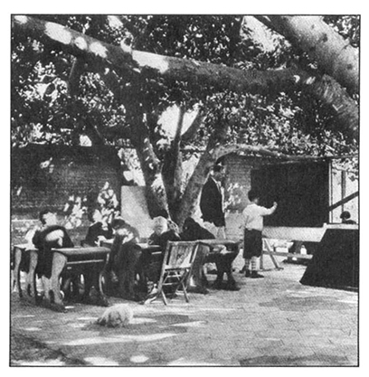
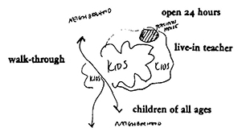

<section class="pattern-plate" aria-labelledby="t-childrens-home">
<a href="/patterns">A Pattern Language</a> · <a href="/patterns#towns">Towns</a> · Pattern 86 · p. 426 · *
<h1 class="pattern-title" id="t-childrens-home">Children’s Home</h1><figure class="pattern-figure pl-figure"></figure><nav class="pattern-links" aria-label="Connections"><h2>Links to</h2><ul><li><a href="/patterns/network-of-learning">18 Network Of Learning</a></li><li><a href="/patterns/children-in-the-city">57 Children In The City</a></li><li><a href="/patterns/connected-play">68 Connected Play</a></li><li><a href="/patterns/adventure-playground">73 Adventure Playground</a></li><li><a href="/patterns/the-family">75 The Family</a></li><li><a href="/patterns/your-own-home">79 Your Own Home</a></li><li><a href="/patterns/individually-owned-shops">87 Individually Owned Shops</a></li><li><a href="/patterns/street-cafe">88 Street Cafe</a></li><li><a href="/patterns/corner-grocery">89 Corner Grocery</a></li><li><a href="/patterns/beer-hall">90 Beer Hall</a></li><li><a href="/patterns/travelers-inn">91 Traveler’s Inn</a></li><li><a href="/patterns/bus-stop">92 Bus Stop</a></li><li><a href="/patterns/food-stands">93 Food Stands</a></li><li><a href="/patterns/sleeping-in-public">94 Sleeping In Public</a></li><li><a href="/patterns/building-complex">95 Building Complex</a></li><li><a href="/patterns/building-thoroughfare">101 Building Thoroughfare</a></li><li><a href="/patterns/common-areas-at-the-heart">129 Common Areas At The Heart</a></li></ul><h2>Linked from</h2><ul><li><a href="/patterns/life-cycle">26 Life Cycle</a></li><li><a href="/patterns/old-people-everywhere">40 Old People Everywhere</a></li><li><a href="/patterns/children-in-the-city">57 Children In The City</a></li><li><a href="/patterns/connected-play">68 Connected Play</a></li><li><a href="/patterns/your-own-home">79 Your Own Home</a></li><li><a href="/patterns/shopfront-schools">85 Shopfront Schools</a></li><li><a href="/patterns/child-caves">203 Child Caves</a></li></ul></nav></section><article class="pattern-text" aria-label="The text of Children’s Home">
427… within each neighborhood there are hundred! of children. The children, especially the young ones, are helped in their relation to the world by the patterns <a class="pl-ref" href="/patterns/children-in-the-city">CHILDREN IN THE CITY (57)</a> and <a class="pl-ref" href="/patterns/connected-play">CONNECTED PLAY (68)</a>. However, these very general provisions in the form of public land need to be supported by some kind of communal place, where they can stay without their parents for a few hours, or a few days, according to necessity. This pattern is a part of the <a class="pl-ref" href="/patterns/network-of-learning">NETWORK OF LEARNING (18)</a> for the youngest children.

◆ ◆ ◆

<strong>The task of looking after little children is a much deeper and more fundamental social issue than the phrases “babysitting” and “child care” suggest</strong>

It is true, of course, that in a society where most children are in the care of single adults or couples, the mothers and fathers must be able to have their children looked after while they work or when they want to meet their friends. This is what child care and baby-sitting are for. It is, if you like, the adult’s view of the situation.

But the fact is that the children themselves have unsatisfied needs which are equally pressing. They need access to other adults beyond their parents, and access to other children; and the situations in which they meet these other adults and other children need to be highly complex, subtle, full of the same complexities and intensities as family life—not merely “schools” and “kindergarten” and “playgrounds.”

When we look at the children’s needs, <em>and</em> at the needs of the adults, we realize that what is needed is a new institution in the neighborhood: <em>a children?! home</em>—a place where children can be safe and well looked after, night and day, with the full range of opportunities and social activities that can introduce them, fully, to society.

To a certain extent, these needs were absorbed in the large, extended families of the past. In such a family, the variety of 428adults and children of other ages had a positive value for the children. It brought them into contact with more human situations, allowed them to work out their needs with a variety of people, not j ust two.

However, as this kind of family has gradually disappeared, we have continued to hold fast to the idea that child-raising is the job of the family alone, especially the mother. But it is no longer viable. Here is Philip Slater discussing the difficulties that beset a small nuclear family focussing its attention on one or two children:

The new parents may not be as absorbed in material possessions and occupational self-aggrandizement as their own parents were. They may channel their parental vanity into different spheres, pushing their children to be brilliant artists, thinkers, and performers. But the hard narcissistic core on which the old culture was based will not be dissolved until the parent-child relationship itself is deintensified….

Breaking the pattern means establishing communities in which (a) children are not socialized exclusively by their parents, (b) parents have lives of their own and do not live vicariously through their children (<em>The Pursuit of Loneliness</em>, Boston: Beacon Press, 1971. pp. 141–42).

The children’s home we propose is a place which “de-intensifies the parent-child relationship” by bringing the child into authentic social relationships with several other adults and many other children.

1. Physically, it is a very large, rambling home, with a goodsized yard.

2. The house is within walking distance of the children’s own homes. Terence Lee was found that young children who walk or bike to school learn more than those who go by bus or car. The mechanism is simple and startling. The children who walk or bike, remain in contact with the ground, and are therefore able to create a cognitive map which includes both home and school. The children who are taken by car, are whisked, as if by magic carpet, from one place to the other, and cannot maintain any cognitive map which includes both home and school. To all intents and purposes they feel lost when they are at school; they are perhaps even afraid that they have lost their mothers. (T. R. Lee, “On the relation between the school journey and social and emotional 429adjustment in rural infant children,” <em>British Journal of Educational Psychology</em>, 27:101, 1957.)

3. There is a core staff <em>of</em> two or three adults who manage the home; and at least one of them, preferably more, actually lives there. In effect, it is the real home of some people; it does not close down at night.

4. Parents and their children join a particular home. And then the children may come and stay there at any time, for an hour, an afternoon, sometimes for long overnight stays.

5. Payment might be made by the hour to begin with. If we assume $1 per hour as a base fee, and assume that a child might spend 20 hours a week there, the house needs about 30 member children to generate a monthly income of about $2500.

6. The home focuses on raising children in a big extended family setting. For example, the home might be the center of a local coffee klatch, where a few people meet every day and mix with the children.

7. In line with this atmosphere, the home itself should be relatively open, with a public path passing across the site. Silver-stein has indicated that the child’s sense of his first school being “separate” from society can be reduced if the play areas of the children’s home are open to all passing adults and to all passing children. (Murray Silverstein, “The Child’s Urban Environment,” Proceedings of the Seventy-First National Convention of the Congress of Parents and Teachers, Chicago, Illinois, 1967, pp. 39–45.)

8. To keep the young children safe, and to make it possible to give them this great freedom without losing track of them altogether, the play areas may be sunk slightly, and surrounded by a low wall. If the wall is at seat height, it will encourage people to sit on it—giving them a place from which to watch the children playing, and the children a chance to talk to passers-by.

The children’s home pattern has been tried, successfully, in a far more extreme form than we imagine here, in many kibbutzim where children are raised in collective nurseries, and merely visit their parents for a few hours per week. The fact that this very extreme version has been successful should remove any doubts about the workability of the much milder version which we are proposing.

Therefore:

430<strong>In every neighborhood, build a children’s home—a second home for children—a large rambling house or workplace—a place where children can stay for an hour or two, or for a week. At least one of the people who run it must live on the premises; it must be open 24 hours a day; open to children of all ages; and it must be clear, from the way that it is run, that it is a second family for the children—not just a place where baby-sitting is available.</strong>

<figure class="pl-figure"></figure>
◆ ◆ ◆

Treat the building as a collection of small connected buildings—<a class="pl-ref" href="/patterns/building-complex">BUILDING COMPLEX (95)</a>; lay an important neighborhood path right through the building, so that children who are not a part of the school can see and get to know it by meeting the children who are—<a class="pl-ref" href="/patterns/building-thoroughfare">BUILDING THOROUGHFARE (101)</a>; attach it to the local <a class="pl-ref" href="/patterns/adventure-playground">ADVENTURE PLAYGROUND (73)</a>; make the teachers’ house an integral part of the interior—<a class="pl-ref" href="/patterns/your-own-home">YOUR OWN HOME (79)</a>; and treat the common space itself as the hearth of a larger family—<a class="pl-ref" href="/patterns/the-family">THE FAMILY (75)</a>, <a class="pl-ref" href="/patterns/common-areas-at-the-heart">COMMON AREAS AT THE HEART (129)</a>….

431<strong><em>the local shops and gathering places:</em></strong>

<a class="pl-ref" href="/patterns/individually-owned-shops">87. INDIVIDUALLY OWNED SHOPS</a>

<a class="pl-ref" href="/patterns/street-cafe">88. STREET CAFE</a>

<a class="pl-ref" href="/patterns/corner-grocery">89. CORNER GROCERY</a>

<a class="pl-ref" href="/patterns/beer-hall">90. BEER HALL</a>

<a class="pl-ref" href="/patterns/travelers-inn">91. TRAVELER’S INN</a>

<a class="pl-ref" href="/patterns/bus-stop">92. BUS STOP</a>

<a class="pl-ref" href="/patterns/food-stands">93. FOOD STANDS</a>

<a class="pl-ref" href="/patterns/sleeping-in-public">94. SLEEPING IN PUBLIC</a>
</article>

Christopher Alexander, Sara Ishikawa and Murray Silverstein, with Max Jacobson, Ingrid Fiksdahl-King and Shlomo Angel, <cite>A Pattern Language</cite> (Oxford University Press, 1977), pattern 86, pp. 426–431. Text and illustrations from the <a href="https://github.com/natureoforder/sources">Nature of Order sources</a> reading edition, transcribed from the 1977 printing; report errors on <a href="https://github.com/natureoforder/alexander-wiki/issues">GitHub</a>.

<a href="/patterns/shopfront-schools">← 85 Shopfront Schools</a> · <a href="/patterns">All 253 patterns</a> · <a href="/patterns/individually-owned-shops">87 Individually Owned Shops →</a>

