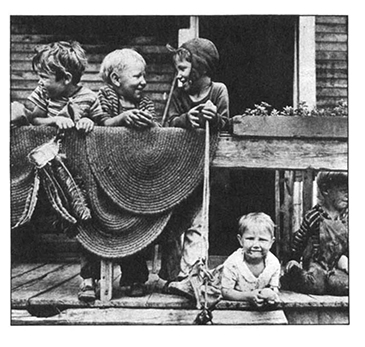
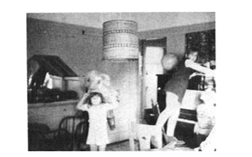
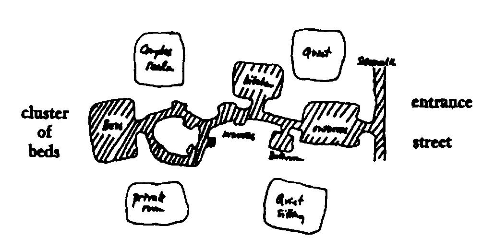

<section class="pattern-plate" aria-labelledby="t-childrens-realm">
<a href="/patterns">A Pattern Language</a> · <a href="/patterns#buildings">Buildings</a> · Pattern 137 · p. 651 · *
<h1 class="pattern-title" id="t-childrens-realm">Children’s Realm</h1><figure class="pattern-figure pl-figure"></figure><nav class="pattern-links" aria-label="Connections"><h2>Links to</h2><ul><li><a href="/patterns/connected-play">68 Connected Play</a></li><li><a href="/patterns/house-for-a-small-family">76 House For A Small Family</a></li><li><a href="/patterns/common-areas-at-the-heart">129 Common Areas At The Heart</a></li><li><a href="/patterns/short-passages">132 Short Passages</a></li><li><a href="/patterns/couples-realm">136 Couple’s Realm</a></li><li><a href="/patterns/farmhouse-kitchen">139 Farmhouse Kitchen</a></li><li><a href="/patterns/bed-cluster">143 Bed Cluster</a></li><li><a href="/patterns/bathing-room">144 Bathing Room</a></li><li><a href="/patterns/home-workshop">157 Home Workshop</a></li><li><a href="/patterns/outdoor-room">163 Outdoor Room</a></li></ul><h2>Linked from</h2><ul><li><a href="/patterns/house-for-a-small-family">76 House For A Small Family</a></li><li><a href="/patterns/tapestry-of-light-and-dark">135 Tapestry Of Light And Dark</a></li><li><a href="/patterns/sleeping-to-the-east">138 Sleeping To The East</a></li><li><a href="/patterns/sequence-of-sitting-spaces">142 Sequence Of Sitting Spaces</a></li><li><a href="/patterns/bed-cluster">143 Bed Cluster</a></li><li><a href="/patterns/bathing-room">144 Bathing Room</a></li><li><a href="/patterns/communal-sleeping">186 Communal Sleeping</a></li><li><a href="/patterns/child-caves">203 Child Caves</a></li></ul></nav></section><article class="pattern-text" aria-label="The text of Children’s Realm">
652… in a <a class="pl-ref" href="/patterns/house-for-a-small-family">HOUSE FOR A SMALL FAMILY (76)</a>, there are three main areas: a <a class="pl-ref" href="/patterns/common-areas-at-the-heart">COMMON AREA AT THE HEART (129)</a>, a <a class="pl-ref" href="/patterns/couples-realm">COUPLE’S REALM (136)</a>, and a CHILDREN’S REALM which overlaps the common area. If the common area and couple’s realm are in position, it is now possible to weave in this partly separate, partly overlapping place for children, which we call a realm, although we recognize that it is not a separate realm but more an aspect of the house, reserved for children, a mode of functioning which is physically separate only in certain parts. It is that component of <a class="pl-ref" href="/patterns/connected-play">CONNECTED PLAY (68)</a> which acts within the individual houses.

◆ ◆ ◆

<strong>If children do not have space to release a tremendous amount of energy when they need to, they will drive themselves and everybody else in the family up the wall.</strong>

<figure class="pl-figure"><figcaption><em>A frenzy in the dining room</em>.</figcaption></figure>

For a graphic example, visualize what happens when children bring in friends after school and have a whole number of ideas in their heads of what to do or play. They are loud and boisterous after being pent up in school all day and they need a lot of indoor and outdoor space to expend all this energy. Obviously, the mood calls for space which contains long distances because they suggest the possibility of physical freedom much more.

653And, in general, the child’s world is not some single space or room—it is a continuum of spaces. The sidewalk where he sells lemonade and talks with friends, the outdoor play area of his house into which he can invite his friends, the indoor play-space, his private space in the house where he can be alone with a friend, the bathroom, the kitchen where his mother is, the family room where the rest of the family is—for the child, all of these together form his world. If any other kind of space interrupts this continuum, it will be swallowed up into the child’s world as part of his circulation path.

If the private rooms, the couple’s realm, the quiet sitting areas are scattered randomly among the places that form the children’s world, then they will certainly be violated. But if the children’s world is one continuous swath, then these quiet, private, adult places will be protected by the mere fact that they are not part of the continuum. We therefore conclude that all the places which children need and use should form one continuous geometrical swath, which does not include the couple’s realm, the adult private rooms, or any formal, quiet sitting spaces. This continuous playspace needs certain additional properties.

1. Children are apt to be very demanding of everyone’s attention when they are in this specially energetic state. The mother is particularly susceptible to being totally swallowed up by them. They will want to show her things, ask her questions, ask her to do things … “Look what I found. Look what I made. Where shall I put this? Where’s the clay? Make some paint.” The mother must be available for all this, but not forced to be in the thick of it. Her workroom and the kitchen need to be protected, yet tangential to the playspace.

2. The family room is also part of the continuum since it is where children and the rest of the family have contact with each other. The playspace, therefore, should enter the common area—preferably to one side—see <a class="pl-ref" href="/patterns/common-areas-at-the-heart">COMMON AREA AT THE HEART (129)</a>.

3. The children’s private spaces (whether they are alcoves or bedrooms) can be off the playspace, but it must be possible to close them off. Children naturally want to be exclusive at times—they often invite their closest friends into such a space for a private chat or to show off some prized possession.

654

<ol start="4" type="1">
<li>It is usually too expensive to create a special playspace; but it is always possible to make a hallway function as the indoor part of the playspace. It needs to be a bit wider than a normal hall (perhaps seven feet) with nooks and stages along the edge. Children take up the suggestive qualities of spaces—on sight of a little cave-like space, they will decide to play house; on sight of a raised platform, they will decide to put on a play. Thus, both indoor and outdoor parts of the playspace need different levels, little nooks, counters, or tables, and so on. A lot of open storage for toys, costumes, and so forth should also be provided in these spaces. When toys are visible, they are more likely to be used.</li>
</ol>

5. The outdoor space just adjacent to the indoor space should be partially roofed, to provide transition between the two and to reinforce the continuity.

Remember that this kind of playspace is as much in the interest of the adults in the family, as in the interest of the children. If the house is organized so that the children’s world gradually spreads throughout the home, it will disrupt and dominate the world of tranquility, preciousness, and freedom that adults need, to live their own lives. If there is an adequate children’s world, in the manner described in this pattern, then both the adults and children can co-exist, each without dominating the other.

Therefore:

<strong>Start by placing the small area which will belong entirely to the children—the cluster of their beds. Place it in a separate position toward the back of the house, and in such a way that a continuous playspace can be made from this cluster to the street, almost like a wide swath inside the house, muddy, toys strewn along the way, touching those family rooms which children need—the bathroom and the kitchen most of all—passing the common area along one side (but leaving quiet sitting areas and the couple’s realm entirely separate and inviolate), reaching out to the street, either through its own door or through the entrance room, and ending in an outdoor room, connected 655to the street, and sheltered, and large enough so that the children can play in it when it rains, yet still be outdoors.</strong>

<figure class="pl-figure"></figure>
◆ ◆ ◆

As you place this swath between the children’s beds and the street, place the <a class="pl-ref" href="/patterns/farmhouse-kitchen">FARMHOUSE KITCHEN (139)</a> and the <a class="pl-ref" href="/patterns/home-workshop">HOME WORKSHOP (157)</a> to one side of the path, touching it, yet not violated by it. Do the same for <a class="pl-ref" href="/patterns/bathing-room">BATHING ROOM (144)</a>, and give it some connection to the children’s beds. Develop the cluster of children’s beds according to <a class="pl-ref" href="/patterns/bed-cluster">BED CLUSTERS (143)</a>; make the long passages which form the realm as light and warm as possible—<a class="pl-ref" href="/patterns/short-passages">SHORT PASSAGES (132)</a>; make the <a class="pl-ref" href="/patterns/outdoor-room">OUTDOOR ROOM (163)</a> large enough for boisterous activity….
</article>

Christopher Alexander, Sara Ishikawa and Murray Silverstein, with Max Jacobson, Ingrid Fiksdahl-King and Shlomo Angel, <cite>A Pattern Language</cite> (Oxford University Press, 1977), pattern 137, pp. 651–655. Text and illustrations from the <a href="https://github.com/natureoforder/sources">Nature of Order sources</a> reading edition, transcribed from the 1977 printing; report errors on <a href="https://github.com/natureoforder/alexander-wiki/issues">GitHub</a>.

<a href="/patterns/couples-realm">← 136 Couple’s Realm</a> · <a href="/patterns">All 253 patterns</a> · <a href="/patterns/sleeping-to-the-east">138 Sleeping To The East →</a>

