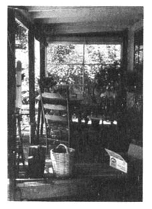

<a href="/patterns">A Pattern Language</a>
<h1 class="pattern-title">Choosing a Language for Your Project</h1><article class="pattern-text">
xxxv

All 253 patterns together form a language. They create a coherent picture of an entire region, with the power to generate such regions in a million forms, with infinite variety in all the details.

It is also true that any small sequence of patterns from this language is itself a language for a smaller part of the environment; and this small list of patterns is then capable of generating a million parks, paths, houses, workshops, or gardens.

For example, consider the following ten patterns:

<a class="pl-ref" href="/patterns/private-terrace-on-the-street">PRIVATE TERRACE ON THE STREET (140)</a>

<a class="pl-ref" href="/patterns/sunny-place">SUNNY PLACE (161)</a>

<a class="pl-ref" href="/patterns/outdoor-room">OUTDOOR ROOM (163)</a>

<a class="pl-ref" href="/patterns/six-foot-balcony">SIX-FOOT BALCONY (167)</a>

<a class="pl-ref" href="/patterns/paths-and-goals">PATHS AND GOALS (120)</a>

<a class="pl-ref" href="/patterns/ceiling-height-variety">CEILING HEIGHT VARIETY (190)</a>

<a class="pl-ref" href="/patterns/columns-at-the-corners">COLUMNS AT THE CORNERS (212)</a>

<a class="pl-ref" href="/patterns/front-door-bench">FRONT DOOR BENCH (242)</a>

<a class="pl-ref" href="/patterns/raised-flowers">RAISED FLOWERS (245)</a>

<a class="pl-ref" href="/patterns/different-chairs">DIFFERENT CHAIRS (251)</a>

This short list of patterns is itself a language: it is one of a thousand possible languages for a porch, at the front of a house. One of us chose this small language, to build xxxvia porch onto the front of his house. This is the way the language, and its patterns, helped to generate this porch. I started with <a class="pl-ref" href="/patterns/private-terrace-on-the-street">PRIVATE TERRACE ON THE STREET (140)</a>. That pattern calls for a terrace, slightly raised, connected to the house, and on the street side. <a class="pl-ref" href="/patterns/sunny-place">SUNNY PLACE (161)</a> suggests that a special place on the sunny side of the yard should be intensified and made into a place by the use of a patio, balcony, outdoor room, etc. I used these two patterns to locate a raised platform on the south side of the house.

To make this platform into an <a class="pl-ref" href="/patterns/outdoor-room">OUTDOOR ROOM (163)</a>, I put it half under the existing roof overhang, and kept a mature pyracanthus tree right smack in the middle of the platform. The overhead foliage of the tree added to the roof-like enclosure of the space. I put a wind screen of fixed glass on the west side of the platform too, to give it even more enclosure.

I used <a class="pl-ref" href="/patterns/six-foot-balcony">SIX-FOOT BALCONY (167)</a> to determine the size of the platform. But this pattern had to be used judiciously and not blindly—the reasoning for the pattern has to do with the minimum space required for people to sit comfortably and carry on a discussion around a small side-table. Since I wanted space for at least two of these conversation areas—one under the roof for very hot or rainy days, and one out under the sky for days when you wanted to be full in the sun, the balcony had to be made 12 x 12 feet square.

Now <a class="pl-ref" href="/patterns/paths-and-goals">PATHS AND GOALS (120)</a>: Usually, this pattern deals with large paths in a neighborhood, and comes much earlier in a language. But I used it in a special way. It says that the paths which naturally get formed by people’s walking, on the land, should be preserved and intensified. Since the path to our front door cut right across the corner of the place where I had planned to put the platform, I cut the corner of the platform off.

The height of the platform above the ground was determined by <a class="pl-ref" href="/patterns/ceiling-height-variety">CEILING HEIGHT VARIETY (190)</a>. By building the platform approximately one foot above the ground line, the ceiling height of the covered portion came out at between 6 and 7 feet—just right for a space as small as this. Since this height above the ground level is just about right for sitting, the pattern <a class="pl-ref" href="/patterns/front-door-bench">FRONT DOOR BENCH (242)</a> was automatically satisfied.

There were three columns standing, supporting the roof over xxxviithe old porch. They had to stay where they are, because they hold the roof up. But, following <a class="pl-ref" href="/patterns/columns-at-the-corners">COLUMNS AT THE CORNERS (212)</a>, the platform was very carefully tailored to their positions——so that the columns help define the social spaces on either side of them. Finally, we put a couple of flower boxes next to the “front door bench”——it’s nice to smell them when you sit there——according to <a class="pl-ref" href="/patterns/raised-flowers">RAISED FLOWERS (245)</a>. And the old chairs you can see in the porch are <a class="pl-ref" href="/patterns/different-chairs">DIFFERENT CHAIRS (251)</a>.

You can see, from this short example, how powerful and simple a pattern language is. And you are now, perhaps ready to appreciate how careful you must be, when you construct a language for yourself and your own project.

<figure class="pl-figure"><figcaption><em>The finished porch</em></figcaption></figure>

The character of the porch is given by the ten patterns in this short language. In just this way, each part of the environment is given its character by the collection of patterns which we choose to build into it. The character of what you build, will be given to it by the language of patterns you use, to generate it.

xxxviiiFor this reason, of course, the task of choosing a language for your project is fundamental. The pattern language we have given here contains 253 patterns. You can therefore use it to generate an almost unimaginably large number of possible different smaller languages, for all the different projects you may choose to do, simply by picking patterns from it.

We shall now describe a rough procedure by which you can choose a language for your own project, first by taking patterns from this language we have printed here, and then by adding patterns of your own.

<ol type="1">
<li>
First of all, make a copy of the master sequence (pages xix–xxxiv) on which you can tick off the patterns which will form the language for your project. If you don’t have access to a copying machine, you can tick off patterns in the list printed in the book, use paper clips to mark pages, write your own list, use paper markers—whatever you like. But just for now, to explain it clearly, we shall assume that you have a copy of the list in front of you.
</li>
<li>
Scan down the list, and find the pattern which best describes the overall scope of the project you have in mind. This is the starting pattern for your project. Tick it. (If there are two or three possible candidates, don’t worry: just pick the one which seems best: the others will fall in place as you move forward.)
</li>
<li>
Turn to the starting pattern itself, in the book, and read it through. Notice that the other patterns mentioned by name at the beginning and at the end, of the pattern you are reading, are also possible candidates for your language. The ones at the beginning will tend to be “larger” than your project. Don’t include them, unless xxxixyou have the power to help create these patterns, at least in a small way, in the world around your project. The ones at the end are “smaller.” Almost all of them will be important. Tick all of them, on your list, unless you have some special reason for not wanting to include them.
</li>
<li>
Now your list has some more ticks on it. Turn to the next highest pattern on the list which is ticked, and open the book to that pattern. Once again, it will lead you to other patterns. Once again, tick those which are relevant—especially the ones which are “smaller” that come at the end. As a general rule, do not tick the ones which are “larger” unless you can do something about them, concretely, in your own project.
</li>
<li>
When in doubt about a pattern, don’t include it. Your list can easily get too long: and if it does, it will become confusing. The list will be quite long enough, even if you only include the patterns you especially like.
</li>
<li>
Keep going like this, until you have ticked all the patterns you want for your project.
</li>
<li>
Now, adjust the sequence by adding your own material. If there are things you want to include in your project, but you have not been able to find patterns which correspond to them, then write them in, at an appropriate point in the sequence, near other patterns which are of about the same size and importance. For example, there is no pattern for a sauna. If you want to include one, write it in somewhere near <a class="pl-ref" href="/patterns/bathing-room">BATHING ROOM (144)</a> in your sequence.
</li>
<li>
And of course, if you want to change any patterns, change them. There are often cases where you may have a personal version of a pattern, which is more true, or xlmore relevant for you. In this case, you will get the most “power” over the language, and make it your own most effectively, if you write the changes in, at the appropriate places in the book. And, it will be most concrete of all, if you change the name of the pattern too—so that it captures your own changes clearly.
</li>
</ol>

Suppose now that you have a language for your project. The way to use the language depends very much on its scale. Patterns dealing with towns can only be implemented gradually, by grass roots action; patterns for a building can be built up in your mind, and marked out on the ground; patterns for construction must be built physically, on the site. For this reason we have given three separate instructions, for these three different scales. For towns, see page 3; for buildings, see page 463; for construction, see page 935.

The procedures for each of these three scales are described in much more detail with extensive examples, in the appropriate chapters of <em>The Timeless Way of Building.</em> For the town—see chapters 24 and 25; for an individual building—see chapters 20, 21, and 22; and for the process of construction which describes the way a building is actually built see chapter 23.

xli

<h2 id="the-poetry-of-the-language">THE POETRY OF THE LANGUAGE</h2>

Finally, a note of caution. This language, like English, can be a medium for prose, or a medium for poetry. The difference between prose and poetry is not that different languages are used, but that the same language is used, differently. In an ordinary English sentence, each word has one meaning, and the sentence too, has one simple meaning. In a poem, the meaning is far more dense. Each word carries several meanings; and the sentence as a whole carries an enormous density of interlocking meanings, which together illuminate the whole.

The same is true for pattern languages. It is possible to make buildings by stringing together patterns, in a rather loose way. A building made like this, is an assembly of patterns. It is not dense. It is not profound. But it is also possible to put patterns together in such a way that many many patterns overlap in the same physical space: the building is very dense; it has many meanings captured in a small space; and through this density, it becomes profound.

In a poem, this kind of density creates illumination, by making identities between words and meanings, whose identity we have not understood before. In “O Rose thou art sick,” the rose is identified with many xliigreater, and more personal things than any rose—and the poem illuminates the person, and the rose, because of this connection. The connection not only illuminates the words but also illuminates our actual lives.

O Rose thou art sick. The invisible worm, That flies in the night In the howling storm:

Has found out thy bed Of crimson joy: And his dark secret love Does thy life destroy.

WILLIAM BLAKE

The same exactly, happens in a building. Consider, for example, the two patterns <a class="pl-ref" href="/patterns/bathing-room">BATHING ROOM (144)</a> and <a class="pl-ref" href="/patterns/still-water">STILL WATER (71)</a>. One defines a part of a house where you can bathe yourself slowly, with pleasure, perhaps in company; a place to rest your limbs, and to relax. The other is a place in a neighborhood, where this is water to gaze into, perhaps to swim in, where children can sail boats, and splash about, which nourishes those parts of ourselves which <em>rely</em> on water as one of the great elements of the unconscious.

Suppose now, that we make a complex of buildings where individual bathing rooms are somehow connected to a common pond, or lake, or pool——where the bathing room merges with this common place; where there is no sharp distinction between the individual and family processes of the bathing room, and the common pleasure of the common pool. In this place, these two patterns xliiiexist in the same space; they are identified; there is a compression of the two, which requires less space, and which is more profound than in a place where they are merely side by side. The compression illuminates each of the patterns, sheds light on its meaning; and also illuminates our lives, as we understand a little more about the connections of our inner needs.

But this kind of compression is not only poetic and profound. It is not only the stuff of poems and exotic statements, but to some degree, the stuff of every English sentence. To some degree, there is compression in every single word we utter, just because each word carries the whisper of the meanings of the words it is connected to. Even “Please pass the butter, Fred” has some compression in it, because it carries overtones that lie in the connections of these words to all the words which came before it.

Each of us, talking to our friends, or to our families, makes use of these compressions, which are drawn out from the connections between words which are given by the language. The more we can feel all the connections in the language, the more rich and subtle are the things we say at the most ordinary times.

And once again, the same is true in building. The compression of patterns into a single space is not a poetic and exotic thing, kept for special buildings that are works of art. It is the most ordinary economy of space. It is quite possible that all the patterns for a house might, in some form, be present and overlapping in a simple one-room cabin. The patterns do not need to be strung out and kept separate. Every building, every room, xlivevery garden is better when all the patterns it needs are compressed as far as possible. The building will be cheaper, and the meanings in it will be denser.

It is essential then, once you have learned to use the language, that you pay attention <em>to</em> the possibility of compressing the many patterns which you put together in the smallest possible space. You may think of this process of compressing patterns as a way to make the cheapest possible building that has the necessary patterns in it. It is also the only way of using a pattern language to make buildings which are poems.
</article>

Christopher Alexander, Sara Ishikawa and Murray Silverstein, with Max Jacobson, Ingrid Fiksdahl-King and Shlomo Angel, <cite>A Pattern Language</cite> (Oxford University Press, 1977).

<a href="/patterns/summary-of-the-language">← Summary of the Language</a> · <a href="/patterns">All 253 patterns</a> · <a href="/patterns/towns">Towns →</a>

