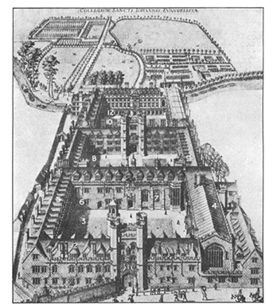
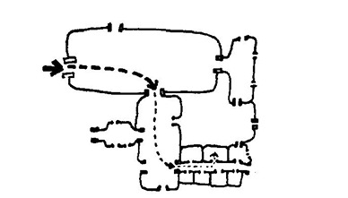
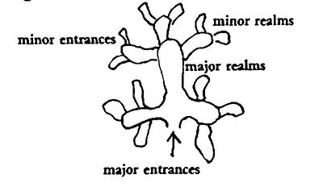

<section class="pattern-plate" aria-labelledby="t-circulation-realms">
<a href="/patterns">A Pattern Language</a> · <a href="/patterns#buildings">Buildings</a> · Pattern 98 · p. 480 · **
<h1 class="pattern-title" id="t-circulation-realms">Circulation Realms</h1><figure class="pattern-figure pl-figure"></figure><nav class="pattern-links" aria-label="Connections"><h2>Links to</h2><ul><li><a href="/patterns/main-gateways">53 Main Gateways</a></li><li><a href="/patterns/common-land">67 Common Land</a></li><li><a href="/patterns/building-complex">95 Building Complex</a></li><li><a href="/patterns/number-of-stories">96 Number Of Stories</a></li><li><a href="/patterns/main-building">99 Main Building</a></li><li><a href="/patterns/pedestrian-street">100 Pedestrian Street</a></li><li><a href="/patterns/building-thoroughfare">101 Building Thoroughfare</a></li><li><a href="/patterns/family-of-entrances">102 Family Of Entrances</a></li><li><a href="/patterns/main-entrance">110 Main Entrance</a></li><li><a href="/patterns/hierarchy-of-open-space">114 Hierarchy Of Open Space</a></li><li><a href="/patterns/courtyards-which-live">115 Courtyards Which Live</a></li><li><a href="/patterns/paths-and-goals">120 Paths And Goals</a></li></ul><h2>Linked from</h2><ul><li><a href="/patterns/main-gateways">53 Main Gateways</a></li><li><a href="/patterns/building-complex">95 Building Complex</a></li><li><a href="/patterns/shielded-parking">97 Shielded Parking</a></li><li><a href="/patterns/main-building">99 Main Building</a></li><li><a href="/patterns/pedestrian-street">100 Pedestrian Street</a></li><li><a href="/patterns/building-thoroughfare">101 Building Thoroughfare</a></li><li><a href="/patterns/family-of-entrances">102 Family Of Entrances</a></li><li><a href="/patterns/small-parking-lots">103 Small Parking Lots</a></li><li><a href="/patterns/site-repair">104 Site Repair</a></li><li><a href="/patterns/main-entrance">110 Main Entrance</a></li><li><a href="/patterns/arcades">119 Arcades</a></li><li><a href="/patterns/paths-and-goals">120 Paths And Goals</a></li><li><a href="/patterns/short-passages">132 Short Passages</a></li></ul></nav></section><article class="pattern-text" aria-label="The text of Circulation Realms">
481… once you have some rough idea how many buildings you are going to build—<a class="pl-ref" href="/patterns/building-complex">BUILDING COMPLEX (95)</a>, and how high they are to be—<a class="pl-ref" href="/patterns/number-of-stories">NUMBER OF STORIES (96)</a>, you can work out roughly what kind of layout they should have to make the access to them clear and comfortable. This pattern defines the overall philosophy of layout.

◆ ◆ ◆

<strong>In many modern building complexes the problem of disorientation is acute. People have no idea where they are, and they experience considerable mental stress as a result.</strong>

… the terror of being lost comes from the necessity that a mobile organism be oriented in its surroundings. Jaccard quotes an incident of native Africans who became disoriented. They were stricken with panic and plunged wildly into the bush. Witkin tells of an experienced pilot who lost his orientation to the vertical, and who described it as the most terrifying experience in his life. Many other writers in describing the phenomenon of temporary disorientation in the modern city, speak of the accompanying emotions of distress. (Kevin Lynch, <em>The Image of the City</em>, Cambridge, Mass.: MIT Press, 1960, p. 125.)

It is easiest to state the circulation problem for the case of a complete stranger who has to find his way around the complex of buildings. Imagine yourself as the stranger, looking for a particular address, within the building. From your point of view, the building is easy to grasp if someone can explain the position of this address to you, in a way you can remember easily, and carry in your head while you are looking for it. To put this in its most pungent form: <em>a person must be able to explain any given address within the building, to any other person, who does not know his way around, in one sentence</em>. For instance, “Come straight through the main gate, down the main path and turn into the second little gate, the small one with the blue grillwork—you can’t miss my door.”

At first sight, it might seem that the problem is only important for strangers—since a person who is familiar with a building can find his way around no matter how badly it is organized. 482However, psychological theory suggests that the effect of badly laid out circulation has almost as bad an effect on a person who knows a building, as it does on a stranger. We may assume that every time a person goes toward some destination, he must carry some form of map or instruction in his mind. The question arises: How much of the time does he have to be consciously thinking about this map and his destination? If he spends a great deal of time looking out for landmarks, thinking about where to go next, then his time is entirely occupied, and leaves him little time for the process of reflection, tranquil contemplation, and thought.

We conclude that any environment which requires that a person pay attention to it constantly is as bad for a person who knows it, as for a stranger. A good environment is one which is easy to understand, without conscious attention.

What makes an environment easy to understand? What makes an environment confusing? Let us imagine that a person is going to a particular address within a building. Call this address A. The person who is looking for A does not go directly toward A—unless it happens to be visible from the point where he starts. Instead, he sets his journey up to form a series of steps, in which each step is a kind of temporary intermediate goal, and a taking off point for the next step. For example: First go through the gate, then to the second courtyard on the left, then to the right-hand arcade of the courtyard, and then through the third door. This sequence is a kind of map which the person has in his head. If it is always easy to construct such a map, it is easy to find your way around the building. If it is not easy, it is hard to find your way around.

<figure class="pl-figure"><figcaption><em>The way the may in your mini works</em>.</figcaption></figure>

483A map works because it identifies a nested system of realms (in the case of our example the realms are first, the building itself, then the courtyard, then the arcade, then the room itself, the destination). The map guides you to the entrance of the largest realm, and from there to the entrance of the next largest realm, and so on. You make one decision at a time, and each decision you make narrows down the extent of the building which remains to be explored, until you finally narrow it down to the particular address you are looking for.

It seems reasonable to say that any useful map through a building complex must have this structure, and that any building complex in which you cannot create maps of this kind is confusing to be in. This is borne out by intuition. Consider these two examples; each has a system of realms which allows you to make such maps very easily.

An Oxford college. Here the college is made up of courts, each court has a collection of rooms called a “staircase” opening off it, and the individual suites of rooms open off these staircases. The realms are: College, Courts, Staircases, Rooms.

Manhattan. Here the city is made up of major areas, each major area has certain central streets and arteries. The realms are: Manhattan, Districts, Realms defined by the avenues, and Realms defined by cross streets and individual buildings. Manhattan is clear because the districts are so well defined, and the realms defined by the streets are subordinate to the realms defined by the avenues.

We conclude that in order to be clear, a building complex must follow three rules:

1. It is possible to identify a nested system of realms in the complex, the first and largest of these realms being the entire complex.

2. Each realm has a main circulation space, which opens directly from the entrances to that realm.

3. The entrances to any realm open directly off the circulation space of the next larger realm above it.

We emphasize finally, that these realms at every level must have <em>names;</em> and this requires, in turn, that they be well enough defined physically, so that they can in fact be named, and so that one knows where the realm of that name starts, and where it 484stops. The realms do not have to be as precise as in the two examples we have given. But they must have enough psychological substance and existence so that they can honestly work as realms in somebody’s mind.

Therefore:

<strong>Lay out very large buildings and collections of small buildings so that one reaches a given point inside by passing through a sequence of realms, each marked by a gateway and becoming smaller and smaller, as one passes from each one, through a gateway, to the next Choose the realms so that each one can be easily named, so that you can tell a person where to go, simply by telling him which realms togo through.</strong>

<figure class="pl-figure"></figure>
◆ ◆ ◆

Treat the first entrances to the whole system of circulation realms, the very largest ones, as gateways—<a class="pl-ref" href="/patterns/main-gateways">MAIN GATEWAYS (53)</a>; make the major realms, which open off the gateways, pedestrian streets or common land—<a class="pl-ref" href="/patterns/common-land">COMMON LAND (67)</a>, <a class="pl-ref" href="/patterns/pedestrian-street">PEDESTRIAN STREET (100)</a>; then, make minor realms with individual buildings, and courtyards, and major indoor streets—<a class="pl-ref" href="/patterns/main-building">MAIN BUILDING (99)</a>, <a class="pl-ref" href="/patterns/building-thoroughfare">BUILDING THOROUGHFARE (101)</a>, <a class="pl-ref" href="/patterns/hierarchy-of-open-space">HIERARCHY OF OPEN SPACE (114)</a>, <a class="pl-ref" href="/patterns/courtyards-which-live">COURTYARDS WHICH LIVE (115)</a>; and mark the entrance to these minor realms with minor entrances that still stand out quite clearly—<a class="pl-ref" href="/patterns/family-of-entrances">FAMILY OF ENTRANCES (102)</a>, <a class="pl-ref" href="/patterns/main-entrance">MAIN ENTRANCE (110)</a>. Make the layout of paths consonant with <a class="pl-ref" href="/patterns/paths-and-goals">PATHS AND GOALS (120)</a>….
</article>

Christopher Alexander, Sara Ishikawa and Murray Silverstein, with Max Jacobson, Ingrid Fiksdahl-King and Shlomo Angel, <cite>A Pattern Language</cite> (Oxford University Press, 1977), pattern 98, pp. 480–484. Text and illustrations from the <a href="https://github.com/natureoforder/sources">Nature of Order sources</a> reading edition, transcribed from the 1977 printing; report errors on <a href="https://github.com/natureoforder/alexander-wiki/issues">GitHub</a>.

<a href="/patterns/shielded-parking">← 97 Shielded Parking</a> · <a href="/patterns">All 253 patterns</a> · <a href="/patterns/main-building">99 Main Building →</a>

