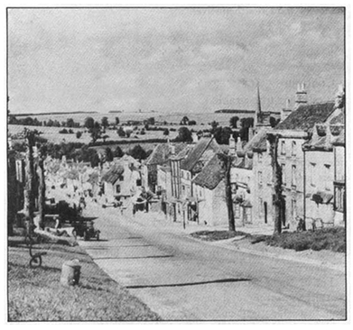
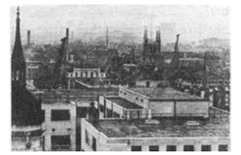
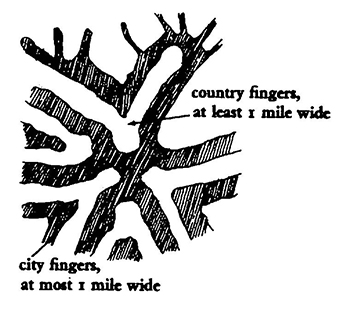

<section class="pattern-plate" aria-labelledby="t-city-country-fingers">
<a href="/patterns">A Pattern Language</a> · <a href="/patterns#towns">Towns</a> · Pattern 3 · p. 21 · **
<h1 class="pattern-title" id="t-city-country-fingers">City Country Fingers</h1><figure class="pattern-figure pl-figure"></figure><nav class="pattern-links" aria-label="Connections"><h2>Links to</h2><ul><li><a href="/patterns/the-distribution-of-towns">2 The Distribution Of Towns</a></li><li><a href="/patterns/agricultural-valleys">4 Agricultural Valleys</a></li><li><a href="/patterns/mosaic-of-subcultures">8 Mosaic Of Subcultures</a></li><li><a href="/patterns/web-of-public-transportation">16 Web Of Public Transportation</a></li><li><a href="/patterns/ring-roads">17 Ring Roads</a></li></ul><h2>Linked from</h2><ul><li><a href="/patterns/independent-regions">1 Independent Regions</a></li><li><a href="/patterns/the-distribution-of-towns">2 The Distribution Of Towns</a></li><li><a href="/patterns/agricultural-valleys">4 Agricultural Valleys</a></li><li><a href="/patterns/lace-of-country-streets">5 Lace Of Country Streets</a></li><li><a href="/patterns/the-countryside">7 The Countryside</a></li><li><a href="/patterns/mosaic-of-subcultures">8 Mosaic Of Subcultures</a></li><li><a href="/patterns/magic-of-the-city">10 Magic Of The City</a></li><li><a href="/patterns/local-transport-areas">11 Local Transport Areas</a></li><li><a href="/patterns/web-of-public-transportation">16 Web Of Public Transportation</a></li><li><a href="/patterns/ring-roads">17 Ring Roads</a></li><li><a href="/patterns/four-story-limit">21 Four-Story Limit</a></li><li><a href="/patterns/garden-seat">176 Garden Seat</a></li></ul></nav></section><article class="pattern-text" aria-label="The text of City Country Fingers">
22…the distribution of towns required to make a balanced region—<a class="pl-ref" href="/patterns/the-distribution-of-towns">DISTRIBUTION OF TOWNS (2)</a>—can be further helped by controlling the balance of urban land and open countryside within the towns and cities themselves.

◆ ◆ ◆

<strong>Continuous sprawling urbanization destroys life, and makes cities unbearable. But the sheer size of cities is also valuable and potent.</strong>

People feel comfortable when they have access to the countryside, experience of open fields, and agriculture; access to wild plants and birds and animals. For this access, cities must have boundaries with the countryside near every point. At the same time, a city becomes good for life only when it contains a great density of interactions among people and work, and different ways of life. For the sake of this interaction, the city must be continuous-not broken up. In this pattern we shall try to bring these two facts to balance.

Let us begin with the fact that people living in cities need contact with true rural land to maintain their roots with the land that supports them. A 1972 Gallup poll gives very strong evidence for this fact. The poll asked the question: “If you could live anywhere, would you prefer a city, suburban area, small town, or farm 1” and received the following answers from 1465 Americans:

<table>
<tbody>
<tr>
<td style="text-align: left;">City</td>
<td style="text-align: left;">13%</td>
</tr>
<tr>
<td style="text-align: left;">Suburb</td>
<td style="text-align: left;">13</td>
</tr>
<tr>
<td style="text-align: left;">Small town</td>
<td style="text-align: left;">32</td>
</tr>
<tr>
<td style="text-align: left;">Farm</td>
<td style="text-align: left;">23</td>
</tr>
</tbody>
</table>

And this dissatisfaction with cities is getting worse. In 1966, 22 percent said they preferred the city—in 1972, only six years later, this figure dropped to 13 percent. (“Most don’t want to live in a city,” George Gallup, <em>San Francisco Chronicle</em>, Monday, December 18, 1972, p. 12.)

It is easy to understand why city people long for contact with 23the countryside. Only 100 years ago 85 percent of the Americans lived on rural land; today 70 percent live in cities. Apparently we cannot live entirely within cities—at least the kinds of cities we have built so far—our need for contact with the countryside runs too deep, it is a biological necessity:

Unique as we may think we are, we are nevertheless as likely to be genetically programmed to a natural habitat of clean air and a varied green landscape as any other mammal. To be relaxed and feel healthy usually means simply allowing our bodies to react in the way for which one hundred millions of years of evolution has equipped us. Physically and genetically, we appear best adapted to a tropical savanna, but as a cultural animal we utilize learned adaptations to cities and towns. For thousands of years we have tried in our houses to imitate not only the climate, but the setting of our evolutionary past: warm, humid air, green plants, and even animal companions. Today, if we can afford it, we may even build a greenhouse or swimming pool next to our living room, buy a place in the country, or at least take our children vacationing on the seashore. The specific physiological reactions to natural beauty and diversity, to the shapes and colors of nature (especially to green), to the motions and sounds of other animals, such as birds, we as yet do not comprehend. But it is evident that nature in our daily life should be thought of as a part of the biological need. It cannot be neglected in the discussions of resource policy for man. (H. H. Iltis, P. Andres, and O. L. Loucks, in <em>Population Resources Environment: Issues in Human Ecology</em>, P. R. Ehrlich and A. H. Ehrlich, San Francisco: Freeman and Co., 1970, p. 204.)

But it is becoming increasingly difficult for city dwellers to come into contact with rural life. In the San Francisco Bay Region 21 square miles of open space is lost each year (Gerald D. Adams, “The Open Space Explosion,’’ <em>Cry California</em>, Fall 1970, pp. 27–32.) As cities get bigger the rural land is farther and farther away.

With the breakdown of contact between city dwellers and the countryside, the cities become prisons. Farm vacations, a year on the farm for city children, and retirement to the country for old people are replaced by expensive resorts, summer camps, and retirement villages. And for most, the only contact remaining is the weekend exodus from the city, choking the highways and the few organized recreation centers. Many weekenders return to the city on Sunday night with their nerves more shattered than when they left.

24

<figure class="pl-figure"><figcaption><em>When the countryside is far away the city becomes a prison</em>.</figcaption></figure>

If we wish to re-establish and maintain the proper connection between city and country, and yet maintain the density of urban interactions, it will be necessary to stretch out the urbanized area into long sinuous fingers which extend into the farmland, shown in the diagram below. Not only will the city be in. the form of narrow fingers, but so will the farmlands adjacent to it.

The maximum width of the city fingers is determined by the maximum acceptable distance from the heart of the city to the countryside. We reckon that everyone should be within 10 minutes’ walk of the countryside. This would set a maximum width of 1 mile for the city fingers.

The minimum for any farmland finger is determined <em>by</em> the minimum acceptable dimensions for typical working farms. Since 90 percent of all farms are still 500 acres or less and there is no respectable evidence that the giant farm is more efficient (Leon H. Keyserling, <em>Agriculture and the Public Interest</em>, Conference on Economic Progress, Washington, D. C., February 1965), these fingers of farmland need be no more than 1 mile wide.

The implementation of this pattern requires new policies of three different kinds. With respect to the farmland, there must be policies encouraging the reconstruction of small farms, farms that fit the one-mile bands of country land. Second, there must he policies which contain the cities’ tendency to scatter in every direction. And third, the countryside must be truly public, so that people can establish contact with even those parts of the land that are under private cultivation.

Imagine how this one pattern would transform life in cities. 25Every city dweller would have access to the countryside; the open country would be a half-hou r bicycle ride from downtown.

Therefore:

<strong>Keep interlocking fingers of farmland and urban land, even at the center of the metropolis. The urban fingers should never be more than 1 mile wide, while the farmland fingers should never be less than 1 mile wide.</strong>

<figure class="pl-figure"></figure>
◆ ◆ ◆

Whenever land is hilly, keep the country fingers in the valleys and the city fingers on the upper slopes of hillsides—<a class="pl-ref" href="/patterns/agricultural-valleys">AGRICULTURAL VALLEYS (4)</a>. Break the city fingers into hundreds of distinct self-governing subcultures—<a class="pl-ref" href="/patterns/mosaic-of-subcultures">MOSAIC OF SUBCULTURES (8)</a>, and run the major roads and railways down the middle of these city fingers—<a class="pl-ref" href="/patterns/web-of-public-transportation">WEB OF PUBLIC TRANSPORTATION (16)</a>, <a class="pl-ref" href="/patterns/ring-roads">RING ROADS (17)</a>….
</article>

Christopher Alexander, Sara Ishikawa and Murray Silverstein, with Max Jacobson, Ingrid Fiksdahl-King and Shlomo Angel, <cite>A Pattern Language</cite> (Oxford University Press, 1977), pattern 3, pp. 21–25. Text and illustrations from the <a href="https://github.com/natureoforder/sources">Nature of Order sources</a> reading edition, transcribed from the 1977 printing; report errors on <a href="https://github.com/natureoforder/alexander-wiki/issues">GitHub</a>.

<a href="/patterns/the-distribution-of-towns">← 2 The Distribution Of Towns</a> · <a href="/patterns">All 253 patterns</a> · <a href="/patterns/agricultural-valleys">4 Agricultural Valleys →</a>

