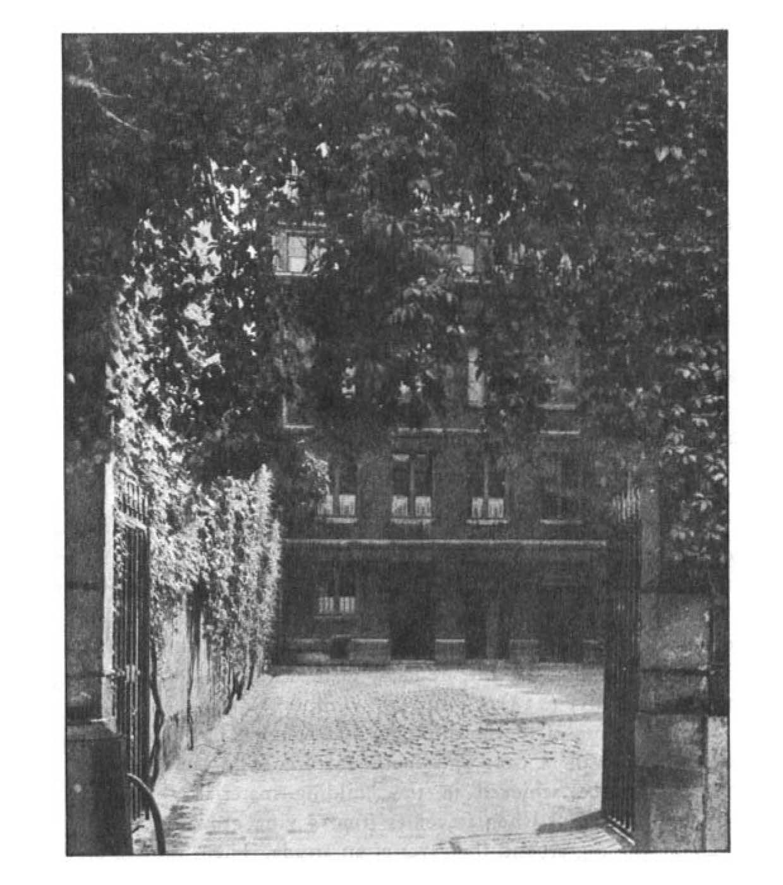
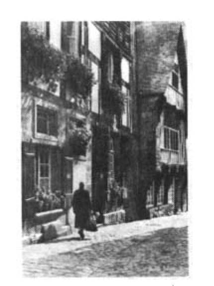
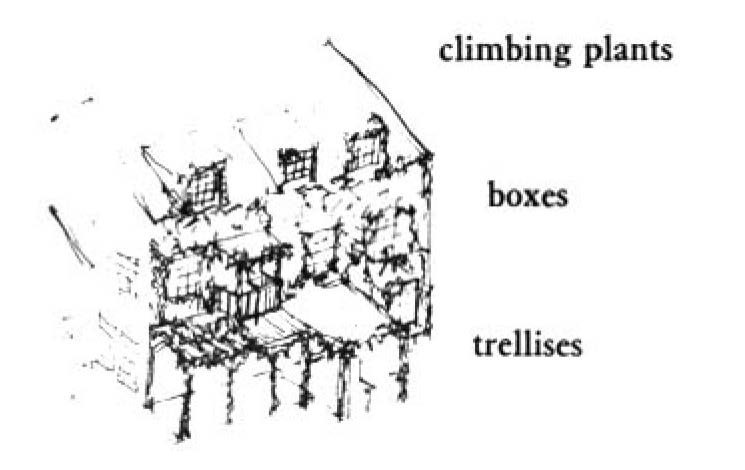

<section class="pattern-plate" aria-labelledby="t-climbing-plants">
<a href="/patterns">A Pattern Language</a> · <a href="/patterns#construction">Construction</a> · Pattern 246 · p. 1135
<h1 class="pattern-title" id="t-climbing-plants">Climbing Plants</h1><figure class="pattern-figure pl-figure"></figure><nav class="pattern-links" aria-label="Connections"><h2>Links to</h2><ul><li><a href="/patterns/trellised-walk">174 Trellised Walk</a></li><li><a href="/patterns/filtered-light">238 Filtered Light</a></li></ul><h2>Linked from</h2><ul><li><a href="/patterns/roof-garden">118 Roof Garden</a></li><li><a href="/patterns/street-windows">164 Street Windows</a></li><li><a href="/patterns/trellised-walk">174 Trellised Walk</a></li><li><a href="/patterns/deep-reveals">223 Deep Reveals</a></li><li><a href="/patterns/filtered-light">238 Filtered Light</a></li><li><a href="/patterns/half-inch-trim">240 Half-Inch Trim</a></li></ul></nav></section><article class="pattern-text" aria-label="The text of Climbing Plants">
1136… two earlier patterns can be helped by climbing plants around the building: <a class="pl-ref" href="/patterns/trellised-walk">TRELLISED WALK (174)</a> and <a class="pl-ref" href="/patterns/filtered-light">FILTERED LIGHT (238)</a>.

◆ ◆ ◆

<strong>A building finally becomes a part of its surroundings when the plants grow over parts of it as freely as they grow along the ground.</strong>

There is no doubt that buildings with roses or vines or honeysuckle growing on them mean much more to us than buildings whose walls are blank and bare. That is reason enough to plant wild clematis around the outside of a building, to make boxes to encourage plants to grow at higher storys, and to make frames and trellises for them to climb on.

We can think of four ways to ground this intuition in function.

1. One argument, consistent with others in the book, is that climbing plants effect a smooth transition between the built and the natural. A sort of blurring of the edges.

2. The quality of light. When the plants grow around the openings of buildings, they create a special kind of filtered light inside. This light is soft, reduces glare, and stark shadows—<a class="pl-ref" href="/patterns/filtered-light">FILTERED LIGHT (238)</a>.

3. The sense of touch. Climbing and hanging plants also give the outside walls a close and subtle texture. The same kind of texture can be achieved in the building materials, but it is uniquely beautiful when it comes from a vine growing across a wall or winding around the eaves of an arcade. Then, the texture invites you to touch and smell it, to pick off a leaf. Perhaps most important, the texture of climbing plants is ever different; it is subtly different from day to day, as the wind and sun play upon it; and it is greatly different from season to season.

4. Tending the plants. When they are well-tended, healthy plants and flowers growing around the windows and out of flower boxes in the upper storys, make the street feel more 1137comfortable. They bespeak a social order of some repose within the buildings, and therefore it is comfortable to be on the streets—one feels at home. It is as if the plants were a gift from the people inside to people on the street.

<figure class="pl-figure"><figcaption><em>The contribution to the street</em></figcaption></figure>

Therefore:

<strong>On sunny walls, train climbing plants to grow up round the openings in the wall—the windows, doors, porches, arcades, and trellises.</strong>

<figure class="pl-figure"></figure>
◆ ◆ ◆
</article>

Christopher Alexander, Sara Ishikawa and Murray Silverstein, with Max Jacobson, Ingrid Fiksdahl-King and Shlomo Angel, <cite>A Pattern Language</cite> (Oxford University Press, 1977), pattern 246, pp. 1135–1137. Text and illustrations from the <a href="https://github.com/natureoforder/sources">Nature of Order sources</a> reading edition, transcribed from the 1977 printing; report errors on <a href="https://github.com/natureoforder/alexander-wiki/issues">GitHub</a>.

<a href="/patterns/raised-flowers">← 245 Raised Flowers</a> · <a href="/patterns">All 253 patterns</a> · <a href="/patterns/paving-with-cracks-between-the-stones">247 Paving With Cracks Between The Stones →</a>

