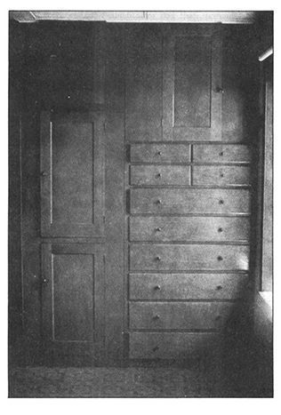
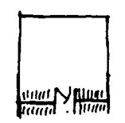
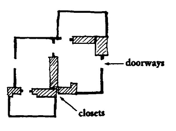

<section class="pattern-plate" aria-labelledby="t-closets-between-rooms">
<a href="/patterns">A Pattern Language</a> · <a href="/patterns#buildings">Buildings</a> · Pattern 198 · p. 913 · *
<h1 class="pattern-title" id="t-closets-between-rooms">Closets Between Rooms</h1><figure class="pattern-figure pl-figure"></figure><nav class="pattern-links" aria-label="Connections"><h2>Links to</h2><ul><li><a href="/patterns/couples-realm">136 Couple’s Realm</a></li><li><a href="/patterns/a-room-of-ones-own">141 A Room Of One’s Own</a></li><li><a href="/patterns/workspace-enclosure">183 Workspace Enclosure</a></li><li><a href="/patterns/dressing-rooms">189 Dressing Rooms</a></li><li><a href="/patterns/corner-doors">196 Corner Doors</a></li><li><a href="/patterns/thick-walls">197 Thick Walls</a></li></ul><h2>Linked from</h2><ul><li><a href="/patterns/short-passages">132 Short Passages</a></li><li><a href="/patterns/couples-realm">136 Couple’s Realm</a></li><li><a href="/patterns/bed-cluster">143 Bed Cluster</a></li><li><a href="/patterns/north-face">162 North Face</a></li><li><a href="/patterns/dressing-rooms">189 Dressing Rooms</a></li><li><a href="/patterns/the-shape-of-indoor-space">191 The Shape Of Indoor Space</a></li><li><a href="/patterns/corner-doors">196 Corner Doors</a></li><li><a href="/patterns/thick-walls">197 Thick Walls</a></li><li><a href="/patterns/secret-place">204 Secret Place</a></li><li><a href="/patterns/stair-vault">228 Stair Vault</a></li></ul></nav></section><article class="pattern-text" aria-label="The text of Closets Between Rooms">
914… given the layout of rooms, it is now necessary to decide exactly where to put the built-in cupboards and closets. Use them, especially, to help form the enclosure around a workspace—<a class="pl-ref" href="/patterns/workspace-enclosure">WORKSPACE ENCLOSURE (183)</a>, around a dressing SPACE—<a class="pl-ref" href="/patterns/dressing-rooms">DRESSING ROOM (189)</a>, and around the doors of rather private rooms so that the doorway itself gets some depth—<a class="pl-ref" href="/patterns/corner-doors">CORNER DOOR (196)</a>.

◆ ◆ ◆

<strong>The provision of storage and closets usually comes as an afterthought</strong>

But when they are correctly placed, they can contribute greatly to the layout of the building.

Perhaps the most important secondary feature of storage space is its sound insulating quality. The extra wall sections, and the doors enclosing the closet, as well as the clothes, boxes, and so on, that are being stored, all work to create substantial acoustical barriers. You can take advantage of this feature of closet space by locating all required storage areas within the walls separating rooms rather than in exterior walls, where they cut off natural light.

In addition, when storage is placed in the interior walls of a room, around the doorway, the resulting thickness will make the transitions between rooms and corridors more distinct. For the person entering such a room, the thickness of the wall creates a subtle “entry” space, which makes the room more private. This way of making the closet “thickness” around an entrance is therefore appropriate for spaces like the <a class="pl-ref" href="/patterns/couples-realm">COUPLE’S REALM (136)</a> and the various private rooms—<a class="pl-ref" href="/patterns/a-room-of-ones-own">A ROOM OF ONE’S OWN (141)</a>.

<figure class="pl-figure"><figcaption><em>Closets form the entrance to the room</em>.</figcaption></figure>

915Therefore

<strong>Mark all the rooms where you want closets. Then place the closets themselves on those interior walls which lie between two rooms and between rooms and passages where yon need acoustic insulation. Place them so as to create transition spaces for the doors into the rooms. On no account put closets on exterior walls. It wastes the opportunity for good acoustic insulation and cuts off precious light</strong>

<figure class="pl-figure"></figure>
◆ ◆ ◆

Later, include the closets as part of the overall building structure <a class="pl-ref" href="/patterns/thick-walls">THICK WALLS (197)</a>….
</article>

Christopher Alexander, Sara Ishikawa and Murray Silverstein, with Max Jacobson, Ingrid Fiksdahl-King and Shlomo Angel, <cite>A Pattern Language</cite> (Oxford University Press, 1977), pattern 198, pp. 913–915. Text and illustrations from the <a href="https://github.com/natureoforder/sources">Nature of Order sources</a> reading edition, transcribed from the 1977 printing; report errors on <a href="https://github.com/natureoforder/alexander-wiki/issues">GitHub</a>.

<a href="/patterns/thick-walls">← 197 Thick Walls</a> · <a href="/patterns">All 253 patterns</a> · <a href="/patterns/sunny-counter">199 Sunny Counter →</a>

