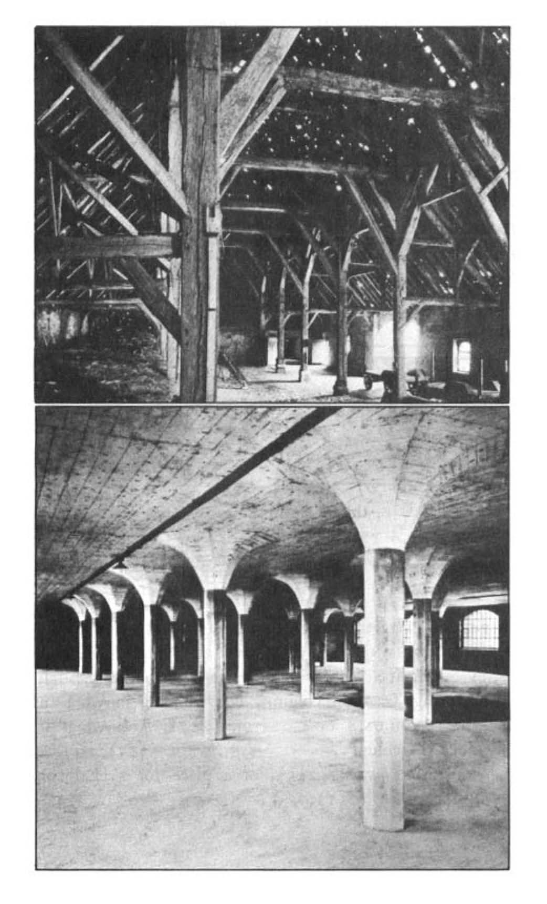
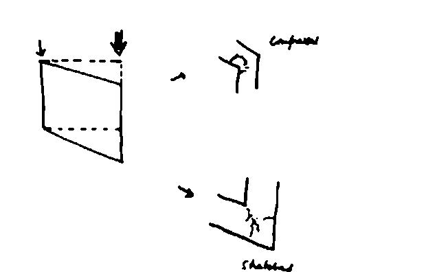
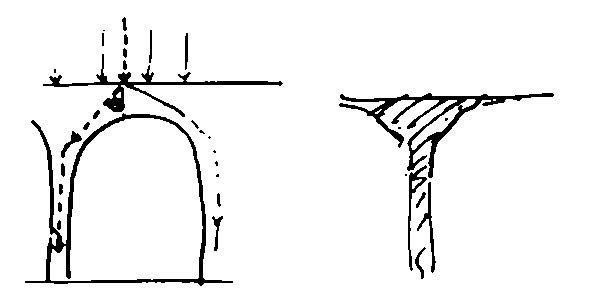
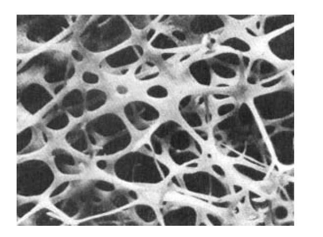
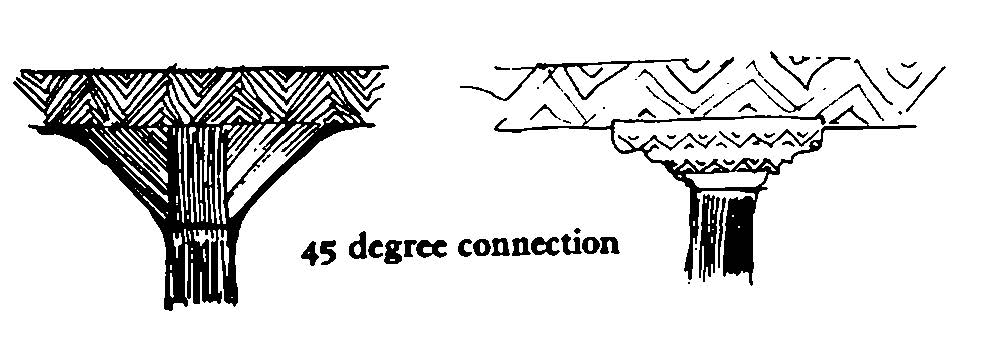

<section class="pattern-plate" aria-labelledby="t-column-connections">
<a href="/patterns">A Pattern Language</a> · <a href="/patterns#construction">Construction</a> · Pattern 227 · p. 1068 · **
<h1 class="pattern-title" id="t-column-connections">Column Connections</h1><figure class="pattern-figure pl-figure"></figure><nav class="pattern-links" aria-label="Connections"><h2>Links to</h2><ul><li><a href="/patterns/arcades">119 Arcades</a></li><li><a href="/patterns/gallery-surround">166 Gallery Surround</a></li><li><a href="/patterns/six-foot-balcony">167 Six-Foot Balcony</a></li><li><a href="/patterns/efficient-structure">206 Efficient Structure</a></li><li><a href="/patterns/box-columns">216 Box Columns</a></li><li><a href="/patterns/perimeter-beams">217 Perimeter Beams</a></li><li><a href="/patterns/frames-as-thickened-edges">225 Frames As Thickened Edges</a></li><li><a href="/patterns/column-place">226 Column Place</a></li><li><a href="/patterns/ornament">249 Ornament</a></li></ul><h2>Linked from</h2><ul><li><a href="/patterns/arcades">119 Arcades</a></li><li><a href="/patterns/half-open-wall">193 Half-Open Wall</a></li><li><a href="/patterns/efficient-structure">206 Efficient Structure</a></li><li><a href="/patterns/box-columns">216 Box Columns</a></li><li><a href="/patterns/perimeter-beams">217 Perimeter Beams</a></li><li><a href="/patterns/column-place">226 Column Place</a></li><li><a href="/patterns/ornament">249 Ornament</a></li></ul></nav></section><article class="pattern-text" aria-label="The text of Column Connections">
1069… the columns are in position, and have been tied together by a perimeter beam—<a class="pl-ref" href="/patterns/box-columns">BOX COLUMNS (216)</a>, <a class="pl-ref" href="/patterns/perimeter-beams">PERIMETER BEAMS (217)</a>. According to the principles of continuity which govern the basic structure—<a class="pl-ref" href="/patterns/efficient-structure">EFFICIENT STRUCTURE (206)</a>, the connections need stiffening to lead the forces smoothly front the beams into the columns, especially when the columns are free standing as they are in an arcade or balcony—<a class="pl-ref" href="/patterns/arcades">ARCADE (119)</a>, <a class="pl-ref" href="/patterns/gallery-surround">GALLERY SURROUND (166)</a>, <a class="pl-ref" href="/patterns/six-foot-balcony">SIX-FOOT BALCONY (167)</a>, <a class="pl-ref" href="/patterns/column-place">COLUMN PLACE (226)</a>. You may also do the same in the upper corners of your door and window frames—<a class="pl-ref" href="/patterns/frames-as-thickened-edges">FRAMES AS THICKENED EDGES (225)</a>—making arched openings.

◆ ◆ ◆

<strong>The strength of a structure depends on the strength of its connections; and these connections are most critical of all at comers, especially at the comers where the columns meet the beams.</strong>

There are two entirely different ways of looking at a connection :

1 As a source of rigidity, which can be strengthened by triangulation, to prevent racking of the frame. This is a moment connection: a brace. See the upper picture.

2 As a source of continuity, which helps the forces to flow easily around the corner in the process of transferring loads by changing the direction of the force. This is a continuity connection: a capital. See the lower picture.

<em>1. A column connection as a brace</em>.

As a building is erected, and throughout its life, it settles, creating tiny stresses within the structure. When the settling is uneven, as it most always is, the stresses are out of balance; there is strain in every part of the building, whether or not that part of the building was designed to accept strain and transmit the forces on down to the ground. The parts of the building that are not designed to carry these forces become the weak points of the building subject to fracture and rupture.

1070

<figure class="pl-figure"></figure>
Effects of uneven stresses on a frame.

Rectangular frames, especially, have these cracks at the corners because the transmission of the load is discontinuous there. To solve this problem the frame must be braced—made into a rigid frame that transmits the forces around it as a whole without distorting. The bracing is required at any right-angled comer between columns and beams or in the corners of door and window frames.

<em>ESects of uneven stresses on a frame</em>.

2. <em>A column connection as a cafital</em>.

This happens most effectively in an arch. The arch creates a continuous body of compressive material, which transfers vertical forces from one vertical axis to another. It works effectively because the line of action of a vertical force in a continuous compressive medium spreads out downward at about 45 degrees.

<em>A cafital that acts the same way as an arch</em>.

And a column capital is, in this sense, acting as a small, underdeveloped arch. It reduces the length of the beam—and so reduces bending stress. And it begins to provide the path for the forces as they move from one vertical axis to another, through the medium of the beam. The larger the capital, the better.

<figure class="pl-figure"><figcaption><em>A capital that acts the same way as an arch</em>.</figcaption></figure>

A column connection will work best when it acts both as a column capital and as a column brace. This means that it needs to 1071be thick and solid, like a capital, so that there is a lot of material for the forces to travel through, and stiff and strong and completely continuous with the column and perimeter beam, like the brace, so that it can work against shear and bending.

The bone structure, shown below uses both principles, to transfer compressive stress from one strut to another, continuously, throughout a three-dimensional space frame of struts. The structure is most massive at the connections, where the forces change direction.

<figure class="pl-figure"><figcaption><em>Connections inside a bone</em>.</figcaption></figure>

A similar column connection can be made integral with poured hollow columns and beams. The forms for the connection are gussets made of skin material: then fill the column and the gussets and the beam in a continuous concrete pour.

Of all the patterns in the book, this is one of the most widespread and has taken the greatest variety of outward forms throughout the course of history. A solid wood capital on a wood column, or a continuously poured column top, and arches of stone, brick, or poured concrete are all examples. And, of course, typical column capitals—a larger stone on a stone column or typical gusset plate or brace—even if weak in some ways, also help a great deal. But only relatively few of the historical column connections succeed fully in acting both as braces and as capitals.

Therefore:

<strong>Build connections where the columns meet the beams. Any distribution of material which fills the corner up will do: fillets, gussets, column capitals, mushroom column, and 1072most general of all, the arch, which connects column and beam in a continuous curve.</strong>

<figure class="pl-figure"></figure>
◆ ◆ ◆

The connection is one of the most natural places for <a class="pl-ref" href="/patterns/ornament">ORNAMENT (249)</a>: there is a wide variety of possible connections, carvings, fretwork, painting, for this critical position. In certain cases, the connection may act as an umbrella for a <a class="pl-ref" href="/patterns/column-place">COLUMN PLACE (226)</a>….
</article>

Christopher Alexander, Sara Ishikawa and Murray Silverstein, with Max Jacobson, Ingrid Fiksdahl-King and Shlomo Angel, <cite>A Pattern Language</cite> (Oxford University Press, 1977), pattern 227, pp. 1068–1072. Text and illustrations from the <a href="https://github.com/natureoforder/sources">Nature of Order sources</a> reading edition, transcribed from the 1977 printing; report errors on <a href="https://github.com/natureoforder/alexander-wiki/issues">GitHub</a>.

<a href="/patterns/column-place">← 226 Column Place</a> · <a href="/patterns">All 253 patterns</a> · <a href="/patterns/stair-vault">228 Stair Vault →</a>

