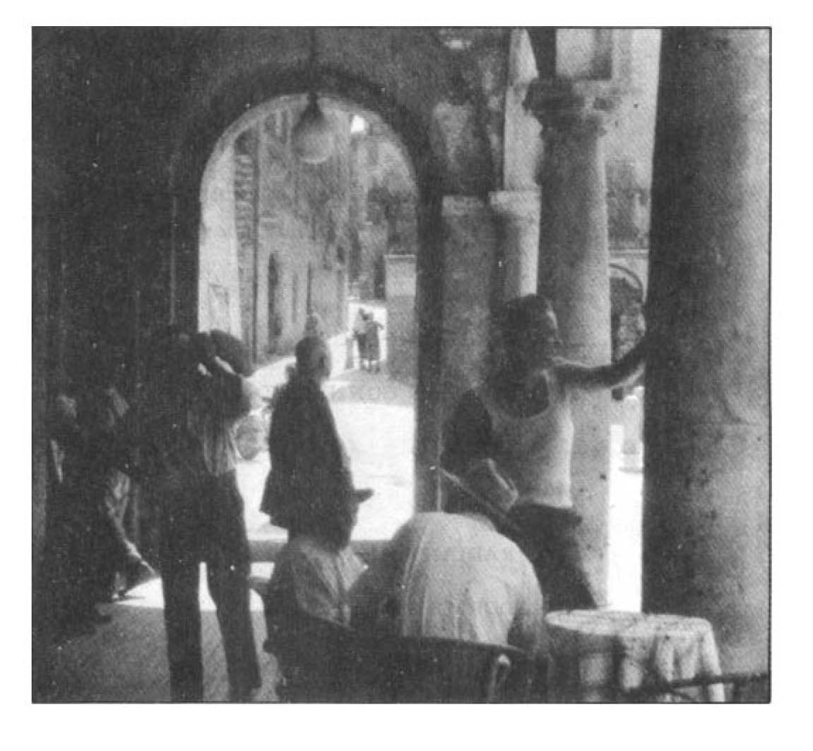
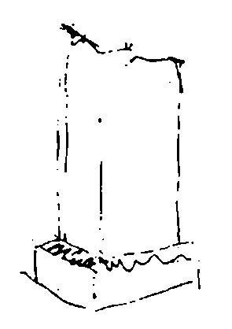
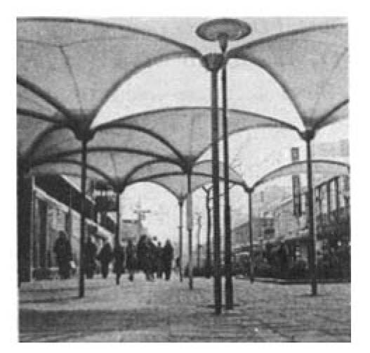
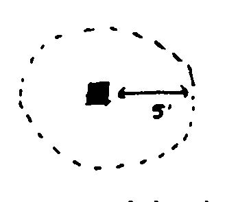
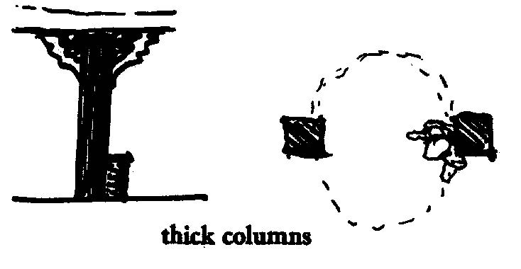

<section class="pattern-plate" aria-labelledby="t-column-place">
<a href="/patterns">A Pattern Language</a> · <a href="/patterns#construction">Construction</a> · Pattern 226 · p. 1064 · *
<h1 class="pattern-title" id="t-column-place">Column Place</h1><figure class="pattern-figure pl-figure"></figure><nav class="pattern-links" aria-label="Connections"><h2>Links to</h2><ul><li><a href="/patterns/public-outdoor-room">69 Public Outdoor Room</a></li><li><a href="/patterns/arcades">119 Arcades</a></li><li><a href="/patterns/outdoor-room">163 Outdoor Room</a></li><li><a href="/patterns/six-foot-balcony">167 Six-Foot Balcony</a></li><li><a href="/patterns/trellised-walk">174 Trellised Walk</a></li><li><a href="/patterns/columns-at-the-corners">212 Columns At The Corners</a></li><li><a href="/patterns/box-columns">216 Box Columns</a></li><li><a href="/patterns/column-connections">227 Column Connections</a></li><li><a href="/patterns/sitting-wall">243 Sitting Wall</a></li><li><a href="/patterns/raised-flowers">245 Raised Flowers</a></li><li><a href="/patterns/different-chairs">251 Different Chairs</a></li></ul><h2>Linked from</h2><ul><li><a href="/patterns/arcades">119 Arcades</a></li><li><a href="/patterns/flexible-office-space">146 Flexible Office Space</a></li><li><a href="/patterns/outdoor-room">163 Outdoor Room</a></li><li><a href="/patterns/gallery-surround">166 Gallery Surround</a></li><li><a href="/patterns/six-foot-balcony">167 Six-Foot Balcony</a></li><li><a href="/patterns/trellised-walk">174 Trellised Walk</a></li><li><a href="/patterns/alcoves">179 Alcoves</a></li><li><a href="/patterns/half-open-wall">193 Half-Open Wall</a></li><li><a href="/patterns/columns-at-the-corners">212 Columns At The Corners</a></li><li><a href="/patterns/box-columns">216 Box Columns</a></li><li><a href="/patterns/frames-as-thickened-edges">225 Frames As Thickened Edges</a></li><li><a href="/patterns/column-connections">227 Column Connections</a></li><li><a href="/patterns/ornament">249 Ornament</a></li></ul></nav></section><article class="pattern-text" aria-label="The text of Column Place">
1065… certain columns, especially those which are free standing, play an important social role, beyond their structural role as <a class="pl-ref" href="/patterns/columns-at-the-corners">COLUMNS AT THE CORNERS (212)</a>. These are, especially, the columns which help to form arcades, galleries, porches, walkways, and outdoor rooms—<a class="pl-ref" href="/patterns/public-outdoor-room">PUBLIC OUTDOOR ROOM (69)</a>, <a class="pl-ref" href="/patterns/arcades">ARCADES (119)</a>, <a class="pl-ref" href="/patterns/outdoor-room">OUTDOOR ROOM (163)</a>, GALLERY SURROUND (l66), <a class="pl-ref" href="/patterns/six-foot-balcony">SIX FOOT BALCONY (167)</a>, <a class="pl-ref" href="/patterns/trellised-walk">TRELLISED WALK (174)</a>. This pattern defines the character these columns need to make them function socially.

◆ ◆ ◆

<strong>Thin columns, spindly columns, columns which take their shape from structural arguments alone, will never make a comfortable environment.</strong>

The fact is, that a free-standing column plays a role in shaping human space. It marks a point. Two or more together define a wall or an enclosure. The main function of the columns, from a human point of view, is to create a space for human activity.

In ancient times, the structural arguments for columns coincided in their implications with the social arguments. Columns made of brick, or stone, or timber were always large and thick. It was easy to make useful space around them.

<figure class="pl-figure"><figcaption><em>A big thick column</em>.</figcaption></figure>

But with steel and reinforced concrete, it is possible to make a very slender column; so slender that its social properties disappear 1066altogether. Four inch steel pipes or 6 inch reinforced concrete columns break up space, but they destroy it as a place for human action, because they do not create “spots” where people can be comfortable.

<figure class="pl-figure"><figcaption><em>Thin columns of the plastic world</em>.</figcaption></figure>

In these times, it is therefore necessary to reintroduce, consciously, the social purposes which columns have, alongside their structural functions. Let us try to define these social purposes exactly.

A column affects a volume of space around it, according to the situation. The space has an area that is roughly circular, perhaps 5 feet in radius.

<figure class="pl-figure"><figcaption><em>The space around the column</em>.</figcaption></figure>

When the column is too thin, or lacks a top or bottom, this entire volume—an area of perhaps 75 square feet—is lost. It cannot be a satisfactory place in its own right: the column is too thin to lean against, there is no way to build a seat up against it, there is no natural way to place a table or a chair against the column. On the other hand, the column still breaks up the space. It subtly prevents people from walking directly through that area: we notice 1067that people tend to give these thin columns a wide berth; and it prevents people from forming groups.

In short, if the column has to be there, it will destroy a considerable area unless it is made to be a place where people feel comfortable to stay, a natural focus, a place to sit down, a place to lean.

Therefore:

<strong>When a column is free standing, make it as thick as a man—at least 12 inches, preferably 16 inches: and form places around it where people can sit and lean comfortably: a step, a small seat built up against the column, or a space formed by a pair of columns.</strong>

<figure class="pl-figure"></figure>
◆ ◆ ◆

You can get the extra thickness quite cheaply if you build the column as a <a class="pl-ref" href="/patterns/box-columns">BOX COLUMN (216)</a>; complete the “place” the column forms, by giving it a “roof’ in the form of a column capital, or vault which springs from the column, or by bracing the column against the beams—<a class="pl-ref" href="/patterns/column-connections">COLUMN CONNECTION (227)</a>. And when it makes sense, make the column base a <a class="pl-ref" href="/patterns/sitting-wall">SITTING WALL (243)</a>, a place for flowers—<a class="pl-ref" href="/patterns/raised-flowers">RAISED FLOWERS (245)</a>, or a place for a chair or table <a class="pl-ref" href="/patterns/different-chairs">DIFFERENT CHAIRS (251)</a>….
</article>

Christopher Alexander, Sara Ishikawa and Murray Silverstein, with Max Jacobson, Ingrid Fiksdahl-King and Shlomo Angel, <cite>A Pattern Language</cite> (Oxford University Press, 1977), pattern 226, pp. 1064–1067. Text and illustrations from the <a href="https://github.com/natureoforder/sources">Nature of Order sources</a> reading edition, transcribed from the 1977 printing; report errors on <a href="https://github.com/natureoforder/alexander-wiki/issues">GitHub</a>.

<a href="/patterns/frames-as-thickened-edges">← 225 Frames As Thickened Edges</a> · <a href="/patterns">All 253 patterns</a> · <a href="/patterns/column-connections">227 Column Connections →</a>

