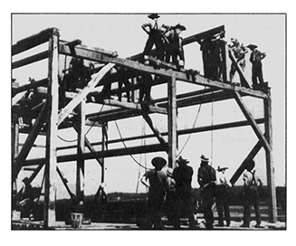
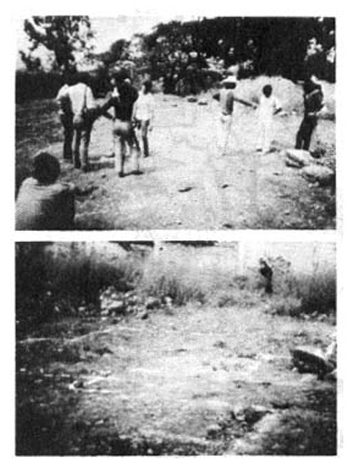
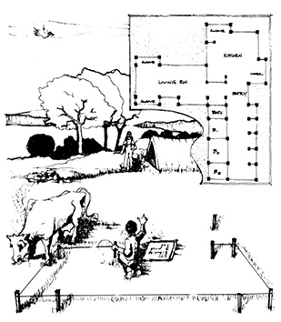
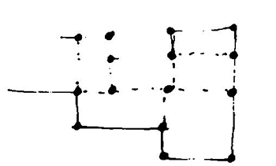

<section class="pattern-plate" aria-labelledby="t-columns-at-the-corners">
<a href="/patterns">A Pattern Language</a> · <a href="/patterns#construction">Construction</a> · Pattern 212 · p. 989 · **
<h1 class="pattern-title" id="t-columns-at-the-corners">Columns At The Corners</h1><figure class="pattern-figure pl-figure"></figure><nav class="pattern-links" aria-label="Connections"><h2>Links to</h2><ul><li><a href="/patterns/structure-follows-social-spaces">205 Structure Follows Social Spaces</a></li><li><a href="/patterns/efficient-structure">206 Efficient Structure</a></li><li><a href="/patterns/gradual-stiffening">208 Gradual Stiffening</a></li><li><a href="/patterns/roof-layout">209 Roof Layout</a></li><li><a href="/patterns/floor-and-ceiling-layout">210 Floor And Ceiling Layout</a></li><li><a href="/patterns/final-column-distribution">213 Final Column Distribution</a></li><li><a href="/patterns/root-foundations">214 Root Foundations</a></li><li><a href="/patterns/box-columns">216 Box Columns</a></li><li><a href="/patterns/perimeter-beams">217 Perimeter Beams</a></li><li><a href="/patterns/floor-ceiling-vaults">219 Floor-Ceiling Vaults</a></li><li><a href="/patterns/roof-vaults">220 Roof Vaults</a></li><li><a href="/patterns/column-place">226 Column Place</a></li></ul><h2>Linked from</h2><ul><li><a href="/patterns/the-shape-of-indoor-space">191 The Shape Of Indoor Space</a></li><li><a href="/patterns/half-open-wall">193 Half-Open Wall</a></li><li><a href="/patterns/staircase-volume">195 Staircase Volume</a></li><li><a href="/patterns/thick-walls">197 Thick Walls</a></li><li><a href="/patterns/structure-follows-social-spaces">205 Structure Follows Social Spaces</a></li><li><a href="/patterns/efficient-structure">206 Efficient Structure</a></li><li><a href="/patterns/gradual-stiffening">208 Gradual Stiffening</a></li><li><a href="/patterns/floor-and-ceiling-layout">210 Floor And Ceiling Layout</a></li><li><a href="/patterns/thickening-the-outer-walls">211 Thickening The Outer Walls</a></li><li><a href="/patterns/final-column-distribution">213 Final Column Distribution</a></li><li><a href="/patterns/root-foundations">214 Root Foundations</a></li><li><a href="/patterns/ground-floor-slab">215 Ground Floor Slab</a></li><li><a href="/patterns/column-place">226 Column Place</a></li><li><a href="/patterns/dormer-windows">231 Dormer Windows</a></li></ul></nav></section><article class="pattern-text" aria-label="The text of Columns At The Corners">
990… assume that you have worked out the roof plan, and laid out ceiling vaults for every room on every floor—<a class="pl-ref" href="/patterns/roof-layout">ROOF LAYOUT (209)</a>, <a class="pl-ref" href="/patterns/floor-and-ceiling-layout">FLOOR AND CEILING LAYOUT (210)</a>. These vaults are not only the basis of the structure, but also define the social spaces underneath them. Now it is time to put columns at the corners of the vaults. This will both complete them as clearly defined social spaces—<a class="pl-ref" href="/patterns/structure-follows-social-spaces">STRUCTURE FOLLOWS SOCIAL SPACES (205)</a>—and also be the first constructive step in the erection of the building—<a class="pl-ref" href="/patterns/gradual-stiffening">GRADUAL STIFFENING (208)</a>.

◆ ◆ ◆

<strong>We have already established the idea that the structural components of a building should be congruent with its social spaces.</strong>

In <a class="pl-ref" href="/patterns/structure-follows-social-spaces">STRUCTURE FOLLOWS SOCIAL SPACES (205)</a> we have established that the columns need to be at comers of social spaces for psychological reasons. In <a class="pl-ref" href="/patterns/efficient-structure">EFFICIENT STRUCTURE (206)</a> we have established that there needs to be a thickening of material at the corners of a space for purely structural reasons.

Now we give yet a third still different derivation of the same pattern—not based on psychological arguments or structural arguments, but on the process by which a person can communicate a complex design to the builder, and ensure that it can be built in an organic manner.

We begin with the problem of measurement and working drawings. For the last few decades it has been common practice to specify a building plan by means of working drawings. These measured drawings are then taken to the site; the builder transfers the measurements to the site, and every detail of the drawings is built in the flesh, on site.

<em>This process cripples buildings</em>. It is not possible to make such a drawing without a T-square. The necessities of the drawing itself change the plan, make it more rigid, turn it into the kind of plan which can be drawn and can be measured.

But the kind of plans which you can make by using the pattern 991language are much freer than that—and not so easy to draw and measure. Whether you conceive these plans out on the site—and mark them on the site with sticks and stones and chalk marks—or draw them roughly on the back of envelopes or scraps of tracing paper—in all events, the richness which you want to build into the plan can only be preserved if the builder is able to generate a living building, with all its slightly uneven lines and imperfect angles.

<figure class="pl-figure"><figcaption><em>Chalk marks on the ground</em>.</figcaption></figure>

In order to achieve this aim, the building must be generated in an entirely different manner. It cannot be made by following a working drawing slavishly. What must be done, essentially, is to fix those points which generate the spaces<em>—as fete of them as possible</em>—and then let these points generate the walls, right out on the building site, during the very process of construction.

You may proceed like this: first fix the comer of every major space by putting a stake in the ground. There are no more than a few dozen of these comers in a building, so this is possible, even if the measurements are intricate and irregular. Place these comer markers where they seem right, without regard for the 992exact distances between them. There is no reason whatever to try and make modular distances between them. If angles are slightly off, as they often will be, the modular dimensions are impossible anyway.

<figure class="pl-figure"><figcaption><em>“Staking out”</em></figcaption></figure>

These simple marks are all you need to build the building. Once construction starts, you can start very simply, by building a column, over each of these marks. These columns will then generate the rest of the building, by their mere presence, without 993any further need for detailed measurements or drawings, because the walls will simply be built along the lines which connect adjacent columns: and everything else follows.

For the upper storys, you can make drawings of the column positions and once again transfer them to the actual building while it is being built. As you will see from <a class="pl-ref" href="/patterns/final-column-distribution">final COLUMN DISTRIBUTION (213)</a>, upper story columns do not need to line up perfectly with downstairs columns.

With this procedure, it becomes possible to transfer a rather complex building from your mind, or from a scrap of paper, to the site—and regenerate it in a way which makes it live out there.

The method hinges on the fact that you can fix the corners of the spaces first—and that these comers may then play a significant role in the construction of the building. It is interesting that although it is based on entirely different arguments from <a class="pl-ref" href="/patterns/structure-follows-social-spaces">STRUCTURE FOLLOWS SOCIAL SPACES (205)</a>, it leads to almost exactly the same conclusion.

Therefore:

<strong>On your rough building plan, draw a dot to represent a column at the corner of every room and in the comers formed by lesser spaces like thick walls and alcoves. Then transfer these dots onto the ground out on the site with stakes.</strong>

<figure class="pl-figure"></figure>
◆ ◆ ◆

Once you have the columns for each floor on your vault plan, reconcile them from floor to floor and put in intermediate col994umns—final <a class="pl-ref" href="/patterns/final-column-distribution">COLUMN DISTRIBUTION (213)</a>. Note, especially, that it is not necessary for the corner columns to fall on a grid. The floor vaults and roof vaults can be made to fit any arrangement of columns, and still make a coherent structure—thus allowing the social spaces to determine the building shape without undue constraint from purely structural considerations—<a class="pl-ref" href="/patterns/floor-ceiling-vaults">FLOOR CEILING VAULTS (219)</a>, <a class="pl-ref" href="/patterns/roof-vaults">ROOF VAULTS (220)</a>.

These columns will not only guide your mental image of the building, they will also guide construction: first put the columns and the column foundations in place; then, to make the frame complete, tie the columns together around each room with the perimeter beam—<a class="pl-ref" href="/patterns/root-foundations">ROOT FOUNDATIONS (214)</a>, <a class="pl-ref" href="/patterns/box-columns">BOX COLUMNS (216)</a>, <a class="pl-ref" href="/patterns/perimeter-beams">PERIMETER BEAMS (217)</a>. Give special emphasis to all free-standing columns with the idea that when you build them, you will make them very thick—<a class="pl-ref" href="/patterns/column-place">COLUMN PLACE (226)</a>….
</article>

Christopher Alexander, Sara Ishikawa and Murray Silverstein, with Max Jacobson, Ingrid Fiksdahl-King and Shlomo Angel, <cite>A Pattern Language</cite> (Oxford University Press, 1977), pattern 212, pp. 989–994. Text and illustrations from the <a href="https://github.com/natureoforder/sources">Nature of Order sources</a> reading edition, transcribed from the 1977 printing; report errors on <a href="https://github.com/natureoforder/alexander-wiki/issues">GitHub</a>.

<a href="/patterns/thickening-the-outer-walls">← 211 Thickening The Outer Walls</a> · <a href="/patterns">All 253 patterns</a> · <a href="/patterns/final-column-distribution">213 Final Column Distribution →</a>

