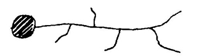
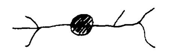
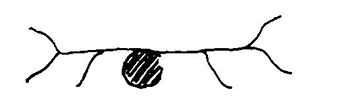
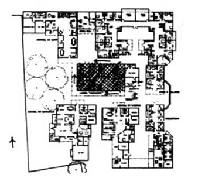
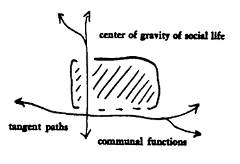

<section class="pattern-plate" aria-labelledby="t-common-areas-at-the-heart">
<a href="/patterns">A Pattern Language</a> · <a href="/patterns#buildings">Buildings</a> · Pattern 129 · p. 618 · **
<h1 class="pattern-title" id="t-common-areas-at-the-heart">Common Areas At The Heart</h1><nav class="pattern-links" aria-label="Connections"><h2>Links to</h2><ul><li><a href="/patterns/cascade-of-roofs">116 Cascade Of Roofs</a></li><li><a href="/patterns/arcades">119 Arcades</a></li><li><a href="/patterns/intimacy-gradient">127 Intimacy Gradient</a></li><li><a href="/patterns/indoor-sunlight">128 Indoor Sunlight</a></li><li><a href="/patterns/the-flow-through-rooms">131 The Flow Through Rooms</a></li><li><a href="/patterns/short-passages">132 Short Passages</a></li><li><a href="/patterns/farmhouse-kitchen">139 Farmhouse Kitchen</a></li><li><a href="/patterns/sequence-of-sitting-spaces">142 Sequence Of Sitting Spaces</a></li><li><a href="/patterns/communal-eating">147 Communal Eating</a></li><li><a href="/patterns/light-on-two-sides-of-every-room">159 Light On Two Sides Of Every Room</a></li><li><a href="/patterns/outdoor-room">163 Outdoor Room</a></li><li><a href="/patterns/the-fire">181 The Fire</a></li><li><a href="/patterns/the-shape-of-indoor-space">191 The Shape Of Indoor Space</a></li></ul><h2>Linked from</h2><ul><li><a href="/patterns/master-and-apprentices">83 Master And Apprentices</a></li><li><a href="/patterns/childrens-home">86 Children’s Home</a></li><li><a href="/patterns/travelers-inn">91 Traveler’s Inn</a></li><li><a href="/patterns/main-building">99 Main Building</a></li><li><a href="/patterns/long-thin-house">109 Long Thin House</a></li><li><a href="/patterns/car-connection">113 Car Connection</a></li><li><a href="/patterns/something-roughly-in-the-middle">126 Something Roughly In The Middle</a></li><li><a href="/patterns/intimacy-gradient">127 Intimacy Gradient</a></li><li><a href="/patterns/the-flow-through-rooms">131 The Flow Through Rooms</a></li><li><a href="/patterns/staircase-as-a-stage">133 Staircase As A Stage</a></li><li><a href="/patterns/childrens-realm">137 Children’s Realm</a></li><li><a href="/patterns/farmhouse-kitchen">139 Farmhouse Kitchen</a></li><li><a href="/patterns/a-room-of-ones-own">141 A Room Of One’s Own</a></li><li><a href="/patterns/sequence-of-sitting-spaces">142 Sequence Of Sitting Spaces</a></li><li><a href="/patterns/bathing-room">144 Bathing Room</a></li><li><a href="/patterns/flexible-office-space">146 Flexible Office Space</a></li><li><a href="/patterns/communal-eating">147 Communal Eating</a></li><li><a href="/patterns/small-work-groups">148 Small Work Groups</a></li><li><a href="/patterns/outdoor-room">163 Outdoor Room</a></li><li><a href="/patterns/alcoves">179 Alcoves</a></li><li><a href="/patterns/the-fire">181 The Fire</a></li><li><a href="/patterns/sitting-circle">185 Sitting Circle</a></li><li><a href="/patterns/floor-and-ceiling-layout">210 Floor And Ceiling Layout</a></li><li><a href="/patterns/pools-of-light">252 Pools Of Light</a></li></ul></nav></section><article class="pattern-text" aria-label="The text of Common Areas At The Heart">
… along the <a class="pl-ref" href="/patterns/intimacy-gradient">INTIMACY GRADIENT (127)</a>, in every building and in every social group within the building, it is necessary to place the common areas. Place them on the sunlit side to reinforce the pattern of <a class="pl-ref" href="/patterns/indoor-sunlight">INDOOR SUNLIGHT (128)</a>; and, when they are large, give them the higher roofs of the <a class="pl-ref" href="/patterns/cascade-of-roofs">CASCADE OF ROOFS (116)</a>.

◆ ◆ ◆

<strong>No social group—whether a family, a work group, or a school group—can survive without constant informal contact among its members.</strong>

Any building which houses a social group supports this kind of contact by providing common areas. The form and location of the common areas is critical. Here is a perfect example—-a description of the family room in a Peruvian worker’s house:

For a low-income Peruvian family, the family room is the heart of family life. The family eat here, they watch TV here, and everyone who comes into the house comes into this room to say hello to the others, kiss them, shake hands with them, exchange news. The same happens when people leave the house.

The family room functions as the heart of the family life by helping to support these processes. The room is so placed in the house, that people naturally pass through it on their way into and out of the house. The end where they pass through it allows them to linger for a few moments, without having to pull out a chair to sit down. The TV set is at the opposite end of the room from this throughway, and a glance at the screen is often the excuse for a moment’s further lingering. The part of the room for the TV set is often darkened; the family room and the TV function just as much during midday as they do at night.

Let us now generalize from this example. If a common area is 619located at the end of a corridor and people have to make a special, deliberate effort to go there, they are not likely to use it informally and spontaneously.

<figure class="pl-figure"><figcaption><em>… At one end</em>.</figcaption></figure>

Alternatively, if the circulation path cuts too deeply through the common area, the space will be too exposed, it will not be comfortable to linger there and settle down.

<figure class="pl-figure"></figure>
… <em>Through the middle</em>.

<figure class="pl-figure"></figure>
… <em>Tangent</em>.

The only balanced situation is the one where a common path, which people use every day, runs <em>tangent</em> to the common areas and is open to them in passing. Then people will be constantly passing the space; but because the path is to one side, they are not forced to stop. If they want to, they can keep going. If they want to, they can stop for a moment, and see what’s happening; if they want to, they can come right in and settle down.

It is worth mentioning, that this pattern has occurred, in some form, in every single project we have worked on. In the multiservice center, we had a pattern called <em>Staff lounge</em> based on the same geometry (<em>A fattem language which generates multi-service centers</em>, C.E.S., 1968, p. 241); in our work on mental health centers, we had <em>Patient’s choice of being involved</em>, the same pattern again, as an essential element in therapy; in our work on Peruvian housing, we had <em>Family room circulation</em>—this is the example we have given for a family (<em>Houses generated by patterns,</em> C.E.S., 1969, p. 140); and in our work on universities, <em>The 620Oregon Experiment</em>, we had a pattern called <em>Department hearth,</em> again the tame, for each department. It it perhaps the most basic pattern there is in forming group cohesion.

In detail, we have isolated three characteristics for a successful common area:

1. It must be at the center of gravity of the building complex, building, or building wing which the group occupies. In other words, it must be at the physical heart of the organization, so that it is equally accessible to everyone and can be felt as the center of the group.

2. Most important of all, it must be “on the way” from the entrance to private rooms, so people always go by it on the way in and out of the building. It is crucial that it not be a dead-end room which one would have to go out of one’s way to get to. For this reason, the paths which pass it must lie tangent to it.

<figure class="pl-figure"><figcaption><em>The common area of a clinic vie have built in Modesto, California, where we managed to put tangent paths on all four sides</em>.</figcaption></figure>

3. It must have the right components in it—usually a kitchen and eating space, since eating is one of the most communal of activities, and a sitting space—at least some comfortable chairs, so people will feel like staying. It should also include an outdoor area—on nice days there is always the longing to be outside—to step out for a smoke, to sit down on the grass, to carry on a discussion.

621Therefore:

<strong>Create a single common area for every social group. Locate it at the center of gravity of all the spaces the group occupies, and in such a way that the paths which go in and out of the building lie tangent to it.</strong>

<figure class="pl-figure"></figure>
◆ ◆ ◆

Most basic of all to common areas are food and fire. Include <a class="pl-ref" href="/patterns/farmhouse-kitchen">FARMHOUSE KITCHEN (139)</a>, <a class="pl-ref" href="/patterns/communal-eating">COMMUNAL EATINC (147)</a>, and <a class="pl-ref" href="/patterns/the-fire">THE FIRE (181)</a>. For the shape of the common area in fine detail, see <a class="pl-ref" href="/patterns/light-on-two-sides-of-every-room">LIGHT ON TWO SIDES OF EVERY ROOM (159)</a> and <a class="pl-ref" href="/patterns/the-shape-of-indoor-space">THE SHAPE OF INDOOR SPACE (191)</a>. Make sure that there are plenty of different sitting places, different in character for different kinds of moments—<a class="pl-ref" href="/patterns/sequence-of-sitting-spaces">SEQUENCE OF SITTING SPACES (142)</a>. Include an <a class="pl-ref" href="/patterns/outdoor-room">OUTDOOR ROOM (163)</a>. And make the paths properly tangent to the common areas—<a class="pl-ref" href="/patterns/arcades">ARCADES (119)</a>, <a class="pl-ref" href="/patterns/the-flow-through-rooms">THE FLOW THROUGH ROOMS (131)</a>, <a class="pl-ref" href="/patterns/short-passages">SHORT PASSAGES (132)</a>….
</article>

Christopher Alexander, Sara Ishikawa and Murray Silverstein, with Max Jacobson, Ingrid Fiksdahl-King and Shlomo Angel, <cite>A Pattern Language</cite> (Oxford University Press, 1977), pattern 129, pp. 618–621. Text and illustrations from the <a href="https://github.com/natureoforder/sources">Nature of Order sources</a> reading edition, transcribed from the 1977 printing; report errors on <a href="https://github.com/natureoforder/alexander-wiki/issues">GitHub</a>.

<a href="/patterns/indoor-sunlight">← 128 Indoor Sunlight</a> · <a href="/patterns">All 253 patterns</a> · <a href="/patterns/entrance-room">130 Entrance Room →</a>

