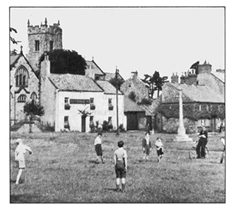
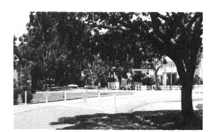
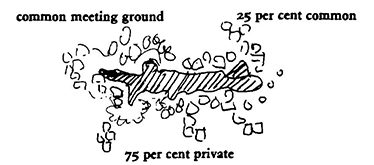

<section class="pattern-plate" aria-labelledby="t-common-land">
<a href="/patterns">A Pattern Language</a> · <a href="/patterns#towns">Towns</a> · Pattern 67 · p. 336 · **
<h1 class="pattern-title" id="t-common-land">Common Land</h1><figure class="pattern-figure pl-figure"></figure><nav class="pattern-links" aria-label="Connections"><h2>Links to</h2><ul><li><a href="/patterns/row-houses">38 Row Houses</a></li><li><a href="/patterns/housing-hill">39 Housing Hill</a></li><li><a href="/patterns/work-community">41 Work Community</a></li><li><a href="/patterns/green-streets">51 Green Streets</a></li><li><a href="/patterns/local-sports">72 Local Sports</a></li><li><a href="/patterns/positive-outdoor-space">106 Positive Outdoor Space</a></li><li><a href="/patterns/vegetable-garden">177 Vegetable Garden</a></li></ul><h2>Linked from</h2><ul><li><a href="/patterns/house-cluster">37 House Cluster</a></li><li><a href="/patterns/green-streets">51 Green Streets</a></li><li><a href="/patterns/holy-ground">66 Holy Ground</a></li><li><a href="/patterns/connected-play">68 Connected Play</a></li><li><a href="/patterns/public-outdoor-room">69 Public Outdoor Room</a></li><li><a href="/patterns/grave-sites">70 Grave Sites</a></li><li><a href="/patterns/still-water">71 Still Water</a></li><li><a href="/patterns/animals">74 Animals</a></li><li><a href="/patterns/circulation-realms">98 Circulation Realms</a></li><li><a href="/patterns/hierarchy-of-open-space">114 Hierarchy Of Open Space</a></li><li><a href="/patterns/something-roughly-in-the-middle">126 Something Roughly In The Middle</a></li><li><a href="/patterns/fruit-trees">170 Fruit Trees</a></li><li><a href="/patterns/greenhouse">175 Greenhouse</a></li><li><a href="/patterns/vegetable-garden">177 Vegetable Garden</a></li></ul></nav></section><article class="pattern-text" aria-label="The text of Common Land">
337… just as there is a need for public land at the neighborhood level—accessible green (60), so also, within the clusters and work communities from which the neighborhoods are made, there is a need for smaller and more private kinds of common land shared by a few work groups or a few families. This common land, in fact, forms the very heart and soul of any cluster. Once it is defined, the individual buildings of the cluster form around it—house cluster (37), <a class="pl-ref" href="/patterns/row-houses">row houses (38)</a>, <a class="pl-ref" href="/patterns/housing-hill">housing hill (39)</a>, <a class="pl-ref" href="/patterns/work-community">work community (41)</a>.

◆ ◆ ◆

<strong>Without common land no social system can survive.</strong>

In pre-industrial societies, common land between houses and between workshops existed automatically—so it was never necessary to make a point of it. The paths and streets which gave access to buildings were safe, social spaces, and therefore functioned automatically as common land.

But in a society with cars and trucks, the common land which can play an effective social role in knitting people together no longer happens automatically. Those streets which carry cars and trucks at more than crawling speeds, definitely do not function as common land; and many buildings find themselves entirely isolated from the social fabric because they are not joined to one another by land they hold in common. In such a situation common land must be provided, separately, and with deliberation, as a social necessity, as vital as the streets.

The common land has two specific social functions. First, the land makes it possible for people to feel comfortable outside their buildings and their private territory, and therefore allows them to feel connected to the larger social system—though not necessarily to any specific neighbor. And second, common land acts as a meeting place for people.

The first function is subtle. Certainly one’s immediate neighbors are less important in modern society than in traditional 338society. This is because people meet friends at work, at school, at meetings of interest groups and therefore no longer rely exclusively on neighbors for friendship. (See for instance, Melvin Webber, “Order in Diversity: Community Without Propinquity,” <em>Cities and Space</em>, ed. Lowdon Wingo, Baltimore: Resources for the Future, 1963; and Webber, “The Urban Place and the Nonplace Urban Realm,” in Webber et al., <em>Explorations into Urban Structure</em>, Philadelphia, 1964, pp. 79–153)

To the extent that this is true, the common land between houses might be less important than it used to be as a meeting ground for friendship. But the common land between buildings may have a deeper psychological function, which remains important, even when people have no relation to their neighbors. In order to portray this function, imagine that your house is separated from the city by a gaping chasm, and that you have to pass across this chasm every time you leave your house, or enter it. The house would be disturbingly isolated; and you, in the house, would be isolated from society, merely by this physical fact. In psychological terms, we believe that a building without common land in front of it is as isolated from society as if it had j ust such a chasm there.

There is a new emotional disorder—a type of agoraphobia—making its appearance in today’s cities. Victims of this disorder are afraid to go out of their houses for any reason—even to mail a letter or to go to the corner grocery store—literally, they are afraid of the marketplace—the agora. We speculate—entirely without evidence—that this disorder may be reinforced by the absence of common land, by an environment in which people feel they have no “right” to be outside their own front doors. If this is so, agoraphobia would be the most concrete manifestation of the breakdown of common land.

The second social function of common land is straightforward. Common land provides a <em>meeting ground</em> for the fluid, common activities that a house cluster shares. The larger pieces of public land which serve neighborhoods—the parks, the community facilities—do not fill the bill. They are fine for the neighborhood as a whole. But they do not provide a base for the functions that are common to a cluster of households.

339Lewis Mumford:

Even in housing estates that are laid out at twelve families to the acre—perhaps one should say especially there—there is often a lack of common meeting places for the mothers, where, on a good day, they might come together under a big tree, or a pergola, to sew or gossip, while their infants slept in a pram or their runabout children grubbed around in a play pit. Perhaps the best part of Sir Charles Reilly’s plans for village greens was that they provided for such common activities: as the planners of Sunnyside, Long Island, Messrs. Stein and Wright, had done as early as 1924. <em>(The Urban Prosfect</em>, New York: Harcourt, Brace and World, 1968, p. 26.)

How much common land must there be? There must be enough to be useful, to contain children’s games and small gatherings. And enough land must be common so that private land doesn’t dominate it psychologically. We guess that the amount of common land needed in a neighborhood is on the order of 25 per cent of the land held privately. This is the figure that the greenbelt planners typically devoted to their commons and greens. (See Clarence Stein, <em>Toward New Towns in America</em>, Cambridge: M.I.T. Press, 1966.)

With cooperation among the people, it is possible to build this pattern piecemeal, into our existing neighborhoods by closing streets.

<figure class="pl-figure"><figcaption><em>Berkeley street transformed to neighborhood commons</em>.</figcaption></figure>

Therefore:

<strong>Give over 25 per cent of the land in house clusters to common land which touches, or is very very near, the 340homes which share it Basic: be wary of the automobile; on no account let it dominate this land.</strong>

<figure class="pl-figure"></figure>
◆ ◆ ◆

Shape the common land so it has some enclosure and good sunlight—south facing outdoors (105), <a class="pl-ref" href="/patterns/positive-outdoor-space">positive outdoor space (106)</a>; and so that smaller and more private pieces of land and pockets always open onto it—hierarchy of open space (114); provide communal functions within the land—public outdoor room (69), <a class="pl-ref" href="/patterns/local-sports">local sports (72)</a>, <a class="pl-ref" href="/patterns/vegetable-garden">vegetable garden (177)</a>; and connect the different and adjacent pieces of common land to one another to form swaths of connected play space—connected play (68). Roads can be part of common land if they are treated as <a class="pl-ref" href="/patterns/green-streets">green streets (51)</a>….
</article>

Christopher Alexander, Sara Ishikawa and Murray Silverstein, with Max Jacobson, Ingrid Fiksdahl-King and Shlomo Angel, <cite>A Pattern Language</cite> (Oxford University Press, 1977), pattern 67, pp. 336–340. Text and illustrations from the <a href="https://github.com/natureoforder/sources">Nature of Order sources</a> reading edition, transcribed from the 1977 printing; report errors on <a href="https://github.com/natureoforder/alexander-wiki/issues">GitHub</a>.

<a href="/patterns/holy-ground">← 66 Holy Ground</a> · <a href="/patterns">All 253 patterns</a> · <a href="/patterns/connected-play">68 Connected Play →</a>

