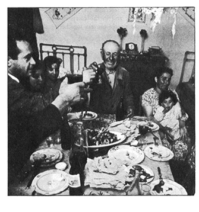
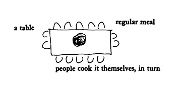

<section class="pattern-plate" aria-labelledby="t-communal-eating">
<a href="/patterns">A Pattern Language</a> · <a href="/patterns#buildings">Buildings</a> · Pattern 147 · p. 696 · *
<h1 class="pattern-title" id="t-communal-eating">Communal Eating</h1><figure class="pattern-figure pl-figure"></figure><nav class="pattern-links" aria-label="Connections"><h2>Links to</h2><ul><li><a href="/patterns/the-family">75 The Family</a></li><li><a href="/patterns/self-governing-workshops-and-offices">80 Self-Governing Workshops And Offices</a></li><li><a href="/patterns/common-areas-at-the-heart">129 Common Areas At The Heart</a></li><li><a href="/patterns/farmhouse-kitchen">139 Farmhouse Kitchen</a></li><li><a href="/patterns/small-work-groups">148 Small Work Groups</a></li><li><a href="/patterns/small-meeting-rooms">151 Small Meeting Rooms</a></li><li><a href="/patterns/eating-atmosphere">182 Eating Atmosphere</a></li></ul><h2>Linked from</h2><ul><li><a href="/patterns/work-community">41 Work Community</a></li><li><a href="/patterns/the-family">75 The Family</a></li><li><a href="/patterns/master-and-apprentices">83 Master And Apprentices</a></li><li><a href="/patterns/teen-age-society">84 Teen-Age Society</a></li><li><a href="/patterns/travelers-inn">91 Traveler’s Inn</a></li><li><a href="/patterns/common-areas-at-the-heart">129 Common Areas At The Heart</a></li><li><a href="/patterns/farmhouse-kitchen">139 Farmhouse Kitchen</a></li><li><a href="/patterns/bulk-storage">145 Bulk Storage</a></li><li><a href="/patterns/flexible-office-space">146 Flexible Office Space</a></li><li><a href="/patterns/eating-atmosphere">182 Eating Atmosphere</a></li></ul></nav></section><article class="pattern-text" aria-label="The text of Communal Eating">
697… this pattern helps complete all those human groups and institutions which have <a class="pl-ref" href="/patterns/common-areas-at-the-heart">COMMON AREAS AT THE HEART (129)</a> in them, and most of all it helps to complete workshops and offices and extended families—<a class="pl-ref" href="/patterns/the-family">THE FAMILY (75)</a>, <a class="pl-ref" href="/patterns/self-governing-workshops-and-offices">SELF-GOVERNING WORKSHOPS AND OFFICES (80)</a>. In all of them, the common area will draw its strength from the sharing of food and drink. This pattern defines it in detail, and shows also how it helps to generate a larger social order.

◆ ◆ ◆

<strong>Without communal eating, no human group can hold together.</strong>

The importance of communal eating is clear in all human societies. Holy communion, wedding feasts, birthday parties, Christmas dinner, an Irish wake, the family evening meal are Western and Christian examples, but every society has its equivalents. There are almost no important human events or institutions which are not given their power to bind, their sacral character, by food and drink. The anthropological literature is full of references. For example: “Food and Its Vicissitudes: A Cross-Cultural Study of Sharing and Nonsharing,” in Yehudi A. Cohen, <em>Social Structure and Personality: A Casebook</em>, New York: Holt, 1961. Audrey I. Richards, <em>Hunger and Work in a Savage Tribe: A Functional Study of Nutrition Among the Southern Bantu</em>. Glencoe, 111.: Free Press, 1932.

Thomas Merton summarizes the meaning of communal eating beautifully:

A feast is of such a nature that it draws people to itself, and makes them leave everything else in order to participate in its joys. To feast together is to bear witness to the joy one has at being with his friends. The mere act of eating together, quite apart from a banquet or some other festival occasion, is by its very nature a sign of friendship and of “communion.”

In modern times we have lost sight of the fact that even the most ordinary actions of our everyday life are invested, by their very nature, with a deep spiritual meaning. The table is in a 698certain sense the center of family life, the expression of family life. Here the children gather with their parents to eat the food which the love of their parents has provided….

So, too, with a banquet. The Latin word <em>convrv’mm</em> contains more of this mystery than our words “banquet” or “feast.” To call a feast a “convivium” is to call it a “mystery of the sharing of life”—a mystery in which guests partake of the good things prepared and given to them by the love of their host, and in which the atmosphere of friendship and gratitude expands into a sharing of thoughts and sentiments, and ends in common rejoicing. (Thomas Merton, <em>The Living Bread</em>, New York, 1956, pp. 116–27.)

It is clear, then, that communal eating plays a vital role in almost all human societies as a way of binding people together and increasing the extent to which they feel like “members” of a group.

But beyond this intrinsic importance of communal eating, as a way of binding the members of a group together, there is another important reason for maintaining the pattern, which applies especially to modern metropolitan society.

Metropolitan society creates the possibility of meeting a wonderful variety of people, a possibility almost entirely new in human history. In a traditional society, one learns to live with the people he knows, but the people he knows form a relatively closed group; there is little possibility of expanding it greatly. In a modern metropolitan society, each person has the possibility of finding those few other people in the city he really wants to be with. In theory, a man in a city of five million people has the possibility of meeting just those half dozen people who are the people he most wants to be with, in all of these five million.

But this is only theory. In practice it is very hard. Few people can feel confident that they have met their closest possible companions or found the informal groups they want to belong to in the cities they inhabit. In fact, on the contrary, people complain constantly that they cannot meet enough people, that there are too few opportunities for meeting people. Far from being free to explore the natures of all the people in society, and free to be together with those others who have the greatest natural and mutual affinities, instead people feel constrained to be with the few people they happen to have run into.

699How can the great potential of metropolitan society be realized? How can a person find the other people for whom he has the greatest possible affinity?

To answer this question, we must define the workings of the process by which people meet new people in society. The answer to this question hinges on the following three critical hypotheses:

1 The process hinges entirely on the <em>overlap</em> of the human groups in society, and the way a person can pass through these human groups, expanding his associations.

2 The process can only take place if the various human groups in society possess “group territories” where meeting can take place.

3 The process of meeting seems to depend especially on communal eating and drinking and therefore takes place especially well in those groups which have at least partly institutionalized common food and drink.

If these three hypotheses are correct, as we believe, then it is plain that the process by which people meet one another depends very largely on the extent to which people are able to pass from group to group, as visitors and guests, at communal meals. And this of course can happen only if each institution and each social group has its own common meals, regularly, and if its members are free to invite guests to their meals and in turn are free to be invited by the guests they meeet to other meals at other gatherings.

Therefore:

<strong>Give every institution and social group a place where people can eat together. Make the common meal a regular event In particular, start a common lunch in every work place, so that a genuine meal around a common table (not out of boxes, machines, or bags) becomes an important, comfortable^ and daily event with room for invited guests. In our own work group at the Center, we found this worked most beautifully when we took it in turns to cook the lunch. The lunch became an event: a gathering: something that each of us put our love and energy into, on our day to cook.</strong>

700

<figure class="pl-figure"></figure>
◆ ◆ ◆

If the institution is large, find some way of breaking it down into smaller groups which eat together, so that no one group which eats together has more than about a dozen people in it—<a class="pl-ref" href="/patterns/small-work-groups">SMALL WORK CROUPS (148)</a>, <a class="pl-ref" href="/patterns/small-meeting-rooms">SMALL MEETING ROOMS (151)</a>. Build the kitchen all around the eating place like a <a class="pl-ref" href="/patterns/farmhouse-kitchen">FARMHOUSE KITCHEN (139)</a>; make the table itself a focus of great importance <a class="pl-ref" href="/patterns/eating-atmosphere">EATING ATMOSPHERE (182)</a>….
</article>

Christopher Alexander, Sara Ishikawa and Murray Silverstein, with Max Jacobson, Ingrid Fiksdahl-King and Shlomo Angel, <cite>A Pattern Language</cite> (Oxford University Press, 1977), pattern 147, pp. 696–700. Text and illustrations from the <a href="https://github.com/natureoforder/sources">Nature of Order sources</a> reading edition, transcribed from the 1977 printing; report errors on <a href="https://github.com/natureoforder/alexander-wiki/issues">GitHub</a>.

<a href="/patterns/flexible-office-space">← 146 Flexible Office Space</a> · <a href="/patterns">All 253 patterns</a> · <a href="/patterns/small-work-groups">148 Small Work Groups →</a>

