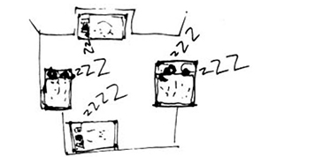

<section class="pattern-plate" aria-labelledby="t-communal-sleeping">
<a href="/patterns">A Pattern Language</a> · <a href="/patterns#buildings">Buildings</a> · Pattern 186 · p. 861
<h1 class="pattern-title" id="t-communal-sleeping">Communal Sleeping</h1><nav class="pattern-links" aria-label="Connections"><h2>Links to</h2><ul><li><a href="/patterns/couples-realm">136 Couple’s Realm</a></li><li><a href="/patterns/childrens-realm">137 Children’s Realm</a></li><li><a href="/patterns/sleeping-to-the-east">138 Sleeping To The East</a></li><li><a href="/patterns/bed-cluster">143 Bed Cluster</a></li><li><a href="/patterns/alcoves">179 Alcoves</a></li><li><a href="/patterns/window-place">180 Window Place</a></li><li><a href="/patterns/marriage-bed">187 Marriage Bed</a></li><li><a href="/patterns/bed-alcove">188 Bed Alcove</a></li><li><a href="/patterns/dressing-rooms">189 Dressing Rooms</a></li></ul><h2>Linked from</h2><ul><li><a href="/patterns/travelers-inn">91 Traveler’s Inn</a></li><li><a href="/patterns/bed-cluster">143 Bed Cluster</a></li><li><a href="/patterns/compost">178 Compost</a></li></ul></nav></section><article class="pattern-text" aria-label="The text of Communal Sleeping">
… by this time the sleeping areas have been defined—<a class="pl-ref" href="/patterns/couples-realm">COUPLE’S REALM (136)</a>, <a class="pl-ref" href="/patterns/childrens-realm">CHILDREN’S REALM (137)</a>; <a class="pl-ref" href="/patterns/sleeping-to-the-east">SLEEPING TO THE EAST (138)</a>, <a class="pl-ref" href="/patterns/bed-cluster">BED CLUSTER (143)</a>. It remains only to build in the actual detailed space which forms the beds themselves—<a class="pl-ref" href="/patterns/marriage-bed">MARRIAGE BED (187)</a>, <a class="pl-ref" href="/patterns/bed-alcove">BED ALCOVE (188)</a>. However, before we consider these patterns, we wish to draw attention to a slightly more general pattern which may affect their detailed positions.

◆ ◆ ◆

<strong>In many traditional and primitive cultures, sleep is a communal activity without the sexual overtones it has in the West today. We believe that it may be a vital social function, which plays a role as fundamental and as necessary to people as communal eating.</strong>

For instance, in Indian villages during the dry season the men pull their beds into the compound at sundown and talk and smoke together, then drift off to sleep. It is a vital part of the social life of the community. The experience of the campfire is the closest western equivalent: people’s love of camping suggests that the urge is still a common one.

It is possible that sleep as a communal activity may be a vital part of healthy social life, not only for children, but for all adults. How might we harmonize this need with the obvious facts of privacy and sexuality that are linked with sleeping?

Of course, it is a beautifully intimate thing—the moment in the morning and at night when a couple are together, in private, falling asleep or waking up together. But we believe that it is also possible to create a situation where, occasionally, people can sleep together in big, family-size groups.

In particular, we can imagine a special version of this activity for metropolitan culture, where so often friends live many miles 862away from each other. How many times have you experienced this situation: You have been out for the night with your friends and end up back at their house for drinks, to talk, to build a fire. Finally, late into the night, it is time to leave. Often they will say, “Please, spend the night”—but this rarely happens. You decline, and make the weary, half-drunken drive home to “your own bed.”

It seems to us that under these conditions especially, communal sleeping makes sense. It would help to intensify the social occasions when we do see our friends who live far away.

But the environment must invite it, or we shall never overcome our reluctance. People are uneasy about spending the night because it usually means having to make up a guest bed, or sleeping on the rug, or cramped on the sofa. Think how much more inviting it would be if, at the end of the night, people simply dozed off, in ones and twos, in alcoves, and on mats with quilts, around the main sleeping area of the house, or around the commons.

From a practical point of view, there are two alternative positions for the alcoves:

1. There might be a place in the commons—not in any one person’s private space—a place where late at night after people have been together for the evening and the fire is dying out, it is simple to draw together and sleep—a place where children and parents can sleep together on special nights. It could be very simple: one large mat and some blankets.

2. The other solution is a more deliberate version of the pattern: the couple’s realm in a family house could be slightly larger than normal, with one or two alcoves or window seats that could double as beds. A built-in seat, for example, that is wide enough and long enough to lay down on, with a thin mat spread across it, becomes a bed. A few places like this, and, at a moment’s notice the couple’s bedroom becomes a setting for communal sleeping.

In either case, the solution must be simple and must involve nothing more than reaching for a blanket and a mat. If special beds must be made and the room rearranged, it will never happen. And, of course, the space for guest’s beds must be made so that it is not dead when it is not used for sleeping. It needs a 863compatible double function—a place to put a crib, a seat, a place to lay out clothes—<a class="pl-ref" href="/patterns/alcoves">ALCOVE (179)</a>, <a class="pl-ref" href="/patterns/window-place">WINDOW PLACE (180)</a>, <a class="pl-ref" href="/patterns/dressing-rooms">DRESSING ROOM (189)</a>.

This pattern may seem strange at first, but when our typist, read it, she was fascinated and decided to try it one Saturday night with her family. They spread a big mat across the living room. They all got up together and helped the youngest son on his paper route; then they had some breakfast. Ed: Are they still doing it? ? Au: No, after 2 weeks they were arrested.

Seriously though:

<strong>Arrange the sleeping area so that there is the possibility for children and adults to sleep in the same space, in sight and sound of one another, at least as an occasional alternative to their more usual sleeping habits.</strong>

<strong>This can be done in the common area near die fireplace, where the entire household and guests can sleep together-one large mat and some blankets in an alcove. It is also possible to build bed alcoves for overnight guests, in an extended couple’s realm.</strong>

<figure class="pl-figure"><figcaption><em>beds within sight and sound of other beds</em></figcaption></figure>

◆ ◆ ◆

Place the <a class="pl-ref" href="/patterns/alcoves">ALCOVES (179)</a> and <a class="pl-ref" href="/patterns/marriage-bed">MARRIAGE BED (187)</a> and the <a class="pl-ref" href="/patterns/bed-alcove">BED ALCOVES (188)</a> and <a class="pl-ref" href="/patterns/dressing-rooms">DRESSING ROOMS (189)</a> accordingly. The children have this pattern for themselves already—if bed alcoves are placed in a cluster—<a class="pl-ref" href="/patterns/bed-cluster">BED CLUSTER (143)</a>….
</article>

Christopher Alexander, Sara Ishikawa and Murray Silverstein, with Max Jacobson, Ingrid Fiksdahl-King and Shlomo Angel, <cite>A Pattern Language</cite> (Oxford University Press, 1977), pattern 186, pp. 861–863. Text and illustrations from the <a href="https://github.com/natureoforder/sources">Nature of Order sources</a> reading edition, transcribed from the 1977 printing; report errors on <a href="https://github.com/natureoforder/alexander-wiki/issues">GitHub</a>.

<a href="/patterns/sitting-circle">← 185 Sitting Circle</a> · <a href="/patterns">All 253 patterns</a> · <a href="/patterns/marriage-bed">187 Marriage Bed →</a>

