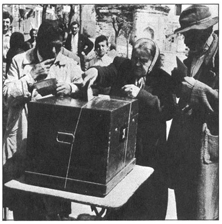
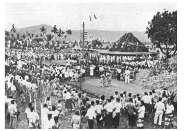
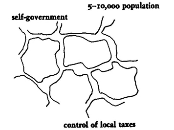

<section class="pattern-plate" aria-labelledby="t-community-of-7000">
<a href="/patterns">A Pattern Language</a> · <a href="/patterns#towns">Towns</a> · Pattern 12 · p. 70 · *
<h1 class="pattern-title" id="t-community-of-7000">Community Of 7000</h1><figure class="pattern-figure pl-figure"></figure><nav class="pattern-links" aria-label="Connections"><h2>Links to</h2><ul><li><a href="/patterns/mosaic-of-subcultures">8 Mosaic Of Subcultures</a></li><li><a href="/patterns/subculture-boundary">13 Subculture Boundary</a></li><li><a href="/patterns/identifiable-neighborhood">14 Identifiable Neighborhood</a></li><li><a href="/patterns/eccentric-nucleus">28 Eccentric Nucleus</a></li><li><a href="/patterns/promenade">31 Promenade</a></li><li><a href="/patterns/local-town-hall">44 Local Town Hall</a></li></ul><h2>Linked from</h2><ul><li><a href="/patterns/country-towns">6 Country Towns</a></li><li><a href="/patterns/mosaic-of-subcultures">8 Mosaic Of Subcultures</a></li><li><a href="/patterns/local-transport-areas">11 Local Transport Areas</a></li><li><a href="/patterns/subculture-boundary">13 Subculture Boundary</a></li><li><a href="/patterns/identifiable-neighborhood">14 Identifiable Neighborhood</a></li><li><a href="/patterns/neighborhood-boundary">15 Neighborhood Boundary</a></li><li><a href="/patterns/nine-per-cent-parking">22 Nine Per Cent Parking</a></li><li><a href="/patterns/life-cycle">26 Life Cycle</a></li><li><a href="/patterns/men-and-women">27 Men And Women</a></li><li><a href="/patterns/eccentric-nucleus">28 Eccentric Nucleus</a></li><li><a href="/patterns/density-rings">29 Density Rings</a></li><li><a href="/patterns/activity-nodes">30 Activity Nodes</a></li><li><a href="/patterns/promenade">31 Promenade</a></li><li><a href="/patterns/night-life">33 Night Life</a></li></ul></nav></section><article class="pattern-text" aria-label="The text of Community Of 7000">
71… the <a class="pl-ref" href="/patterns/mosaic-of-subcultures">MOSAIC OF SUBCULTURES (8)</a> is made up of a great number of large and small self-governing communities and neighborhoods. Community of 7000 helps define the structure of the large communities.

◆ ◆ ◆

<strong>Individuals have no effective voice in any community of more than 5000–10,000 persons.</strong>

People can only have a genuine effect on local government when the units of local government are autonomous, self-governing, self-budgeting communities, which are small enough to create the possibility of an immediate link between the man in the street and his local officials and elected representatives.

This is an old idea. It was the model for Athenian democracy in the third and fourth centuries s.c.; it was Jefferson’s plan for American democracy; it was the tack Confucius took in his book on government, <em>The Great Digest</em>.

For these people, the practice of exercising power over local matters was itself an experience of intrinsic satisfaction. Sophocles wrote that life would be unbearable were it not for the freedom to initiate action in a small community. And it was considered that this experience was not only good in itself, but was the only way of governing that would not lead to corruption. Jefferson wanted to spread out the power not because “the people” were so bright and clever, but precisely because they were prone to error, and it was therefore dangerous to vest power in the hands of a few who would inevitably make big mistakes. “Break the country into wards” was his campaign slogan, so that the mistakes will be manageable and people will get practice and improve.

Today the distance between people and the centers of power that govern them is vast—both psychologically and geographically. Milton Kotler, a Jeffersonian, has described the experience:

The process of city administration is invisible to the citizen who sees little evidence of its human components but feels the sharp pain of taxation. With increasingly poor public service, his desires and needs are more insistently expressed. Yet his expressions of need seem 72to issue into thin air, for government does not appear attentive to his demands. This disjunction between citizen and government is the major political problem of city government, because it embodies the dynamics of civil disorder…. (Milton Kotler, Neighborhood Foundations, Memorandum # 24, “Neighborhood corporations and the reorganization of city government,” unpub, ms., August 1967.)

There are two ways in which the physical environment, as it is now ordered, promotes and sustains the separation between citizens and their government. First, the size of the political community is so large that its members are separated from its leaders simply by their number. Second, government is invisible, physically located out of the realm of most citizens’ daily lives. Unless these two conditions are altered, political alienation is not likely to be overcome.

1. <em>The size of the political community</em>. It is obvious that the larger the community the greater the distance between the average citizen and the heads of government. Paul Goodman has proposed a rule of thumb, based on cities like Athens in their prime, that no citizen be more than two friends away from the highest member of the local unit. Assume that everyone knows about 12 people in his local community. Using this notion and Goodman’s rule we can see that an optimum size for a political community would be about 123 or 1728 households or 5500 persons. This figure corresponds to an old Chicago school estimate of 5000. And it is the same order of magnitude as the size of ECCO, the neighborhood corporation in Columbus, Ohio, of 6000 to 7000, described <em>by</em> Kotler (<em>Committee on Government Operations</em>, U.S. Senate, 89th Congress, Second Session, Part 9, December 1966).

The editors of <em>The Ecologist</em> have a similar intuition about the proper size for units of local government. (See their <em>Blueprint for Survival</em>, Penguin Books, 1972, pp. 50–55) And Terence Lee, in his study, “Urban neighborhood as a socio-spatial schema,” <em>Ekistics 177</em>, August 1970, gives evidence for the importance of the spatial community. Lee gives 75 acres as a natural size for a community. At 25 persons per acre, such a community would accommodate some 2000 persons; at 60 persons per acre, some 4500.

<em>2. The visible location of local government</em>. Even when local 73branches of government are decentralized in function, they are often still centralized in space, hidden in vast municipal city county buildings out of the realm of everyday life. These places are intimidating and alienating. What 19 needed is for every person to feel at home in the place of his local government with his ideas and complaints. A person must feel that it is a forum, that it is his directly, that he can call and talk to the person in charge of such and such, a nd see him personally within a day or two.

For this purpose, local forums must be situated in highly visible and accessible places. They could, for instance, be located in the most active marketplace of each community of 5000 to 7000. We discuss this possibility more fully under <a class="pl-ref" href="/patterns/local-town-hall">LOCAL TOWN HALL (44)</a>, but we emphasize it here, since the provision of a political “heart,” a political center of gravity, is an essential part of a political community.

<figure class="pl-figure"><figcaption><em>Community meeting of several thousand</em>.</figcaption></figure>

Therefore:

<strong>Decentralize city governments in a way that gives local control to communities of 5,000 to 10,000 persons. As nearly as possible, use natural geographic and historical boundaries to mark these communities. Give each community the power to initiate, decide, and execute the affairs that concern 74it closely: land use, housing, maintenance, streets, parks, police, schooling, welfare, neighborhood services.</strong>

<figure class="pl-figure"></figure>
◆ ◆ ◆

Separate the communities from one another by means of substantial areas—<a class="pl-ref" href="/patterns/subculture-boundary">SUBCULTURE BOUNDARY (13)</a>; subdivide each community into 10 or 20 independent neighborhoods, each with a representative on the community council—<a class="pl-ref" href="/patterns/identifiable-neighborhood">IDENTIFIABLE NEIGHBORHOOD (14)</a>; provide a central place where people have a chance to come together—<a class="pl-ref" href="/patterns/eccentric-nucleus">ECCENTRIC NUCLEUS (28)</a>, <a class="pl-ref" href="/patterns/promenade">PROMENADE (31)</a>; and in this central place provide a local town hall, as a focal point for the community’s political activity—<a class="pl-ref" href="/patterns/local-town-hall">LOCAL TOWN HALL (44)</a>….
</article>

Christopher Alexander, Sara Ishikawa and Murray Silverstein, with Max Jacobson, Ingrid Fiksdahl-King and Shlomo Angel, <cite>A Pattern Language</cite> (Oxford University Press, 1977), pattern 12, pp. 70–74. Text and illustrations from the <a href="https://github.com/natureoforder/sources">Nature of Order sources</a> reading edition, transcribed from the 1977 printing; report errors on <a href="https://github.com/natureoforder/alexander-wiki/issues">GitHub</a>.

<a href="/patterns/local-transport-areas">← 11 Local Transport Areas</a> · <a href="/patterns">All 253 patterns</a> · <a href="/patterns/subculture-boundary">13 Subculture Boundary →</a>

