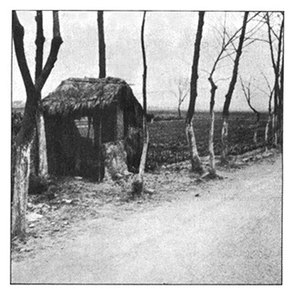
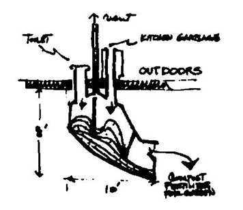
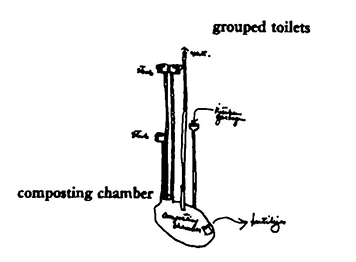

<section class="pattern-plate" aria-labelledby="t-compost">
<a href="/patterns">A Pattern Language</a> · <a href="/patterns#buildings">Buildings</a> · Pattern 178 · p. 822 · *
<h1 class="pattern-title" id="t-compost">Compost</h1><figure class="pattern-figure pl-figure"></figure><nav class="pattern-links" aria-label="Connections"><h2>Links to</h2><ul><li><a href="/patterns/house-cluster">37 House Cluster</a></li><li><a href="/patterns/animals">74 Animals</a></li><li><a href="/patterns/fruit-trees">170 Fruit Trees</a></li><li><a href="/patterns/vegetable-garden">177 Vegetable Garden</a></li><li><a href="/patterns/alcoves">179 Alcoves</a></li><li><a href="/patterns/window-place">180 Window Place</a></li><li><a href="/patterns/the-fire">181 The Fire</a></li><li><a href="/patterns/eating-atmosphere">182 Eating Atmosphere</a></li><li><a href="/patterns/workspace-enclosure">183 Workspace Enclosure</a></li><li><a href="/patterns/cooking-layout">184 Cooking Layout</a></li><li><a href="/patterns/sitting-circle">185 Sitting Circle</a></li><li><a href="/patterns/communal-sleeping">186 Communal Sleeping</a></li><li><a href="/patterns/marriage-bed">187 Marriage Bed</a></li><li><a href="/patterns/bed-alcove">188 Bed Alcove</a></li></ul><h2>Linked from</h2><ul><li><a href="/patterns/bathing-room">144 Bathing Room</a></li><li><a href="/patterns/north-face">162 North Face</a></li><li><a href="/patterns/connection-to-the-earth">168 Connection To The Earth</a></li><li><a href="/patterns/greenhouse">175 Greenhouse</a></li><li><a href="/patterns/vegetable-garden">177 Vegetable Garden</a></li><li><a href="/patterns/the-fire">181 The Fire</a></li></ul></nav></section><article class="pattern-text" aria-label="The text of Compost">
<em>In Chekiang Province, as in many other farts of China, roadside toilets abound. They are built by farmers to entice passersby into favoring them with a gift of valued fertilizer</em>.

823… the garden is a valuable part of the house, because it can help you grow fruit and vegetables—<a class="pl-ref" href="/patterns/fruit-trees">FRUIT TREES (170)</a>, <a class="pl-ref" href="/patterns/vegetable-garden">VEGETABLE GARDEN (177)</a>. But it can only flourish if it gets nourishment; and this nourishment, in the form of compost, can only be created when the garbage and the wastes from the individual houses and <a class="pl-ref" href="/patterns/house-cluster">HOUSE CLUSTERS (37)</a> and from the <a class="pl-ref" href="/patterns/animals">ANIMALS (74)</a> are properly organized.

◆ ◆ ◆

<strong>Our current ways of getting rid of sewage poison the great bodies of natural water, and rob the land around our buildings of the nutrients they need.</strong>

To the average individual in the city, it probably appears that the sewage system works beautifully—no muss, no fuss. Just pull the toilet chain, and everything is fine. In fact, city dwellers who have had the experience of using a smelly outhouse would probably argue that our modern system of sewage disposal is a tremendous advance over earlier practices. Unfortunately, this is simply not the case. Almost every step in modern sewage disposal is either wasteful, expensive, or dangerous.

We can start by remembering that every single time a toilet is flushed, seven gallons of drinking water go down the drain. In fact, around half of our domestic water consumption goes to flushing out the toilet.

Beyond the cost of the water, there is an enormous cost in the hardware of the sewer system. The average new homeowner today, living on a 50 x 150 foot lot in the city, has paid $1500 as his share of the collection system which takes sewage from his house to the sewage treatment plant. In lower density residential areas, this cost may be $2000 or even $6000. Each house pays an additional $500 toward the cost of the sewage treatment plant. We see then that the initial cost of today’s sewage system is at least $2000 per house, often more. And these prices do not include monthly service charges for water and sewer facilities: around $50 per year for a single family household.

824In addition we must add those costs which arc less easily measurable in dollars and cents, but which may, in the long run, prove even higher than those already discussed. These include: (i) the value of lost nutrients which are allowed to flow away into the rivers and oceans—nutrients which could have been used to build up the soil they came from; and (2) the cost of the pollution: effluents cause “eutrophication”—the sewage depletes the oxygen in water and causes it to become clogged with algae.

What can be done? Some of this effluent might be recycled back to the land in the form of sludge. But residential sewage is usually mixed with industrial waste which often contains extremely noxious elements. And even if industrial wastes were not allowed into the sewage system, an additional distribution system would be needed to get the sludge back to the land. We see, therefore, that additional costs required to make the existing system ecologically sound are prohibitive.

What is needed is not a larger, more centralized and complex system, but a smaller, more decentralized and simpler one. We need a system that is less expensive; and we need a system that is an ecological benefit rather than an ecological drain.

We propose that Individual small-scale composting plants begin to replace our present, disposal system. Small buildings would be equipped with their own miniature sewage plants, located directly under the toilets. All bulky garbage produced on-site would be added to the plants. The resultant humus would be used to replenish the soil surrounding the building and throughout the neighborhood, as would the waste water from bathing and washing.

Such miniature sewage plants are commercially available and are currently in use in Sweden, Norway, and Finland. They are sold under the trade names Multrum or Clivus, and they can even be imported to the United States for a total price of $1500: much lower than the lowest figure of $2000, currently being charged for the conventional system. For a worked example, see Van der Ryn, Anderson and Sawyer, “Composting Privy”, Technical Bulletin ^£1, Natural Energy Design Center, University of California, Berkeley, Dept, of Architecture, January 1974.

825

<figure class="pl-figure"><figcaption><em>Clivus compost chamber</em>.</figcaption></figure>

These composting plants are so simple that they can be built by amateurs for much less money. An extremely simple homemade composting system is described below:

The privy is built adjoining a larger outbuilding which is built over a root cellar. From overhead joists to floor, the cellar is about 7’ deep. And so it was simplest to make the composting chamber beneath the privy 7’ deep….

In the composting chamber underneath our privy, we have been using peat-moss—both because it is highly absorbent, and because it comes compactly baled and is convenient to store. We also use some garden dirt and a little lime.

We keep a garbage can full of peat moss in the privy, and dump in about a quart of the moss after each use. The privy is fairly odorless. Whenever there gets to be a smell I add lime, dirt and an extra layer of peat moss. That takes care of it. I figure that we will use three or four bales of peat moss a year—for a family of four plus a large number of guests.

My privy is of the kind familiarly known as a two-holer, which seems necessary for my composting system.

We use only one hole at a time. We use A until there is an accumulation 18 inches deep. We then shift to B and use it until the accumulation there is as great as that of A. Then the heap at A is shoveled to C, and so on. When all four positions are filled, C and D are shoveled into a heap on the ground outside, where I mean to let it stay for at least several weeks before use. (<em>Organic Gardening and Farming</em>, Emmaus, Pennsylvania: Rodale Press, February 1972.)

Therefore:

<strong>Arrange all toilets over a dry composting chamber. Lead 826organic garbage chutes to the same chamber, and use the combined products for fertilizer.</strong>

<figure class="pl-figure"></figure>
◆ ◆ ◆

Add to the effect of dry composting by re-using waste water; run all water drains into the garden to irrigate the soil; use organic soap—BATHING ROOM (144.)….

827<em>go back to the inside of the building and attach the necessary minor rooms and alcoves to complete the main rooms;</em>

<a class="pl-ref" href="/patterns/alcoves">179. ALCOVES</a>

<a class="pl-ref" href="/patterns/window-place">180. WINDOW PLACE</a>

<a class="pl-ref" href="/patterns/the-fire">181. THE FIRE</a>

<a class="pl-ref" href="/patterns/eating-atmosphere">182. EATING ATMOSPHERE</a>

<a class="pl-ref" href="/patterns/workspace-enclosure">183. WORKSPACE ENCLOSURE</a>

<a class="pl-ref" href="/patterns/cooking-layout">184. COOKING LAYOUT</a>

<a class="pl-ref" href="/patterns/sitting-circle">185. SITTING CIRCLE</a>

<a class="pl-ref" href="/patterns/communal-sleeping">186. COMMUNAL SLEEPING</a>

<a class="pl-ref" href="/patterns/marriage-bed">187. MARRIAGE BED</a>

<a class="pl-ref" href="/patterns/bed-alcove">188. BED ALCOVE</a>

189.    DRESSING ROOM
</article>

Christopher Alexander, Sara Ishikawa and Murray Silverstein, with Max Jacobson, Ingrid Fiksdahl-King and Shlomo Angel, <cite>A Pattern Language</cite> (Oxford University Press, 1977), pattern 178, pp. 822–827. Text and illustrations from the <a href="https://github.com/natureoforder/sources">Nature of Order sources</a> reading edition, transcribed from the 1977 printing; report errors on <a href="https://github.com/natureoforder/alexander-wiki/issues">GitHub</a>.

<a href="/patterns/vegetable-garden">← 177 Vegetable Garden</a> · <a href="/patterns">All 253 patterns</a> · <a href="/patterns/alcoves">179 Alcoves →</a>

