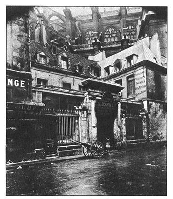
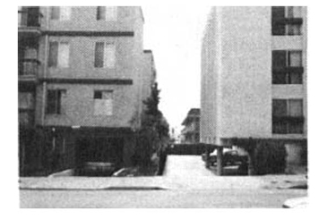
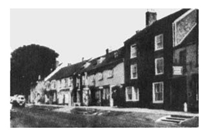
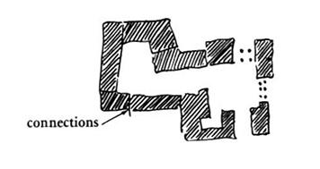

<section class="pattern-plate" aria-labelledby="t-connected-buildings">
<a href="/patterns">A Pattern Language</a> · <a href="/patterns#buildings">Buildings</a> · Pattern 108 · p. 531 · *
<h1 class="pattern-title" id="t-connected-buildings">Connected Buildings</h1><figure class="pattern-figure pl-figure"></figure><nav class="pattern-links" aria-label="Connections"><h2>Links to</h2><ul><li><a href="/patterns/building-complex">95 Building Complex</a></li><li><a href="/patterns/wings-of-light">107 Wings Of Light</a></li><li><a href="/patterns/courtyards-which-live">115 Courtyards Which Live</a></li><li><a href="/patterns/arcades">119 Arcades</a></li><li><a href="/patterns/outdoor-room">163 Outdoor Room</a></li></ul><h2>Linked from</h2><ul><li><a href="/patterns/small-parking-lots">103 Small Parking Lots</a></li><li><a href="/patterns/wings-of-light">107 Wings Of Light</a></li><li><a href="/patterns/arcades">119 Arcades</a></li></ul></nav></section><article class="pattern-text" aria-label="The text of Connected Buildings">
532… this pattern helps to complete <a class="pl-ref" href="/patterns/building-complex">BUILDING COMPLEX (95)</a>, <a class="pl-ref" href="/patterns/wings-of-light">WINGS OF LIGHT (107)</a>, and POSITIVE OUTDOOR SPACE (l06). It help to create positive outdoor space, especially, by eliminating all the wasted areas between buildings. As you connect each building to the next you will find that you make the outdoor space positive, almost instinctively.

◆ ◆ ◆

<strong>Isolated buildings are symptoms of a disconnected sick society.</strong>

Even in medium and high density areas where buildings are very close to each other and where there are strong reasons to connect them in a single fabric, people still insist on building isolated structures, with little bits of useless space around them.

<figure class="pl-figure"></figure>
<em>These buildings pretend to be independent of one another</em>—<em>and this pretense leads to useless space around them</em>.

Indeed, in our time, isolated, free-standing buildings are so common, that we have learned to take them for granted, without realizing that all the psycho-social disintegration of society is embodied in the fact of their existence.

It is easiest to understand this at the emotional level. The house, in dreams, most often means the self or person of the dreamer. A town of disconnected buildings, in a dream, would be a picture of society, made up of disconnected, isolated, selves. And the real towns which have this form, like dreams, embody just this meaning: they perpetuate the arrogant assumption that people stand alone and exist independently of one another.

533When buildings are isolated and free standing, it is of course not necessary for the people who own them, use them, and repair them to interact with one another at all. By contrast, in a town where buildings lean against each other physically, the sheer fact of their adjacency forces people to confront their neighbors, forces them to solve the myriad of little problems which occur between them, forces them to learn how to adapt to other people’s foibles, forces them to learn how to adapt to the realities outside them, which are greater, and more impenetrable than they are.

Not only is it true that connected buildings have these healthy consequences and that isolated buildings have unhealthy ones. It seems very likely—though we have no evidence to prove it—that, in fact, isolated buildings have become so popular, so automatic, so taken for granted in our time, because people seek refuge from the need to confront their neighbors, refuge from the need to work out common problems. In this sense, the isolated buildings are not only symptoms of withdrawal, but they also perpetuate and nurture the sickness.

If this is so, it is literally not too much to say that <em>in those farts of town where densities are relatively high</em>, isolated buildings, and the laws which create and enforce them, are undermining the fabric of society as forcibly and as persistently as any other social evil of our time.

By contrast, Sitte gives a beautiful discussion, with many examples, of the normal way that buildings were connected in ancient times:

The result is indeed astonishing, since from amongst 255 churches:

41 have one side attached to other buildings

96 have two sides attached to other buildings

110 have three sides attached to other buildings

2 have four sides obstructed by other buildings

6 are free standing

255 churches in all; only 6 free-standing.

Regarding Rome then, it can be taken as a rule that churches were never erected as free-standing structures. Almost the same is true, in fact, for the whole of Italy. As is becoming clear, our modern attitude runs precisely contrary to this well-integrated and obviously thought-out procedure. We do not seem to think it possible that a new church can be located anywhere except in the middle of its building lot, so that there is space all around it. But this placement offers only disadvantages and not a single advantage. It is the least favorable 534for building, since its effect is not concentrated anywhere but is scattered all about it. Such an exposed building will always appear like a cake on a serving-platter. To start with, any life-like organic integration with the site is ruled out….

It is really a foolish fad, this craze for isolating buildings…. (Camillo Sitte, <em>City Planning According to Artistic Principles,</em> New York: Random House, 1965, pp. 25–31.)

<figure class="pl-figure"><figcaption><em>A fabric of connected buildings</em>.</figcaption></figure>

Therefore:

<strong>Connect your building up, wherever possible, to the existing buildings round about Do not keep set backs between buildings; instead, try to form new buildings as continuations of the older buildings.</strong>

<figure class="pl-figure"></figure>
◆ ◆ ◆

Connect buildings with arcades, and outdoor rooms, and courtyards where they cannot be connected physically, wall to wall—<a class="pl-ref" href="/patterns/courtyards-which-live">COURTYARDS WHICH LIVE (115)</a>, <a class="pl-ref" href="/patterns/arcades">ARCADES (119)</a>, <a class="pl-ref" href="/patterns/outdoor-room">OUTDOOR ROOMS (163)</a>….
</article>

Christopher Alexander, Sara Ishikawa and Murray Silverstein, with Max Jacobson, Ingrid Fiksdahl-King and Shlomo Angel, <cite>A Pattern Language</cite> (Oxford University Press, 1977), pattern 108, pp. 531–534. Text and illustrations from the <a href="https://github.com/natureoforder/sources">Nature of Order sources</a> reading edition, transcribed from the 1977 printing; report errors on <a href="https://github.com/natureoforder/alexander-wiki/issues">GitHub</a>.

<a href="/patterns/wings-of-light">← 107 Wings Of Light</a> · <a href="/patterns">All 253 patterns</a> · <a href="/patterns/long-thin-house">109 Long Thin House →</a>

