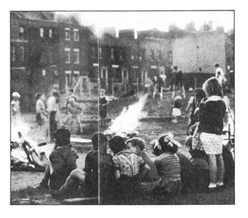
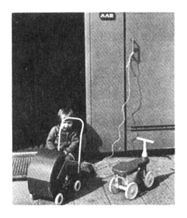
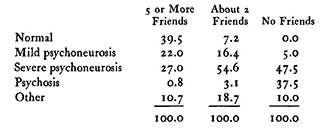
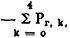
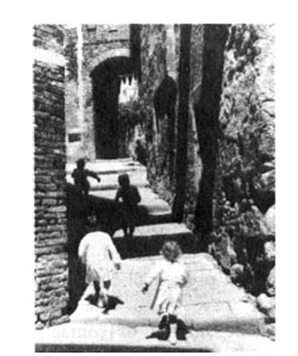
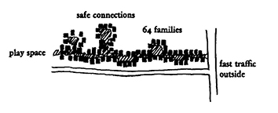

<section class="pattern-plate" aria-labelledby="t-connected-play">
<a href="/patterns">A Pattern Language</a> · <a href="/patterns#towns">Towns</a> · Pattern 68 · p. 341 · *
<h1 class="pattern-title" id="t-connected-play">Connected Play</h1><figure class="pattern-figure pl-figure"></figure><nav class="pattern-links" aria-label="Connections"><h2>Links to</h2><ul><li><a href="/patterns/green-streets">51 Green Streets</a></li><li><a href="/patterns/common-land">67 Common Land</a></li><li><a href="/patterns/animals">74 Animals</a></li><li><a href="/patterns/childrens-home">86 Children’s Home</a></li></ul><h2>Linked from</h2><ul><li><a href="/patterns/household-mix">35 Household Mix</a></li><li><a href="/patterns/housing-hill">39 Housing Hill</a></li><li><a href="/patterns/holy-ground">66 Holy Ground</a></li><li><a href="/patterns/adventure-playground">73 Adventure Playground</a></li><li><a href="/patterns/childrens-home">86 Children’s Home</a></li><li><a href="/patterns/childrens-realm">137 Children’s Realm</a></li></ul></nav></section><article class="pattern-text" aria-label="The text of Connected Play">
342… suppose the common land that connects clusters to one another is being provided—common land (67). Within this common land, it is necessary to identify play space for children and, above all, to make sure that the relationship between adjacent pieces of common land allows this play space to form.

◆ ◆ ◆

<strong>If children don’t play enough with other children during the first five years of life, there is a great chance that they will have some kind of mental illness later in their lives.</strong>

Children need other children. Some findings suggest that they need other children even more than they need their own mothers. And empirical evidence shows that if they are forced to spend their early years with too little contact with other children, they will be likely to suffer from psychosis and neurosis in their later

<figure class="pl-figure"></figure>
<em>Alone</em> …

Since the layout of the land between the houses in a neighborhood virtually controls the formation of play groups, it therefore has a critical effect on people’s mental health. A typical suburban subdivision with private lots opening off streets almost confines 343children to their houses. Parents, afraid of traffic or of their neighbors, keep their small children indoors or in their own gardens: so the children never have enough chance meetings with other children of their own age to form the groups which are essential to a healthy emotional development.

We shall show that children will only be able to have the access to other children which they need, if each household opens onto some kind of safe, connected common land, which touches at least 64 other households.

First, let us review the evidence for the problem. The most dramatic evidence comes from the Harlows’ work on monkeys. The Harlows have shown that monkeys isolated from other infant monkeys during the first six months of life are incapable of normal social, sexual, or play relations with other monkeys in their later lives:

They exhibit abnormalities of behavior rarely seen in animals born in the wild. They sit in their cages and stare fixedly into space, circle their cages in a repetitively stereotyped manner, and clasp their heads in their hands or arms and rock for long periods of time … the animal may chew and tear at its body until it bleeds … similar symptoms of emotional pathology are observed in deprived children in orphanages and in withdrawn adolescents and adults in mental hospitals. (Henry F. Harlow and Margaret K. Harlow, “The Effect of Rearing Conditions on Behavior,” <em>Bull, Menniger Clinic</em>, 26, 1962, pp. 213–14.)

It is well known that infant monkeys—like infant human beings—have these defects if brought up without a mother or a mother surrogate. It is not well known that the effects of separation from other infant monkeys are even stronger than the effects of maternal deprivation. Indeed, the Harlows showed that although monkeys can be raised successfully without a mother, provided that they have other infant monkeys to play with, they cannot be raised successfully by a mother alone, without other infant monkeys, even if the mother is entirely normal. They conclude: “It seems possible that the infant-mother affectional system is dispensable, whereas the infant-infant system is a sine-qua-non for later adjustment in all spheres of monkey life.” (Harry F. Harlow and Margaret K. Harlow, “Social Deprivation in Monkeys,” <em>Scientific American</em>, 207, No. 5, 1962, pp. 136–46.)

344The first six months of a rhesus monkey’s life correspond to the first three years of a child’s life. Although there is no formal evidence to show that lack of contact during these first three years damages human children—and as far as we know, it has never been studied—there is very strong evidence for the effect of isolation between the ages of four to ten.

Herman Lantz questioned a random sample of 1,000 men in the United States Army, who had been referred to a mental hygiene clinic because of emotional difficulties. (Herman K. Lantz, “Number of Childhood Friends as Reported in the Life Histories of a Psychiatrically Diagnosed Group of 1,000,” <em>Marriage and Family Life</em>, May 1956, pp. 107–108.) Army psychiatrists classified each of the men as normal, suffering from mild psychoneurosis, severe psychoneurosis, or psychosis. Lantz then put each man into one of three categories: those who reported having five friends or more at any typical moment when they were between four and ten years old, those who reported an average of about two friends, and those who reported having no friends at that time. The following table shows the relative percentages in each of the three friendship categories separately. The results are astounding:

<figure class="pl-figure"></figure>
Among people who have five friends or more as children, 61.5 per cent have mild cases, while 27.8 per cent have severe cases. Among people who had no friends, only 5 per cent have mild cases, and 85 per cent have severe cases.

On the positive side, an informal account by Anna Freud shows how powerful the effect of contact among tiny children can be on the emotional development of the children. She describes five young German children who lost their parents during infancy 345in a concentration camp, and then looked after one another inside the camp until the war ended, at which point they were brought to England. (Anna Freud and Sophie Dann, “An Experiment in Group Upbringing,” <em>Reading in Child Behavior and Development</em>, ed. Celia Stendler, New York, 1964, pp. 122-40.) She describes the beautiful social and emotional maturity of these tiny children. Reading the account, one feels that these children, at the age of three, were more aware of each other and more sensitive to each other’s needs than many people ever are.

It is almost certain, then, that contact is essential, and that lack of contact, when it is extreme, has extreme effects. A considerable body of literature beyond that which we have quoted, is given in Christopher Alexander, “The City as a Mechanism for Sustaining Human Contact,” <em>Environment for Man</em>, ed. W. R. Ewald, Indiana University Press, Bloomington, 1967, pp. 60–109.

If we assume that informal, neighborhood contact between children is a vital experience, we may then ask what kinds of neighborhoods support the formation of spontaneous play groups. The answer, we believe, is some form of safe common land, connected to a child’s home, and from which he can make contact with several other children. The critical question is: How many households need to share this connected play space?

The exact number of households that are required depends on the child population within the households. Let us assume that children represent about one-fourth of a given population (slightly less than the modal figure for suburban households), and that these children are evenly distributed in age from 0 to 18. Roughly speaking, a given pre-school child who is <em>x</em> years old will play with children who are <em>x</em>—1 or <em>x</em> + 1 years old. In order to have a reasonable amount of contact, and in order for playgroups to form, each child must be able to reach at least five children in his age range. Statistical analysis shows that for each child to have a 95 per cent chance of reaching five such potential playmates, each child must be in reach of 64 households.

The problem may be stated as follows: In an infinite population of children, one-sixth are the right age and five-sixths are the wrong age for any given child. A group of <em>r</em> children is 346chosen at random. The probability that this group of r children contains 5 or more right-age children in it is 1  where Pr, k is the hypergeometric distribution. If we now ask what is the least r which makes 1  &gt; 0.95, r turns out to be 54.

If we need 54 children, we need a total population of 4(54) = 216, which at 3.4 persons per household, needs 64 households.

Sixty-four is a rather large number of households to share connected common land. In fact, in the face of this requirement, there is a strong temptation to try to solve the problem by grouping to or 12 homes in a cluster. But this will not work: while it is a useful configuration for other reasons—house cluster (37) and <a class="pl-ref" href="/patterns/common-land">common land (67)</a>—by itself it will not solve the problem of connected play space for children. There must also be safe paths to connect the bits of common land.

<figure class="pl-figure"><figcaption><em>Connecting paths</em>.</figcaption></figure>

Therefore:

<strong>Lay out common land, paths, gardens, and bridges so that groups of at least 64 households are connected by a 347swath of land that does not cross traffic. Establish this land as the connected play space for the children in these households.</strong>

<figure class="pl-figure"></figure>
◆ ◆ ◆

<strong>Do this by connecting several house clusters (37) with <a class="pl-ref" href="/patterns/green-streets">green streets (51)</a> and safe paths. Place the local <a class="pl-ref" href="/patterns/childrens-home">children’s home (86)</a> in this play space. Within the play space, make sure the children have access to mud, and plants, and animals, and water—still water (71), <a class="pl-ref" href="/patterns/animals">animals (74)</a>; set aside one area where there is all kinds of junk that they can use to make things—adventure playground (73)….</strong>
</article>

Christopher Alexander, Sara Ishikawa and Murray Silverstein, with Max Jacobson, Ingrid Fiksdahl-King and Shlomo Angel, <cite>A Pattern Language</cite> (Oxford University Press, 1977), pattern 68, pp. 341–347. Text and illustrations from the <a href="https://github.com/natureoforder/sources">Nature of Order sources</a> reading edition, transcribed from the 1977 printing; report errors on <a href="https://github.com/natureoforder/alexander-wiki/issues">GitHub</a>.

<a href="/patterns/common-land">← 67 Common Land</a> · <a href="/patterns">All 253 patterns</a> · <a href="/patterns/public-outdoor-room">69 Public Outdoor Room →</a>

