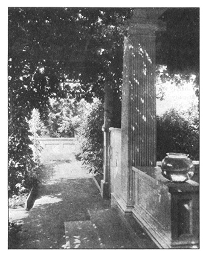
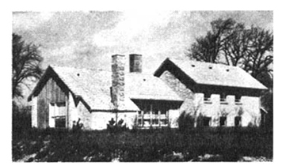
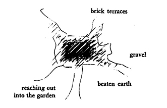

<section class="pattern-plate" aria-labelledby="t-connection-to-the-earth">
<a href="/patterns">A Pattern Language</a> · <a href="/patterns#buildings">Buildings</a> · Pattern 168 · p. 785 · **
<h1 class="pattern-title" id="t-connection-to-the-earth">Connection To The Earth</h1><figure class="pattern-figure pl-figure"></figure><nav class="pattern-links" aria-label="Connections"><h2>Links to</h2><ul><li><a href="/patterns/arcades">119 Arcades</a></li><li><a href="/patterns/entrance-room">130 Entrance Room</a></li><li><a href="/patterns/private-terrace-on-the-street">140 Private Terrace On The Street</a></li><li><a href="/patterns/building-edge">160 Building Edge</a></li><li><a href="/patterns/outdoor-room">163 Outdoor Room</a></li><li><a href="/patterns/six-foot-balcony">167 Six-Foot Balcony</a></li><li><a href="/patterns/terraced-slope">169 Terraced Slope</a></li><li><a href="/patterns/fruit-trees">170 Fruit Trees</a></li><li><a href="/patterns/tree-places">171 Tree Places</a></li><li><a href="/patterns/garden-growing-wild">172 Garden Growing Wild</a></li><li><a href="/patterns/garden-wall">173 Garden Wall</a></li><li><a href="/patterns/trellised-walk">174 Trellised Walk</a></li><li><a href="/patterns/greenhouse">175 Greenhouse</a></li><li><a href="/patterns/garden-seat">176 Garden Seat</a></li><li><a href="/patterns/vegetable-garden">177 Vegetable Garden</a></li><li><a href="/patterns/compost">178 Compost</a></li><li><a href="/patterns/ground-floor-slab">215 Ground Floor Slab</a></li><li><a href="/patterns/paving-with-cracks-between-the-stones">247 Paving With Cracks Between The Stones</a></li><li><a href="/patterns/soft-tile-and-brick">248 Soft Tile And Brick</a></li></ul><h2>Linked from</h2><ul><li><a href="/patterns/stair-seats">125 Stair Seats</a></li><li><a href="/patterns/open-stairs">158 Open Stairs</a></li><li><a href="/patterns/building-edge">160 Building Edge</a></li><li><a href="/patterns/outdoor-room">163 Outdoor Room</a></li><li><a href="/patterns/terraced-slope">169 Terraced Slope</a></li><li><a href="/patterns/root-foundations">214 Root Foundations</a></li><li><a href="/patterns/ground-floor-slab">215 Ground Floor Slab</a></li><li><a href="/patterns/roof-caps">232 Roof Caps</a></li><li><a href="/patterns/seat-spots">241 Seat Spots</a></li><li><a href="/patterns/front-door-bench">242 Front Door Bench</a></li><li><a href="/patterns/paving-with-cracks-between-the-stones">247 Paving With Cracks Between The Stones</a></li><li><a href="/patterns/soft-tile-and-brick">248 Soft Tile And Brick</a></li></ul></nav></section><article class="pattern-text" aria-label="The text of Connection To The Earth">
786… this pattern helps to create the <a class="pl-ref" href="/patterns/building-edge">BUILDING EDGE (160)</a> and its <a class="pl-ref" href="/patterns/arcades">ARCADES (119)</a>, <a class="pl-ref" href="/patterns/private-terrace-on-the-street">PRIVATE TERRACE ON THE STREET (140)</a>, the GALLERY SURROUND (l66)., and <a class="pl-ref" href="/patterns/six-foot-balcony">SIX-FOOT BALCONY (167)</a>, by specifying the way the floor of the building reaches out into the land and gardens round about it.

◆ ◆ ◆

<strong>A house feels isolated from the nature around it, unless its floors are interleaved directly with the earth that is around the house.</strong>

We shall understand this best by contrasting those houses which are sharply separated from the earth with those in which there is a continuity between the two.

Look first at this house where there is no continuity.

<figure class="pl-figure"><figcaption><em>An average house—but look at it closely. It lacks this fattem utterly</em>.</figcaption></figure>

The inside and the outside are abruptly separate. There is no way of being partly inside, yet still connected to the outside; there is no way in which the inside of the house allows you, in your bare feet, to step out and feel the dew collecting or pick blossoms off a climbing plant because there is no surface near the house on which you can go out and yet still be the person that you are inside.

Compare it with the house in our main picture, where there <em>is</em> 787continuity. Here, there is an intermediate area, whose surface is connected to the inside of the house—and yet it is in plain outdoors. This surface is part of the earth—and yet a little smoother, a little more beaten, more swept—stepping out on it is not like stepping out into a field in your bare feet—it is as if the earth itself becomes in that small area a part of your indoor terrain.

When we compare the examples, there seems little doubt that some deep feeling is involved, and we are confident in presenting this pattern as a fundamental one. But we can only speculate about its origins or why it is important.

Perhaps the likeliest of all the explanations we are able to imagine is one which connects the earth boundness and rootedness of a man or a woman to their physical connection to the earth. It is very plain, and we all discover for ourselves, that our lives become satisfactory to the extent that we are rooted, “down to earth,” in touch with common sense about everyday things—not flying high in the sky of concepts and fantasies. The path toward this rootedness is personal and slow—but it may just be true that it is helped or hindered by the extent to which our physical world is itself rooted and connected to the earth.

In physical terms, the rootedness occurs in buildings when the building is surrounded, along at least a part of its perimeter, by terraces, paths, steps, gravel, and earthen surfaces, which bring the floors outside, into the land. These surfaces are made of intermediate materials more natural than the floors inside the house—and more man-made than earth and clay and grass. Brick terraces, tiles, and beaten earth tied into the foundations of the house all help make this connection; and, if possible, each house should have a reasonable amount of them, pushing out into the land around the house and opening up the outdoors to the inside.

Therefore:

<strong>Connect the building to the earth around it by building a series of paths and terraces and steps around the edge. Place them deliberately to make the boundary ambiguous—so that it is impossible to say exactly where the building stops and earth begins.</strong>

788

<figure class="pl-figure"></figure>
◆ ◆ ◆

Use the connection to the earth to form the ground for outdoor rooms, and entrances, and terraces—<a class="pl-ref" href="/patterns/entrance-room">ENTRANCE ROOM (130)</a>, PRIVATE TERRACE ON THE STREET (14O), <a class="pl-ref" href="/patterns/outdoor-room">OUTDOOR ROOM (163)</a>, <a class="pl-ref" href="/patterns/terraced-slope">TERRACED SLOPE (169)</a>; prepare to tie the terraces continuously into the wall which forms the edge of the ground floor slab, to make the very structure of the building feel connected to the earth—<a class="pl-ref" href="/patterns/ground-floor-slab">GROUND FLOOR SLAB (215)</a>; and where you come to form the terrace surfaces, use things like hand-made bricks and soft-baked crumbling biscuit-fired tile—<a class="pl-ref" href="/patterns/soft-tile-and-brick">SOFT TILE AND BRICK (248)</a>; and further out, along the paths a little distance from the house, leave cracks between the tiles to let the grass and flowers grow between them—<a class="pl-ref" href="/patterns/paving-with-cracks-between-the-stones">PAVING WITH CRACKS BETWEEN THE STONES (247)</a>….

789<em>decide on the arrangement of the gardenst and the;places in the gardens;</em>

<a class="pl-ref" href="/patterns/terraced-slope">169. TERRACED SLOPE</a>

<a class="pl-ref" href="/patterns/fruit-trees">170. FRUIT TREES</a>

<a class="pl-ref" href="/patterns/tree-places">171. TREE PLACES</a>

<a class="pl-ref" href="/patterns/garden-growing-wild">172. GARDEN GROWING WILD</a>

<a class="pl-ref" href="/patterns/garden-wall">173. GARDEN WALL</a>

<a class="pl-ref" href="/patterns/trellised-walk">174. TRELLISED WALK</a>

<a class="pl-ref" href="/patterns/greenhouse">175. GREENHOUSE</a>

<a class="pl-ref" href="/patterns/garden-seat">176. GARDEN SEAT</a>

<a class="pl-ref" href="/patterns/vegetable-garden">177. VEGETABLE GARDEN</a>

<a class="pl-ref" href="/patterns/compost">178. COMPOST</a>
</article>

Christopher Alexander, Sara Ishikawa and Murray Silverstein, with Max Jacobson, Ingrid Fiksdahl-King and Shlomo Angel, <cite>A Pattern Language</cite> (Oxford University Press, 1977), pattern 168, pp. 785–789. Text and illustrations from the <a href="https://github.com/natureoforder/sources">Nature of Order sources</a> reading edition, transcribed from the 1977 printing; report errors on <a href="https://github.com/natureoforder/alexander-wiki/issues">GitHub</a>.

<a href="/patterns/six-foot-balcony">← 167 Six-Foot Balcony</a> · <a href="/patterns">All 253 patterns</a> · <a href="/patterns/terraced-slope">169 Terraced Slope →</a>

