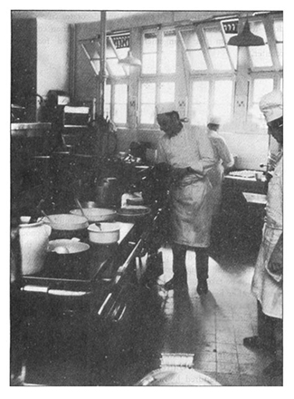
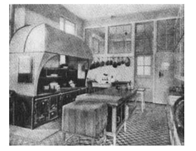
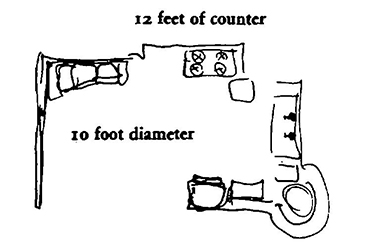

<section class="pattern-plate" aria-labelledby="t-cooking-layout">
<a href="/patterns">A Pattern Language</a> · <a href="/patterns#buildings">Buildings</a> · Pattern 184 · p. 853 · *
<h1 class="pattern-title" id="t-cooking-layout">Cooking Layout</h1><figure class="pattern-figure pl-figure"></figure><nav class="pattern-links" aria-label="Connections"><h2>Links to</h2><ul><li><a href="/patterns/farmhouse-kitchen">139 Farmhouse Kitchen</a></li><li><a href="/patterns/thick-walls">197 Thick Walls</a></li><li><a href="/patterns/sunny-counter">199 Sunny Counter</a></li><li><a href="/patterns/open-shelves">200 Open Shelves</a></li></ul><h2>Linked from</h2><ul><li><a href="/patterns/farmhouse-kitchen">139 Farmhouse Kitchen</a></li><li><a href="/patterns/compost">178 Compost</a></li><li><a href="/patterns/sunny-counter">199 Sunny Counter</a></li></ul></nav></section><article class="pattern-text" aria-label="The text of Cooking Layout">
854… within the <a class="pl-ref" href="/patterns/farmhouse-kitchen">FARMHOUSE KITCHEN (139)</a>, or any other kind of kitchen, it is essential that the cooking area be fashioned as a workshop for the preparation of food, and not as some kind of magazine kitchen with built-in counters and decorator colors. This down-to-earth and working character of a good kitchen comes in large part from the arrangement of the stove and food and counter.

◆ ◆ ◆

<strong>Cooking is uncomfortable if the kitchen counter is too short and also if it is too long.</strong>

Efficiency kitchens never live up to their name. They are based on the notion that the best arrangement is one that saves the most steps; and this has led to tiny, compact kitchens. These compact layouts do save steps, but they usually don’t have enough counter space. Preparing dinner for a family is a complex operation; several things must go on at once, and this calls for the simultaneous use of counter space for different projects. If there isn’t enough counter space, then the ingredients and utensils for one thing must be moved, washed, or put away before the next thing can be prepared; or else things become so jumbled that extra time and effort must be taken to find what’s needed at the proper moment. On the other hand, if the counter is too long or too spread out, the various points along its length are too far apart—and cooking is again uncomfortable, because your movements as you cook are so inefficient and slow.

Empirical support for the notion that there is insufficient counter space in many kitchens comes from a recent work by the Small Homes Council, University of Illinois. The Council found that in over a hundred housing developments, 67 per cent had too little counter space. No one complained that their kitchens were too large.

In <em>The Owner Built Home</em> (Yellow Springs, Ohio, 1961, Volume IV, p. 30), Ken Kern notes that a principal concept in cooking design is to provide for storage and workspace at each of 855the major cooking centers in the kitchen. Drawing on a Cornell University study he identifies the major cooking centers as the sink, the stove, the refrigerator, the mixing, and the serving areas. To provide storage for each center requires 12 to 15 feet of free counter space, excluding the sink, drainboards, and stove. (<em>The Cornell Kitchen</em>, Glenn Beyer, Cornell University, 1952.)

As far as the limits on the distance between these major cooking centers are concerned, there is less empirical evidence. Estimates vary. The rule of thumb we postulate is that no two of them should be more than three or four steps, or about 10 feet, apart.

<figure class="pl-figure"><figcaption><em>A kitchen that really works: huge, but great</em>.</figcaption></figure>

Therefore:

<strong>To strike the balance between the kitchen which is too small, and the kitchen which is too spread out, place the stove, sink, and food storage and counter in such a way that:</strong>

<strong>1. No two of the four are more than 10 feet apart.</strong>

<strong>2. The total length of counter—excluding sink, stove, and refrigerator—is at least 12 feet</strong>

<strong>3. No one section of the counter is less than 4 feet long.</strong>

<strong>There is no need for the counter to be continuous or entirely “built-in” as it is in many modem kitchens—it can even consist of free-standing tables or counter tops. Only the three functional relationships described above are critical.</strong>

856

<figure class="pl-figure"></figure>
◆ ◆ ◆

Place the most important part of the working surface in the sunlight—<a class="pl-ref" href="/patterns/sunny-counter">SUNNY COUNTER (199)</a>; put all the kitchen tools and plates and saucepans and nonperishable food around the walls, one deep, so all of it is visible, and all of it directly open to reach—<a class="pl-ref" href="/patterns/thick-walls">THICK WALLS (197)</a>, <a class="pl-ref" href="/patterns/open-shelves">OPEN SHELVES (200)</a>….
</article>

Christopher Alexander, Sara Ishikawa and Murray Silverstein, with Max Jacobson, Ingrid Fiksdahl-King and Shlomo Angel, <cite>A Pattern Language</cite> (Oxford University Press, 1977), pattern 184, pp. 853–856. Text and illustrations from the <a href="https://github.com/natureoforder/sources">Nature of Order sources</a> reading edition, transcribed from the 1977 printing; report errors on <a href="https://github.com/natureoforder/alexander-wiki/issues">GitHub</a>.

<a href="/patterns/workspace-enclosure">← 183 Workspace Enclosure</a> · <a href="/patterns">All 253 patterns</a> · <a href="/patterns/sitting-circle">185 Sitting Circle →</a>

