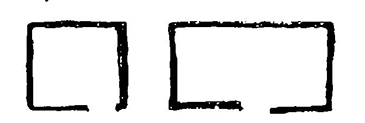
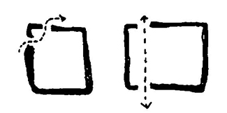
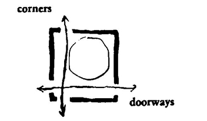

<section class="pattern-plate" aria-labelledby="t-corner-doors">
<a href="/patterns">A Pattern Language</a> · <a href="/patterns#buildings">Buildings</a> · Pattern 196 · p. 904 · *
<h1 class="pattern-title" id="t-corner-doors">Corner Doors</h1><nav class="pattern-links" aria-label="Connections"><h2>Links to</h2><ul><li><a href="/patterns/the-flow-through-rooms">131 The Flow Through Rooms</a></li><li><a href="/patterns/tapestry-of-light-and-dark">135 Tapestry Of Light And Dark</a></li><li><a href="/patterns/sequence-of-sitting-spaces">142 Sequence Of Sitting Spaces</a></li><li><a href="/patterns/thick-walls">197 Thick Walls</a></li><li><a href="/patterns/closets-between-rooms">198 Closets Between Rooms</a></li><li><a href="/patterns/sunny-counter">199 Sunny Counter</a></li><li><a href="/patterns/open-shelves">200 Open Shelves</a></li><li><a href="/patterns/waist-high-shelf">201 Waist-High Shelf</a></li><li><a href="/patterns/built-in-seats">202 Built-In Seats</a></li><li><a href="/patterns/child-caves">203 Child Caves</a></li><li><a href="/patterns/secret-place">204 Secret Place</a></li><li><a href="/patterns/low-doorway">224 Low Doorway</a></li><li><a href="/patterns/frames-as-thickened-edges">225 Frames As Thickened Edges</a></li><li><a href="/patterns/solid-doors-with-glass">237 Solid Doors With Glass</a></li><li><a href="/patterns/ornament">249 Ornament</a></li></ul><h2>Linked from</h2><ul><li><a href="/patterns/the-flow-through-rooms">131 The Flow Through Rooms</a></li><li><a href="/patterns/dressing-rooms">189 Dressing Rooms</a></li><li><a href="/patterns/closets-between-rooms">198 Closets Between Rooms</a></li><li><a href="/patterns/natural-doors-and-windows">221 Natural Doors And Windows</a></li><li><a href="/patterns/low-doorway">224 Low Doorway</a></li><li><a href="/patterns/solid-doors-with-glass">237 Solid Doors With Glass</a></li><li><a href="/patterns/ornament">249 Ornament</a></li></ul></nav></section><article class="pattern-text" aria-label="The text of Corner Doors">
… this pattern helps you place doors exactly. Use it to help create the larger <a class="pl-ref" href="/patterns/the-flow-through-rooms">FLOW THROUGH ROOMS (131)</a>. You can use it too, to generate a <a class="pl-ref" href="/patterns/sequence-of-sitting-spaces">SEQUENCE OF SITTING SPACES (142)</a>, by leaving small corners for sitting, uninterrupted by the doors; and you can use it to create <a class="pl-ref" href="/patterns/tapestry-of-light-and-dark">TAPESTRY OF LIGHT AND DARK (135)</a>, since every door, if glazed and near a window, will create a natural pool of light which people gravitate toward.

◆ ◆ ◆

<strong>The success of a room depends to a great extent on the position of the doors. If the doors create a pattern of movement which destroys the places in the room, the room will never allow people to be comfortable.</strong>

First there is the case of a room with a single door. In general, it is best if this door is in a corner. When it is in the middle of a wall, it almost always creates a pattern of movement which breaks the room in two, destroys the center, and leaves no single area which is large enough to use. The one common exception to this rule is the case of a room which is rather long and narrow. In this case it makes good sense to enter from the middle of one of the long sides, since this creates two areas, both roughly square, and therefore large enough to be useful. This kind of central door is especially useful when the room has two partly separate functions, which fall naturally into its two halves.

<figure class="pl-figure"><figcaption><em>Rooms with one door</em>.</figcaption></figure>

Now, the case of a room with two or more doors: the individual doors should still be in the corners for the reasons given above. But we must now consider not only the position of the 905individual doors, but the relation between the doors. If possible, they should be placed more or less along the same side, so as to leave the rest of the room untouched by movement.

More generally, if we draw lines which connect the doors, then the spaces which are left uncut by these lines, should be large enough to be useful, and should have a strong positive shape—a triangular space left between paths of circulation will hardly ever be used.

<figure class="pl-figure"><figcaption><em>Rooms with more than one door</em>.</figcaption></figure>

Finally, note that this pattern does not apply to very large rooms. In a very large room, or in a room with a big table in the middle, the doors can be in the middle, and still create a special formal, spacious feeling. In fact, in this case, it may even be better to put them in the middle, just to create this feeling. But this only works when the room is large enough to benefit from it.

Therefore:

<strong>Except in very large rooms, a door only rarely makes sense in the middle of a walk It does in an entrance room, for instance, because this room gets its character essentially from the door. But in most rooms, especially small ones, put the doors as near the corners of the room as possible. If the room has two doors, and people move through it, keep both doors at one end of the room.</strong>

<figure class="pl-figure"></figure>
906When a door marks a transition, as it does into a bedroom or a private place, for instance, make it as low as you dare—<a class="pl-ref" href="/patterns/low-doorway">LOW DOORWAY (224)</a>; and thicken the entry way with closet space where it needs to be especially private—<a class="pl-ref" href="/patterns/closets-between-rooms">CLOSETS BETWEEN ROOMS (198)</a>. Later, when you make the door frame, make it integral with the wall, and decorate it freely—<a class="pl-ref" href="/patterns/frames-as-thickened-edges">FRAMES AS THICKENED EDGES (225)</a>, <a class="pl-ref" href="/patterns/ornament">ORNAMENT (249)</a>; except when rooms arc very private, put windows in the door—<a class="pl-ref" href="/patterns/solid-doors-with-glass">SOLID DOORS WITH GLASS (237)</a>….

907<em>give all the walls some depth, wherever there are to be alcoves, windows, shelves, closets or seats</em>.

<a class="pl-ref" href="/patterns/thick-walls">197. THICK WALLS</a>

<a class="pl-ref" href="/patterns/closets-between-rooms">198. CLOSETS BETWEEN ROOMS</a>

<a class="pl-ref" href="/patterns/sunny-counter">199. SUNNY COUNTER</a>

<a class="pl-ref" href="/patterns/open-shelves">200. OPEN SHELVES</a>

<a class="pl-ref" href="/patterns/waist-high-shelf">201. WAIST-HIGH SHELF</a>

<a class="pl-ref" href="/patterns/built-in-seats">202. BUILT-IN SEATS</a>

<a class="pl-ref" href="/patterns/child-caves">203. CHILD CAVES</a>

<a class="pl-ref" href="/patterns/secret-place">204. SECRET PLACE</a>
</article>

Christopher Alexander, Sara Ishikawa and Murray Silverstein, with Max Jacobson, Ingrid Fiksdahl-King and Shlomo Angel, <cite>A Pattern Language</cite> (Oxford University Press, 1977), pattern 196, pp. 904–907. Text and illustrations from the <a href="https://github.com/natureoforder/sources">Nature of Order sources</a> reading edition, transcribed from the 1977 printing; report errors on <a href="https://github.com/natureoforder/alexander-wiki/issues">GitHub</a>.

<a href="/patterns/staircase-volume">← 195 Staircase Volume</a> · <a href="/patterns">All 253 patterns</a> · <a href="/patterns/thick-walls">197 Thick Walls →</a>

