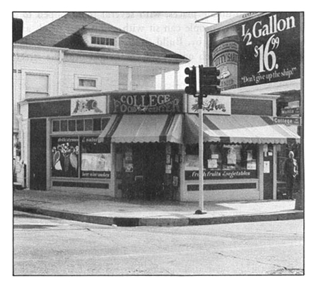
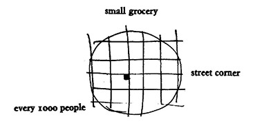

<section class="pattern-plate" aria-labelledby="t-corner-grocery">
<a href="/patterns">A Pattern Language</a> · <a href="/patterns#towns">Towns</a> · Pattern 89 · p. 440 · *
<h1 class="pattern-title" id="t-corner-grocery">Corner Grocery</h1><figure class="pattern-figure pl-figure"></figure><nav class="pattern-links" aria-label="Connections"><h2>Links to</h2><ul><li><a href="/patterns/identifiable-neighborhood">14 Identifiable Neighborhood</a></li><li><a href="/patterns/web-of-shopping">19 Web Of Shopping</a></li><li><a href="/patterns/market-of-many-shops">46 Market Of Many Shops</a></li><li><a href="/patterns/individually-owned-shops">87 Individually Owned Shops</a></li><li><a href="/patterns/building-complex">95 Building Complex</a></li><li><a href="/patterns/main-entrance">110 Main Entrance</a></li><li><a href="/patterns/opening-to-the-street">165 Opening To The Street</a></li><li><a href="/patterns/the-shape-of-indoor-space">191 The Shape Of Indoor Space</a></li><li><a href="/patterns/thick-walls">197 Thick Walls</a></li><li><a href="/patterns/open-shelves">200 Open Shelves</a></li></ul><h2>Linked from</h2><ul><li><a href="/patterns/neighborhood-boundary">15 Neighborhood Boundary</a></li><li><a href="/patterns/web-of-shopping">19 Web Of Shopping</a></li><li><a href="/patterns/childrens-home">86 Children’s Home</a></li><li><a href="/patterns/individually-owned-shops">87 Individually Owned Shops</a></li></ul></nav></section><article class="pattern-text" aria-label="The text of Corner Grocery">
441… the major shopping needs, in any community, are taken care of by the <a class="pl-ref" href="/patterns/market-of-many-shops">MARKET OK MANY SHOPS (46)</a>. However, the <a class="pl-ref" href="/patterns/web-of-shopping">WEB OF SHOPPING(19)</a> is not complete, unless there are also much smaller shops, more widely scattered, helping to supplement the markets, and helping to create the natural identity of <a class="pl-ref" href="/patterns/identifiable-neighborhood">IDENTIFIABLE NEIGHBORHOODS (14)</a>.

◆ ◆ ◆

<strong>It has lately been assumed that people no longer want to walk to local stores. This assumption is mistaken.</strong>

Indeed, we believe that people are not only <em>willing</em> to walk to their local corner groceries, but that the comer grocery plays an essential role in any healthy neighborhood: partly because it is just more convenient for individuals; partly because it helps to integrate the neighborhood as a whole.

Strong support for this notion comes from a study by Arthur D.’ Little, Inc., which found that neighborhood stores are one of the two most important elements in people’s perception of an area <em>as a neighborhood</em> (<em>Community Renewal Program</em>, New York: Praeger Press, 1966). Apparently this is because local stores are an important destination for neighborhood walks. People go to them when they feel like a walk as well as when they need a carton of milk. In this way, as a generator of walks, they draw a residential area together and help to give it the quality of a neighborhood. Similar evidence comes from a report by the management of one of San Francisco’s housing projects for the elderly. One of the main reasons why people resisted moving into some of the city’s new housing projects, according to the rental manager, was that the projects were not located in “downtown locations, where … there is a store on every street corner.” (<em>San Francisco Chronicle</em>, August 1971.)

To find out how far people will walk to a store we interviewed <em>20</em> people at a neighborhood store in Berkeley. We found that 80 per cent of the people interviewed walked, and that those who walked all came three blocks or less. Over half of 442them had been to the store previously within two days. On the other hand, those who came by car usually came from more than four blocks away. We found the pattern to be similar at other public facilities in the neighborhoods that we surveyed. At distances around four blocks, or greater, people who rode outnumbered those who walked. It seems then, that corner groceries need to be within walking distance, three to four blocks or 1200 feet, of every home.

But can they survive? Are these stores doomed by the economics of scale? How many people does it take to support one corner grocery? We may estimate the critical population for grocery stores by consulting the yellow pages. For example, San Francisco, a city of 750,000, has 638 neighborhood grocery stores. This means that there is one grocery for every 1160 people, which corresponds to Berry’s estimate—see <a class="pl-ref" href="/patterns/web-of-shopping">WEB OF SHOPPING (19)</a>—and corresponds also to the size of neighborhoods—See <a class="pl-ref" href="/patterns/identifiable-neighborhood">IDENTIFIABLE NEIGHBORHOOD (14)</a>.

It seems, then, that a corner grocery can survive under circumstances where there are 1000 people within three or four blocks—a net density of at least 20 persons per net acre, or six houses per net acre. Most neighborhoods do have this kind of density. One might even take this figure as a lower limit for a viable neighborhood, on the grounds that a neighborhood <em>ought</em> to be able to support a comer grocery, for the sake of its own social cohesion.

Finally, the success of a neighborhood store will depend on its location. It has been shown that the rents which owners of small retail businesses are willing to pay vary directly with the amount of pedestrian traffic passing by, and are therefore uniformly higher on street corners than in the middle of the block. (Brian J. L. Berry, <em>Geography of Market Centers and Retail Distribution</em>, Prentice Hall, 1967, p. 49.)

Therefore:

<strong>Give every neighborhood at least one comer grocery, somewhere near its heart Place these comer groceries every 200 to 800 yards, according to the density, so that each one serves about 1000 people. Place them on corners, where 443large numbers of people are going past. And combine them with houses, so that the people who run them can live over them or next to them.</strong>

<figure class="pl-figure"></figure>
◆ ◆ ◆

Prevent franchises and pass laws which prevent the emergence of those much larger groceries which swallow up the corner groceries—<a class="pl-ref" href="/patterns/individually-owned-shops">INDIVIDUALLY OWNED SHOPS (87)</a>. Treat the inside of the shop as a room, lined with goods—<a class="pl-ref" href="/patterns/the-shape-of-indoor-space">THE SHAPE OF INDOOR SPACE (191)</a>, <a class="pl-ref" href="/patterns/thick-walls">THICK WALLS (197)</a>, <a class="pl-ref" href="/patterns/open-shelves">OPEN SHELVES (200)</a>; give it a clear and wide entrance so that everyone can see it—<a class="pl-ref" href="/patterns/main-entrance">MAIN ENTRANCE (110)</a>, <a class="pl-ref" href="/patterns/opening-to-the-street">OPENING TO THE STREET (165)</a>. And for the shape of the grocery, as a small building or as part of a larger building, begin with <a class="pl-ref" href="/patterns/building-complex">BUILDING COMPLEX (95)</a>….
</article>

Christopher Alexander, Sara Ishikawa and Murray Silverstein, with Max Jacobson, Ingrid Fiksdahl-King and Shlomo Angel, <cite>A Pattern Language</cite> (Oxford University Press, 1977), pattern 89, pp. 440–443. Text and illustrations from the <a href="https://github.com/natureoforder/sources">Nature of Order sources</a> reading edition, transcribed from the 1977 printing; report errors on <a href="https://github.com/natureoforder/alexander-wiki/issues">GitHub</a>.

<a href="/patterns/street-cafe">← 88 Street Cafe</a> · <a href="/patterns">All 253 patterns</a> · <a href="/patterns/beer-hall">90 Beer Hall →</a>

