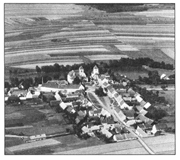
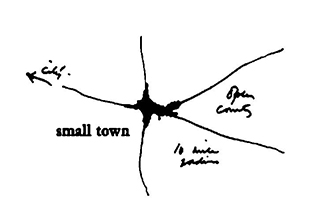

<section class="pattern-plate" aria-labelledby="t-country-towns">
<a href="/patterns">A Pattern Language</a> · <a href="/patterns#towns">Towns</a> · Pattern 6 · p. 33 · *
<h1 class="pattern-title" id="t-country-towns">Country Towns</h1><figure class="pattern-figure pl-figure"></figure><nav class="pattern-links" aria-label="Connections"><h2>Links to</h2><ul><li><a href="/patterns/the-distribution-of-towns">2 The Distribution Of Towns</a></li><li><a href="/patterns/the-countryside">7 The Countryside</a></li><li><a href="/patterns/community-of-7000">12 Community Of 7000</a></li><li><a href="/patterns/life-cycle">26 Life Cycle</a></li></ul><h2>Linked from</h2><ul><li><a href="/patterns/independent-regions">1 Independent Regions</a></li><li><a href="/patterns/the-distribution-of-towns">2 The Distribution Of Towns</a></li><li><a href="/patterns/the-countryside">7 The Countryside</a></li></ul></nav></section><article class="pattern-text" aria-label="The text of Country Towns">
34… this pattern forms the backbone of <a class="pl-ref" href="/patterns/the-distribution-of-towns">the DISTRIBUTION OF TOWNS (2)</a>, which requires that scores of smaller country towns support the larger towns and cities of the region.

◆ ◆ ◆

<strong>The big city is a magnet. It is terribly hard for small towns to stay alive and healthy in the face of central urban growth.</strong>

During the last 30 years, 30 million rural Americans have been forced to leave their farms and small towns and migrate to crowded cities. This forced migration continues at the rate of 800,000 people a year. The families that are left behind are not able to count on a future living in the country: about half of them live on less than $3000 a year.

And it is not purely the search for jobs that has led people away from small towns to the cities. It is also a search for information, for connection to the popular culture. In Ireland and India, for example, lively people leave the villages where there is some work, and some little food, and they go to the city, looking for action, for better work, for a better life.

Unless steps are taken to recharge the life of country towns, the cities will swamp those towns which lie the nearest to them; and will rob those which lie furthest out of their most vigorous inhabitants. What are the possibilities?

1. Economic reconstruction.. Incentives to business and industry to decentralize and locate in small towns. Incentives to the inhabitants of small towns to begin grassroots business and production ventures. (See, for example, the bill introduced by Joe Evins in the House of Representatives, <em>Congressional Record</em>—House, October 3, 1967, 27687.)

2. Zoning. Zoning policy to protect small towns and the countryside around them. Greenbelt zoning was defined by Ebenezer Howard at the turn of the century and has yet to be taken seriously by American governments.

3. Social services. There are connections between small towns 35and cities that take the form of social services, that are irreplaceable: small town visits, farm weekends and vacations for city dwellers, schools and camps in the countryside for city children, small town retirement for old people who do not like the pace of city life. Let the city invite small towns to provide these services, as grassroots ventures, and the city, or private groups, will pay for the cost of the service.

Therefore:

<strong>Preserve country towns where they exist; and encourage the growth of new self-containcd towns, with populations between 500 and 10,000, entirely surrounded by open countryside and at least 10 miles from neighboring towns. Make it the region’s collective concern to give each town the wherewithal it needs to build a base of local industry, so that these towns are not dormitories for people who work in other places, but real towns-able to sustain the whole of life.</strong>

<figure class="pl-figure"></figure>
◆ ◆ ◆

Treat each of these small towns as a political community, with full provision for all the stages of human life—<a class="pl-ref" href="/patterns/community-of-7000">COMMUNITY OF 7000 (12)</a>, <a class="pl-ref" href="/patterns/life-cycle">LIFE CYCLE (26)</a>. Treat the belt of open country which surrounds the town as farm land which belongs to the people and can be freely used by them—<a class="pl-ref" href="/patterns/the-countryside">THE COUNTRYSIDE (7)</a> ….
</article>

Christopher Alexander, Sara Ishikawa and Murray Silverstein, with Max Jacobson, Ingrid Fiksdahl-King and Shlomo Angel, <cite>A Pattern Language</cite> (Oxford University Press, 1977), pattern 6, pp. 33–35. Text and illustrations from the <a href="https://github.com/natureoforder/sources">Nature of Order sources</a> reading edition, transcribed from the 1977 printing; report errors on <a href="https://github.com/natureoforder/alexander-wiki/issues">GitHub</a>.

<a href="/patterns/lace-of-country-streets">← 5 Lace Of Country Streets</a> · <a href="/patterns">All 253 patterns</a> · <a href="/patterns/the-countryside">7 The Countryside →</a>

