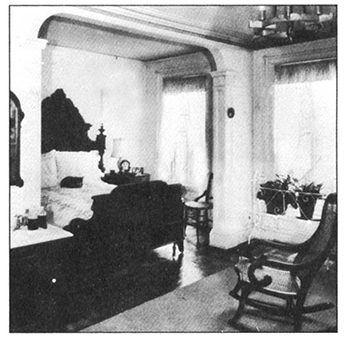
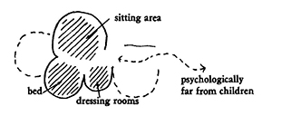

<section class="pattern-plate" aria-labelledby="t-couples-realm">
<a href="/patterns">A Pattern Language</a> · <a href="/patterns#buildings">Buildings</a> · Pattern 136 · p. 648 · *
<h1 class="pattern-title" id="t-couples-realm">Couple’s Realm</h1><figure class="pattern-figure pl-figure"></figure><nav class="pattern-links" aria-label="Connections"><h2>Links to</h2><ul><li><a href="/patterns/the-family">75 The Family</a></li><li><a href="/patterns/house-for-a-small-family">76 House For A Small Family</a></li><li><a href="/patterns/house-for-a-couple">77 House For A Couple</a></li><li><a href="/patterns/intimacy-gradient">127 Intimacy Gradient</a></li><li><a href="/patterns/sleeping-to-the-east">138 Sleeping To The East</a></li><li><a href="/patterns/bathing-room">144 Bathing Room</a></li><li><a href="/patterns/light-on-two-sides-of-every-room">159 Light On Two Sides Of Every Room</a></li><li><a href="/patterns/sitting-circle">185 Sitting Circle</a></li><li><a href="/patterns/marriage-bed">187 Marriage Bed</a></li><li><a href="/patterns/dressing-rooms">189 Dressing Rooms</a></li><li><a href="/patterns/the-shape-of-indoor-space">191 The Shape Of Indoor Space</a></li><li><a href="/patterns/closets-between-rooms">198 Closets Between Rooms</a></li><li><a href="/patterns/low-doorway">224 Low Doorway</a></li></ul><h2>Linked from</h2><ul><li><a href="/patterns/birth-places">65 Birth Places</a></li><li><a href="/patterns/house-for-a-small-family">76 House For A Small Family</a></li><li><a href="/patterns/house-for-a-couple">77 House For A Couple</a></li><li><a href="/patterns/tapestry-of-light-and-dark">135 Tapestry Of Light And Dark</a></li><li><a href="/patterns/childrens-realm">137 Children’s Realm</a></li><li><a href="/patterns/sleeping-to-the-east">138 Sleeping To The East</a></li><li><a href="/patterns/sequence-of-sitting-spaces">142 Sequence Of Sitting Spaces</a></li><li><a href="/patterns/bed-cluster">143 Bed Cluster</a></li><li><a href="/patterns/bathing-room">144 Bathing Room</a></li><li><a href="/patterns/communal-sleeping">186 Communal Sleeping</a></li><li><a href="/patterns/marriage-bed">187 Marriage Bed</a></li><li><a href="/patterns/closets-between-rooms">198 Closets Between Rooms</a></li></ul></nav></section><article class="pattern-text" aria-label="The text of Couple’s Realm">
649… this pattern helps to complete <a class="pl-ref" href="/patterns/the-family">THE FAMILY (75)</a>, <a class="pl-ref" href="/patterns/house-for-a-small-family">HOUSE FOR A SMALL FAMILY (76)</a> and <a class="pl-ref" href="/patterns/house-for-a-couple">HOUSE FOR A COUPLE (77)</a>. It also ties in to a particular position on the <a class="pl-ref" href="/patterns/intimacy-gradient">INTIMACY GRADIENTE (127)</a>, and can be used to help generate that gradient, if it doesn’t exist already.

◆ ◆ ◆

<strong>The presence of children in a family often destroys the closeness and the special privacy which a man and wife need together.</strong>

Every couple start out sharing each other’s adult lives. When children come, concern for parenthood often overwhelms the private sharing, and everything becomes exclusively oriented toward the children.

In most houses this is aggravated by the physical design of the environment. Specifically:

1. Children are able to run everywhere in the house, and therefore tend to dominate all of it. No rooms are private.

2. The bathroom is often placed so that adults must walk past children’s bedrooms to reach it.

3. The walls of the master bedroom are usually too thin to afford much acoustical privacy.

The result is that the private life of the couple is continually interrupted by the awareness that the children are nearby. Their role as parents rather than as a couple permeates all aspects of their private relations.

On the other hand, of course, they do not want to be completely separated from the children’s rooms. They also want to be close to them, especially while the children are young. A mother wants to run quickly to the bed of an infant in an emergency.

These problems can only be solved if there is a part of the house, which we call the couple’s realm; that is, a world in which the intimacy of the man and woman, their joys and sorrows, can be shared and lived through. It is a place not only insulated from the children’s world, but also complete in itself, a 650world, a domain. In many respects it is a version of the pattern <a class="pl-ref" href="/patterns/house-for-a-couple">HOUSE FOR A COUPLE (77)</a>, embedded in the larger house with children.

The couple’s realm needs to be the kind of place that one might sit in and talk privately, perhaps with its own entrance to the outdoors, to a balcony. It is a sitting room, a place for privacy, a place for projects; the bed is part of it, but tucked away into an alcove with its own window; a fireplace is wonderful; and it needs some kind of a double door, an ante-room, to protect its privacy.

Therefore:

<strong>Make a special part of the house distinct from the common areas and all the children’s rooms, where the man and woman of the house can be together in private. Give this place a quick path to the children’s rooms, but, at all costs, make it a distinctly separate realm.</strong>

<figure class="pl-figure"></figure>
Even if it’s very tiny, give it a sitting area, a place to relax, read, make love, play music—<a class="pl-ref" href="/patterns/sitting-circle">SITTING CIRCLE (185)</a>. Give it <a class="pl-ref" href="/patterns/light-on-two-sides-of-every-room">LIGHT ON TWO SIDES (159)</a>. At the heart of the couple’s realm, place the bed—<a class="pl-ref" href="/patterns/marriage-bed">MARRIAGE BED (187)</a> so it has morning light—<a class="pl-ref" href="/patterns/sleeping-to-the-east">SLEEPING TO THE EAST (138)</a>, and, beside it, the <a class="pl-ref" href="/patterns/dressing-rooms">DRESSING ROOM (189)</a>; if possible, try to place the bathing room to open off the couple’s realm—<a class="pl-ref" href="/patterns/bathing-room">BATHING ROOM (144)</a>. For the shape of this room in fine detail and its construction, see <a class="pl-ref" href="/patterns/the-shape-of-indoor-space">THE SHAPE OF INDOOR SPACE (191)</a>. And keep the area private with a <a class="pl-ref" href="/patterns/low-doorway">LOW DOORWAY (224)</a> or two doors—<a class="pl-ref" href="/patterns/closets-between-rooms">CLOSETS BETWEEN ROOMS (198)</a>….
</article>

Christopher Alexander, Sara Ishikawa and Murray Silverstein, with Max Jacobson, Ingrid Fiksdahl-King and Shlomo Angel, <cite>A Pattern Language</cite> (Oxford University Press, 1977), pattern 136, pp. 648–650. Text and illustrations from the <a href="https://github.com/natureoforder/sources">Nature of Order sources</a> reading edition, transcribed from the 1977 printing; report errors on <a href="https://github.com/natureoforder/alexander-wiki/issues">GitHub</a>.

<a href="/patterns/tapestry-of-light-and-dark">← 135 Tapestry Of Light And Dark</a> · <a href="/patterns">All 253 patterns</a> · <a href="/patterns/childrens-realm">137 Children’s Realm →</a>

