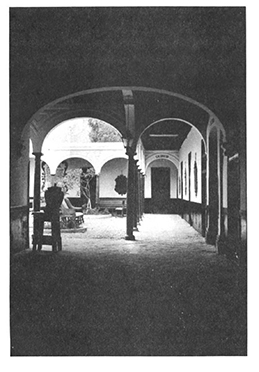
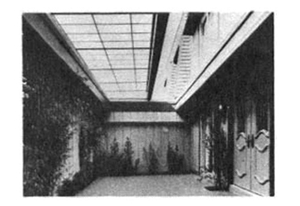
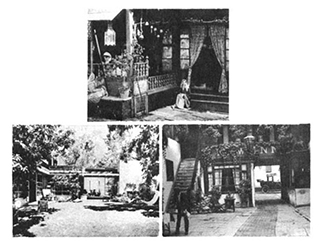
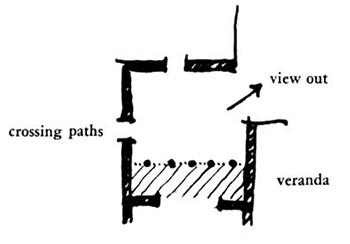

<section class="pattern-plate" aria-labelledby="t-courtyards-which-live">
<a href="/patterns">A Pattern Language</a> · <a href="/patterns#buildings">Buildings</a> · Pattern 115 · p. 561 · **
<h1 class="pattern-title" id="t-courtyards-which-live">Courtyards Which Live</h1><figure class="pattern-figure pl-figure"></figure><nav class="pattern-links" aria-label="Connections"><h2>Links to</h2><ul><li><a href="/patterns/positive-outdoor-space">106 Positive Outdoor Space</a></li><li><a href="/patterns/hierarchy-of-open-space">114 Hierarchy Of Open Space</a></li><li><a href="/patterns/arcades">119 Arcades</a></li><li><a href="/patterns/something-roughly-in-the-middle">126 Something Roughly In The Middle</a></li><li><a href="/patterns/zen-view">134 Zen View</a></li><li><a href="/patterns/sunny-place">161 Sunny Place</a></li><li><a href="/patterns/outdoor-room">163 Outdoor Room</a></li><li><a href="/patterns/gallery-surround">166 Gallery Surround</a></li><li><a href="/patterns/six-foot-balcony">167 Six-Foot Balcony</a></li><li><a href="/patterns/garden-wall">173 Garden Wall</a></li><li><a href="/patterns/roof-layout">209 Roof Layout</a></li></ul><h2>Linked from</h2><ul><li><a href="/patterns/circulation-realms">98 Circulation Realms</a></li><li><a href="/patterns/positive-outdoor-space">106 Positive Outdoor Space</a></li><li><a href="/patterns/connected-buildings">108 Connected Buildings</a></li><li><a href="/patterns/long-thin-house">109 Long Thin House</a></li><li><a href="/patterns/half-hidden-garden">111 Half-Hidden Garden</a></li><li><a href="/patterns/something-roughly-in-the-middle">126 Something Roughly In The Middle</a></li><li><a href="/patterns/roof-layout">209 Roof Layout</a></li></ul></nav></section><article class="pattern-text" aria-label="The text of Courtyards Which Live">
562… within the general scheme of outdoor spaces, made positive according to the patterns <a class="pl-ref" href="/patterns/positive-outdoor-space">POSITIVE OUTDOOR SPACE (106)</a> and <a class="pl-ref" href="/patterns/hierarchy-of-open-space">HIERARCHY OF OPEN SPACE (114)</a>, it is necessary to pay special attention to those smallest ones, less than 30 or 40 feet across—the courtyards—because it is especially easy to make them in such a way that they do not live.

◆ ◆ ◆

<strong>The courtyards built in modem buildings are very often dead. They are intended to be private open spaces for people to use—but they end up unused, full of gravel and abstract sculptures.</strong>

<figure class="pl-figure"><figcaption><em>Dead courtyard</em>.</figcaption></figure>

There seem to be three distinct ways in which these courtyards fail.

<em>1. There is too little ambiguity between indoors and outdoors.</em> If the walls, sliding doors, doors which lead from the indoors to the outdoors, are too abrupt, then there is no opportunity for a person to find himself half way between the two—and then, on the impulse of a second, to drift toward the outside. People need an ambiguous in-between realm—a porch, or a veranda, which they naturally pass onto often, as part of their ordinary life within the house, so that they can drift naturally to the outside.

<em>2. There are not enough doors into the courtyard</em>. If there is just one door, then the courtyard never lies between two activities inside the house; and so people are never passing through it, and enlivening it, while they go about their daily business. To overcome this, the courtyard should have doors on at least two opposite 563sides, so that it becomes a meeting point for different activities, provides access to them, provides overflow from them, and provides the cross-circulation between them.

<em>3. They are too enclosed</em>. Courtyards which are pleasant to be in always seem to have “loopholes” which allow you to see beyond them into some larger, further space. The courtyard should never be perfectly enclosed by the rooms which surround it, but should give at least a glimpse of some other space beyond.

Here are several examples of courtyards, large and small, from various parts of the world, which are alive.

<figure class="pl-figure"><figcaption><em>Courtyards which live</em>.</figcaption></figure>

Each one is partly open to the activity of the building that surrounds it and yet still private. A person passing through the courtyard and children running by can all be glimpsed and felt, but they are not disruptive. Again, notice that all these courtyards have strong Connections to other spaces. The photographs do not tell the whole story; but still, you can see that the courtyards look out, along paths, through the buildings, to larger spaces. And most spectacular, notice the many different positions that one can take up in each courtyard, depending on mood and climate. There are covered places, places in the sun, places 564spotted with filtered light, places to lie on the ground, places where a person can sleep. The edge and the corners of the courtyards are ambiguous and richly textured; in some places the walls of the buildings open, and connect the courtyard with the inside of the building, directly.

Therefore:

<strong>Place every courtyard in such a way that there is a view out of it to some larger open space; place it so that at least two or three doors open from the building into it and so that the natural paths which connect these doors pass across the courtyard. And, at one edge, beside a door, make a roofed veranda or a porch, which is continuous with both the inside and the courtyard.</strong>

<figure class="pl-figure"></figure>
◆ ◆ ◆

Build the porch according to the patterns for <a class="pl-ref" href="/patterns/arcades">ARCADE (119)</a>, <a class="pl-ref" href="/patterns/gallery-surround">GALLERY SURROUND (166)</a>, and <a class="pl-ref" href="/patterns/six-foot-balcony">SIX-FOOT BALCONY (167)</a>; make sure that it is in the sun—<a class="pl-ref" href="/patterns/sunny-place">SUNNY PLACE (161)</a>; build the view out according to the <a class="pl-ref" href="/patterns/hierarchy-of-open-space">HIERARCHY OF OPEN SPACE (114)</a> and <a class="pl-ref" href="/patterns/zen-view">ZEN VIEW (134)</a>; make the courtyard like an <a class="pl-ref" href="/patterns/outdoor-room">OUTDOOR ROOM (163)</a> and a <a class="pl-ref" href="/patterns/garden-wall">GARDEN WALL (173)</a> for more enclosure; make the height of the eaves around any courtyard of even height; if there arc gable ends, hip them to make the roof edge level—<a class="pl-ref" href="/patterns/roof-layout">ROOF LAYOUT (209)</a>; put <a class="pl-ref" href="/patterns/something-roughly-in-the-middle">SOMETHING ROUGHLY IN THE MIDDLE (126)</a>….
</article>

Christopher Alexander, Sara Ishikawa and Murray Silverstein, with Max Jacobson, Ingrid Fiksdahl-King and Shlomo Angel, <cite>A Pattern Language</cite> (Oxford University Press, 1977), pattern 115, pp. 561–564. Text and illustrations from the <a href="https://github.com/natureoforder/sources">Nature of Order sources</a> reading edition, transcribed from the 1977 printing; report errors on <a href="https://github.com/natureoforder/alexander-wiki/issues">GitHub</a>.

<a href="/patterns/hierarchy-of-open-space">← 114 Hierarchy Of Open Space</a> · <a href="/patterns">All 253 patterns</a> · <a href="/patterns/cascade-of-roofs">116 Cascade Of Roofs →</a>

