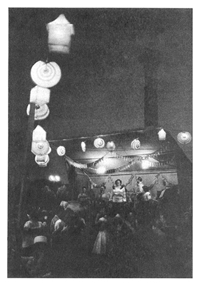
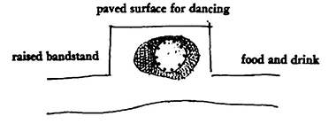

<section class="pattern-plate" aria-labelledby="t-dancing-in-the-street">
<a href="/patterns">A Pattern Language</a> · <a href="/patterns#towns">Towns</a> · Pattern 63 · p. 319 · *
<h1 class="pattern-title" id="t-dancing-in-the-street">Dancing In The Street</h1><figure class="pattern-figure pl-figure"></figure><nav class="pattern-links" aria-label="Connections"><h2>Links to</h2><ul><li><a href="/patterns/promenade">31 Promenade</a></li><li><a href="/patterns/night-life">33 Night Life</a></li><li><a href="/patterns/carnival">58 Carnival</a></li><li><a href="/patterns/small-public-squares">61 Small Public Squares</a></li><li><a href="/patterns/food-stands">93 Food Stands</a></li></ul><h2>Linked from</h2><ul><li><a href="/patterns/magic-of-the-city">10 Magic Of The City</a></li><li><a href="/patterns/promenade">31 Promenade</a></li><li><a href="/patterns/night-life">33 Night Life</a></li><li><a href="/patterns/children-in-the-city">57 Children In The City</a></li><li><a href="/patterns/carnival">58 Carnival</a></li><li><a href="/patterns/travelers-inn">91 Traveler’s Inn</a></li><li><a href="/patterns/something-roughly-in-the-middle">126 Something Roughly In The Middle</a></li></ul></nav></section><article class="pattern-text" aria-label="The text of Dancing In The Street">
320… several patterns have laid the groundwork for evening activity in public—macic of the city (10), <a class="pl-ref" href="/patterns/promenade">promenade (31)</a>, <a class="pl-ref" href="/patterns/night-life">night life (33)</a>, <a class="pl-ref" href="/patterns/carnival">carnival (58)</a>, <a class="pl-ref" href="/patterns/small-public-squares">small public squares (61)</a>. To make these places alive at night, there is nothing like music and dancing; this pattern simply states the physical conditions which will encourage dancing and music to fill the streets.

◆ ◆ ◆

<strong>Why is it that people don’t dance in the streets today?</strong>

All over the earth, people once danced in the streets; in theater, song, and natural speech, “dancing in the street” is an image of supreme joy. Many cultures still have some version of this activity. There are the Balinese dancers who fall into a trance whirling around in the street; the mariachi bands in Mexico—every town has several squares where the bands play and the neighborhood comes out to dance; there is the European and American tradition of bandstands and jubilees in the park; there is the <em>bon odori</em> festival in Japan, when everybody claps and dances in the streets.

But in those parts of the world that have become “modern” and technically sophisticated, this experience has died. Communities are fragmented; people are uncomfortable in the streets, afraid with one another; not many people play the right kind of music; people are embarrassed.

Certainly there is no way in which a change in the environment, as simple as the one which we propose, can remedy these circumstances. But we detect a change in mood. The embarrassment and the alienation are recent developments, blocking a more basic need. And as we get in touch with these needs, things start to happen. People remember how to dance; everyone takes up an instrument; many hundreds form little bands. At this writing, in San Francisco, Berkeley, and Oakland there is a controversy over “street musicians”—bands that have spontaneously begun playing in streets and plazas whenever the weather is good—where should they be allowed to play, do they obstruct traffic, shall people dance?

321It is in this atmosphere that we propose the pattern. Where there is feeling for the importance of the activity re-emerging, then the right setting can actualize it and give it roots. The essentials are straightforward: a platform for the musicians, perhaps with a cover; hard surface for dancing, all around the bandstand; places to sit and lean for people who want to watch and rest; provision for some drink and refreshment (some Mexican bandstands have a beautiful way of building tiny stalls into the base of the bandstand, so that people are drawn though the dancers and up to the music, for a fruit drink or a beer); the whole thing set somewhere where people congregate.

Therefore:

<strong>Along promenades, in squares and evening centers, make a slightly raised platform to form a bandstand, where street musicians and local bands can play. Cover it, and perhaps build in at ground level tiny stalls for refreshment. Surround the bandstand with paved surface for dancing—no admission charge.</strong>

<figure class="pl-figure"></figure>
◆ ◆ ◆

Place the bandstand in a pocket of activity, toward the edge of a square or a promenade—activity pockets (124); make it a room, defined by trellises and columns—public outdoor room (69); build <a class="pl-ref" href="/patterns/food-stands">food stands (93)</a> around the bandstand; and for dancing, maybe colored canvas canopies, which reach out over portions of the street, and make the street, or parts of it, into a great, half-open tent—canvas roofs (244)….
</article>

Christopher Alexander, Sara Ishikawa and Murray Silverstein, with Max Jacobson, Ingrid Fiksdahl-King and Shlomo Angel, <cite>A Pattern Language</cite> (Oxford University Press, 1977), pattern 63, pp. 319–321. Text and illustrations from the <a href="https://github.com/natureoforder/sources">Nature of Order sources</a> reading edition, transcribed from the 1977 printing; report errors on <a href="https://github.com/natureoforder/alexander-wiki/issues">GitHub</a>.

<a href="/patterns/high-places">← 62 High Places</a> · <a href="/patterns">All 253 patterns</a> · <a href="/patterns/pools-and-streams">64 Pools And Streams →</a>

