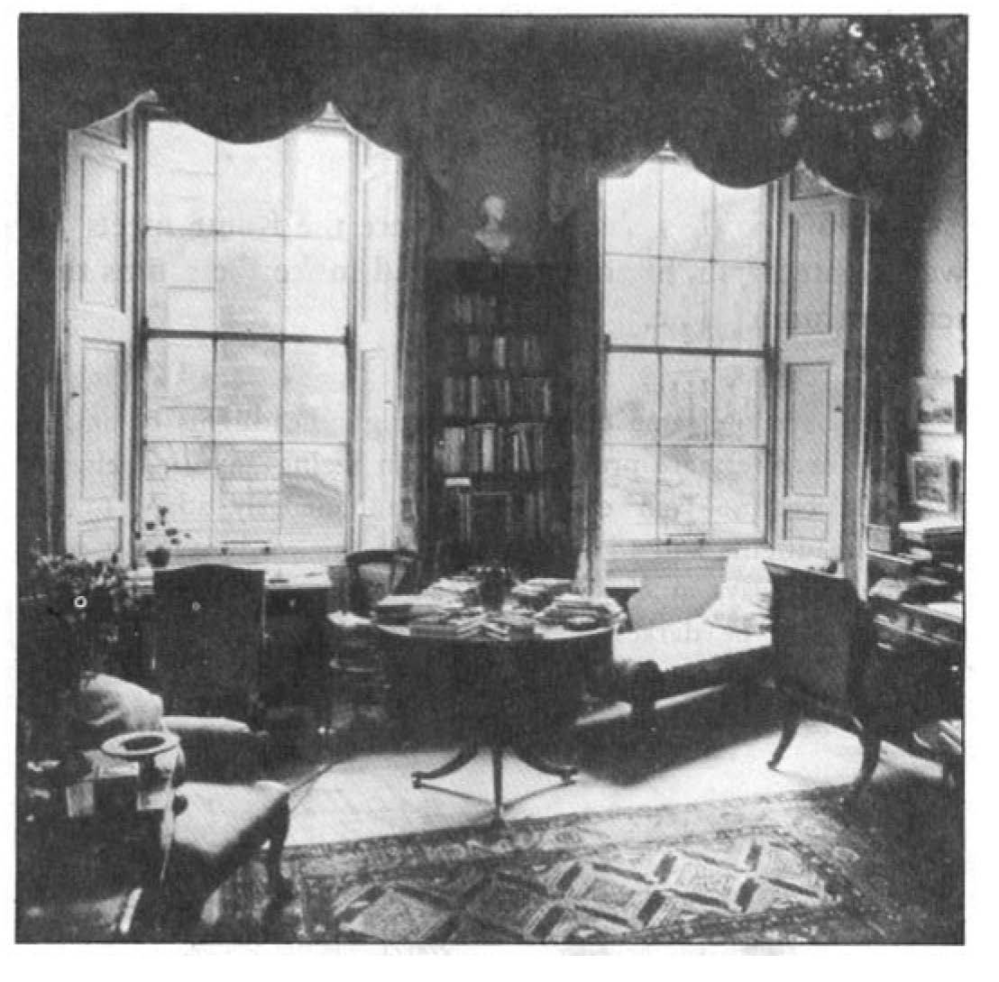
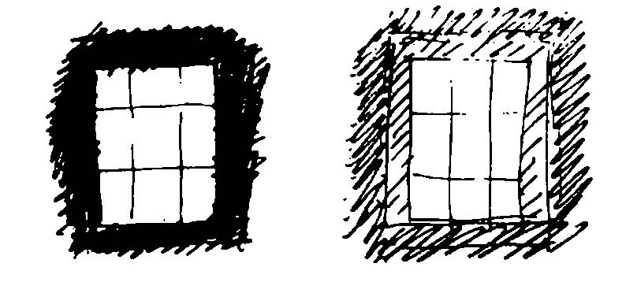

<section class="pattern-plate" aria-labelledby="t-deep-reveals">
<a href="/patterns">A Pattern Language</a> · <a href="/patterns#construction">Construction</a> · Pattern 223 · p. 1053
<h1 class="pattern-title" id="t-deep-reveals">Deep Reveals</h1><figure class="pattern-figure pl-figure"></figure><nav class="pattern-links" aria-label="Connections"><h2>Links to</h2><ul><li><a href="/patterns/light-on-two-sides-of-every-room">159 Light On Two Sides Of Every Room</a></li><li><a href="/patterns/thick-walls">197 Thick Walls</a></li><li><a href="/patterns/frames-as-thickened-edges">225 Frames As Thickened Edges</a></li><li><a href="/patterns/filtered-light">238 Filtered Light</a></li><li><a href="/patterns/half-inch-trim">240 Half-Inch Trim</a></li><li><a href="/patterns/climbing-plants">246 Climbing Plants</a></li></ul><h2>Linked from</h2><ul><li><a href="/patterns/wings-of-light">107 Wings Of Light</a></li><li><a href="/patterns/light-on-two-sides-of-every-room">159 Light On Two Sides Of Every Room</a></li><li><a href="/patterns/window-place">180 Window Place</a></li><li><a href="/patterns/windows-overlooking-life">192 Windows Overlooking Life</a></li><li><a href="/patterns/natural-doors-and-windows">221 Natural Doors And Windows</a></li><li><a href="/patterns/frames-as-thickened-edges">225 Frames As Thickened Edges</a></li><li><a href="/patterns/filtered-light">238 Filtered Light</a></li></ul></nav></section><article class="pattern-text" aria-label="The text of Deep Reveals">
1054… this pattern helps to complete the work of <a class="pl-ref" href="/patterns/light-on-two-sides-of-every-room">LIGHT ON TWO SIDES OF EVERY ROOM (159)</a>, by going even further to reduce glare; and it helps to shape the <a class="pl-ref" href="/patterns/frames-as-thickened-edges">FRAMES AS THICKENED EDGES (225)</a>.

◆ ◆ ◆

<strong>Windows with a sharp edge where the frame meets the wall create harsh, blinding glare, and make the rooms they serve uncomfortable.</strong>

They have the same effect as the bright headlights of an oncoming car: the glare prevents you from seeing anything else on the road because your eye cannot simultaneously adapt to the bright headlights and to the darkness of the roadway. Just so, a window is always much brighter than an interior wall; and the walls tend to be darkest next to the window’s edge. The difference in brightness between the bright window and the dark wall around it also causes glare.

<figure class="pl-figure"></figure>
To solve this problem, the edge of the window must be splayed, by making a reveal between the window and the wall. The splayed reveal then creates a transition area—a zone of intermediate brightness—between the brightness of the window and the darkness of the wall. If the reveal is deep enough and the angle just right, the glare will vanish altogether.

But the reveal must be quite deep, and the angle of the splay quite marked. In empirical studies of glare, Hopkinson and 1055Petherbridge have found: (1) that the larger the reveal is, the less glare there is; (2) the reveal functions best, when its brightness is just halfway between the brightness of the window and the brightness of the wall. (“Discomfort Glare and the Lighting of Buildings,” <em>Transactions of the Illuminating Engineering Society</em>, Vol. XV, No. 2, 1950, pp. 58–59.)

Our own experiments show that this happens most nearly, when the reveal lies at between 50 and 60 degrees to the plane of the window; though, of course, the angle will vary with local conditions. And, to satisfy the need for a “large” reveal, we have found that the reveal itself must be a good 10 to 12 inches wide.

Therefore:

<strong>Make the window frame a deep, splayed edge: about a foot wide and splayed at about 50 to 60 degrees to the plane of the window, so that the gentle gradient of daylight gives a smooth transition between the light of the window and the dark of the inner wall.</strong>

<figure class="pl-figure"></figure>
◆ ◆ ◆

Build the depth of the frame so that it is continuous with the structure of the walls—<a class="pl-ref" href="/patterns/frames-as-thickened-edges">FRAMES AS THICKENED EDGES (225)</a>; if the wall is thin, make up the necessary depth for the reveal on the inside face of the wall, with bookshelves, closets or other <a class="pl-ref" href="/patterns/thick-walls">THICK WALLS (197)</a>; embellish the edge of the window even further, to make light even softer, with lace work, tracery, and climbing plants—<a class="pl-ref" href="/patterns/filtered-light">FILTERED LIGHT (238)</a>, <a class="pl-ref" href="/patterns/half-inch-trim">HALF-INCH TRIM (240)</a>, <a class="pl-ref" href="/patterns/climbing-plants">CLIMBING PLANTS (246)</a>….
</article>

Christopher Alexander, Sara Ishikawa and Murray Silverstein, with Max Jacobson, Ingrid Fiksdahl-King and Shlomo Angel, <cite>A Pattern Language</cite> (Oxford University Press, 1977), pattern 223, pp. 1053–1055. Text and illustrations from the <a href="https://github.com/natureoforder/sources">Nature of Order sources</a> reading edition, transcribed from the 1977 printing; report errors on <a href="https://github.com/natureoforder/alexander-wiki/issues">GitHub</a>.

<a href="/patterns/low-sill">← 222 Low Sill</a> · <a href="/patterns">All 253 patterns</a> · <a href="/patterns/low-doorway">224 Low Doorway →</a>

