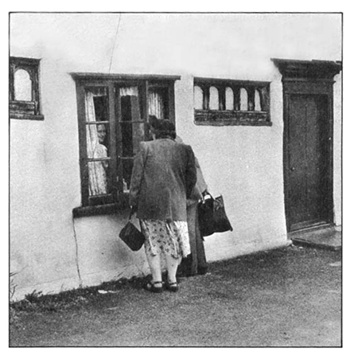
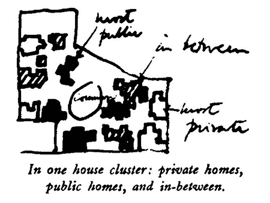
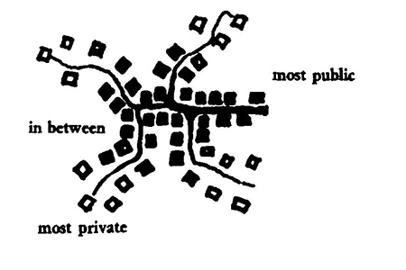

<section class="pattern-plate" aria-labelledby="t-degrees-of-publicness">
<a href="/patterns">A Pattern Language</a> · <a href="/patterns#towns">Towns</a> · Pattern 36 · p. 192 · **
<h1 class="pattern-title" id="t-degrees-of-publicness">Degrees Of Publicness</h1><figure class="pattern-figure pl-figure"></figure><nav class="pattern-links" aria-label="Connections"><h2>Links to</h2><ul><li><a href="/patterns/identifiable-neighborhood">14 Identifiable Neighborhood</a></li><li><a href="/patterns/density-rings">29 Density Rings</a></li><li><a href="/patterns/activity-nodes">30 Activity Nodes</a></li><li><a href="/patterns/house-cluster">37 House Cluster</a></li><li><a href="/patterns/row-houses">38 Row Houses</a></li><li><a href="/patterns/housing-hill">39 Housing Hill</a></li><li><a href="/patterns/green-streets">51 Green Streets</a></li><li><a href="/patterns/raised-walk">55 Raised Walk</a></li><li><a href="/patterns/pedestrian-street">100 Pedestrian Street</a></li><li><a href="/patterns/path-shape">121 Path Shape</a></li><li><a href="/patterns/pedestrian-density">123 Pedestrian Density</a></li></ul><h2>Linked from</h2><ul><li><a href="/patterns/activity-nodes">30 Activity Nodes</a></li><li><a href="/patterns/interchange">34 Interchange</a></li><li><a href="/patterns/house-cluster">37 House Cluster</a></li><li><a href="/patterns/paths-and-goals">120 Paths And Goals</a></li></ul></nav></section><article class="pattern-text" aria-label="The text of Degrees Of Publicness">
193… within the neighborhoods—<a class="pl-ref" href="/patterns/identifiable-neighborhood">IDENTIFIABLE NEIGHBORHOOD (14)</a>—there are naturally some areas where life is rather concentrated <a class="pl-ref" href="/patterns/activity-nodes">ACTIVITY NODES (30)</a>, others where it is slower, and others in between—<a class="pl-ref" href="/patterns/density-rings">DENSITY RINGS (29)</a>. It is essential to differentiate groups of houses and the paths which lead to them according to this gradient.

◆ ◆ ◆

<strong>People are different, and the way they want to place their houses in a neighborhood is one of the most basic kinds of difference.</strong>

Some people want to live where the action is. Others want more isolation. This corresponds to a basic human personality dimension, which could be called the “extrovert-introvert” dimension, or the “community loving-privacy loving” dimension. Those who want the action like being near services, near shops, they like a lively atmosphere outside their houses, and they are happy to have strangers going past their houses all the time. Those who want more isolation like being away from services and shops, enjoy a very small scale in the areas outside their houses, and don’t want strangers going past their houses. (See for example, Nancy Marshall, “Orientations Toward Privacy: Environmental and Personality Components,” James Madison College, Michigan State University, East Lansing, Michigan.)

The variation of different people along the extrovert-introvert dimension is very well described by Frank Hendricks and Malcolm MacNair in “Concepts of Environmental Quality Standards Based on Life Styles,” report to the American Public Health Association, February 12, 1969, pp. 11–15. The authors identify several kinds of persons and characterize each by the relative amount of time spent in extroverted activities and in introverted activities. Francis Loetterle has shed further light on the problem in “Environment Attitudes and Social Life in Santa Clara County,” Santa Clara County Planning Department, San Jose, 194California, 1967. He asked 3300 households how far they wanted to be from various community services. The results were: 20 per cent of the households interviewed wanted to be located less than three blocks from commercial centers; 60 per cent wanted to be located between four and six blocks away; 20 per cent wanted to be located more than six blocks away (mean block size in Santa Clara County is 150 yards). The exact distances apply only to Santa Clara. But the overall result overwhelmingly supports our contention that people vary in this way and shows that they have quite different needs as far as the location and character of houses is concerned.

To make sure that the different kinds of people can find houses which satisfy their own particular desires, we suggest that each cluster of houses, and each neighborhood should have three kinds of houses, in about equal numbers: those which are nearest to the action, those which are half-way between, and those which are almost completely isolated. And, to support this pattern we need, also, three distinct kinds of paths:

1. Paths along services, wide and open for activities and crowds, paths that connect activities and encourage busy through traffic.

2. Paths remote from services, narrow and twisting, to discourage through traffic, with many at right angles and dead ends.

3. Intermediate types of paths linking the most remote and quiet paths to the most central and busy ones.

This pattern is as important in the design of a cluster of a few houses as it is in the design of a neighborhood. When we were helping a group of people to design their own cluster of houses, we first asked each person to consider his preference for location on the basis of extrovert-introvert. Three groups emerged: four “extroverts” who wished to be as near the pedestrian and community action as possible, four “introverts” who desired as much remoteness and privacy as possible, and the remaining four who wanted a bit of both. The site plan they made, using this pattern, is shown below, with the positions which the three kinds of people chose.

195

<figure class="pl-figure"><figcaption><em>In one house cluster: private homes, public homes, and in-between</em>.</figcaption></figure>

Therefore:

<strong>Make a clear distinction between three kinds of homes—those on quiet backwaters, those on busy streets, and those that arc more or less in between. Make sure that those on quiet backwaters arc on twisting paths, and that these houses arc themselves physically secluded; make sure that the more public houses arc on busy streets with many people passing by all day long and that the houses themselves arc relatively exposed to the passers-by. The in-between houses may then be located on the paths half-way between the other two. Give every neighborhood about equal numbers of these three kinds of homes.</strong>

<figure class="pl-figure"></figure>
196

◆ ◆ ◆

Use this pattern to help differentiate the houses both in neighborhoods and in house clusters. Within a neighborhood, place higher density clusters along the busier streets—<a class="pl-ref" href="/patterns/housing-hill">HOUSING HILL (39)</a>, <a class="pl-ref" href="/patterns/row-houses">ROW HOUSES (38)</a>, and lower density clusters along the backwaters—<a class="pl-ref" href="/patterns/house-cluster">HOUSE CLUSTER (37)</a>, <a class="pl-ref" href="/patterns/row-houses">ROW HOUSES (38)</a>. The actual busy streets themselves should either be <a class="pl-ref" href="/patterns/pedestrian-street">PEDESTRIAN STREETS (100)</a> or <a class="pl-ref" href="/patterns/raised-walk">RAISED WALKS (55)</a> on major roads; the backwaters <a class="pl-ref" href="/patterns/green-streets">GREEN STREETS (51)</a>, or narrow paths with a distinct <a class="pl-ref" href="/patterns/path-shape">PATH SHAPE (121)</a>. Where lively streets are wanted, make sure the density of housing is high enough to generate the liveliness—<a class="pl-ref" href="/patterns/pedestrian-density">PEDESTRIAN DENSITY (123)</a>….
</article>

Christopher Alexander, Sara Ishikawa and Murray Silverstein, with Max Jacobson, Ingrid Fiksdahl-King and Shlomo Angel, <cite>A Pattern Language</cite> (Oxford University Press, 1977), pattern 36, pp. 192–196. Text and illustrations from the <a href="https://github.com/natureoforder/sources">Nature of Order sources</a> reading edition, transcribed from the 1977 printing; report errors on <a href="https://github.com/natureoforder/alexander-wiki/issues">GitHub</a>.

<a href="/patterns/household-mix">← 35 Household Mix</a> · <a href="/patterns">All 253 patterns</a> · <a href="/patterns/house-cluster">37 House Cluster →</a>

