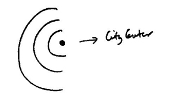
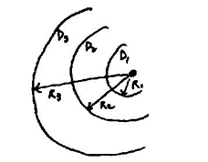
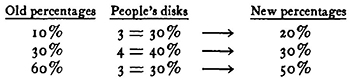
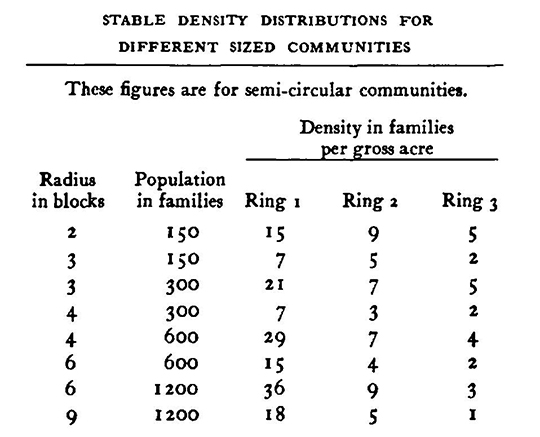
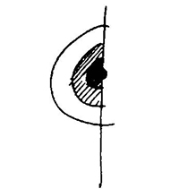

<section class="pattern-plate" aria-labelledby="t-density-rings">
<a href="/patterns">A Pattern Language</a> · <a href="/patterns#towns">Towns</a> · Pattern 29 · p. 156 · *
<h1 class="pattern-title" id="t-density-rings">Density Rings</h1><nav class="pattern-links" aria-label="Connections"><h2>Links to</h2><ul><li><a href="/patterns/mosaic-of-subcultures">8 Mosaic Of Subcultures</a></li><li><a href="/patterns/community-of-7000">12 Community Of 7000</a></li><li><a href="/patterns/subculture-boundary">13 Subculture Boundary</a></li><li><a href="/patterns/eccentric-nucleus">28 Eccentric Nucleus</a></li><li><a href="/patterns/promenade">31 Promenade</a></li><li><a href="/patterns/house-cluster">37 House Cluster</a></li><li><a href="/patterns/row-houses">38 Row Houses</a></li><li><a href="/patterns/housing-hill">39 Housing Hill</a></li><li><a href="/patterns/small-public-squares">61 Small Public Squares</a></li><li><a href="/patterns/pedestrian-density">123 Pedestrian Density</a></li></ul><h2>Linked from</h2><ul><li><a href="/patterns/magic-of-the-city">10 Magic Of The City</a></li><li><a href="/patterns/four-story-limit">21 Four-Story Limit</a></li><li><a href="/patterns/men-and-women">27 Men And Women</a></li><li><a href="/patterns/eccentric-nucleus">28 Eccentric Nucleus</a></li><li><a href="/patterns/activity-nodes">30 Activity Nodes</a></li><li><a href="/patterns/degrees-of-publicness">36 Degrees Of Publicness</a></li><li><a href="/patterns/house-cluster">37 House Cluster</a></li><li><a href="/patterns/housing-hill">39 Housing Hill</a></li></ul></nav></section><article class="pattern-text" aria-label="The text of Density Rings">
… in <a class="pl-ref" href="/patterns/eccentric-nucleus">ECCENTRIC NUCLEUS (28)</a> we have given a general form for the configuration of density “peaks” and “valleys,” with respect to the <a class="pl-ref" href="/patterns/mosaic-of-subcultures">MOSAIC OF SUBCULTURES (8)</a> and <a class="pl-ref" href="/patterns/subculture-boundary">SUBCULTURE BOUNDARIES (13)</a>. Suppose now that the center of commercial activity in a <a class="pl-ref" href="/patterns/community-of-7000">COMMUNITY OF 7000 (12)</a> is placed according to the prescriptions of <a class="pl-ref" href="/patterns/eccentric-nucleus">ECCENTRIC NUCLEUS (28)</a>, and according to the overall density within the region. We then face the problem of establishing local densities, for house clusters and work communities, at different distances around this peak. This pattern gives a rule for working out the gradient of these local densities. Most concretely, this gradient of density can be specified, by drawing rings at different distances from the main center of activity and then assigning different densities to each ring, so that the densities in the succeeding rings create the gradient of density. The gradient will vary from community to community—both according to a community’s position in the region, and according to the cultural background of the people.

◆ ◆ ◆

<strong>People want to be close to shops and services, for excitement and convenience. And they want to be away from services, for quiet and green. The exact balance of these two desires varies from person to person, but in the aggregate it is the balance of these two desires which determines the gradient of housing densities in a neighborhood.</strong>

In order to be precise about the gradient of housing densities, let us agree at once, to analyze the. densities by means of three concentric semi-circular rings, of equal radial thickness, around the main center of activity.

[We make them semi-circles, rather than full circles, since it has been shown, empirically, that the catch basin of a given local 157center is a half-circle, on the side away from the city-see discussion in <a class="pl-ref" href="/patterns/eccentric-nucleus">ECCENTRIC NUCLEUS (28)</a> and the references to Brennan and Lee given in that pattern. However, even if you do not accept this finding, and wish to assume that the circles are full circles, the following analysis remains essentially unchanged.] We now define a density gradient, as a set of three densities, one for each of the three rings.

<figure class="pl-figure"><figcaption><em>Rings of equal thickness</em>.</figcaption></figure>
<figure class="pl-figure"><figcaption><em>A density gradient</em>.</figcaption></figure>

Imagine that the three rings of some actual neighborhood have densities D1, D2, D3. And assume, now, that a new person moves into this neighborhood. As we have said, within the given density gradient, he will choose to live in that ring, where his liking for green and quiet just balances his liking for access to shops and public services. This means that each person is essentially faced with a choice among three alternative density-distance combinations:

Ring 1. The density D1, with a distance of about R1 to shops.

Ring 2. The density D2, with a distance of about R2 to shops.

Ring 3. The density D3, with a distance of about R3 to shops.

Now, of course, each person will make a different choice—according to his own personal preference for the balance of density and distance. Let us imagine, just for the sake of argument, that all the people in the neighborhood are asked to make this choice (forgetting, for a moment, which houses are available). Some will 158choose ring 1, some ring 2, and some ring 3. Suppose that N1 choose ring 1, N2 choose ring 2, and N3 choose ring 3. Since the three rings have specific, well-defined areas, the numbers of people who have ch06en the three areas, can be turned into hypothetical densities. In other words, if we (in imagination) distribute the people among the three rings according to their choices, we can work out the hypothetical densities which would occur in the three rings as a result.

<em>Now we are suddenly faced with two fascinating possibilities:</em>

I. These new densities are different from the actual densities.

II. These new densities are the same as the actual densities.

Case I is much more likely to occur. But this is unstable—since people’s choices will tend to change the densities. Case II, which is less likely to occur, is stable—since it means that people, choosing freely, will together re-create the very same pattern of density within which they have made these choices. This distinction is fundamental.

If we assume that a given neighborhood, with a given total area, must accommodate a certain number of people (given by the average density of people at that point in the region), then there is just <em>one</em> configuration of densities which is stable in this sense. We now describe a computational procedure which can be used to obtain this stable density configuration.

<em>Before we explain the computational procedure, we must explain how fiery fundamental and important this kind of stable density configuration is</em>.

In today’s world, where density gradients are usually not stable, in our sense, most people are forced to live under conditions where the balance of quiet and activity does not correspond to their wishes or. their needs, because the total number of available houses and apartments at different distances is inappropriate. What happens, then, is that the rich, who can afford to pay for what they want, are able to find houses and apartments with the balance that they want; the not so rich and poor arc forced to take the leavings. All this is made legitimate by the middleclass economics of “ground rent”—the idea that land at different distances from centers of activity, commands different prices, because more or less people want to be at those distances. But actually the fact of differential ground rent is an economic 159mechanism which springs up, within an unstable density configuration, to compensate for its instability.

We want to point out that in a neighborhood with a stable density configuration (stable in our sense of the word), the land would not need to coot different prices at different distances, because the total available number of houses in each ring would exactly correspond to the number of people who wanted to live at those distances. With demand equal to supply in every ring, the ground rents, or the price of land, could be the same in every ring, and everyone, rich and poor, could be certain of having the balance they require.

We now come to the problem of computing the stable densities for a given neighborhood. The stability depends on very subtle psychological forces; so far as we know these forces cannot be represented in any psychologically accurate way by mathematical equations, and it is therefore, at least for the moment, impossible to give a mathematical model for the stable density. Instead, we have chosen to use the fact that each person can make choices about his required balance of activity and quiet, and to use people’s choices, within a simple game, as the source of the computation. I n short, we have constructed a game, which allows one to obtain the stable density configuration within a few minutes. This game essentially simulates the behavior of the real system, and is, we believe, far more reliable than any mathematical computation.

DENSITY GRADIENTS GAME

1. First draw a map of the three concentric half rings. Make it a half-circle—if you accept the arguments of <a class="pl-ref" href="/patterns/eccentric-nucleus">ECCENTRIC NUCLEUS (28)</a>—otherwise a full circle Smooth this half-circle to fit the horseshoe of the highest density—mark its center as the center of that horaeshoe.

2. If the overall radius of the half-circle is <strong>R,</strong> then the mean radii of the three rings are <strong>R1, R2, R3</strong> given by:

R1 = R/6 
R2 = 3R/6 
R3 = 5R/6

3. Make up a board for the game, which has the three concentric circles shown on it, with the radii marked in blocks, so people can understand them easily, i.e., 1000 feet = 3 blocks.

4. Decide on the total population of this neighborhood. This is 160the same as settling on an <em>overall</em> average net density for the area, It will have to be roughly compatible with the overall pattern of density in the region. Let us say that the total population of the community is N families.

<em>5</em>. Find ten people who are roughly similar to the people in the community—vis-à-vis cultural habits, background, and so on. If possible, they should be ten of the people in the actual community itself.

6. Show the players a set of photographs of areas that show typical best examples of different population densities (in families per gross acre), and leave these photographs on display throughout the game so that people can use them when they make their choices.

7. Give each player a disk, which he can place on the board in one of the three rings.

8. Now, to start the game, decide what percentage of the total population is to be in each of the three rings. It doesn’t matter what percentages you choose to start with—they will soon right themselves as the game gets under way—but, for the sake of simplicity, choose multiples of 10 per cent for each ring, i.e., I O per cent in ring 1, 30 per cent in ring 2, 60 per cent in ring 3.

9. Now translate these percentages into actual densities of families per net acre. Since you will have to do this many times during the course of the game, it is advisable to construct a table which translates percentages directly into densities. You can make up such a table by inserting the values for N and R which you have chosen for your community into the formulae below. The formulae are based on the simple arithmetic of area, and population. R is expressed in hundreds of yards—roughly in blocks. The densities are expressed in <em>families per gross acre</em>. Multiply each ring density by a number between I and 10, according to the per cent in that ring. Thus, if there are 30 per cent in ring 3, the density there is 3 times the entry in the formulae, or 24N/5πR2.

10 % 
Ring 1     8N/5πR2 
Ring 2     8N/3πR2 
Ring 3     8N/5πR2

10. Once you have found the proper densities, from the formulae, write them on three slips of paper, and place these slips into their appropriate rings, on the game board.

11. The slips define a tentative density configuration for the community. Each ring has a certain typical distance from the center. And each ring has a density. Ask people to look carefully at the pictures which represent these densities, and then to decide which of the three rings gives them the best balance of quiet and green, as against access to shops. Ask each person to place his disk in the ring he chooses.

161

<ol start="12" type="1">
<li>When all ten disks are on the board, this defines a new distribution of population. Probably, it is different from the one you started with. Now make up a new set of percentages, half-way between the one you originally defined, and the one which people’s disks define, and, again, round off the percentages to the nearest 1o per cent. Here is an example of the way you can get new percentages.</li>
</ol>
<figure class="pl-figure"></figure>
As you see, the new ones are not perfectly half-way between the other two-but as near as you can get, and still have multiples of ten.

13. Now go back to step 9, and go through 9, 10, 11, 12 again and again, until the percentages defined by people’s disks are the same as the ones you defined for that round. If you turn these last stable percentages into densities, you have found the stable density configuration for this community. Stop, and have a drink all round.

In our experiments, we have found that this game reaches a stable state very quickly indeed. Ten people, in a few minutes, can define a stable density distribution. We have presented the results of one set of games in the table which follows below.

<figure class="pl-figure"></figure>
162It is essential to recognize that the densities given in this table cannot wisely be used j ust as they stand. The figures will vary with the exact geometry of the neighborhood and with different cultural attitudes in different subcultures. For this reason, we consider it essential that the people of a given community, who want to apply this pattern, play the game themselves, in order to find a stable gradient of densities for their own situation. The numbers we have given above are more for the sake of illustration than anything else.

Therefore:

<strong>Once the nucleus of a community is clearly placed—define rings of decreasing local housing density around this nucleus. If you cannot avoid it, choose the densities from the foregoing table. But, much better, if you can possibly manage it, play the density rings game, to obtain these densities, from the intuitions of the very people who are going to live in the community.</strong>

<figure class="pl-figure"></figure>
◆ ◆ ◆

Within the rings of density, encourage housing to take the form of housing clusters—self-governing cooperatives of 8 to 15 households, their physical size varying according to the density—<a class="pl-ref" href="/patterns/house-cluster">HOUSE CLUSTER (37)</a>. According to the densities in the different rings, build these houses as free-standing houses—<a class="pl-ref" href="/patterns/house-cluster">HOUSF. CLUSTER (37)</a>, <a class="pl-ref" href="/patterns/row-houses">ROW HOUSES (38)</a>, or higher density clusters of housing—<a class="pl-ref" href="/patterns/housing-hill">HOUSING HILL (39)</a>. Keep public spaces—<a class="pl-ref" href="/patterns/promenade">PROMENADE (31)</a>, <a class="pl-ref" href="/patterns/small-public-squares">SMALL PUBLIC SQUARES (61)</a>—to those areas which have a high enough density around them to keep them alive—<a class="pl-ref" href="/patterns/pedestrian-density">PEDESTRIAN DENSITY (123)</a>….
</article>

Christopher Alexander, Sara Ishikawa and Murray Silverstein, with Max Jacobson, Ingrid Fiksdahl-King and Shlomo Angel, <cite>A Pattern Language</cite> (Oxford University Press, 1977), pattern 29, pp. 156–162. Text and illustrations from the <a href="https://github.com/natureoforder/sources">Nature of Order sources</a> reading edition, transcribed from the 1977 printing; report errors on <a href="https://github.com/natureoforder/alexander-wiki/issues">GitHub</a>.

<a href="/patterns/eccentric-nucleus">← 28 Eccentric Nucleus</a> · <a href="/patterns">All 253 patterns</a> · <a href="/patterns/activity-nodes">30 Activity Nodes →</a>

