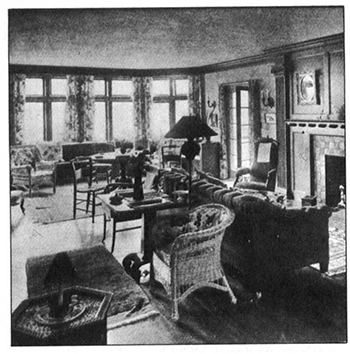
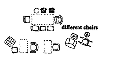

<section class="pattern-plate" aria-labelledby="t-different-chairs">
<a href="/patterns">A Pattern Language</a> · <a href="/patterns#construction">Construction</a> · Pattern 251 · p. 1157
<h1 class="pattern-title" id="t-different-chairs">Different Chairs</h1><figure class="pattern-figure pl-figure"></figure><nav class="pattern-links" aria-label="Connections"><h2>Links to</h2><ul><li><a href="/patterns/sequence-of-sitting-spaces">142 Sequence Of Sitting Spaces</a></li><li><a href="/patterns/sitting-circle">185 Sitting Circle</a></li><li><a href="/patterns/built-in-seats">202 Built-In Seats</a></li><li><a href="/patterns/pools-of-light">252 Pools Of Light</a></li></ul><h2>Linked from</h2><ul><li><a href="/patterns/street-cafe">88 Street Cafe</a></li><li><a href="/patterns/small-meeting-rooms">151 Small Meeting Rooms</a></li><li><a href="/patterns/eating-atmosphere">182 Eating Atmosphere</a></li><li><a href="/patterns/sitting-circle">185 Sitting Circle</a></li><li><a href="/patterns/column-place">226 Column Place</a></li><li><a href="/patterns/soft-tile-and-brick">248 Soft Tile And Brick</a></li><li><a href="/patterns/pools-of-light">252 Pools Of Light</a></li></ul></nav></section><article class="pattern-text" aria-label="The text of Different Chairs">
1158… when you are ready to furnish rooms, choose the variety of furniture as carefully as you have made the building, so that each piece of furniture, loose or built in, has the same unique and organic individuality as the rooms and alcoves have—each different, according to the place it occupies—<a class="pl-ref" href="/patterns/sequence-of-sitting-spaces">SEQUENCE OF SITTING SPACES (142)</a>, <a class="pl-ref" href="/patterns/sitting-circle">SITTING CIRCLE (185)</a>, <a class="pl-ref" href="/patterns/built-in-seats">BUILT-IN SEATS (202)</a>.

◆ ◆ ◆

<strong>People are different sizes; they sit in different ways. And yet there is a tendency in modem times to make all chairs alike.</strong>

Of course, this tendency to make all chairs alike is fueled by the demands of prefabrication and the supposed economies of scale. Designers have for years been creating “perfect chairs”—chairs that can be manufactured cheaply in mass. These chairs are made to be comfortable for the average person. And the institutions that buy chairs have been persuaded that buying these chairs in bulk meets all their needs.

But what it means is that some people are chronically uncomfortable; and the variety of moods among people sitting gets entirely stifled.

Obviously, the “average chair” is good for some, but not for everyone. Short and tall people are likely to be uncomfortable. And although situations are roughly uniform—in a restaurant everyone is eating, in an office everyone is working at a table—even so, there are important distinctions: people sitting for different lengths of time; people sitting back and musing; people sitting aggressively forward in a hot discussion; people sitting formally, waiting for a few minutes. If the chairs are all the same, these differences are repressed, and some people are uncomfortable.

What is less obvious, and yet perhaps most important of all, is this: we project our moods and personalities into the chairs we sit in. In one mood a big fat chair is just right; in another 1159mood, a rocking chair; for another, a stiff upright; and yet again, a stool or sofa. And, of course, it isn’t only that we like to switch according to our mood; one of them is our favorite chair, the one that makes us most secure and comfortable; and that again is different for each person. A setting that is full of chairs, all slightly different, immediately creates an amosphere which supports rich experience; a setting which contains chairs that are all alike puts a subtle straight jacket on experience.

Therefore:

<strong>Never furnish any place with chairs that are identically the same. Choose a variety of different chairs, some big, some small, some softer than others, some rockers, some very old, some new, with arms, without arms, some wicker, some wood, some cloth.</strong>

<figure class="pl-figure"></figure>
◆ ◆ ◆

Where chairs are placed alone and where chain are gathered, reinforce the character of the places which the chain create with <a class="pl-ref" href="/patterns/pools-of-light">POOLS OF LIGHT (252)</a>, each local to the group of chain it marks….
</article>

Christopher Alexander, Sara Ishikawa and Murray Silverstein, with Max Jacobson, Ingrid Fiksdahl-King and Shlomo Angel, <cite>A Pattern Language</cite> (Oxford University Press, 1977), pattern 251, pp. 1157–1159. Text and illustrations from the <a href="https://github.com/natureoforder/sources">Nature of Order sources</a> reading edition, transcribed from the 1977 printing; report errors on <a href="https://github.com/natureoforder/alexander-wiki/issues">GitHub</a>.

<a href="/patterns/warm-colors">← 250 Warm Colors</a> · <a href="/patterns">All 253 patterns</a> · <a href="/patterns/pools-of-light">252 Pools Of Light →</a>

