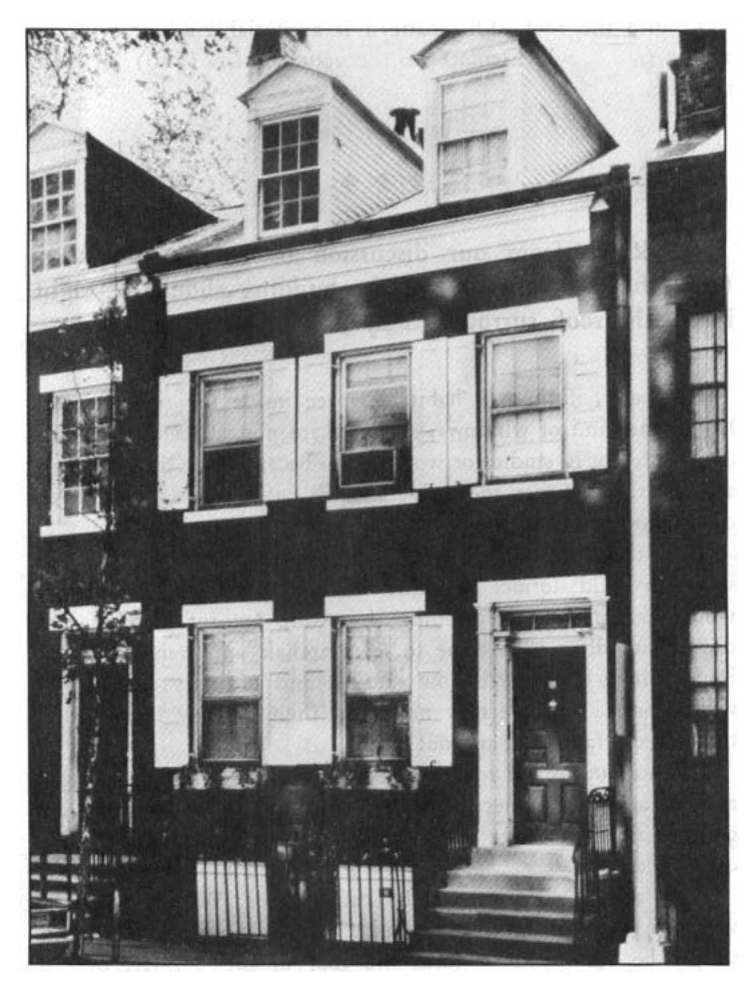
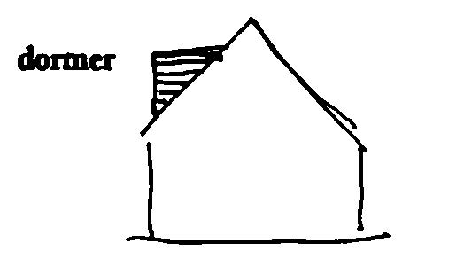

<section class="pattern-plate" aria-labelledby="t-dormer-windows">
<a href="/patterns">A Pattern Language</a> · <a href="/patterns#construction">Construction</a> · Pattern 231 · p. 1081 · *
<h1 class="pattern-title" id="t-dormer-windows">Dormer Windows</h1><figure class="pattern-figure pl-figure"></figure><nav class="pattern-links" aria-label="Connections"><h2>Links to</h2><ul><li><a href="/patterns/sheltering-roof">117 Sheltering Roof</a></li><li><a href="/patterns/alcoves">179 Alcoves</a></li><li><a href="/patterns/window-place">180 Window Place</a></li><li><a href="/patterns/windows-overlooking-life">192 Windows Overlooking Life</a></li><li><a href="/patterns/gradual-stiffening">208 Gradual Stiffening</a></li><li><a href="/patterns/columns-at-the-corners">212 Columns At The Corners</a></li><li><a href="/patterns/perimeter-beams">217 Perimeter Beams</a></li><li><a href="/patterns/floor-ceiling-vaults">219 Floor-Ceiling Vaults</a></li><li><a href="/patterns/roof-vaults">220 Roof Vaults</a></li><li><a href="/patterns/frames-as-thickened-edges">225 Frames As Thickened Edges</a></li><li><a href="/patterns/windows-which-open-wide">236 Windows Which Open Wide</a></li><li><a href="/patterns/small-panes">239 Small Panes</a></li></ul><h2>Linked from</h2><ul><li><a href="/patterns/sheltering-roof">117 Sheltering Roof</a></li><li><a href="/patterns/window-place">180 Window Place</a></li><li><a href="/patterns/roof-vaults">220 Roof Vaults</a></li><li><a href="/patterns/frames-as-thickened-edges">225 Frames As Thickened Edges</a></li></ul></nav></section><article class="pattern-text" aria-label="The text of Dormer Windows">
1082… this pattern helps to complete <a class="pl-ref" href="/patterns/sheltering-roof">SHELTERING ROOF (117)</a>. If you have followed sheltering roof, your roof has living space within it: and it must therefore have windows in it, to bring light into the roof. This pattern is a special kind of <a class="pl-ref" href="/patterns/window-place">WINDOW PLACE (180)</a>, which completes the <a class="pl-ref" href="/patterns/roof-vaults">ROOF VAULTS (220)</a>, in these situations.

◆ ◆ ◆

<strong>We know from our discussion of <a class="pl-ref" href="/patterns/sheltering-roof">SHELTERING ROOF (117)</a> that the top story of the building should be right inside the roof, surrounded by it.</strong>

Obviously, if there is habitable space inside the roof, it must have some kind of windows; skylights are not satisfactory as windows—except in studios or workshops—because they do not create a connection between the inside and the outside world—<a class="pl-ref" href="/patterns/windows-overlooking-life">WINDOWS OVERLOOKING LIFE (192)</a>.

It is therefore natural to pierce the roof with windows; in short, to build dormer windows. This simple, fundamental fact would hardly need mentioning if it were not for the fact that dormer windows have come to seem archaic and romantic. It is important to emphasize how sensible and ordinary they are—simply because people may not build them if they believe that they are old fashioned and out of date.

Dormers make the roof livable. Aside from bringing in light and air and the connection to the outside, they relieve the low ceilings along the edge of the roofs and create alcoves and window places.

How should the dormers be constructed? Within the roof vault we have described, the basket which forms the vault can simply be continued to form the roof of the dormer, over a frame of columns and perimeter beams which form the opening.

The other ways of building dormer windows depend on the construction system you are using. Whatever you are using for lintels, columns, and walls, can simply be modified and used in combination to build the dormer.

1083Therefore:

<strong>Wherever you have windows in the roof, make dormer windows which are high enough to stand in, and frame them like any other alcoves in the building.</strong>

<figure class="pl-figure"></figure>
◆ ◆ ◆

Frame them like <a class="pl-ref" href="/patterns/alcoves">ALCOVES (179)</a> and <a class="pl-ref" href="/patterns/window-place">WINDOW PLACE (180)</a>

with <a class="pl-ref" href="/patterns/gradual-stiffening">GRADUAL STIFFENING (208)</a>, <a class="pl-ref" href="/patterns/columns-at-the-corners">COLUMNS AT THE CORNERS (212)</a>, BOX COLUMNS (2l6), <a class="pl-ref" href="/patterns/perimeter-beams">PERIMETER BEAMS (217)</a>, WALL MEMBRANES (2l8), <a class="pl-ref" href="/patterns/floor-ceiling-vaults">FLOOR-CEILING VAULTS (219)</a>, <a class="pl-ref" href="/patterns/roof-vaults">ROOF VAULTS (220)</a> and <a class="pl-ref" href="/patterns/frames-as-thickened-edges">FRAMES AS THICKENED EDGES (225)</a>. Put <a class="pl-ref" href="/patterns/windows-which-open-wide">WINDOWS WHICH OPEN WIDE (236)</a> in them, and make <a class="pl-ref" href="/patterns/small-panes">SMALL PANES (239)</a>….
</article>

Christopher Alexander, Sara Ishikawa and Murray Silverstein, with Max Jacobson, Ingrid Fiksdahl-King and Shlomo Angel, <cite>A Pattern Language</cite> (Oxford University Press, 1977), pattern 231, pp. 1081–1083. Text and illustrations from the <a href="https://github.com/natureoforder/sources">Nature of Order sources</a> reading edition, transcribed from the 1977 printing; report errors on <a href="https://github.com/natureoforder/alexander-wiki/issues">GitHub</a>.

<a href="/patterns/radiant-heat">← 230 Radiant Heat</a> · <a href="/patterns">All 253 patterns</a> · <a href="/patterns/roof-caps">232 Roof Caps →</a>

