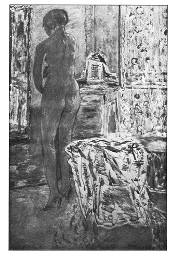
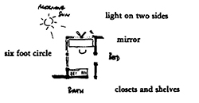

<section class="pattern-plate" aria-labelledby="t-dressing-rooms">
<a href="/patterns">A Pattern Language</a> · <a href="/patterns#buildings">Buildings</a> · Pattern 189 · p. 872 · *
<h1 class="pattern-title" id="t-dressing-rooms">Dressing Rooms</h1><figure class="pattern-figure pl-figure"></figure><nav class="pattern-links" aria-label="Connections"><h2>Links to</h2><ul><li><a href="/patterns/bathing-room">144 Bathing Room</a></li><li><a href="/patterns/light-on-two-sides-of-every-room">159 Light On Two Sides Of Every Room</a></li><li><a href="/patterns/marriage-bed">187 Marriage Bed</a></li><li><a href="/patterns/bed-alcove">188 Bed Alcove</a></li><li><a href="/patterns/ceiling-height-variety">190 Ceiling Height Variety</a></li><li><a href="/patterns/the-shape-of-indoor-space">191 The Shape Of Indoor Space</a></li><li><a href="/patterns/windows-overlooking-life">192 Windows Overlooking Life</a></li><li><a href="/patterns/half-open-wall">193 Half-Open Wall</a></li><li><a href="/patterns/interior-windows">194 Interior Windows</a></li><li><a href="/patterns/staircase-volume">195 Staircase Volume</a></li><li><a href="/patterns/corner-doors">196 Corner Doors</a></li><li><a href="/patterns/thick-walls">197 Thick Walls</a></li><li><a href="/patterns/closets-between-rooms">198 Closets Between Rooms</a></li><li><a href="/patterns/open-shelves">200 Open Shelves</a></li><li><a href="/patterns/waist-high-shelf">201 Waist-High Shelf</a></li></ul><h2>Linked from</h2><ul><li><a href="/patterns/couples-realm">136 Couple’s Realm</a></li><li><a href="/patterns/a-room-of-ones-own">141 A Room Of One’s Own</a></li><li><a href="/patterns/bed-cluster">143 Bed Cluster</a></li><li><a href="/patterns/communal-sleeping">186 Communal Sleeping</a></li><li><a href="/patterns/marriage-bed">187 Marriage Bed</a></li><li><a href="/patterns/bed-alcove">188 Bed Alcove</a></li><li><a href="/patterns/closets-between-rooms">198 Closets Between Rooms</a></li></ul></nav></section><article class="pattern-text" aria-label="The text of Dressing Rooms">
873… if the beds arc in position—<a class="pl-ref" href="/patterns/marriage-bed">MARRIAGE BED (187)</a>, <a class="pl-ref" href="/patterns/bed-alcove">BED ALCOVES (188)</a>—we can give detailed attention to the dressing spaces—both to the closets where people keep their clothes and to the space they use for dressing. These dressing spaces may also help to form the <a class="pl-ref" href="/patterns/bathing-room">BATHING ROOM (144)</a>.

◆ ◆ ◆

<strong>Dressing and undressing, storing clothes, having clothes lying around, have no reason to be part of any larger complex of activities. Indeed they disturb other activities: they are so self-contained that they themselves need concentrated space which has no other function.</strong>

We have argued, in bed alcoves (188), that the concept of the bedroom leads to wasted space around the bed. This pattern lends further support to the idea that “bedrooms” in their present form are not valuable entities to have in a house.

The arguments are:

1. Clothes lying around are messy; they can take over a great deal of space; they need some kind of individual space. A dressing space can be for one person or shared by a couple. The important thing is that it be organized as a small space where it is comfortable to store clothes and to dress. When such a space is not provided, <em>the whole bedroom</em> is potentially the dressing room; and this can destroy its integrity as a room. It becomes more a big closet to “keep neat,” than a room to stay in and relax.

2. People tend to take up a private position while they dress, even where they arc relatively intimate with the people they live with. Even in a locker room, people will make a half-turn away from others as they dress. This suggests that the space for dressing be relatively private. The old fashioned standing screens in a green room or a boudoir worked this way; they created a halfprivate dressing space.

3. The time of dressing, the activity, is a natural moment of transition in the day. It is a time when people think about the day ahead, or unwind at the end of the day and get ready for bed. If you dwell, for a moment, on this transitional quality of 874dressing, it seems clear that the dressing space can be made to help support it. For example, a good place to dress will have beautiful natural light; this requires as much thought in your design as any room—see, for example, <a class="pl-ref" href="/patterns/light-on-two-sides-of-every-room">light on two sides of every room (159)</a>.

4. The dressing space should be large enough, with room to stretch your arms and turn around. This means six or seven feet of open area. It must also have about six feet of clothes hanging space, another six feet of open shelves, and a few drawers for each person. These figures are rough. Check your own closet and shelves, think about what you really need, and make an estimate.

Therefore:

<strong>Give everyone a dressing room—either private or shared—between their bed and the bathing room. Make this dressing room big enough so there is an open area in it at least six feet in diameter; about six linear feet of clothes hanging space; and another six feet of open shelves; two or three drawers; and a mirror.</strong>

<figure class="pl-figure"></figure>
◆ ◆ ◆

Place each dressing room so that it gets plenty of natural light ON TWO SIDES (159). Use <a class="pl-ref" href="/patterns/thick-walls">THICK WALLS (197)</a>, <a class="pl-ref" href="/patterns/closets-between-rooms">CLOSETS BETWEEN ROOMS (198)</a>, and <a class="pl-ref" href="/patterns/open-shelves">OPEN SHELVES (200)</a> to form its walls; include a wide shelf around the edge—<a class="pl-ref" href="/patterns/waist-high-shelf">WAIST-HIGH SHELF (201)</a>; and for the detailed shape of the room, see <a class="pl-ref" href="/patterns/the-shape-of-indoor-space">the SHAPE OF INDOOR SPACE (191)</a>….

875<em>fine tune the shape and size of rooms and alcoves to make them precise and buildable;</em>

<a class="pl-ref" href="/patterns/ceiling-height-variety">190. CEILING HEIGHT VARIETY</a>

<a class="pl-ref" href="/patterns/the-shape-of-indoor-space">191. THE SHAPE OF INDOOR SPACE</a>

<a class="pl-ref" href="/patterns/windows-overlooking-life">192. WINDOWS OVERLOOKING LIFE</a>

<a class="pl-ref" href="/patterns/half-open-wall">193. HALF-OPEN WALL</a>

<a class="pl-ref" href="/patterns/interior-windows">194. INTERIOR WINDOWS</a>

<a class="pl-ref" href="/patterns/staircase-volume">195. STAIRCASE VOLUME</a>

<a class="pl-ref" href="/patterns/corner-doors">196. CORNER DOORS</a>
</article>

Christopher Alexander, Sara Ishikawa and Murray Silverstein, with Max Jacobson, Ingrid Fiksdahl-King and Shlomo Angel, <cite>A Pattern Language</cite> (Oxford University Press, 1977), pattern 189, pp. 872–875. Text and illustrations from the <a href="https://github.com/natureoforder/sources">Nature of Order sources</a> reading edition, transcribed from the 1977 printing; report errors on <a href="https://github.com/natureoforder/alexander-wiki/issues">GitHub</a>.

<a href="/patterns/bed-alcove">← 188 Bed Alcove</a> · <a href="/patterns">All 253 patterns</a> · <a href="/patterns/ceiling-height-variety">190 Ceiling Height Variety →</a>

