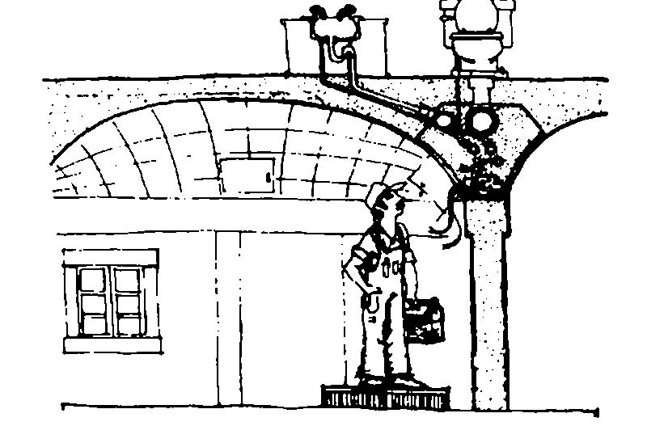
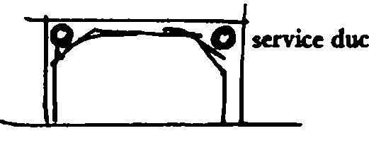

<section class="pattern-plate" aria-labelledby="t-duct-space">
<a href="/patterns">A Pattern Language</a> · <a href="/patterns#construction">Construction</a> · Pattern 229 · p. 1076
<h1 class="pattern-title" id="t-duct-space">Duct Space</h1><nav class="pattern-links" aria-label="Connections"><h2>Links to</h2><ul><li><a href="/patterns/efficient-structure">206 Efficient Structure</a></li><li><a href="/patterns/floor-ceiling-vaults">219 Floor-Ceiling Vaults</a></li><li><a href="/patterns/radiant-heat">230 Radiant Heat</a></li><li><a href="/patterns/pools-of-light">252 Pools Of Light</a></li></ul><h2>Linked from</h2><ul><li><a href="/patterns/floor-ceiling-vaults">219 Floor-Ceiling Vaults</a></li><li><a href="/patterns/frames-as-thickened-edges">225 Frames As Thickened Edges</a></li><li><a href="/patterns/radiant-heat">230 Radiant Heat</a></li></ul></nav></section><article class="pattern-text" aria-label="The text of Duct Space">
… in a building built according to the principles of <a class="pl-ref" href="/patterns/efficient-structure">EFFICIENT STRUCTURE (206)</a> and built with vaulted floors—<a class="pl-ref" href="/patterns/floor-ceiling-vaults">FLOOR-CEILING VAULTS (219)</a>, there is a triangular volume, unused, around the edge of every room. This is the most natural place to put the ducts.

◆ ◆ ◆

<strong>You never know where pipes and conduits are; they are buried somewhere in the walls; but where exactly are they?</strong>

In most buildings electric conduits, plumbing, drains, gas pipes, telephone wires, and so on, are buried in the walls, in a completely uncoordinated and disorganized way. This makes the initial construction of the building complicated since it is difficult to coordinate the installation of the various services with the building of various parts of the building. It makes it difficult to think about making any changes or additions to the building once it is built since you don’t know where the service lines arc. And it leaves a gap in our understanding of our surroundings: the organization of utilities and services in the buildings we live in are a mystery to us.

We propose that all the services be located together and run around the ceiling of each room in the spandrel between the vaulted ceiling and the floor above—<a class="pl-ref" href="/patterns/floor-ceiling-vaults">FLOOR-CEILING VAULTS (219)</a>.

Heating and electrical conduits will be universal throughout the building and should thus be run around every room. Plumbing and gas lines will be around some rooms only. All lines will also be concentrated vertically at the corners of rooms. Thus the lines form vertical trunks from which horizontal loops spring. This configuration of pipes and conduits is easy to understand and plug into.

1077

<figure class="pl-figure"><figcaption><em>All in one place</em>.</figcaption></figure>

Therefore:

<strong>Make ducts to carry hot air conduit, plumbing, gas, and other services in the triangular space, within the vault, around the upper edge of every room. Connect the ducts for different rooms by vertical ducts, in special chases, in the comers of rooms. Build oudets and panels at intervals along the duct for access to the conduits.</strong>

<figure class="pl-figure"></figure>
◆ ◆ ◆

Once the duct is in, you can fill up the triangle with lightweight concrete—<a class="pl-ref" href="/patterns/floor-ceiling-vaults">FLOOR-CEILING VAULTS (219)</a>. Place heating panels along the surface of the triangle—<a class="pl-ref" href="/patterns/radiant-heat">RADIANT HEAT (230)</a>; and place outlets for lights at frequent intervals below the duct, with leads and conduits running down in rebates along the window frames <a class="pl-ref" href="/patterns/pools-of-light">POOLS OF LIGHT (252)</a>….
</article>

Christopher Alexander, Sara Ishikawa and Murray Silverstein, with Max Jacobson, Ingrid Fiksdahl-King and Shlomo Angel, <cite>A Pattern Language</cite> (Oxford University Press, 1977), pattern 229, pp. 1076–1077. Text and illustrations from the <a href="https://github.com/natureoforder/sources">Nature of Order sources</a> reading edition, transcribed from the 1977 printing; report errors on <a href="https://github.com/natureoforder/alexander-wiki/issues">GitHub</a>.

<a href="/patterns/stair-vault">← 228 Stair Vault</a> · <a href="/patterns">All 253 patterns</a> · <a href="/patterns/radiant-heat">230 Radiant Heat →</a>

