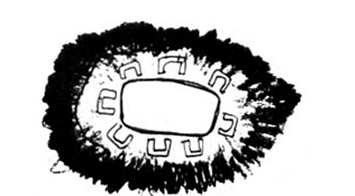

<section class="pattern-plate" aria-labelledby="t-eating-atmosphere">
<a href="/patterns">A Pattern Language</a> · <a href="/patterns#buildings">Buildings</a> · Pattern 182 · p. 844
<h1 class="pattern-title" id="t-eating-atmosphere">Eating Atmosphere</h1><nav class="pattern-links" aria-label="Connections"><h2>Links to</h2><ul><li><a href="/patterns/farmhouse-kitchen">139 Farmhouse Kitchen</a></li><li><a href="/patterns/communal-eating">147 Communal Eating</a></li><li><a href="/patterns/open-shelves">200 Open Shelves</a></li><li><a href="/patterns/waist-high-shelf">201 Waist-High Shelf</a></li><li><a href="/patterns/built-in-seats">202 Built-In Seats</a></li><li><a href="/patterns/warm-colors">250 Warm Colors</a></li><li><a href="/patterns/different-chairs">251 Different Chairs</a></li></ul><h2>Linked from</h2><ul><li><a href="/patterns/farmhouse-kitchen">139 Farmhouse Kitchen</a></li><li><a href="/patterns/communal-eating">147 Communal Eating</a></li><li><a href="/patterns/compost">178 Compost</a></li><li><a href="/patterns/pools-of-light">252 Pools Of Light</a></li></ul></nav></section><article class="pattern-text" aria-label="The text of Eating Atmosphere">
… we have already pointed out how vitally important all kinds of communal eating are in helping to maintain a bond among a group of people—<a class="pl-ref" href="/patterns/communal-eating">COMMUNAL EATING (147)</a>; and we have given some idea of how the common eating may be placed as part of the kitchen itself—<a class="pl-ref" href="/patterns/farmhouse-kitchen">FARMHOUSE KITCHEN (139)</a>. This pattern gives some details of the eating atmosphere.

◆ ◆ ◆

<strong>When people eat together, they may actually be together in spirit—or they may be far apart. Some rooms invite people to eat leisurely and comfortably and feel together, while others force people to eat as quickly as possible so they can go somewhere else to relax.</strong>

Above all, when the table has the same light all over it, and has the same light level on the walls around it, the light does nothing to hold people together; the intensity of feeling is quite likely to dissolve; there is little sense that there is any special kind of gathering. But when there is a soft light, hung low over the table, with dark walls around so that this one point of light lights up people’s faces and is a focal point for the whole group, then a meal can become a special thing indeed, a bond, communion.

Therefore:

<strong>Put a heavy table in the center of the eating space—large enough for the whole family or the group of people using it. Put a light over the table to create a pool of light over the group, and enclose the space with walls or with contrasting darkness. Make the space large enough so the chairs can be pulled back comfortably, and provide shelves and counters close at hand for things related to the meal.</strong>

845

<figure class="pl-figure"><figcaption><em>light in the middle</em></figcaption></figure>

◆ ◆ ◆

Get the details of the light from fools of LIGHT (252); and choose the colors to make the place warm and dark and comfortable at night—<a class="pl-ref" href="/patterns/warm-colors">WARM COLORS (250)</a>; put a few soft chairs nearby—<a class="pl-ref" href="/patterns/different-chairs">DIFFERENT CHAIRS (251)</a>; or put <a class="pl-ref" href="/patterns/built-in-seats">BUILT-IN SEATS (202)</a> with big cushions against one wall; and for the storage space—<a class="pl-ref" href="/patterns/open-shelves">OPEN SHELVES (200)</a> and <a class="pl-ref" href="/patterns/waist-high-shelf">WAIST-HIGH SHELF (201)</a>….
</article>

Christopher Alexander, Sara Ishikawa and Murray Silverstein, with Max Jacobson, Ingrid Fiksdahl-King and Shlomo Angel, <cite>A Pattern Language</cite> (Oxford University Press, 1977), pattern 182, pp. 844–845. Text and illustrations from the <a href="https://github.com/natureoforder/sources">Nature of Order sources</a> reading edition, transcribed from the 1977 printing; report errors on <a href="https://github.com/natureoforder/alexander-wiki/issues">GitHub</a>.

<a href="/patterns/the-fire">← 181 The Fire</a> · <a href="/patterns">All 253 patterns</a> · <a href="/patterns/workspace-enclosure">183 Workspace Enclosure →</a>

