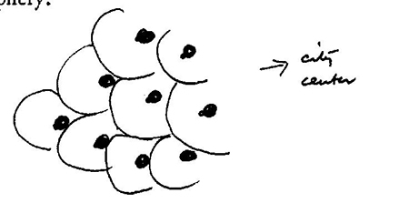
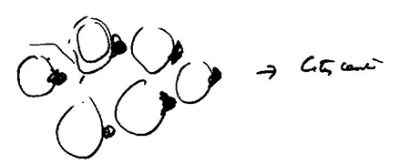
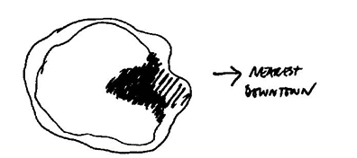
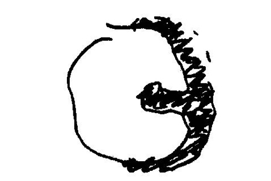
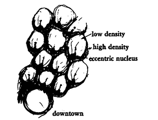

<section class="pattern-plate" aria-labelledby="t-eccentric-nucleus">
<a href="/patterns">A Pattern Language</a> · <a href="/patterns#towns">Towns</a> · Pattern 28 · p. 150 · *
<h1 class="pattern-title" id="t-eccentric-nucleus">Eccentric Nucleus</h1><nav class="pattern-links" aria-label="Connections"><h2>Links to</h2><ul><li><a href="/patterns/magic-of-the-city">10 Magic Of The City</a></li><li><a href="/patterns/community-of-7000">12 Community Of 7000</a></li><li><a href="/patterns/subculture-boundary">13 Subculture Boundary</a></li><li><a href="/patterns/web-of-shopping">19 Web Of Shopping</a></li><li><a href="/patterns/four-story-limit">21 Four-Story Limit</a></li><li><a href="/patterns/sacred-sites">24 Sacred Sites</a></li><li><a href="/patterns/density-rings">29 Density Rings</a></li><li><a href="/patterns/activity-nodes">30 Activity Nodes</a></li><li><a href="/patterns/promenade">31 Promenade</a></li><li><a href="/patterns/shopping-street">32 Shopping Street</a></li><li><a href="/patterns/quiet-backs">59 Quiet Backs</a></li><li><a href="/patterns/still-water">71 Still Water</a></li></ul><h2>Linked from</h2><ul><li><a href="/patterns/community-of-7000">12 Community Of 7000</a></li><li><a href="/patterns/subculture-boundary">13 Subculture Boundary</a></li><li><a href="/patterns/men-and-women">27 Men And Women</a></li><li><a href="/patterns/density-rings">29 Density Rings</a></li><li><a href="/patterns/activity-nodes">30 Activity Nodes</a></li></ul></nav></section><article class="pattern-text" aria-label="The text of Eccentric Nucleus">
… so far, we have established an overall height restriction on the <em>city</em>, with its attendant limitation on average density—<a class="pl-ref" href="/patterns/four-story-limit">FOUR-STORY LIMIT (21)</a>. If we assume, also, that the <em>city</em> contains major centers for <em>every</em> 300,000 people, spaced according to the rules in <a class="pl-ref" href="/patterns/magic-of-the-city">MAGIC OF THE CITY (10)</a> ’it will then follow that the overall density of the <em>city</em> slopes off from these centers: the highest density near to them, the lowest far away. This means that any individual <a class="pl-ref" href="/patterns/community-of-7000">COMMUNITY OF 7000 (12)</a> will have an overall density, given <em>by</em> its distance from the nearest downtown. The question then arises: How should density <em>vary</em> locally, within this community; what geometric pattern should the density have? The question is complicated greatly <em>by</em> the principle of <a class="pl-ref" href="/patterns/subculture-boundary">SUBCULTURE BOUNDARY (13)</a>, which requires that communities are surrounded <em>by</em> their services, instead of having their services at their geometric centers. This pattern, and the next, defines a local distribution of density which is compatible with this context.

◆ ◆ ◆

<strong>The random character of local densities confuses the identity of our communities, and also creates a chaos in the pattern of land use.</strong>

Let us begin <em>by</em> considering the typical configuration of the residential densities in a town. There is an overall slope to the densities: they are high toward the center and lower toward the outskirts. But there is no recognizable structure within this overall slope: no clearly visible repeating pattern we can see again and again within the <em>city</em>. Compare this with the contours of a mountain range. In a mountain range, there is a great deal of recognizable structure; we see systematic ridges and valleys, foothills, bowls, and peaks which have arisen naturally from geological processes; and all this structure is repeated again and again, from place to place, within the whole.

151Of course, this is only an analogy. But it does raise the question: Is it natural, and all right, if density configurations in a town are so random; or would a town be better off if there was some more visible coherent structure, some kind of systematic variation in the pattern of the densities?

What happens when the local densities in a town vary in their present rambling, incoherent fashion? The high density areas, potentially capable of supporting intense activity cannot actually do so because they are too widely spread. And the low density areas, potentially capable of supporting silence and tranquility when they are concentrated, are also too diffusely scattered. The result: the town has neither very intense activity, nor very intense quiet. Since we have many arguments which show how vital it is for a town to give people both intense activity, and also deep and satisfying quiet—<a class="pl-ref" href="/patterns/sacred-sites">SACRED SITES (24)</a>’ <a class="pl-ref" href="/patterns/activity-nodes">ACTIVITY NODES (30)</a>’ <a class="pl-ref" href="/patterns/promenade">PROMENADE (31)</a>, <a class="pl-ref" href="/patterns/quiet-backs">QUIET BACKS (59)</a>, <a class="pl-ref" href="/patterns/still-water">STILL WATER (71)</a>—it seems quite likely, then, that this randomness of density does harm to urban life.

We believe, indeed, that a town would be far better off if it did contain a coherent pattern of densities. We present a systematic account of the factors which might naturally influence the pattern of density-in the hope of showing what kind of coherent pattern might be sensible and useful. The argument has five steps.

1. We may assume, reasonably, that some kind of center, formed by local services, will occur at least once in every community of 7000. This center will typically be the kind we have called a <a class="pl-ref" href="/patterns/shopping-street">SHOPPING STREET (32)</a>. In <a class="pl-ref" href="/patterns/web-of-shopping">WEB OF SHOPPING (19)</a> we have shown that shopping streets occur about once for every 10,000 persons.

2. From the arguments presented in <a class="pl-ref" href="/patterns/subculture-boundary">SUBCULTURE BOUNDARY (13)</a>, we know that this center of activity, since it is a service, should occur in the boundary between subcultures, should help to form the boundary between subcultures, and should therefore be located in the area of the boundary—not <em>inside</em> the community, but <em>between</em> communities.

3.We know, also, that this center must be in just that part of the boundary which is closest to the center of the larger town or city. This follows from a dramatic and little known series of results which show that catch basins of shopping centers are not 152circles, as one might naively suppose, but half-circles, with the half-circle on that side of the center away from the central city, because people always go to that shopping center which lies toward the center of their city, never to the one which lies toward the city’s periphery.

<figure class="pl-figure"><figcaption><em>Brennan’s catch basins</em>.</figcaption></figure>

This phenomenon was originally discovered by Brennan in his post-war studies of Wolverhampton (T. Brennan, <em>Midland City</em>, London: Dobson, 1948). It has, since then, been confirmed and studied by several writers, most notably Terence <em>Lee, “Perceived* Distance as a Function of Direction in the City,” </em>Enrvironment and Behavior*, June 1970, 40-51. Lee has shown that the phenomenon is not only caused by the fact that people are simply more familiar with the roads and paths that lie toward the center, and use them more often, but that their very perception of distance varies with direction, and that distances along lines toward the center are seen as much shorter than distances along lines away from the center.

Since we certainly want the community to correspond with the catch basin of its “center” it is essential, then, that the center be placed off-center—in fact, at that point in the community which lies toward the center of the larger city. This is, of course, compatible with the notion discussed already, that the center should lie in the boundary of the community.

<figure class="pl-figure"><figcaption><em>Eccentric centers</em>.</figcaption></figure>

153

<ol start="4" type="1">
<li>Even though the center lies on one side of the community, forming a boundary of the community, we may also assume that the center does need to bulge into the community just a little. This follows from the fact that, even though services do need to be in the boundary of the community, not in its middle, still, people do have some need for the psychological center of their community to be at least somewhere toward the geometric center of gravity. If we make the boundary bulge toward the geometric center, then this axis will naturally form a center—and, further, its catch basin, according to the data given above, will correspond almost perfectly with the community.</li>
</ol>
<figure class="pl-figure"><figcaption><em>The inward bulge</em>.</figcaption></figure>

<em>5</em>. Finally, although we know that the center needs to be mainly in the boundary, we do not know exactly just how large it needs to be. At the edge of the city, where the overall density is low-the center will be small. At the center of the city, where the overall density is higher, it will be larger, because the greater density of population supports more services. In both cases, it will be in the boundary. If it is too large to be contained at one point, it will naturally extend itself along the boundary, but still within the boundary, thus forming a lune, a partial horseshoe, long or short, according to its position in the greater city.

<figure class="pl-figure"><figcaption><em>A partial horseshoe</em>.</figcaption></figure>

154These rules are rather simple. If we follow them, we shall find a beautiful gradient of overlapping imbricated horseshoes, not unlike the scales of a fish. If the city gradually gets this highly coherent structure, then we can be sure that the articulation of dense areas, and areas of little density, will be so clear that both activity and quiet can exist, each intense, unmixed, and each available to everyone.

Therefore:

<strong>Encourage growth and the accumulation of density to form a clear configuration of peaks and valleys according to the following rules:</strong>

<strong>1.  Consider the town as a collection of communities of 7000. These communities will be between 1/4 mile across and 2 miles across, according to their overall density.</strong>

<strong>2.  Mark that point in the boundary of each community which is closest to the nearest major urban center. This point will be the peak of the density, and the core of the “eccentric” nucleus.</strong>

<strong>3.  Allow the high density to bulge in from the boundary, toward the center of gravity of the community, thus enlarging the eccentric nucleus toward the center.</strong>

<strong>4.  Continue this high density to form a ridge around the boundary in horseshoe fashion-with the length of the horseshoe dependent on the overall mean gross density, at that part of the city, and the bulge of the horseshoe toward the center of the region, so that the horseshoes form a gradient, according to their position in the region. Those close to a major downtown arc almost complete; those further away arc only half complete; and those furthest from centers arc shrunken to a point.</strong>

155

<figure class="pl-figure"></figure>
◆ ◆ ◆

Given this overall configuration, now calculate the average densities at different distances from this ridge of high density, according to the computations given in the next pattern—<a class="pl-ref" href="/patterns/density-rings">DENSITY RINGS (29)</a>; keep major shopping streets and promenades toward the dense part of the horseshoe—<a class="pl-ref" href="/patterns/activity-nodes">ACTIVITY NODES (30)</a>, <a class="pl-ref" href="/patterns/promenade">PROMENADE (31)</a>, <a class="pl-ref" href="/patterns/shopping-street">SHOPPING STREET (32)</a>; and keep quiet areas toward the open part of the horseshoe—<a class="pl-ref" href="/patterns/sacred-sites">SACRED SITES (24)</a>, <a class="pl-ref" href="/patterns/quiet-backs">QUIET BACKS (59)</a>, <a class="pl-ref" href="/patterns/still-water">STILL WATER (71)</a>….
</article>

Christopher Alexander, Sara Ishikawa and Murray Silverstein, with Max Jacobson, Ingrid Fiksdahl-King and Shlomo Angel, <cite>A Pattern Language</cite> (Oxford University Press, 1977), pattern 28, pp. 150–155. Text and illustrations from the <a href="https://github.com/natureoforder/sources">Nature of Order sources</a> reading edition, transcribed from the 1977 printing; report errors on <a href="https://github.com/natureoforder/alexander-wiki/issues">GitHub</a>.

<a href="/patterns/men-and-women">← 27 Men And Women</a> · <a href="/patterns">All 253 patterns</a> · <a href="/patterns/density-rings">29 Density Rings →</a>

