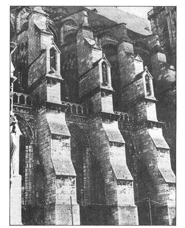
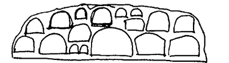
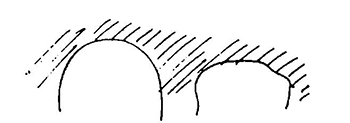
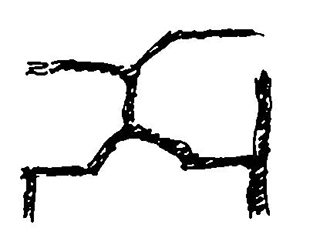
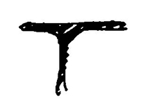
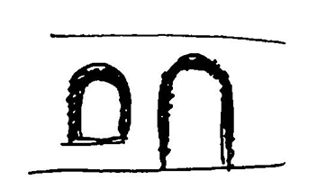
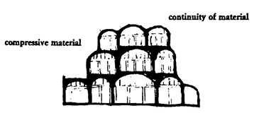

<section class="pattern-plate" aria-labelledby="t-efficient-structure">
<a href="/patterns">A Pattern Language</a> · <a href="/patterns#construction">Construction</a> · Pattern 206 · p. 946 · *
<h1 class="pattern-title" id="t-efficient-structure">Efficient Structure</h1><figure class="pattern-figure pl-figure"></figure><nav class="pattern-links" aria-label="Connections"><h2>Links to</h2><ul><li><a href="/patterns/ceiling-height-variety">190 Ceiling Height Variety</a></li><li><a href="/patterns/the-shape-of-indoor-space">191 The Shape Of Indoor Space</a></li><li><a href="/patterns/structure-follows-social-spaces">205 Structure Follows Social Spaces</a></li><li><a href="/patterns/good-materials">207 Good Materials</a></li><li><a href="/patterns/roof-layout">209 Roof Layout</a></li><li><a href="/patterns/floor-and-ceiling-layout">210 Floor And Ceiling Layout</a></li><li><a href="/patterns/columns-at-the-corners">212 Columns At The Corners</a></li><li><a href="/patterns/final-column-distribution">213 Final Column Distribution</a></li><li><a href="/patterns/box-columns">216 Box Columns</a></li><li><a href="/patterns/perimeter-beams">217 Perimeter Beams</a></li><li><a href="/patterns/wall-membrane">218 Wall Membrane</a></li><li><a href="/patterns/floor-ceiling-vaults">219 Floor-Ceiling Vaults</a></li><li><a href="/patterns/roof-vaults">220 Roof Vaults</a></li><li><a href="/patterns/frames-as-thickened-edges">225 Frames As Thickened Edges</a></li><li><a href="/patterns/column-connections">227 Column Connections</a></li></ul><h2>Linked from</h2><ul><li><a href="/patterns/structure-follows-social-spaces">205 Structure Follows Social Spaces</a></li><li><a href="/patterns/good-materials">207 Good Materials</a></li><li><a href="/patterns/gradual-stiffening">208 Gradual Stiffening</a></li><li><a href="/patterns/floor-and-ceiling-layout">210 Floor And Ceiling Layout</a></li><li><a href="/patterns/thickening-the-outer-walls">211 Thickening The Outer Walls</a></li><li><a href="/patterns/columns-at-the-corners">212 Columns At The Corners</a></li><li><a href="/patterns/final-column-distribution">213 Final Column Distribution</a></li><li><a href="/patterns/ground-floor-slab">215 Ground Floor Slab</a></li><li><a href="/patterns/perimeter-beams">217 Perimeter Beams</a></li><li><a href="/patterns/wall-membrane">218 Wall Membrane</a></li><li><a href="/patterns/floor-ceiling-vaults">219 Floor-Ceiling Vaults</a></li><li><a href="/patterns/roof-vaults">220 Roof Vaults</a></li><li><a href="/patterns/frames-as-thickened-edges">225 Frames As Thickened Edges</a></li><li><a href="/patterns/column-connections">227 Column Connections</a></li><li><a href="/patterns/stair-vault">228 Stair Vault</a></li><li><a href="/patterns/duct-space">229 Duct Space</a></li></ul></nav></section><article class="pattern-text" aria-label="The text of Efficient Structure">
947… this pattern complements the pattern <a class="pl-ref" href="/patterns/structure-follows-social-spaces">structure follows social spaces (205)</a>. Where that pattern defines the relationship between the social spaces and the structure, this pattern lays down the kind of structure which is dictated by pure engineering. As you will see, it is compatible with STRUCTURE FOLLOWS SOCIAL SPACES, and will help to create it.

◆ ◆ ◆

<strong>Some buildings have column and beam structures; others have load-bearing walls with slab floors; others are vaulted structures, or domes, or tents. But which of these, or what mixture of them, is actually the most efficient? What is the best way to distribute materials throughout a building, so as to enclose the space, strongly and well, with the least amount of material?</strong>

Engineers usually say that there is no answer to this question. According to current engineering practice it is first necessary to make an arbitrary choice among the basic possible systems—and only then possible to use theory and calculation to fix the size of members within the chosen system. But, the basic choice itself—at least according to prevailing dogma—cannot be made by theory.

To anyone with an enquiring mind, this seems quite unlikely. That such a fundamental choice, as the choice between column and beams systems and load-bearing wall systems and vaulted systems, should lie purely in the realm of whim—and that the possible myriad of mixed systems, which lie between these archetypes, cannot even be considered—all this has more to do with the status of available theory than with any fundamental insight.

Indeed, as we shall now try to show, the archetypal, best solution to the problem of efficient structure in a building is one which does lie in between the three most famous archetypes. It is a system of load-bearing walls, supported at frequent intervals by thickened stiffeners like columns, and floored and roofed by a system of vaults.

We shall derive the character of the most efficient structure in 948three steps. First, we shall define the three-dimensional character of a typical system of rooms and spaces in a building. We shall then define an efficient structure as the smallest cheapest amount of stable material, placed only in the interstices between the rooms, which can support itself and the loads which the rooms generate. Finally, we shall obtain the details of an efficient structure. For a similar discussion, see Christopher Alexander, “An attempt to derive the nature of a human building system from first principles,” in Edward Allen, <em>The Responsive House,</em> M.I.T. Press, 1974.

1. <em>The three-dimensional character of a typical building based purely on the social spaces and the character of rooms</em>.

In order to obtain this from fundamental considerations, let us first review the typical shape of rooms—see <a class="pl-ref" href="/patterns/the-shape-of-indoor-space">THE SHAPE OF INDOOR SPACE (191)</a>—and then go on to derive the most efficient structure for a building made up of these kinds of rooms:

1. The boundary of any space, seen in plan, is formed by segments which are essentially straight lines—though they need not be perfectly straight.

2. The ceiling heights of spaces vary according to their social functions. Roughly speaking, the ceiling heights vary with floor areas—large spaces have higher ceilings, small ones lower—<a class="pl-ref" href="/patterns/ceiling-height-variety">CEILING HEIGHT VARIETY (190)</a>.

3. The edges of the space are essentially vertical up to head height—that is, about 6 feet. Above head height, the boundaries of the space may come in toward the space. The upper corners between wall and ceiling of a normal room serve no function, and it is therefore not useful to consider them as an essential part of the space.

4. Each space has a horizontal floor.

5. A building then is a packing of polygonal spaces in which each polygon has a beehive cross section, and a height which varies according to its size.

If we follow the principle of <a class="pl-ref" href="/patterns/structure-follows-social-spaces">STRUCTURE FOLLOWS SOCIAL SPACES (205)</a>, we may assume that this three-dimensional array of spaces must remain intact, and not be interrupted by structural

949

<figure class="pl-figure"><figcaption><em>A packing of polygonal beehive spaces</em>.</figcaption></figure>

elements. This means that an efficient structure must be one of the arrangements of material which occupies only the interstices between the spaces.

We may visualize the crudest of these possible structures by means of a simple imaginary process. Make a lump of wax for each of the spaces which appears in the building, and construct a three-dimensional array of these lumps of wax, leaving gaps between all adjacent lumps. Now, take a generalized “structure fluid,” and pour it all over this arrangements of lumps, so that it completely covers the whole thing, and fills all the gaps. Let this fluid harden. Now dissolve out the wax lumps that represent spaces. The stuff which remains is the most generalized building structure.

<em>II. The most efficient structure for a given system of spaces</em>.

Obviously, the imaginary structure made from the structure fluid is not real. And besides, it is rather inefficient: it would, if actually carried out, use a great deal of material. We must now ask how to make a structure, similar to this imaginary one, but one which uses the smallest amount of material. As we shall see, this most efficient structure will be <em>a compression structure</em>, in which bending and tension are reduced to a minimum and <em>a continuous structure</em>, in which all members are rigidly connected in such a way that each member carries at least some part of the stresses caused by any pattern of loading.

1. <em>A compression structure</em>. In an efficient structure, we want every ounce of material to be working to its capacity. In more precise terms, we want the stress distributed throughout the materials in such a way that every cubic inch is stressed to the same degree. This is not happening, for example, in a simple wooden beam. The material is most stressed at the top and bottom 950of the beam; the middle of the beam has only very low stresses, because there is too much material there relative to the stress distribution.

As a general rule, we may say that members which are in bending always have uneven stress distributions and that we can therefore only distribute stresses evenly throughout the materials if the structure is entirely free of bending. In short, then, a perfectly efficient structure must be free of bending.

There are two possible structures which avoid bending altogether: pure tension structures and pure compression structures. Although pure tension structures are theoretically interesting and suitable for occasional special purposes, the considerations described in <a class="pl-ref" href="/patterns/good-materials">GOOD MATERIALS (207)</a> rule them out overwhelmingly on the grounds that tension materials are hard to obtain, and expensive, while almost all materials can resist compression. Note especially that wood and steel, the two principle tension materials in buildings, are both scarce, and can—on ecological grounds—no longer be used in bulk—again, see GOOD MATERIALS ((207)).

2. <em>A continuous structure</em>. In an efficient structure, it is not only true that individual elements have even stress distributions in them when they are loaded. It is also true that the structure acts as a whole.

Consider, for example, the case of a basket. The individual strands of the basket are weak. By itself no one strand can resist much load. But the basket is so cunningly made, that all the strands work together to resist even the smallest load. If you press on one part of the basket with your finger, all the strands in the basket—even those in the part furthest from your finger—work together to resist the load. And of course, since the whole structure works as one, to resist the load, no one part has, individually, to be very strong.

This principle is particularly important in a structure like a building, which faces a vast range of different loading conditions. At one minute, the wind is blowing very strong in one direction; at another moment an earthquake shakes the building; in later years, uneven settlement redistributes dead loads because some foundations sink lower than others; and, of course, throughout its life the people and furniture in the building are moving all the time. If each element is to be strong enough, by itself, to resist the maximum load it can be subjected to, it will have to be enormous.

951But when the building is continuous, like a basket, so that each part of the building helps to carry the smallest load, then, of course, the unpredictable nature of the loads creates no difficulties at all. Members can be quite small, because no matter what the loads are, the continuity of the building will distribute them among the members as a whole, and the building will act as a whole against them.

The continuity of a building depends on its connections: actual continuity of material and shape. It is very hard, almost impossible, to make continuous connections between different materials, which transfer load as efficiently as a continuous material; and it is therefore essential that the building be made of one material, which is actually continuous from member to member. And the shape of the connections between elements is vital too. Right angles tend to create discontinuities: forces can be distributed throughout the building only if there are diagonal fillets wherever walls meet ceilings, walls meet walls, and columns meet beams.

<em>III. The details of an efficient structure</em>.

If we assume now that an efficient building will be both compressive and continuous, we can obtain the main morphological features of its structure by direct inference.

<em>1. Its ceilings, floors, and rooms must all be vaulted</em>. This follows directly. The dome or vault shape is the only shape which works in pure compression. Floors and roofs can only be continuous with walls, if they curve downward at their edges. And the shape of social spaces also invites it directly—since the triangle of space between the wall and ceiling serves no useful purpose, it is a natural place for structural material.

<figure class="pl-figure"><figcaption><em>vaults</em>.</figcaption></figure>

952

<ol start="3" type="1">
<li><em>Walls must all be load-bearing</em>. Any non load-bearing partition evidently contradicts the principle of continuity which says that every particle of the building is helping to resist loads. Furthermore, columns with non load-bearing partitions between them need shear support. The wall provides it naturally; and the continuity of the walls, floor, and ceiling can only be created by the action of a wall that ties them together.</li>
</ol>
<figure class="pl-figure"><figcaption><em>Load-bearing walls</em>.</figcaption></figure>

3. <em>Walls must be stiffened at intervals along their length by columnar ribs</em>. If a wall is to contain a given amount of material, then the wall acts most efficiently when its material is redistributed, nonhomogeneously, to form vertical ribs. This wall is most efficient in resisting buckling—indeed, at most thicknesses this kind of stiffening is actually <em>required</em> to let the wall act at its full compressive capacity—see <a class="pl-ref" href="/patterns/final-column-distribution">final column distribution (213)</a>. And it helps to resist horizontal loads, because the stiffeners act as beams against the horizontal forces.

<figure class="pl-figure"><figcaption><em>Vertical stiffeners</em>.</figcaption></figure>

4. <em>Connections between walls and floors, and between walls and walls, must all be thickened by extra material that forms a fillet along the seam</em>. Connections are the weakest points for continuity, and right-angled connections are the worst. However, we know from <a class="pl-ref" href="/patterns/the-shape-of-indoor-space">THE SHAPE OF INDOOR SPACE (191)</a> that we cannot avoid rough right angles where walls meet walls; and of course, there must be rough right angles where walls meet floors. To counteract the effect of the right angle, it is necessary to “fill” the angle with material. This principle is discussed under <a class="pl-ref" href="/patterns/column-connections">COLUMN CONNECTIONS (227)</a>.

<figure class="pl-figure"><figcaption><em>Thickened connections</em>.</figcaption></figure>

953

<ol start="5" type="1">
<li><em>Openings in walls must have thickened frames, and rounding in the upper comers</em>. This follows directly from the principle of continuity and is fully discussed in <a class="pl-ref" href="/patterns/frames-as-thickened-edges">FRAMES AS THICKENED EDGES (225)</a>.</li>
</ol>
<figure class="pl-figure"><figcaption><em>Openings</em>.</figcaption></figure>

Therefore:

<strong>Conceive the building as a building made from one continuous body of compressive material. In its geometry, conceive it as a three-dimensional system of individually vaulted spaces, most of them roughly rectangular; with thin load-bearing walls, each stiffened by columns at intervals along its length, thickened where walls meet walls and where walls meet vaults and stiffened around the openings.</strong>

<figure class="pl-figure"></figure>
954The layout of the inner vaults is given in <a class="pl-ref" href="/patterns/floor-and-ceiling-layout">FLOOR AND CEILINC LAVOUT (210)</a> and <a class="pl-ref" href="/patterns/floor-ceiling-vaults">FLOOR-CEILING VAULTS (219)</a>; the layout of the outer vaults which form the roof is given in <a class="pl-ref" href="/patterns/roof-layout">roof LAYOUT (209)</a> and <a class="pl-ref" href="/patterns/roof-vaults">ROOF VAULTS (220)</a>. The layout of the stiffeners which make the walls is given in <a class="pl-ref" href="/patterns/final-column-distribution">final COLUMN DISTRIBUTION (213)</a>; the layout of the thickening where walls meet walls is given by <a class="pl-ref" href="/patterns/columns-at-the-corners">COLUMNS AT THE CORNERS (212)</a>; the thickening where walls meet vaults is given by <a class="pl-ref" href="/patterns/perimeter-beams">PERIMETER BEAMS (217)</a>; the construction of the columns and the walls is given by <a class="pl-ref" href="/patterns/box-columns">BOX COLUMNS (216)</a> and <a class="pl-ref" href="/patterns/wall-membrane">WALL MEMBRANES (218)</a>; the thickening of doors and window frames is given by <a class="pl-ref" href="/patterns/frames-as-thickened-edges">FRAMES AS THICKENED EDGES (225)</a>; and the non-right-angled connection between columns and beams by <a class="pl-ref" href="/patterns/column-connections">COLUMN CONNECTION (227)</a>….
</article>

Christopher Alexander, Sara Ishikawa and Murray Silverstein, with Max Jacobson, Ingrid Fiksdahl-King and Shlomo Angel, <cite>A Pattern Language</cite> (Oxford University Press, 1977), pattern 206, pp. 946–954. Text and illustrations from the <a href="https://github.com/natureoforder/sources">Nature of Order sources</a> reading edition, transcribed from the 1977 printing; report errors on <a href="https://github.com/natureoforder/alexander-wiki/issues">GitHub</a>.

<a href="/patterns/structure-follows-social-spaces">← 205 Structure Follows Social Spaces</a> · <a href="/patterns">All 253 patterns</a> · <a href="/patterns/good-materials">207 Good Materials →</a>

