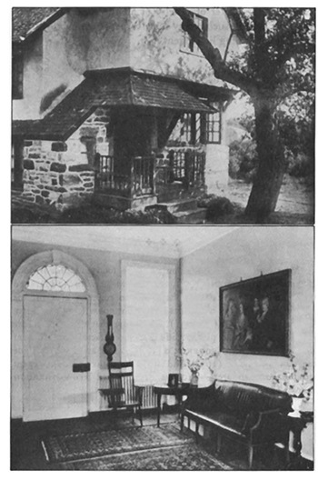
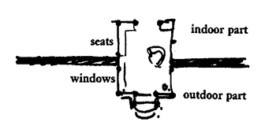

<section class="pattern-plate" aria-labelledby="t-entrance-room">
<a href="/patterns">A Pattern Language</a> · <a href="/patterns#buildings">Buildings</a> · Pattern 130 · p. 622 · **
<h1 class="pattern-title" id="t-entrance-room">Entrance Room</h1><figure class="pattern-figure pl-figure"></figure><nav class="pattern-links" aria-label="Connections"><h2>Links to</h2><ul><li><a href="/patterns/family-of-entrances">102 Family Of Entrances</a></li><li><a href="/patterns/main-entrance">110 Main Entrance</a></li><li><a href="/patterns/entrance-transition">112 Entrance Transition</a></li><li><a href="/patterns/car-connection">113 Car Connection</a></li><li><a href="/patterns/tapestry-of-light-and-dark">135 Tapestry Of Light And Dark</a></li><li><a href="/patterns/private-terrace-on-the-street">140 Private Terrace On The Street</a></li><li><a href="/patterns/sequence-of-sitting-spaces">142 Sequence Of Sitting Spaces</a></li><li><a href="/patterns/light-on-two-sides-of-every-room">159 Light On Two Sides Of Every Room</a></li><li><a href="/patterns/gallery-surround">166 Gallery Surround</a></li><li><a href="/patterns/the-shape-of-indoor-space">191 The Shape Of Indoor Space</a></li><li><a href="/patterns/waist-high-shelf">201 Waist-High Shelf</a></li><li><a href="/patterns/built-in-seats">202 Built-In Seats</a></li><li><a href="/patterns/solid-doors-with-glass">237 Solid Doors With Glass</a></li><li><a href="/patterns/front-door-bench">242 Front Door Bench</a></li></ul><h2>Linked from</h2><ul><li><a href="/patterns/family-of-entrances">102 Family Of Entrances</a></li><li><a href="/patterns/main-entrance">110 Main Entrance</a></li><li><a href="/patterns/entrance-transition">112 Entrance Transition</a></li><li><a href="/patterns/something-roughly-in-the-middle">126 Something Roughly In The Middle</a></li><li><a href="/patterns/intimacy-gradient">127 Intimacy Gradient</a></li><li><a href="/patterns/the-flow-through-rooms">131 The Flow Through Rooms</a></li><li><a href="/patterns/staircase-as-a-stage">133 Staircase As A Stage</a></li><li><a href="/patterns/zen-view">134 Zen View</a></li><li><a href="/patterns/sequence-of-sitting-spaces">142 Sequence Of Sitting Spaces</a></li><li><a href="/patterns/reception-welcomes-you">149 Reception Welcomes You</a></li><li><a href="/patterns/connection-to-the-earth">168 Connection To The Earth</a></li><li><a href="/patterns/window-place">180 Window Place</a></li><li><a href="/patterns/interior-windows">194 Interior Windows</a></li><li><a href="/patterns/built-in-seats">202 Built-In Seats</a></li><li><a href="/patterns/front-door-bench">242 Front Door Bench</a></li></ul></nav></section><article class="pattern-text" aria-label="The text of Entrance Room">
623… the position and overall shape of entrances is given by FAMILY OF ENTRANCES (l02), <a class="pl-ref" href="/patterns/main-entrance">MAIN ENTRANCE (110)</a> and <a class="pl-ref" href="/patterns/entrance-transition">ENTRANCE TRANSITION (112)</a>. This pattern gives the entrances their detailed shape, their shape and body and three dimensions, and helps complete the form begun by <a class="pl-ref" href="/patterns/car-connection">CAR CONNECTION (113)</a>, and the <a class="pl-ref" href="/patterns/private-terrace-on-the-street">PRIVATE TERRACE ON THE STREET (140)</a>.

<strong>Arriving in a building, or leaving it, you need a room to pass through, both inside the building and outside it This is the entrance room.</strong>

The most impressionistic and intuitive way to describe the need for the entrance room is to say that the time of arriving, or leaving, seems to swell with respect to the minutes which precede and follow it, and that in order to be congruent with the importance of the moment, the space too must follow suit and swell with respect to the immediate inside and the immediate outside of the building.

We shall see now that there are a tremendous number of miniscule forces which all come together to support this general intuition. All these forces, tendencies, and solutions were originally describe by Alexander and Poyner, in the Atoms of Environmental Structure, Ministry of Public Works, Research and Development, SFB B24, London, 1966. At that time it seemed important to emphasize the separate and individual patterns defined by these forces. However, at the present writing it seems clear that these original patterns are, in fact, all faces of the one larger and more comprehensive entity, which we call the <a class="pl-ref" href="/patterns/entrance-room">ENTRANCE ROOM (130)</a>.

1. <em>The relationship of windows to the entrance</em>

(a) A person answering the door often tries to see who is at the door before they open it.

(b) People do not want to go out of their way to peer at people on the doorstep.

624(c) If the people meeting are old friends, they seek a chance to shout out and wave in anticipation.

The entrance room therefore needs a window—or windows—on the path from the family room or kitchen to the door, facing the area outside the door from the side.

2. <em>The need for shelter outside the door</em>

(a) People try to get shelter from the rain, wind, and cold while they are waiting.

(b) People stand near the door while they are waiting for it to open.

On the outside, therefore, give the entrance room walls enclosing three sides of a covered space.

3. <em>The subtleties of saying goodbye</em>

When hosts and guests are saying goodbye, the lack of a clearly marked “goodbye” point can easily lead to endless “Well, we really must be going nowr” and then further conversations lingering on, over and over again.

(a) Once they have finally decided to go, people try to leave without hesitation.

(b) People try to make their goodbye as nonabrupt as possible and seek a comfortable break.

Give the entrance room, therefore, a clearly defined area, at least 20 square feet, outside the front door, raised with a natural threshold—perhaps a railing, or a low wall, or a step—between it and the visitors’ cars.

4. <em>Shelf near the entrance</em>

When a person is going into the house with a package:

(a) He tries to hold onto the package; he tries to keep it upright, and off the ground.

(b) At the same time he tries to get both hands free to hunt through pockets or handbag for a key.

And leaving the house with a package:

(c) At the moment of leaving people tend to be preoccupied with other things, and this makes them forget the package which they meant to take.

625You can avoid these conflicts if there are shelves both inside and outside the door, at about waist height; a place to leave packages in readiness; a place to put them down while opening the door.

5. <em>Interior of the entrance room</em>

(a) Politeness demands that when someone comes to the door, the door is opened wide.

(b) People seek privacy for the inside of their houses.

(c) The family, sitting, talking, or at table, do not want to feel disturbed or intruded upon when someone comes to the door.

Make the inside of the entrance room zigzag, or obstructed, so that a person standing on the doorstep of the open door can see no rooms inside, except the entrance room itself, nor through the doors of any rooms.

6. <em>Coats, shoes, children’s bikes</em> …

(a)Muddy boots have got to come off.

(b) People need a five foot diameter of clear space to take off their coats.

(c) People take prams, bicycles, and so on indoors to protect them from theft and weather; and children will tend to leave all kinds of clutter—bikes, wagons, roller skates, trikes, shovels, balls—around the door they use most often.

Therefore, give the entrance room a dead comer for storage, put coat pegs in a position which can be seen from the front door, and make an area five feet in diameter next to the pegs.

Therefore:

<strong>At the main entrance to a building, make a light-filled room which marks the entrance and straddles the boundary between indoors and outdoors, covering some space outdoors and some space indoors. The outside part may be like an old-fashioned porch; the inside like a hall or sitting room.</strong>

626

<figure class="pl-figure"></figure>
◆ ◆ ◆

Give that part of the entrance which sticks out into the street or garden a physical character which, as far as possible, make it one of the family of entrances along the street—<a class="pl-ref" href="/patterns/family-of-entrances">FAMILY OF ENTRANCES (102)</a>; where it is appropriate, make it a porch—<a class="pl-ref" href="/patterns/gallery-surround">GALLERY SURROUND (166)</a>; and include a bench or seat, where people can watch the world go by or wait for someone—<a class="pl-ref" href="/patterns/front-door-bench">FRONT DOOR BENCH (242)</a>. As for the indoor part of the entrance room, above all, make sure that it is filled with light from two or even three sides, so that the first impression of the building is of light <a class="pl-ref" href="/patterns/tapestry-of-light-and-dark">TAPESTRY OF LIGHT AND DARK (135)</a>, <a class="pl-ref" href="/patterns/light-on-two-sides-of-every-room">LIGHT ON TWO SIDES OF EVERY ROOM (159)</a>. Put windows in the door itself—<a class="pl-ref" href="/patterns/solid-doors-with-glass">SOLID DOORS WITH GLASS (237)</a>. Put in <a class="pl-ref" href="/patterns/built-in-seats">BUILT-IN SEATS (202)</a> and make the room part of the <a class="pl-ref" href="/patterns/sequence-of-sitting-spaces">SEQUENCE OF SITTING SPACES (142)</a>; provide a <a class="pl-ref" href="/patterns/waist-high-shelf">WAIST-HIGH SHELF (201)</a> for packages. And finally, for the overall shape of the entrance room and its construction, begin with <a class="pl-ref" href="/patterns/the-shape-of-indoor-space">THE SHAPE OF INDOOR SPACE (191)</a>….
</article>

Christopher Alexander, Sara Ishikawa and Murray Silverstein, with Max Jacobson, Ingrid Fiksdahl-King and Shlomo Angel, <cite>A Pattern Language</cite> (Oxford University Press, 1977), pattern 130, pp. 622–626. Text and illustrations from the <a href="https://github.com/natureoforder/sources">Nature of Order sources</a> reading edition, transcribed from the 1977 printing; report errors on <a href="https://github.com/natureoforder/alexander-wiki/issues">GitHub</a>.

<a href="/patterns/common-areas-at-the-heart">← 129 Common Areas At The Heart</a> · <a href="/patterns">All 253 patterns</a> · <a href="/patterns/the-flow-through-rooms">131 The Flow Through Rooms →</a>

