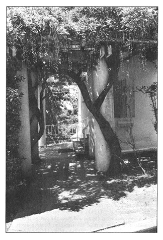
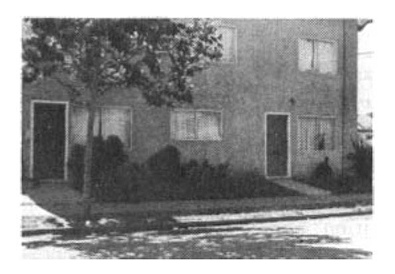
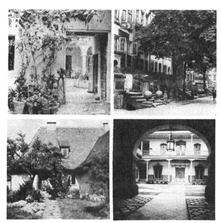
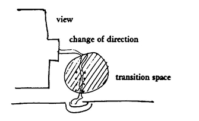

<section class="pattern-plate" aria-labelledby="t-entrance-transition">
<a href="/patterns">A Pattern Language</a> · <a href="/patterns#buildings">Buildings</a> · Pattern 112 · p. 548 · **
<h1 class="pattern-title" id="t-entrance-transition">Entrance Transition</h1><figure class="pattern-figure pl-figure"></figure><nav class="pattern-links" aria-label="Connections"><h2>Links to</h2><ul><li><a href="/patterns/main-gateways">53 Main Gateways</a></li><li><a href="/patterns/family-of-entrances">102 Family Of Entrances</a></li><li><a href="/patterns/main-entrance">110 Main Entrance</a></li><li><a href="/patterns/half-hidden-garden">111 Half-Hidden Garden</a></li><li><a href="/patterns/intimacy-gradient">127 Intimacy Gradient</a></li><li><a href="/patterns/entrance-room">130 Entrance Room</a></li><li><a href="/patterns/zen-view">134 Zen View</a></li><li><a href="/patterns/tapestry-of-light-and-dark">135 Tapestry Of Light And Dark</a></li><li><a href="/patterns/garden-wall">173 Garden Wall</a></li><li><a href="/patterns/trellised-walk">174 Trellised Walk</a></li></ul><h2>Linked from</h2><ul><li><a href="/patterns/family-of-entrances">102 Family Of Entrances</a></li><li><a href="/patterns/long-thin-house">109 Long Thin House</a></li><li><a href="/patterns/main-entrance">110 Main Entrance</a></li><li><a href="/patterns/half-hidden-garden">111 Half-Hidden Garden</a></li><li><a href="/patterns/car-connection">113 Car Connection</a></li><li><a href="/patterns/entrance-room">130 Entrance Room</a></li><li><a href="/patterns/zen-view">134 Zen View</a></li><li><a href="/patterns/rooms-to-rent">153 Rooms To Rent</a></li><li><a href="/patterns/trellised-walk">174 Trellised Walk</a></li></ul></nav></section><article class="pattern-text" aria-label="The text of Entrance Transition">
549… whatever kind of building or building complex you are making, you have a rough position for its major entrances—the gateways to the site from <a class="pl-ref" href="/patterns/main-gateways">MAIN GATEWAYS (53)</a>; the entrances to individual buildings from <a class="pl-ref" href="/patterns/family-of-entrances">FAMILY OF ENTRANCES (102)</a>, <a class="pl-ref" href="/patterns/main-entrance">MAIN ENTRANCE (110)</a>. In every case, the entrances create a transition between the “outside”—the public world—and some less public inner world. If you have <a class="pl-ref" href="/patterns/half-hidden-garden">HALF-HIDDEN GARDENS (111)</a> the gardens help to intensify the beauty of the transition. This pattern now elaborates and reinforces the transition which entrances and gardens generate.

◆ ◆ ◆

<strong>Buildings, and especially houses, with a graceful transition between the street and the inside, are more tranquil than those which open directly off the street.</strong>

The experience of entering a building influences the way you feel inside the building. If the transition is too abrupt there is no feeling of arrival, and the inside of the building fails to be an inner sanctum.

<figure class="pl-figure"><figcaption><em>An abrupt entrance—no transition</em>.</figcaption></figure>

The following argument may help to explain it. While people are on the street, they adopt a style of “street behavior.” When they come into a house they naturally want to get rid of this street behavior and settle down completely into the more intimate spirit appropriate to a house. But it seems likely that they cannot do this unless there is a transition from one to the other which 550helps them to lose the street behavior. The transition must, in effect, destroy the momentum of the closedness, tension and “distance” which are appropriate to street behavior, before people can relax completely.

Evidence comes from the report by Robert Weiss and Serge Bouterline, <em>Fairs, Exhibits, Pavilions, and their Audiences</em>, Cambridge, Mass., 1962. The authors noticed that many exhibits failed to “hold” people; people drifted in and then drifted out again within a very short time. However, in one exhibit people had to cross a huge, deep-pile, bright orange carpet on the way in. In this case, though the exhibit was no better than other exhibits, people stayed. The authors concluded that people were, in general, under the influence of their own “street and crowd behavior,” and that while under this influence could not relax enough to make contact with the exhibits. But the bright carpet presented them with such a strong contrast as they walked in, that it broke the effect of their outside behavior, in effect “wiped them clean,” with the result that they could then get absorbed in the exhibit.

Michael Christiano, while a student at the University of California, made the following experiment. He showed people photographs and drawings of house entrances with varying degrees of transition and then asked them which of these had the most “housencss.” He found that the more changes and transitions a house entrance has, the more it seems to be “houselike.” And the entrance which was judged most houselike of all is one which is approached by a long open sheltered gallery from which there is a view into the distance.

There is another argument which helps to explain the importance of the transition: people want their house, and especially the entrance, to be a private domain. If the front door is set back, and there is a transition space between it and the street, this domain is well established. This would explain why people are often unwilling to go without a front lawn, even though they do not “use it.” Cyril Bird found that 90 per cent of the inhabitants of a housing project said their front gardens, which were some 20 feet deep, were just right or even too small—yet only 15 per cent of them ever used the gardens as a place to sit. (“Reactions to Radburn: A Study of Radburn Type Housing, in Hemel Hempstead,” RIBA final thesis, i960.)

551So far we have spoken mainly about houses. But we believe this pattern applies to a wide variety of entrances. It certainly applies to all dwellings including apartments—even though it is usually missing from apartments today. It also applies to those public buildings which thrive on a sense of seclusion from the world: a clinic, a jewelry store, a church, a public library. It does not apply to public buildings or any buildings which thrive on the fact of being continuous with the public world.

Here are four examples of successful entrance transitions.

<figure class="pl-figure"><figcaption><em>Each creates the transition with a different combination of elements</em>.</figcaption></figure>

As you see from these examples, it is possible to make the transition itself in many different physical ways. In some cases, for example, it may be just inside the front door—a kind of entry court, leading to another door or opening that is more definitely inside, In another case, the transition may be formed by a bend in the path that takes you through a gate and brushes past the fuchsia on the way to the door. Or again, you ’might create a transition 552by changing the texture of the path, so that you step off the sidewalk onto a gravel path and then up a step or two and under a trellis.

In all these cases, what matters most is that the transition exists, as an actual physical place, between the outside and the inside, and that the view, and sounds, and light, and surface which you walk on change as you pass through this place. It is the physical changes—and above all the change of view—which creates the psychological transition in your mind.

Therefore:

<strong>Make a transition space between the street and the front door. Bring the path which connects street and entrance through this transition space, and mark it with a change of light, a change of sound, a change of direction, a change of surface, a change of level, perhaps by gateways which make a change of enclosure, and above all with a change of view.</strong>

<figure class="pl-figure"></figure>
◆ ◆ ◆

Emphasize the momentary view which marks the transition by a glimpse of a distant place—<a class="pl-ref" href="/patterns/zen-view">ZEN VIEW (134)</a>; perhaps make a gateway or a simple garden gate to mark the entrance—<a class="pl-ref" href="/patterns/garden-wall">GARDEN WALL (173)</a>; and emphasize the change of light—<a class="pl-ref" href="/patterns/tapestry-of-light-and-dark">TAPESTRY OF LIGHT AND DARK (135)</a>, <a class="pl-ref" href="/patterns/trellised-walk">TRELLISED WALK (174)</a>. The transition runs right up to the front door, up to the <a class="pl-ref" href="/patterns/entrance-room">ENTRANCE ROOM (130)</a>, and marks the beginning of the <a class="pl-ref" href="/patterns/intimacy-gradient">INTIMACY GRADIENT (127)</a>….
</article>

Christopher Alexander, Sara Ishikawa and Murray Silverstein, with Max Jacobson, Ingrid Fiksdahl-King and Shlomo Angel, <cite>A Pattern Language</cite> (Oxford University Press, 1977), pattern 112, pp. 548–552. Text and illustrations from the <a href="https://github.com/natureoforder/sources">Nature of Order sources</a> reading edition, transcribed from the 1977 printing; report errors on <a href="https://github.com/natureoforder/alexander-wiki/issues">GitHub</a>.

<a href="/patterns/half-hidden-garden">← 111 Half-Hidden Garden</a> · <a href="/patterns">All 253 patterns</a> · <a href="/patterns/car-connection">113 Car Connection →</a>

