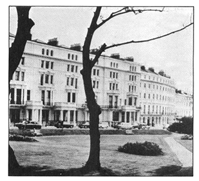
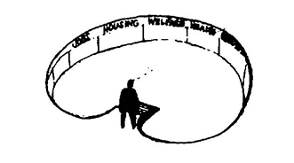
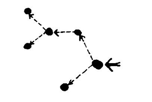
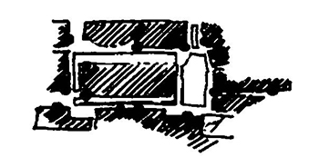
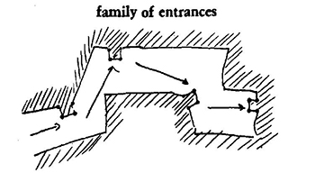

<section class="pattern-plate" aria-labelledby="t-family-of-entrances">
<a href="/patterns">A Pattern Language</a> · <a href="/patterns#buildings">Buildings</a> · Pattern 102 · p. 499 · *
<h1 class="pattern-title" id="t-family-of-entrances">Family Of Entrances</h1><figure class="pattern-figure pl-figure"></figure><nav class="pattern-links" aria-label="Connections"><h2>Links to</h2><ul><li><a href="/patterns/circulation-realms">98 Circulation Realms</a></li><li><a href="/patterns/main-entrance">110 Main Entrance</a></li><li><a href="/patterns/entrance-transition">112 Entrance Transition</a></li><li><a href="/patterns/entrance-room">130 Entrance Room</a></li><li><a href="/patterns/reception-welcomes-you">149 Reception Welcomes You</a></li></ul><h2>Linked from</h2><ul><li><a href="/patterns/small-services-without-red-tape">81 Small Services Without Red Tape</a></li><li><a href="/patterns/office-connections">82 Office Connections</a></li><li><a href="/patterns/circulation-realms">98 Circulation Realms</a></li><li><a href="/patterns/pedestrian-street">100 Pedestrian Street</a></li><li><a href="/patterns/main-entrance">110 Main Entrance</a></li><li><a href="/patterns/entrance-transition">112 Entrance Transition</a></li><li><a href="/patterns/paths-and-goals">120 Paths And Goals</a></li><li><a href="/patterns/entrance-room">130 Entrance Room</a></li><li><a href="/patterns/open-stairs">158 Open Stairs</a></li><li><a href="/patterns/low-doorway">224 Low Doorway</a></li></ul></nav></section><article class="pattern-text" aria-label="The text of Family Of Entrances">
500… this pattern is an embellishment of <a class="pl-ref" href="/patterns/circulation-realms">CIRCULATION REALMS (98)</a>. CIRCULATION REALMS portrayed a series of realms, in a large building or a building complex, with a major entrance or gateway into each realm and a collection of minor doorways, gates, and openings off each realm. This pattern applies to the relationship between these “minor” entrances.

◆ ◆ ◆

<strong>When a person arrives in a complex of offices or services or workshops, or in a group of related houses, there is a good chance he will experience confusion unless the whole collection is laid out before him, so that he can see the entrance of the place where he is going.</strong>

In our work at the Center we have encountered and defined several versions of this pattern. To make the general problem clear, we shall go through these cases and then draw out the general rule.

1. In our multi-service center project we called this pattern Overview of Services. We found that people could find their way around and see exactly what the building had to offer, if the various services were laid out in a horseshoe, directly visible from the threshold of the building. See <em>A Pattern Language Which Generates Multi-Service Centers</em>, pp. 123–26.

<figure class="pl-figure"><figcaption><em>Overview of services</em>.</figcaption></figure>

2. Another version of the pattern, called Reception Nodes, was used for mental health clinics. In these cases we specified <em>one</em>

501clearly defined main entrance, with main reception clearly visible inside this main entrance and each “next” point of reception then visible from the previous one, so that a patient who might be frightened or confused could find his way about by asking receptionists—and could always be directed to the next, <em>visible</em> receptionist down the line.

<figure class="pl-figure"><figcaption><em>Reception nodes</em>.</figcaption></figure>

3. In our project for re-building the Berkeley City Hall complex, we used another version of the pattern. Within the indoor streets, the entrance to each service was made in a similar way—each one bulged out slightly into the street, so that people could easily find their way around among the resulting family of entrances.

<figure class="pl-figure"><figcaption><em>Family of entrances</em>.</figcaption></figure>

4. We have also applied the pattern to houses which are laid out to form a cluster. In one example the pattern drew different house entrances together to make a mutually visible collection of them, and again gave each of them a similar shape.

In all these cases, the same central problem exists. A person who is looking for one of several entrances, and doesn’t know his way around, needs to have some simple way of identifying the one entrance he wants. It can be identified as “the blue one,” “the one with the mimosa bush outside,” “the one with a big 18 on it,” or “the last one on the right, after you get round the 502corner,” but in every case the identification of “the one …” can only make sense if the entire collection of possible entrances can first be seen and understood <em>as a collection</em>. Then it is possible to pick one particular entrance out, without conscious effort.

Therefore:

<strong>Lay out the entrances to form a family. This means:</strong>

<strong>1.  They form a group, are visible together, and each is visible from all the others.</strong>

<strong>2.  They are all broadly similar, for instance all porches, or all gates in a wall, or all marked by a similar kind of doorway.</strong>

<figure class="pl-figure"></figure>
◆ ◆ ◆

In detail, make the entrances bold and easy to see—<a class="pl-ref" href="/patterns/main-entrance">MAIN ENTRANCE (110)</a>; when they lead into private domains, houses and the like, make a transition in between the public street and the inside—<a class="pl-ref" href="/patterns/entrance-transition">ENTRANCE TRANSITION (112)</a>; and shape the entrance itself as a room, which straddles the wall, and is thus both inside and outside as a projecting volume, covered and protected from the rain and sun—<a class="pl-ref" href="/patterns/entrance-room">ENTRANCE ROOM (130)</a>. If it is an entrance from an indoor street into a public office, make reception part of the entrance room—<a class="pl-ref" href="/patterns/reception-welcomes-you">RECEPTION WELCOMES YOU (149)</a>….
</article>

Christopher Alexander, Sara Ishikawa and Murray Silverstein, with Max Jacobson, Ingrid Fiksdahl-King and Shlomo Angel, <cite>A Pattern Language</cite> (Oxford University Press, 1977), pattern 102, pp. 499–502. Text and illustrations from the <a href="https://github.com/natureoforder/sources">Nature of Order sources</a> reading edition, transcribed from the 1977 printing; report errors on <a href="https://github.com/natureoforder/alexander-wiki/issues">GitHub</a>.

<a href="/patterns/building-thoroughfare">← 101 Building Thoroughfare</a> · <a href="/patterns">All 253 patterns</a> · <a href="/patterns/small-parking-lots">103 Small Parking Lots →</a>

