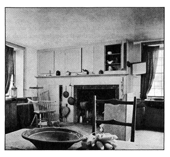
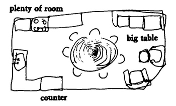

<section class="pattern-plate" aria-labelledby="t-farmhouse-kitchen">
<a href="/patterns">A Pattern Language</a> · <a href="/patterns#buildings">Buildings</a> · Pattern 139 · p. 660 · **
<h1 class="pattern-title" id="t-farmhouse-kitchen">Farmhouse Kitchen</h1><figure class="pattern-figure pl-figure"></figure><nav class="pattern-links" aria-label="Connections"><h2>Links to</h2><ul><li><a href="/patterns/common-areas-at-the-heart">129 Common Areas At The Heart</a></li><li><a href="/patterns/sequence-of-sitting-spaces">142 Sequence Of Sitting Spaces</a></li><li><a href="/patterns/communal-eating">147 Communal Eating</a></li><li><a href="/patterns/light-on-two-sides-of-every-room">159 Light On Two Sides Of Every Room</a></li><li><a href="/patterns/alcoves">179 Alcoves</a></li><li><a href="/patterns/eating-atmosphere">182 Eating Atmosphere</a></li><li><a href="/patterns/cooking-layout">184 Cooking Layout</a></li><li><a href="/patterns/the-shape-of-indoor-space">191 The Shape Of Indoor Space</a></li><li><a href="/patterns/sunny-counter">199 Sunny Counter</a></li><li><a href="/patterns/open-shelves">200 Open Shelves</a></li><li><a href="/patterns/waist-high-shelf">201 Waist-High Shelf</a></li></ul><h2>Linked from</h2><ul><li><a href="/patterns/birth-places">65 Birth Places</a></li><li><a href="/patterns/common-areas-at-the-heart">129 Common Areas At The Heart</a></li><li><a href="/patterns/tapestry-of-light-and-dark">135 Tapestry Of Light And Dark</a></li><li><a href="/patterns/childrens-realm">137 Children’s Realm</a></li><li><a href="/patterns/sequence-of-sitting-spaces">142 Sequence Of Sitting Spaces</a></li><li><a href="/patterns/communal-eating">147 Communal Eating</a></li><li><a href="/patterns/outdoor-room">163 Outdoor Room</a></li><li><a href="/patterns/alcoves">179 Alcoves</a></li><li><a href="/patterns/eating-atmosphere">182 Eating Atmosphere</a></li><li><a href="/patterns/cooking-layout">184 Cooking Layout</a></li><li><a href="/patterns/sunny-counter">199 Sunny Counter</a></li><li><a href="/patterns/open-shelves">200 Open Shelves</a></li><li><a href="/patterns/floor-and-ceiling-layout">210 Floor And Ceiling Layout</a></li></ul></nav></section><article class="pattern-text" aria-label="The text of Farmhouse Kitchen">
661… you have laid out, or already have, some kind of common area at the center of the building. In many cases, especially in houses, the heart of this common area is a kitchen or an eating area since shared food has more capacity than almost anything to be the basis for communal feelings—<a class="pl-ref" href="/patterns/common-areas-at-the-heart">COMMON AREA AT THE HEART (129)</a>, <a class="pl-ref" href="/patterns/communal-eating">COMMUNAL EATING (147)</a>. This pattern defines an ancient kind of kitchen where the cooking and the eating and the living are all in a single place.

◆ ◆ ◆

<strong>The isolated kitchen, separate from the family and considered as an efficient but unpleasant factory for food is a hangover from the days of servants; and from the more recent days when women willingly took over the servants’ role.</strong>

In traditional societies, where there were no servants and the members of a family took care of their own food, the isolated kitchen was virtually unknown. Even when cooking was entirely in the hands of women, as it very often was, the work of cooking was still thought of as a primal, communal function; and the “hearth,” the place where food was made and eaten, was the heart of family life.

As soon as servants took over the function of cooking, in the palaces and manor houses of the rich, the kitchens naturally got separated from the dining halls. Then, in the middle class housing of the nineteenth century, where the use of servants became rather widespread, the pattern of the isolated kitchen also spread, and became an accepted part of any house. But when the servants disappeared, the kitchen was still left separate, because it was thought “genteel” and “nice” to eat in dining rooms away from any sight or smell of food. The isolated kitchen was still associated with those houses of the rich, where dining rooms like this were taken for granted.

But this separation, in a family, has put the woman in a very difficult position. Indeed, it may not be too much to say that it 662has helped to generate those circumstances which have made the woman’s position in mid-twentieth century society unworkable and unacceptable. Very simply, the woman who accepted responsibility for making food agreed to isolate herself in the “kitchen”—and subtly then agreed to become a servant.

Modern American houses, with the so-called open plan, have gone some way toward resolving this conflict. They very often have a kitchen that is half-separated from the family room: not isolated, and not entirely in the family room. This does create a circumstance where the people who are cooking are in touch with the rest of the family, while they are working. And it does not have the obvious stigma and unpleasantness of separated sculleries and kitchens.

But it does not go far enough. If we look beneath the surface, there is in this kind of plan still the hidden supposition that cooking is a chore and that eating is a pleasure. So long as this mentality rules over the arrangement of the house, the conflict which existed in the isolated kitchen is still present. The difficulties which surround the situation will only disappear, finally, when all the members of the family are able to accept, fully, the fact that taking care of themselves by <em>cooking</em> is as much a part of life as taking care of themselves by <em>eating</em>. This will only happen when the communal hearth is once more gathered round the big kitchen table, as it is in primitive communities, where the taking care of necessary functions is an everyday part of life, and has not been lost to people’s consciousness through the misleading function of the servant.

We are convinced that the solution lies in the pattern of the old farmhouse kitchen. In the farmhouse kitchen, kitchen work and family activity were completely integrated in one big room. The family activity centered around a big table in the middle: here they ate, talked, played cards, and did work of all kinds including some of the food preparation. The kitchen work was done communally both on the table, and on counters round the walls. And there might have been a comfortable old chair in the corner where someone could sleep through the activities.

Therefore:

<strong>Make the kitchen bigger than usual, big enough to include 663the “family room” space, and place it near the center of the commons, not so far back in the house as an ordinary kitchen. Make it large enough to hold a good big table and chairs, some soft and some hard, with counters and stove and sink around the edge of the room; and make it a bright and comfortable room.</strong>

<figure class="pl-figure"></figure>
◆ ◆ ◆

Give the kitchen <a class="pl-ref" href="/patterns/light-on-two-sides-of-every-room">LIGHT ON TWO SIDES (159)</a>. When you place the kitchen counters later, make them really long and generous and toward the south to get the light—<a class="pl-ref" href="/patterns/cooking-layout">COOKING LAYOUT (184)</a>, <a class="pl-ref" href="/patterns/sunny-counter">SUNNY COUNTER (199)</a>; leave room for an alcove or two around the kitchen—<a class="pl-ref" href="/patterns/alcoves">ALCOVES (179)</a>; make the table in the middle big, and hang a nice big warm single light right in the middle to draw the family around it—<a class="pl-ref" href="/patterns/eating-atmosphere">EATING ATMOSPHERE (182)</a>; surround the walls, when you detail them, with plenty of open shelves for pots, and mugs, and bottles, and jars of jam—<a class="pl-ref" href="/patterns/open-shelves">OPEN SHELVES (200)</a>, <a class="pl-ref" href="/patterns/waist-high-shelf">WAIST-HIGH SHELP (201)</a>. Put in a comfortable chair somewhere—<a class="pl-ref" href="/patterns/sequence-of-sitting-spaces">SEQUENCE OF SITTING SPACES (142)</a>. And for the room shape and construction, start with <a class="pl-ref" href="/patterns/the-shape-of-indoor-space">THE SHAPE OF INDOOR SPACE (191)</a>….
</article>

Christopher Alexander, Sara Ishikawa and Murray Silverstein, with Max Jacobson, Ingrid Fiksdahl-King and Shlomo Angel, <cite>A Pattern Language</cite> (Oxford University Press, 1977), pattern 139, pp. 660–663. Text and illustrations from the <a href="https://github.com/natureoforder/sources">Nature of Order sources</a> reading edition, transcribed from the 1977 printing; report errors on <a href="https://github.com/natureoforder/alexander-wiki/issues">GitHub</a>.

<a href="/patterns/sleeping-to-the-east">← 138 Sleeping To The East</a> · <a href="/patterns">All 253 patterns</a> · <a href="/patterns/private-terrace-on-the-street">140 Private Terrace On The Street →</a>

