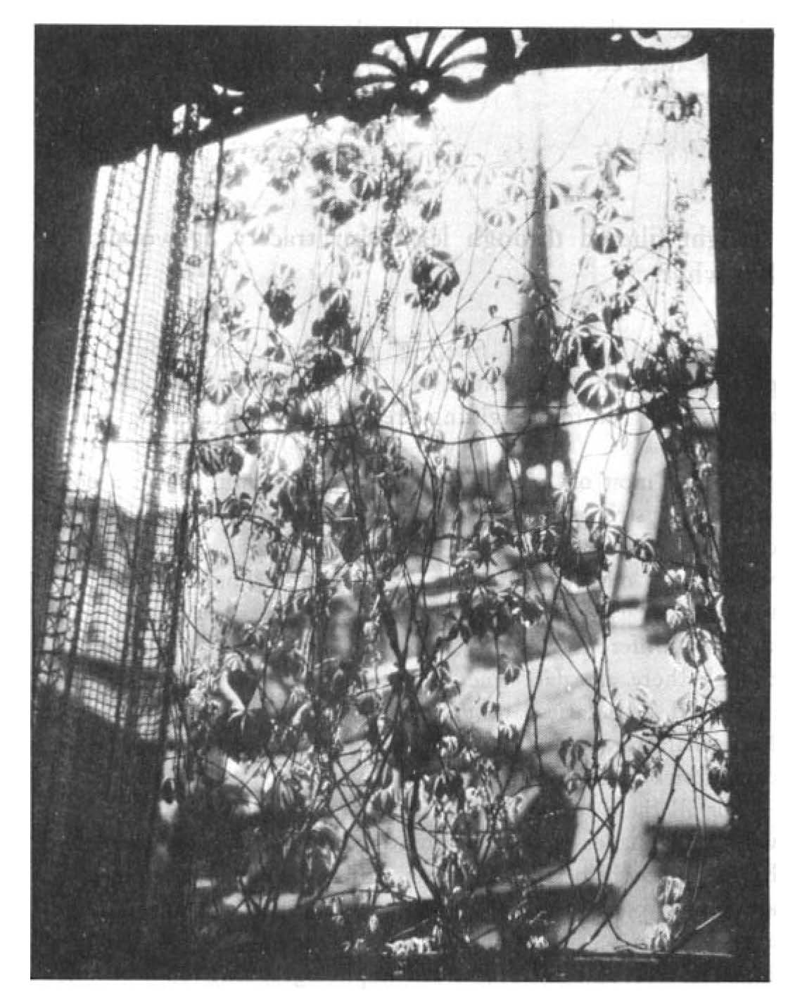
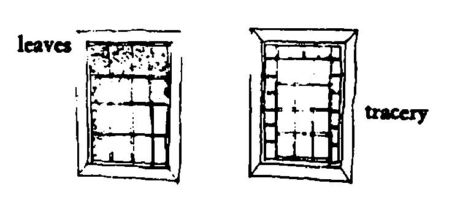

<section class="pattern-plate" aria-labelledby="t-filtered-light">
<a href="/patterns">A Pattern Language</a> · <a href="/patterns#construction">Construction</a> · Pattern 238 · p. 1105 · *
<h1 class="pattern-title" id="t-filtered-light">Filtered Light</h1><figure class="pattern-figure pl-figure"></figure><nav class="pattern-links" aria-label="Connections"><h2>Links to</h2><ul><li><a href="/patterns/natural-doors-and-windows">221 Natural Doors And Windows</a></li><li><a href="/patterns/deep-reveals">223 Deep Reveals</a></li><li><a href="/patterns/small-panes">239 Small Panes</a></li><li><a href="/patterns/canvas-roofs">244 Canvas Roofs</a></li><li><a href="/patterns/climbing-plants">246 Climbing Plants</a></li><li><a href="/patterns/warm-colors">250 Warm Colors</a></li></ul><h2>Linked from</h2><ul><li><a href="/patterns/sleeping-to-the-east">138 Sleeping To The East</a></li><li><a href="/patterns/bathing-room">144 Bathing Room</a></li><li><a href="/patterns/light-on-two-sides-of-every-room">159 Light On Two Sides Of Every Room</a></li><li><a href="/patterns/sunny-place">161 Sunny Place</a></li><li><a href="/patterns/street-windows">164 Street Windows</a></li><li><a href="/patterns/trellised-walk">174 Trellised Walk</a></li><li><a href="/patterns/garden-seat">176 Garden Seat</a></li><li><a href="/patterns/deep-reveals">223 Deep Reveals</a></li><li><a href="/patterns/roof-caps">232 Roof Caps</a></li><li><a href="/patterns/small-panes">239 Small Panes</a></li><li><a href="/patterns/canvas-roofs">244 Canvas Roofs</a></li><li><a href="/patterns/climbing-plants">246 Climbing Plants</a></li></ul></nav></section><article class="pattern-text" aria-label="The text of Filtered Light">
1106… even if the windows are beautifully placed, glare can still be a problem—<a class="pl-ref" href="/patterns/natural-doors-and-windows">NATURAL DOORS AND WINDOWS (221)</a>. The softness of the light, in and around the window, makes an enormous difference to the room inside. The shape of the frames can do a part of it—<a class="pl-ref" href="/patterns/deep-reveals">DEEP REVEALS (223)</a>—but it still needs additional help.

◆ ◆ ◆

<strong>Light filtered through leaves, or tracery, is wonderful. But why?</strong>

We know that light filtering through a leafy tree is very pleasant—it lends excitement, cheerfulness, gaiety; and we know that areas of uniform lighting create dull, uninteresting spaces. But why?

1 The most obvious reason: direct light coming from a point source casts strong shadows, resulting in harsh images with strong contrasts. And people have an optical habit which makes this contrast worse: our eye automatically reinforces boundaries so that they read sharper than they are. For example, a color chart with strips of different colors set next to each other will appear as though there are dark lines between the strips. These contrasts and hard boundaries are unpleasant—objects appear to have a hard character, and our eyes, unable to adjust to the contrast, cannot pick up the details.

For all these reasons, we have a natural desire to diffuse light with lamp shades or indirect lighting, so that the images created by the light will be “softer,” that is, that the boundaries perceived are not sharp, there is less contrast, fewer shadows, and the details are easier to see. This is also why photographers use reflected light instead of direct light when photographing objects; they pick up details which otherwise would be lost in shadow.

2 The second reason: to reduce the glare around the window. When there is bright light coming in through the window, it creates glare against the darkness of the wall around the window—see <a class="pl-ref" href="/patterns/deep-reveals">DEEP REVEALS (223)</a>. Filtering the light especially at the 1107edges of the window cuts down the glare by letting in less light.

3 A third reason which is pure conjecture: it may simply be that an object which has small scale patterns of light dancing on it is sensually pleasing, and stimulates us biologically. Some filmmakers claim the play of light upon the retina is naturally sensuous, all by itself.

To create filtered light, partially cover those windows which get direct sunlight, with vines and lattices. Leaves are special because they move. And the edge of the window can have fine tracery—that is, the edge of the glass itself, not the frame, so that the light coming in is gradually stronger from the edge to the center of the window; the tracery is best toward the top of the window where the light is strongest. Many old windows combine these ideas.

Therefore:

<strong>Where the edge of a window or the overhanging cave of a roof is silhouetted against the sky, make a rich, detailed taspestry of light and dark, to break up the light and soften it</strong>

<figure class="pl-figure"></figure>
◆ ◆ ◆

You can do this, most easily, with climbing plants trained to climb around the outside of the window—<a class="pl-ref" href="/patterns/climbing-plants">CLIMBING PLANTS (246)</a>. If there are no plants, you can also do it beautifully with simple canvas awnings—<a class="pl-ref" href="/patterns/canvas-roofs">CANVAS ROOFS (244)</a>, perhaps colored—<a class="pl-ref" href="/patterns/warm-colors">WARM COLORS (250)</a>. You can also help to filter light by making the panes smaller, more delicate, and more elaborate high in the window where the light is strong—<a class="pl-ref" href="/patterns/small-panes">SMALL PANES (239)</a>….
</article>

Christopher Alexander, Sara Ishikawa and Murray Silverstein, with Max Jacobson, Ingrid Fiksdahl-King and Shlomo Angel, <cite>A Pattern Language</cite> (Oxford University Press, 1977), pattern 238, pp. 1105–1107. Text and illustrations from the <a href="https://github.com/natureoforder/sources">Nature of Order sources</a> reading edition, transcribed from the 1977 printing; report errors on <a href="https://github.com/natureoforder/alexander-wiki/issues">GitHub</a>.

<a href="/patterns/solid-doors-with-glass">← 237 Solid Doors With Glass</a> · <a href="/patterns">All 253 patterns</a> · <a href="/patterns/small-panes">239 Small Panes →</a>

