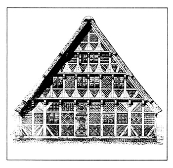
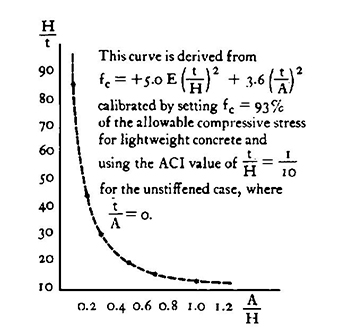
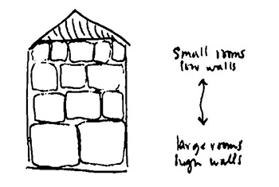
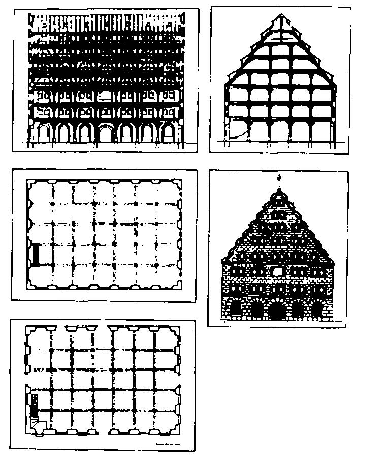
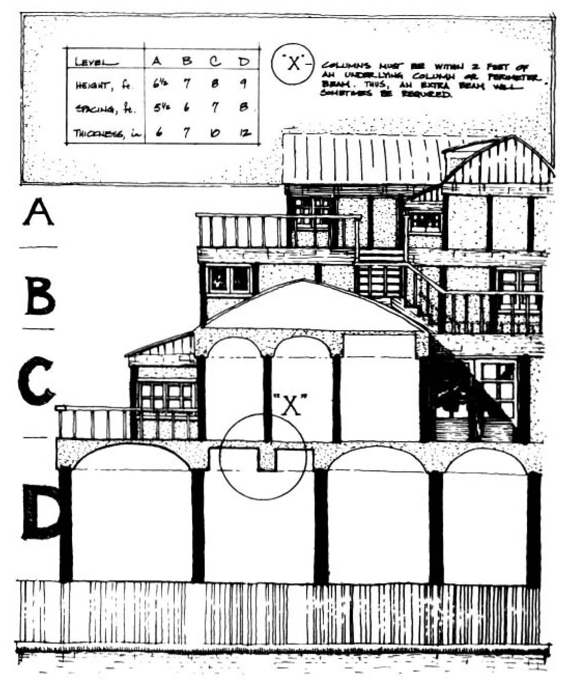
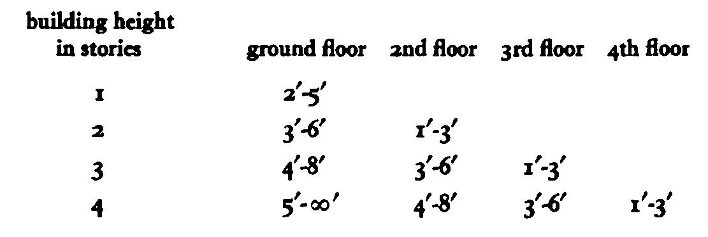
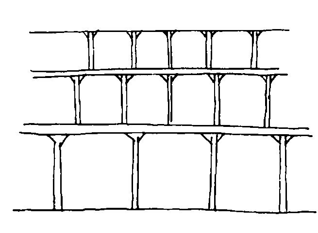

<section class="pattern-plate" aria-labelledby="t-final-column-distribution">
<a href="/patterns">A Pattern Language</a> · <a href="/patterns#construction">Construction</a> · Pattern 213 · p. 995 · **
<h1 class="pattern-title" id="t-final-column-distribution">Final Column Distribution</h1><figure class="pattern-figure pl-figure"></figure><nav class="pattern-links" aria-label="Connections"><h2>Links to</h2><ul><li><a href="/patterns/sheltering-roof">117 Sheltering Roof</a></li><li><a href="/patterns/ceiling-height-variety">190 Ceiling Height Variety</a></li><li><a href="/patterns/efficient-structure">206 Efficient Structure</a></li><li><a href="/patterns/columns-at-the-corners">212 Columns At The Corners</a></li><li><a href="/patterns/root-foundations">214 Root Foundations</a></li><li><a href="/patterns/ground-floor-slab">215 Ground Floor Slab</a></li><li><a href="/patterns/box-columns">216 Box Columns</a></li><li><a href="/patterns/perimeter-beams">217 Perimeter Beams</a></li><li><a href="/patterns/wall-membrane">218 Wall Membrane</a></li><li><a href="/patterns/floor-ceiling-vaults">219 Floor-Ceiling Vaults</a></li><li><a href="/patterns/roof-vaults">220 Roof Vaults</a></li></ul><h2>Linked from</h2><ul><li><a href="/patterns/number-of-stories">96 Number Of Stories</a></li><li><a href="/patterns/ceiling-height-variety">190 Ceiling Height Variety</a></li><li><a href="/patterns/efficient-structure">206 Efficient Structure</a></li><li><a href="/patterns/gradual-stiffening">208 Gradual Stiffening</a></li><li><a href="/patterns/floor-and-ceiling-layout">210 Floor And Ceiling Layout</a></li><li><a href="/patterns/columns-at-the-corners">212 Columns At The Corners</a></li><li><a href="/patterns/root-foundations">214 Root Foundations</a></li><li><a href="/patterns/box-columns">216 Box Columns</a></li><li><a href="/patterns/wall-membrane">218 Wall Membrane</a></li><li><a href="/patterns/floor-ceiling-vaults">219 Floor-Ceiling Vaults</a></li></ul></nav></section><article class="pattern-text" aria-label="The text of Final Column Distribution">
996… assume that you have placed the corner columns which define the spaces—<a class="pl-ref" href="/patterns/columns-at-the-corners">COLUMNS AT TIIE CORNERS (212)</a>. It is now necessary to fill in the gaps between the columns with intermediate stiffener columns as required by <a class="pl-ref" href="/patterns/efficient-structure">EFFICIENT STRUCTURE (206)</a>. This pattern gives the spacing of these intermediate stiffener columns, and helps to generate the kind of walls which <a class="pl-ref" href="/patterns/efficient-structure">EFFICIENT STRUCTURE (206)</a> requires. It also helps to generate <a class="pl-ref" href="/patterns/ceiling-height-variety">CEILING HEIGHT VARIETY (190)</a>.

◆ ◆ ◆

<strong>How should the spacing of the secondary columns which stiffen the walls, vary with ceiling height, number of stories and the size of rooms?</strong>

In some very gross intuitive way we know the answer to this question. Roughly, if we imagine a building with the walls stiffened at intervals along their length, we can see that the texture of these stiffeners needs to be largest near the ground, where social spaces are largest and where loads are largest, and smallest near the roof, where rooms are smallest and where loads are least. In its gross intuitive form this is the same as the intuition which tells us to expect the finest texture in the ribbing at the fine end of a leaf where everything is smallest, and to expect the grosser, cruder structure to be near the large part of the leaf.

<figure class="pl-figure"><figcaption><em>Leaf</em>.</figcaption></figure>

997These intuitions are borne out by many traditional building forms where columns, or frames, or stiffeners are larger and further apart near the ground, and finer and closer together higher up. Our key picture shows examples. But what is the structural basis for these intuitions?

Elastic plate theory gives us a formal explanation.

Consider an unstiffened thin wall carrying an axial load. This wall will usually fail in buckling before it fails in pure compression because it is thin. And this means that the material in the wall is not being used efficiently. It is not able to carry the compressive loads which its compressive strength makes possible because it is too thin.

It is therefore natural to design a wall which is either thick enough or stiffened enough so that it can carry loads up to its full compressive capacity without buckling. Such a wall, which uses its material to the limits of its compressive capacity, will then also satisfy the demands of <a class="pl-ref" href="/patterns/efficient-structure">EFFICIENT STRUCTUREE (206)</a>.

The critical factor is the slenderness of the wall: the ratio of its height to its thickness. For the simple case of an unstiffened concrete wall, the AC I code tells us that the wall will be able to work at 93 per cent efficiency (that is, carry 93 per cent of its potential compressive load without buckling), if it has a slenderness ratio of 10 or less. A wall 10 feet high and 1 foot thick is therefore efficient in this sense.

Suppose now, that we extrapolate to the case of a stiffened wall using elastic plate theory. By using the equation which relates allowable stress to the spacing of stiffeners, we can obtain similar figures for various walls with stiffeners. These figures are presented in the curve below. For example, a wall with a slenderness of 20 needs stiffeners at 0.5H apart (where H is the height) thus creating panels half as wide as they are high. In general, obviously, the thinner the wall is, in relation to its height, the more often it needs to be stiffened along its length.

In every case, the curve gives the spacing of stiffeners which is needed to make the wall work at 93 per cent of its compressive strength. In short, we may say that a wall built according to the principle of <a class="pl-ref" href="/patterns/efficient-structure">EFFICIENT STRUCTURE (206)</a> ought to be stiffened in accordance with this curve.

The gradient of column spacing over different floors follows directly from this curve. We may see this in the following manner. The walls in a four story building carry loads which are very roughly in the ratio 4:3:2:! (only very roughly). In any case, the loads the walls carry get less and less the higher we go in the building. If all the walls are reaching their full compressive capacity, this means that they must be getting steadily thinner too, the higher one goes in the building. If we assume that the walls all have the same height, then the four walls will therefore have progressively greater and greater slenderness ratios, and <em>will therefore jail further and further to the left on the curve, and will therefore need to Be stiffened at closer and closer intervals</em>.

998

<figure class="pl-figure"><figcaption><em>The curve ’which relates wall slenderness to the spacing of stiffeners</em>.</figcaption></figure>

For example, suppose a four story building has 8 foot high walls on all floors and has wall thicknesses of 12 inches, 9 inches, 6 inches, and 3 inches on its four floors. The slenderness ratios are 8, II, 17, and 33. In this case, reading off the curve, we find the ground floor has no stiffeners at all (they are infinitely far apart), the second floor has stiffeners at about 8 feet apart, the third floor has them about 5 feet apart, and the top floor has them about 2 feet apart.

In another case, where the walls are thinner (because materials are lighter and loads smaller), the spacing will be closer. Suppose, for example, that the necessary wall thicknesses are 8, 6, 4, and 9992 inches. Then the slenderness ratios are 12, 16, 24, and 48, and the stiffeners need to be spaced closer together than before: nine feet apart on the ground story, 5 feet apart on the second story, 3 feet apart on the third, and 15 inches apart on the top.

As you can see from these examples, the variation in column spacing is surprisingly great; greater, in fact, than intuition would allow. But the variation is so extreme because we have assumed that ceiling heights are the same on every floor. In fact, in a correctly designed building, the ceiling height will vary from floor to floor; and under these circumstances, as we shall see, the variation in column spacing becomes more reasonable. There are two reasons why the ceiling height needs to vary from floor to floor, one social and one structural.

In most buildings, the spaces and rooms on the first floor will tend to be larger—since communal rooms, meeting rooms, and so on, are generally better located near the entrance to buildings, while private and smaller rooms will be on upper stories, deeper into the building. Since the ceiling heights vary with the size of social spaces—see <a class="pl-ref" href="/patterns/ceiling-height-variety">CEILING HEIGHT VARIETY (190)</a>—this means that the ceiling heights are higher on the ground floor, getting lower as one goes up. And the roof floor has either very short walls or no wall at all—see <a class="pl-ref" href="/patterns/sheltering-roof">SHELTERING ROOF (117)</a>.

<figure class="pl-figure"><figcaption><em>Variation of room sizes</em>.</figcaption></figure>

And there is a second, purely structural explanation of the fact that ceilings need to be lower on upper stories. It is embodied in the drawing of the granary shown below. Suppose that a system of columns is calculated for pure structure. The columns on upper stories will be thinner, because they carry less load than 1000those on lower stories. But because they are thinner, they have less capacity to resist buckling, and must therefore be shorter if we are to avoid wasting material. As a result, even in a granary, where there are no social reasons for variation in ceiling height, purely structural considerations create the necessity for thick columns and high ceilings on the lower stories and for thinner and thinner columns and lower and lower ceilings the higher one gets in the building.

<figure class="pl-figure"><figcaption><em>German granary</em>.</figcaption></figure>

The same conclusion comes from consideration of our curve. We have used the curve, so far, to tell us that stiffeners need to be closer together on upper stories, because the walls are more slender. We may also use the curve to tell us that, for a given load, we should try to keep the slenderness ratio as low as possible. On the upper stories, where walls are most apt to be thin, we should therefore make the walls as low as possible, in order to keep the slenderness ratios low.

1001Let us assume now, that the wall heights do vary in a building, in a manner consistent with these arguments. A four story building, with an attic story on top, might then have these wall heights (remember that the vault height, in a vaulted room, is higher than the wall height): 9 feet on the ground floor, 7 feet on the second, 6 feet on the third, and 4 feet on the fourth, where the pitched roof comes down low over the eaves. And let us assume that the wall thicknesses are 12 inches, 6 inches, 5 inches, and 3 inches, respectively. In this case, the slenderness ratios will be 9, 14, 14, 15. The ground floor needs no stiffeners at all; the second has them 6 feet apart; the third has them 5 feet apart; and the fourth has them 3 feet apart. We show a similar distribution in the drawing opposite.

When you try to apply this pattern to floor plan, you will find a certain type of difficulty. Since the corners of rooms may already be fixed by <a class="pl-ref" href="/patterns/columns-at-the-corners">COLUMNS AT THE CORNERS (212)</a>, it is not always possible to space the stiffeners correctly within the wall of any given room. Naturally this does not matter a great deal; the stiffeners only need to be <em>about</em> right; the spacing can comfortably vary from room to room to fit the dimensions of the walls. However, on the whole, you must try and put the stiffeners closer together where the rooms are small and further apart where rooms are large. If you do not, the building will seem odd, because it defies one’s structural intuitions.

Consider two rooms on the same floor, one twice as large as the other. The larger room has twice the perimeter, but its ceiling generates four times the load; it therefore carries a greater load per unit length of wall. In an ideal efficient structure, this means that the wall must be thicker; and therefore, by the arguments already given, it will need stiffeners spaced further apart than the smaller room which carries less load and has thinner walls.

We recognize that few builders will take the trouble to make wall thicknesses vary from room to room on one floor of the building. However, even if the wall is uniformly thick, we believe that the stiffeners must at least not contradict this rule. If, for reasons of layout, it is necessary that the spacing of stiffeners varies from room to room, then it is essential that the larger spacings of the stiffeners fall on those walls which enclose the 1002larger rooms. If the greater spacing of stiffeners were to coincide with smaller rooms, the eye would be so deceived that people might misunderstand the building.

<figure class="pl-figure"></figure>
<strong><em>The final column distribution in a four story building, built according to our patterns for columns, walls and vaults.</em></strong>

One important note. All of the preceding analysis is based on the assumption that walls and stiffeners are behaving as elastic plates. This is roughly true, and helps to explain the general 1003phenomenon we are trying to describe. However, no wall behaves perfectly as an elastic plate—least of all the kind of lightweight concrete walls we are advocating in the rest of the construction patterns. We have therefore used a modified form of the elastic plate theory, calibrated according to the ACI code, so that the numbers in our analysis are based on the elastic behavior of concrete (and fall within the limits of its tension and compression). However, when the plate goes out of the elastic range and cracks, as it almost certainly will in a concrete design, other factors will enter in. We therefore caution the reader most strongly not to take the actual numbers presented in our analysis as more than illustrations. The numbers reflect the general mathematical behavior of such a system, but they are not reliable enough to use in structural computations.

Therefore:

<strong>Make column stiffeners furthest apart on the ground floor and closer and closer together as you go higher in the building. The exact column spacings for a particular building will depend on heights and loads and wall thicknesses. Tie numbers in the following table are for illustration only, but they show roughly what is needed.</strong>

<figure class="pl-figure"></figure>
Mark in these extra stiffening columns as dots between the corner columns on the drawings you have made for different floors. Adjust them so they are evenly spaced between each pair of corner columns; but on any one floor, make sure that they are closer together along the walls of small rooms and further apart along the walls of large rooms.

1004

<figure class="pl-figure"></figure>
◆ ◆ ◆

To the extent consistent with <a class="pl-ref" href="/patterns/ceiling-height-variety">CEILING HEIGHT VARIETY (190)</a>, make walls and columns progressively shorter the higher you go in the building to keep slenderness ratios low.

And make wall thicknesses and column thicknesses vary with the height—see <a class="pl-ref" href="/patterns/wall-membrane">WALL MEMBRANE (218)</a>. Our calculations, for a typical lightweight concrete building of the kind we have been discussing, suggest the following orders of magnitude for wall thicknesses: Top story—2 inches thick; one below top story—3 inches; two below top story—4 inches; three storys below top (ground floor on a four story building)—5 inches. Of course these numbers will change for different loads, or for different materials, but they show the type of variation you can expect.

Column thicknesses must be proportional to wall thicknesses, so that the thinnest walls have the thinnest columns. If they are very thin, it will be possible to make them simply by placing boards, or one thickness of material, outside the outer skins which form the wall membrane—see <a class="pl-ref" href="/patterns/wall-membrane">WALL MEMBRANE (218)</a>. If the walls are thick, they will need to be full columns, twice as thick as the walls, and roughly square in section, built before the walls, but made in such a way that they can be poured integrally with the walls—<a class="pl-ref" href="/patterns/box-columns">BOX COLUMNS (216)</a>….

1005<em>put stakes in the ground to mark the columns on the site, and start erecting the main frame according to the layout of these stakes;</em>

<a class="pl-ref" href="/patterns/root-foundations">214. ROOT FOUNDATIONS</a>

<a class="pl-ref" href="/patterns/ground-floor-slab">215. GROUND FLOOR SLAB</a>

<a class="pl-ref" href="/patterns/box-columns">216. BOX COLUMNS</a>

<a class="pl-ref" href="/patterns/perimeter-beams">217. PERIMETER BEAMS</a>

218.    WALL MEMBRANES

<a class="pl-ref" href="/patterns/floor-ceiling-vaults">219. FLOOR-CEILING VAULTS</a>

<a class="pl-ref" href="/patterns/roof-vaults">220. ROOF VAULTS</a>
</article>

Christopher Alexander, Sara Ishikawa and Murray Silverstein, with Max Jacobson, Ingrid Fiksdahl-King and Shlomo Angel, <cite>A Pattern Language</cite> (Oxford University Press, 1977), pattern 213, pp. 995–1005. Text and illustrations from the <a href="https://github.com/natureoforder/sources">Nature of Order sources</a> reading edition, transcribed from the 1977 printing; report errors on <a href="https://github.com/natureoforder/alexander-wiki/issues">GitHub</a>.

<a href="/patterns/columns-at-the-corners">← 212 Columns At The Corners</a> · <a href="/patterns">All 253 patterns</a> · <a href="/patterns/root-foundations">214 Root Foundations →</a>

