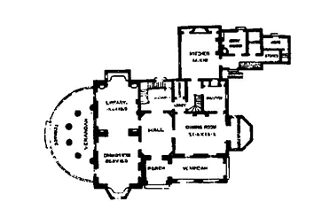
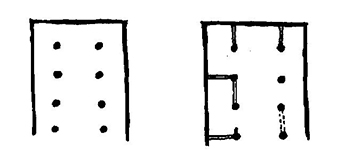
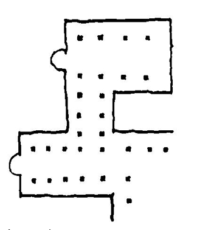

<section class="pattern-plate" aria-labelledby="t-flexible-office-space">
<a href="/patterns">A Pattern Language</a> · <a href="/patterns#buildings">Buildings</a> · Pattern 146 · p. 690
<h1 class="pattern-title" id="t-flexible-office-space">Flexible Office Space</h1><nav class="pattern-links" aria-label="Connections"><h2>Links to</h2><ul><li><a href="/patterns/self-governing-workshops-and-offices">80 Self-Governing Workshops And Offices</a></li><li><a href="/patterns/office-connections">82 Office Connections</a></li><li><a href="/patterns/intimacy-gradient">127 Intimacy Gradient</a></li><li><a href="/patterns/common-areas-at-the-heart">129 Common Areas At The Heart</a></li><li><a href="/patterns/communal-eating">147 Communal Eating</a></li><li><a href="/patterns/small-work-groups">148 Small Work Groups</a></li><li><a href="/patterns/reception-welcomes-you">149 Reception Welcomes You</a></li><li><a href="/patterns/half-private-office">152 Half-Private Office</a></li><li><a href="/patterns/light-on-two-sides-of-every-room">159 Light On Two Sides Of Every Room</a></li><li><a href="/patterns/workspace-enclosure">183 Workspace Enclosure</a></li><li><a href="/patterns/ceiling-height-variety">190 Ceiling Height Variety</a></li><li><a href="/patterns/column-place">226 Column Place</a></li></ul><h2>Linked from</h2><ul><li><a href="/patterns/small-services-without-red-tape">81 Small Services Without Red Tape</a></li><li><a href="/patterns/sequence-of-sitting-spaces">142 Sequence Of Sitting Spaces</a></li><li><a href="/patterns/bulk-storage">145 Bulk Storage</a></li><li><a href="/patterns/small-work-groups">148 Small Work Groups</a></li><li><a href="/patterns/reception-welcomes-you">149 Reception Welcomes You</a></li><li><a href="/patterns/small-meeting-rooms">151 Small Meeting Rooms</a></li><li><a href="/patterns/half-private-office">152 Half-Private Office</a></li><li><a href="/patterns/rooms-to-rent">153 Rooms To Rent</a></li><li><a href="/patterns/alcoves">179 Alcoves</a></li><li><a href="/patterns/workspace-enclosure">183 Workspace Enclosure</a></li><li><a href="/patterns/pools-of-light">252 Pools Of Light</a></li></ul></nav></section><article class="pattern-text" aria-label="The text of Flexible Office Space">
… imagine that you have laid out the basic areas of a workshop or office—<a class="pl-ref" href="/patterns/self-governing-workshops-and-offices">SELF GOVERNING WORKSHOPS AND OFFICES (80)</a>, <a class="pl-ref" href="/patterns/office-connections">OFFICE CONNECTIONS (82)</a>. Once again, as in a house, the most basic layout of all is given by <a class="pl-ref" href="/patterns/intimacy-gradient">INTIMACY GRADIENT (127)</a> and <a class="pl-ref" href="/patterns/common-areas-at-the-heart">COMMON AREAS AT THE HEART (129)</a>. Within their general framework, this pattern helps to define the working space in more detail, and so completes these larger patterns.

◆ ◆ ◆

<strong>Is it possible to create a kind of space which is specifically toned to the needs of people working, and yet capable of an infinite number of various arrangements and combinations within it?</strong>

Every human organization goes through a series of changes. In offices, the clusters of work groups, their size and functions, are all subject to change—often unpredictably. How must office space be designed to cope with this situation?

The standard approaches to the problem of flexibility in office spaces are: (1) uninterrupted modular space with modular partitions (full height or half-height) and (2) entire floors of uninterrupted space with low ceilings and no partitions (known as “office landscape”).

But neither of these solutions really work. They are not genuinely flexible. Let us analyze them in turn.

We discuss the partition solution first. In a naive sense, it seems obvious that the problem can be solved by movable partitions. However, in practice there are a number of serious difficulties.

1. If partitions are made easy to move, they become lightweight and provide inadequate acoustic insulation.

2. If the partitions are both easy to move and acoustically insulated, they are usually very expensive.

691

<ol start="3" type="1">
<li>The actual coat of moving a partition is usually so high that even in highly “flexible” and “modular” systems, the partitions are in fact very rarely moved.</li>
</ol>

4. Most serious of all: it is usually not possible to make minor changes in a partition system. At the moment when one working group expands and needs more space, it is only by rare accident that the working group next door happens at this same moment to be contracting. In order to make room for the expanding group, a large part of the office must be reshuffled, but this causes so much disruption that many office managements adopt the simpler solutions—they leave the partitions as they are and move the people.

5. Finally, it is in the nature of office space that certain informal, semi-permanent arrangements <em>grow more permanent over time</em> (for example, furnishing, filing systems, “ownership” of special spaces or windows). This makes the occupants resistant to change. Though they may be willing to move when the growth of their own working group is at stake, they will resist moving strongly, as part of any general office reshuffle, caused by the expansion or contraction of some other working group.

The modular partition system fails because the partitions become, in effect, ordinary walls; yet they are less useful than real walls for defining territory and for sound insulation; and what is more, the partitions do not necessarily satisfy the need for a semi-enclosed workspace, discussed in <a class="pl-ref" href="/patterns/workspace-enclosure">WORKSPACE ENCLOSURE (183)</a>. It is clear, then, that systems of movable partitions do not really solve the problem.

The office landscape solution, since it has no partitions, is more genuinely flexible. However, this system is only suitable for types of work which require neither a high degree of privacy nor much internal cohesion within individual working groups. Moreover, studies by Brian Wells have made it clear that office workers strongly prefer small work spaces to larger ones—see <a class="pl-ref" href="/patterns/small-work-groups">SMALL WORK GROUPS (148)</a>. Wells shows that, when given a choice among different sized offices, people choose desks in small offices rather than large ones. And he shows that working groups in small offices are much more cohesive (defined by a larger percentage of internal sociometric choices), than the working groups in large offices. (Pilkington Research Unit, <em>Office Design: A 692Study of Environment</em>, Department of Building Science, University of Liverpool, 1965, pp. 113–21.)

It seems then, that neither flexible partitions nor office landscape, really works. Neither creates space that is both well-adapted to specific work arrangements <em>and</em> truly flexible. A clue to an altogether different approach to flexibility comes from the fact that organizations which use converted houses as office space have no difficulty with this problem at all. Indeed, it appears that these old buildings actually provide more real flexibility than the apparent flexibility of modular partitioned offices. The reason is simple. In these old houses, there are many small rooms, a few large rooms, and many partially defined spaces, usually interconnected in a variety of ways.

<figure class="pl-figure"><figcaption><em>Mixture of room sizes</em>.</figcaption></figure>

Though these spaces were designed to support family life, they turn out also to support the natural structure of work groups: there are small spaces for private and half-private offices, slightly larger spaces for work groups of two to six, usually one space where up to 12 people can gather, and a commons centered around the kitchen and dining room. Furthermore, within each space there are usually a variety of walls, half-walls, window seats, which allow for changes within the rooms.

Although the walls cannot be moved at a moment’s notice—the house is genuinely adaptable. Changes in work groups can be made in a few minutes, at no cost, just by opening and closing doors. And the acoustic characteristics are excellent—since most of the walls are solid, often load-bearing walls.

It is occasionally possible to build an office or a workspace like 693a house—when you know enough about the working group ahead of time to base the mix of rooms and larger spaces on their specific nature. But, <em>far more often</em>, the work groups which will occupy the space are unknown at the time the space is built. In this case, no specific “house-like” design is possible. Instead, it is necessary to design and build a type of space which can gradually, and systematically, be turned into this needed house-like kind of space once it is occupied.

The kind of space which will create this possibility is not “warehouse” space or “office landscape” space but instead, a kind of space which contains the possibility that people need, in the form of columns and ceiling height variety, to encourage them to modify it as they use it. If there are columns, so placed, that a few partitions nailed to the columns will begin to form differentiations and rooms within rooms, then we can be sure that people will actually transform it to meet their needs once they begin to work there.

As far as the geometrical layout of the columns is concerned, we have found that it works best when there is essentially a central space—with aisles down the sides—and the possibility of forming the bays of the aisles into workspaces. The illustration below shows the general idea, together with the ways this pattern may be transformed after a few years.

<figure class="pl-figure"><figcaption><em>Adding partitions</em>.</figcaption></figure>

Of course, you can add rooms of different sizes and combine spaces to follow this general outline in an almost endless variety of ways. In one case they may be rather simple, with bays laid out in rows. In another case, the bays may twist and turn, with odd sized rooms and spaces in between. The details are irrelevant. What matters is the general position of the columns and, <em>of course</em>, the guarantee that they are placed in such a way that 694there is plenty of natural light inside—<a class="pl-ref" href="/patterns/light-on-two-sides-of-every-room">LIGHT ON TWO SIDES OF EVERY ROOM (159)</a>.

Therefore:

<strong>Lay out the office space as wings of open space, with free standing columns around their edges, so they define halfprivate and common spaces opening into one another. Set down enough columns so that people can fill them in over the years, in many different ways—but always in a semipermanent fashion.</strong>

<strong>If you happen to know the working group before you build the space, then make it more like a house, more closely tailored to their needs. In either case, create a variety of space throughout the office—comparable in variety to the different sizes and kinds of space in a large old house.</strong>

<figure class="pl-figure"></figure>
possibility of many different sized rooms

◆ ◆ ◆

Light is critical. The bays of this kind of workspace must either be free-standing (so that there is light behind the alcoves), or the entire bay must be short enough to bring enough light in from the two ends—<a class="pl-ref" href="/patterns/light-on-two-sides-of-every-room">LIGHT ON TWO SIDES OF EVERY ROOM (159)</a>. Use <a class="pl-ref" href="/patterns/ceiling-height-variety">CEILING HEIGHT VARIETY (190)</a> and <a class="pl-ref" href="/patterns/column-place">COLUMN PLACES (226)</a> to define the proper mix of possible spaces. Above all, lay the 695workspace out in such a way to make it possible for people to work in twos and threes, always with partial contact and partial privacy—<a class="pl-ref" href="/patterns/small-work-groups">SMALL WORK GROUPS (148)</a> and <a class="pl-ref" href="/patterns/half-private-office">HALF-PRIVATE OFFICE (152)</a>. Place a welcoming reception area at the front—<a class="pl-ref" href="/patterns/reception-welcomes-you">RECEPTION WELCOMES YOU (149)</a>; and in the common areas at the heart arrange a place where people can eat together, everyday—<a class="pl-ref" href="/patterns/communal-eating">COMMUNAL EATING (147)</a>….
</article>

Christopher Alexander, Sara Ishikawa and Murray Silverstein, with Max Jacobson, Ingrid Fiksdahl-King and Shlomo Angel, <cite>A Pattern Language</cite> (Oxford University Press, 1977), pattern 146, pp. 690–695. Text and illustrations from the <a href="https://github.com/natureoforder/sources">Nature of Order sources</a> reading edition, transcribed from the 1977 printing; report errors on <a href="https://github.com/natureoforder/alexander-wiki/issues">GitHub</a>.

<a href="/patterns/bulk-storage">← 145 Bulk Storage</a> · <a href="/patterns">All 253 patterns</a> · <a href="/patterns/communal-eating">147 Communal Eating →</a>

