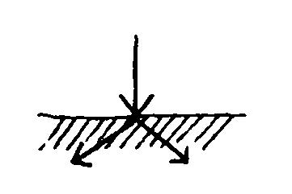
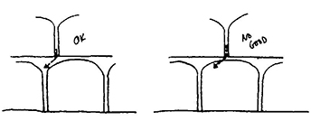
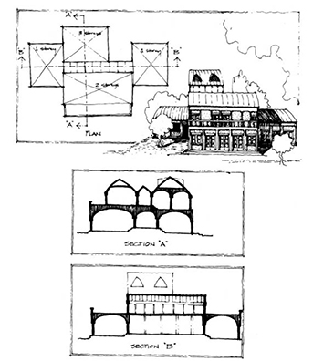
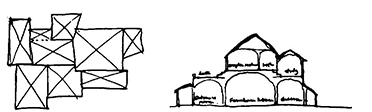

<section class="pattern-plate" aria-labelledby="t-floor-and-ceiling-layout">
<a href="/patterns">A Pattern Language</a> · <a href="/patterns#construction">Construction</a> · Pattern 210 · p. 978
<h1 class="pattern-title" id="t-floor-and-ceiling-layout">Floor And Ceiling Layout</h1><nav class="pattern-links" aria-label="Connections"><h2>Links to</h2><ul><li><a href="/patterns/common-areas-at-the-heart">129 Common Areas At The Heart</a></li><li><a href="/patterns/farmhouse-kitchen">139 Farmhouse Kitchen</a></li><li><a href="/patterns/window-place">180 Window Place</a></li><li><a href="/patterns/ceiling-height-variety">190 Ceiling Height Variety</a></li><li><a href="/patterns/structure-follows-social-spaces">205 Structure Follows Social Spaces</a></li><li><a href="/patterns/efficient-structure">206 Efficient Structure</a></li><li><a href="/patterns/roof-layout">209 Roof Layout</a></li><li><a href="/patterns/thickening-the-outer-walls">211 Thickening The Outer Walls</a></li><li><a href="/patterns/columns-at-the-corners">212 Columns At The Corners</a></li><li><a href="/patterns/final-column-distribution">213 Final Column Distribution</a></li><li><a href="/patterns/perimeter-beams">217 Perimeter Beams</a></li><li><a href="/patterns/floor-ceiling-vaults">219 Floor-Ceiling Vaults</a></li><li><a href="/patterns/roof-vaults">220 Roof Vaults</a></li><li><a href="/patterns/floor-surface">233 Floor Surface</a></li></ul><h2>Linked from</h2><ul><li><a href="/patterns/the-shape-of-indoor-space">191 The Shape Of Indoor Space</a></li><li><a href="/patterns/efficient-structure">206 Efficient Structure</a></li><li><a href="/patterns/gradual-stiffening">208 Gradual Stiffening</a></li><li><a href="/patterns/thickening-the-outer-walls">211 Thickening The Outer Walls</a></li><li><a href="/patterns/columns-at-the-corners">212 Columns At The Corners</a></li><li><a href="/patterns/perimeter-beams">217 Perimeter Beams</a></li><li><a href="/patterns/floor-ceiling-vaults">219 Floor-Ceiling Vaults</a></li></ul></nav></section><article class="pattern-text" aria-label="The text of Floor And Ceiling Layout">
… <a class="pl-ref" href="/patterns/efficient-structure">efficient structure (206)</a> tells us that the spaces in the building should be vaulted so that the floors and ceilings can be made almost entirely of compression materials. To lay out the floor and ceiling vaults, we must fit them to the variety of ceiling heights over individual rooms—ceiling height variety (190) and, on the top story, to the layout of the roof vaults—<a class="pl-ref" href="/patterns/roof-layout">ROOF LAYOUT (209)</a>.

◆ ◆ ◆

<strong>Again, the basic problem is to maintain the integrity of the social spaces in the plan.</strong>

We know, from <a class="pl-ref" href="/patterns/structure-follows-social-spaces">STRUCTURE FOLLOWS SOCIAL SPACES (205)</a>, that floor and ceiling vaults must correspond to the important social spaces in the plan. But there are a great number of social spaces, and they range in size from spaces like <a class="pl-ref" href="/patterns/window-place">WINDOW PLACE (180)</a>, perhaps five feet across, to spaces like <a class="pl-ref" href="/patterns/farmhouse-kitchen">FARMHOUSE KITCHEN (139)</a>, perhaps 15 feet across, to collections of spaces, like <a class="pl-ref" href="/patterns/common-areas-at-the-heart">COMMON AREAS AT THE HEART (129)</a>, perhaps 35 feet across.

Where vaults of different width are near each other, you must remember to pay attention to the level of the floor above. Either you can level out the floor by making the smaller vaults have proportionately higher arches, or you can put extra material in between to keep the small vaults low—see <a class="pl-ref" href="/patterns/ceiling-height-variety">CEILING HEIGHT VARIETY (190)</a>, or you can make steps in the floor above to correspond to changes in the vault sizes below.

Vaults on different floors do not have to line up perfectly with one another. In this sense they are far more flexible than column-beam structures, and for this reason also better adapted to <a class="pl-ref" href="/patterns/structure-follows-social-spaces">STRUCTURE FOLLOWS SOCIAL SPACES (205)</a>. However, there are limits. If one vault is placed so that its loads come down over 979the arch of the vault below, this will put undue stress on the lower vault. Instead, we make use of the fact that vertical forces, passing through a continuous compressive medium, spread out downward in a 45 degree angle cone. If the lower columns are always within this cone, the upper vault will do no structural damage to the vault below it.

<figure class="pl-figure"><figcaption><em>The angle at which a vertical force sfreads downward</em>.</figcaption></figure>

To maintain reasonable structural integrity in the system of vaults as a whole, we therefore suggest that every vault be placed so that its loads come down in a position from which the forces can go to the columns which support the next vault down, by following a 45 degree diagonal.

<figure class="pl-figure"><figcaption><em>Good… …no good</em>.</figcaption></figure>

With all this in mind then, work out a vault plan for your building. We suggest that you try to keep the vaults aligned with the rooms, with occasional adjustments to suit a very big room, or a very small nook or alcove. The drawing on the next page shows a floor and ceiling layout for a simple building.

Each space that you single out for a vault may have either a two-way vault (a domical ceiling on a rectangular base) or a one-way vault (a barrel vault). The two-way vaults are the most efficient structurally; but when a space is long and narrow, the domical shape begins to act like a barrel vault. We therefore suggest domical vaults for spaces where the long side is not more than twice the short side and barrel vaults for the spaces which are narrower.

980

<figure class="pl-figure"><figcaption><em>A version of floor-ceiling layout, shown in flan and section, for a simple ultra-lightweight concrete building</em>.</figcaption></figure>

We also suggest that you use barrel vaults for the rooms immediately under the roof. The roof itself is generally a barrel vault—see <a class="pl-ref" href="/patterns/roof-vaults">ROOF VAULT (220)</a>—so it is most natural to give the ceiling of the space just under the roof a barrel vault as well.

981The vaults described in <a class="pl-ref" href="/patterns/floor-ceiling-vaults">FLOOR-CEILING VAULTS (219)</a> may span from 5 to 30 feet. And they require a rise of at least 13 per cent of the short span.

Therefore:

<strong>Draw a vault plan, for every floor. Use two-way vaults most often; and one-way barrel vaults for any spaces which are more than twice as long as they are wide. Draw sections through the building as you plan the vaults, and bear the following facts in mind:</strong>

<strong>1. Generally speaking, the vaults should correspond to rooms.</strong>

<strong>2. There will have to be a support under the sides of each vault: this will usually be the top of a wall. Under exceptional circumstances, it can be a beam or arch.</strong>

<strong>3. A vault may span as little as 5 feet and as much as 30 feet However, it must have a rise equal to at least 13 per cent of its shorter span.</strong>

<strong>4. If the edge of one vault is more than a couple of feet (in plan) from the edge of the vault below it—then the lower vault will have to contain an arch to support the load from the upper vault</strong>

<figure class="pl-figure"><figcaption><em>vaults over rooms upper vaults/lower vaults reconciled</em></figcaption></figure>

◆ ◆ ◆

Put a <a class="pl-ref" href="/patterns/perimeter-beams">PERIMETER BEAM (217)</a> on all four sides of every vault, along the top of the bearing wall, or spanning openings. Get the shape of the vaults from <a class="pl-ref" href="/patterns/floor-ceiling-vaults">FLOOR-CEILING VAULTS (219)</a> and as you lay out the sections through the vaults, bear in mind that the perimeter beams get lower and lower on higher floors, because 982the columns on upper stories must be shorter (top floor columns about 4 feet, one below top 6 feet, two below top 6 to 7 feet, three below top 8 feet)—<a class="pl-ref" href="/patterns/final-column-distribution">FINAL COLUMN DISTRIBUTION (213)</a>. Make sure that variations in floor level coincide with the distinctions between quiet and more public areas—<a class="pl-ref" href="/patterns/floor-surface">FLOOR SURFACE (233)</a>. Complete the definition of the individual spaces which the vaults create with <a class="pl-ref" href="/patterns/columns-at-the-corners">columns at the CORNERS (212)</a>. Include the smallest vaults of all, around the building edge, in <a class="pl-ref" href="/patterns/thickening-the-outer-walls">THICKENING THE OUTER WALLS (211)</a>….
</article>

Christopher Alexander, Sara Ishikawa and Murray Silverstein, with Max Jacobson, Ingrid Fiksdahl-King and Shlomo Angel, <cite>A Pattern Language</cite> (Oxford University Press, 1977), pattern 210, pp. 978–982. Text and illustrations from the <a href="https://github.com/natureoforder/sources">Nature of Order sources</a> reading edition, transcribed from the 1977 printing; report errors on <a href="https://github.com/natureoforder/alexander-wiki/issues">GitHub</a>.

<a href="/patterns/roof-layout">← 209 Roof Layout</a> · <a href="/patterns">All 253 patterns</a> · <a href="/patterns/thickening-the-outer-walls">211 Thickening The Outer Walls →</a>

