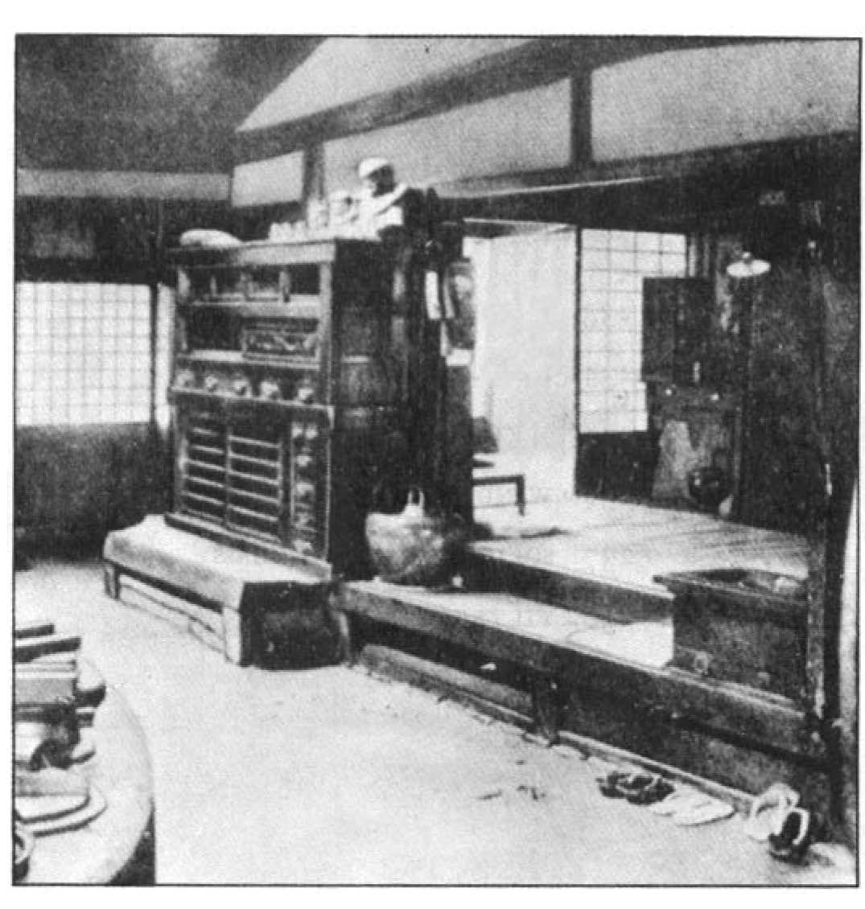
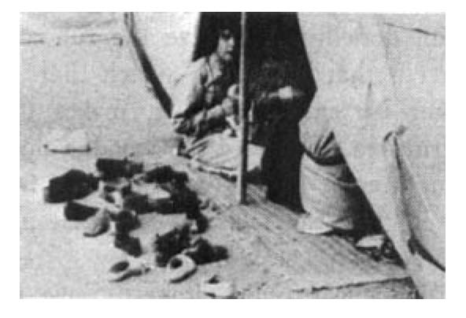
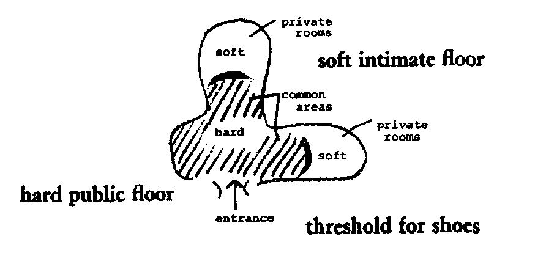

<section class="pattern-plate" aria-labelledby="t-floor-surface">
<a href="/patterns">A Pattern Language</a> · <a href="/patterns#construction">Construction</a> · Pattern 233 · p. 1088 · **
<h1 class="pattern-title" id="t-floor-surface">Floor Surface</h1><figure class="pattern-figure pl-figure"></figure><nav class="pattern-links" aria-label="Connections"><h2>Links to</h2><ul><li><a href="/patterns/intimacy-gradient">127 Intimacy Gradient</a></li><li><a href="/patterns/ground-floor-slab">215 Ground Floor Slab</a></li><li><a href="/patterns/floor-ceiling-vaults">219 Floor-Ceiling Vaults</a></li><li><a href="/patterns/soft-tile-and-brick">248 Soft Tile And Brick</a></li><li><a href="/patterns/ornament">249 Ornament</a></li><li><a href="/patterns/warm-colors">250 Warm Colors</a></li></ul><h2>Linked from</h2><ul><li><a href="/patterns/floor-and-ceiling-layout">210 Floor And Ceiling Layout</a></li><li><a href="/patterns/ground-floor-slab">215 Ground Floor Slab</a></li><li><a href="/patterns/floor-ceiling-vaults">219 Floor-Ceiling Vaults</a></li><li><a href="/patterns/stair-vault">228 Stair Vault</a></li><li><a href="/patterns/roof-caps">232 Roof Caps</a></li><li><a href="/patterns/soft-tile-and-brick">248 Soft Tile And Brick</a></li><li><a href="/patterns/warm-colors">250 Warm Colors</a></li></ul></nav></section><article class="pattern-text" aria-label="The text of Floor Surface">
1089… this pattern tells yon how to pat the surface on the floors, to finish the <a class="pl-ref" href="/patterns/ground-floor-slab">GROUND FLOOR SLAB (215)</a> and <a class="pl-ref" href="/patterns/floor-ceiling-vaults">FLOOR-CEILING VAULTS (219)</a>. When properly made, the floor surfaces will also help intensify the gradient of intimacy in the building—INTIMACY GRADIENT (l27).

◆ ◆ ◆

<strong>We want the floor to be comfortable, warm to the touch, inviting. But we also want it to be hard enough to resist wear, and easy to clean.</strong>

When we think of floors, we think of wood floors. We hope, if we can afford it, to have a wooden floor. Even in hot countries, where tiles are beautiful, many people want hardwood floors whenever they can afford them. But the wood floor, though it seems so beautiful, does little to solve the fundamental problem of floors. The fact is that a room in which there is a bare wood floor, seems rather barren, forbidding, makes the room sound hollow and unfurnished. To make the wooden floor nice, we put down carpets. But then it is not really a wood floor at all. This confusion makes it clear that the fundamental problem of “the floor” has not been properly stated.

When we look at the problem honestly, we realize that the wooden floor, <em>and</em> the wooden floor with a carpet on it, are both rather uneven compromises. The bare wooden floor is too bare, too hard to be comfortable; but not in fact hard enough to resist wear particularly well if it is left uncovered—it scratches and dents and splinters. And when the floor is covered with a carpet, the whole point of the beauty of the wood is lost. You cannot see it any more, except round the edges of the carpet; and the carpet on the floor is certainly not hard enough to resist any substantial wear. Furthermore, the most beautiful carpets, handmade rugs and tapestries, are so delicate that they cannot take very rough wear. The practice of walking on a Persian rug with outdoor shoes on is a barbarian habit, never practiced by the people who make those rugs, and know how to treat them—they always take their shoes off. But the modern nylon and acrylic rugs, machine-made for hard wear, lose all the sumptuousness and 1090pleasure of the carpet: they are, as it were, soft kinds of concrete.

The problem cannot be solved. The conflict is fundamental. The problem can only be <em>avoided</em> by making a clear distinction in the house between those areas which have heavy traffic and so need hard wearing surfaces which are easy to clean, and those other areas which have only very light traffic, where people can take off their shoes, and where lush, soft, beautiful rugs, pillows, and tapestries can easily be spread.

Traditional Japanese houses and Russian houses solve the problem in exactly this way: they divide the floor into two zones—serviceable and comfortable. They use very clean, and often precious materials in the comfortable zone, and often make the serviceable zone an extension of the street—that is, dirt, paving, and so on. People take their shoes off, or put them on, when they pass from one zone to the other.

<figure class="pl-figure"><figcaption><em>The threshold between hard and soft</em>.</figcaption></figure>

We are not sure whether taking shoes off and on could become a natural habit in our culture. But it still makes sense to zone the house so that the floor material changes as one gets deeper into the house. The pattern <a class="pl-ref" href="/patterns/intimacy-gradient">INTIMACY GRADIENT (127)</a> calls for a gradient of public, semi-public, and private rooms. It follows that one wants the floor to get softer as one goes deeper into the house—that is, the entrance and the kitchen are better floored with a hard, serviceable surface, while the dining, family room, and children’s playrooms need a serviceable floor but with comfortable spots, and the bedrooms, studies, rooms of one’s own need soft comfortable floors, on which people can sit, lie, and walk barefoot.

1091What should the materials be? Of the hard and soft materials, the hard is more of a problem. Since children are close to these floors, as well as the soft ones, they must be warm to the touch,—and at the same time they must be easy to clean. For these hard floors, a “soft” concrete might work. It can be made serviceable and pleasant at the same time if it is finished off with a lightweight textured floor finish, which is relatively porous. It can be made to wear and repel water by making the color integral with the mix and by waxing and polishing after it is set. It is fairly cheap and makes sense if the floor is a concrete floor anyway. Other materials which would work as hard floors are earth, rubber or cork tile, soft unbaked tile known as pastelleros in Peru—see <a class="pl-ref" href="/patterns/soft-tile-and-brick">SOFT TILE AND BRICK (248)</a>—and wood planks, but these materials are more expensive.

For soft materials, carpet is the most satisfactory—for sitting, lying, and being close to the ground. We doubt that an improvement can be made on it—in fact we guess that if a substitute is used instead, it will eventually get carpeted over, anyway. This means that the areas which are going to be carpeted might as well have a cheap subfloor with matting laid wall to wall.

To emphasize the two zones, and to promote the taking off and on of shoes from one zone to the next, we suggest that there be a step up or a step down between the zones. This will help tremendously in keeping each zone “pure,” and it is sure to help the activities in each zone.

Therefore:

<strong>Zone the house, or building, into two kinds of zones: public zones, and private or more intimate zones. Use hard materials like waxed, red polished concrete, tiles, or hardwood in the public zones. In the more intimate zone, use an underfloor of soft materials, like felt, cheap nylon carpet, or straw matting, and cover it with cloths, and pillows, and carpets, and tapestries. Make a clearly marked edge between the two—perhaps even a step—so that people can take their shoes off when they pass from the public to the intimate.</strong>

1092

<figure class="pl-figure"></figure>
◆ ◆ ◆

On the hard floor, you can use the same floor as you use on outdoor paths and terraces—hand fired brick and tile—<a class="pl-ref" href="/patterns/soft-tile-and-brick">SOFT TILE AND BRICK (248)</a>. On the soft intimate floors, use materials and cloths that are rich in ornament and color—<a class="pl-ref" href="/patterns/ornament">ORNAMENT (249)</a>, <a class="pl-ref" href="/patterns/warm-colors">WARM COLORS (250)</a>….
</article>

Christopher Alexander, Sara Ishikawa and Murray Silverstein, with Max Jacobson, Ingrid Fiksdahl-King and Shlomo Angel, <cite>A Pattern Language</cite> (Oxford University Press, 1977), pattern 233, pp. 1088–1092. Text and illustrations from the <a href="https://github.com/natureoforder/sources">Nature of Order sources</a> reading edition, transcribed from the 1977 printing; report errors on <a href="https://github.com/natureoforder/alexander-wiki/issues">GitHub</a>.

<a href="/patterns/roof-caps">← 232 Roof Caps</a> · <a href="/patterns">All 253 patterns</a> · <a href="/patterns/lapped-outside-walls">234 Lapped Outside Walls →</a>

