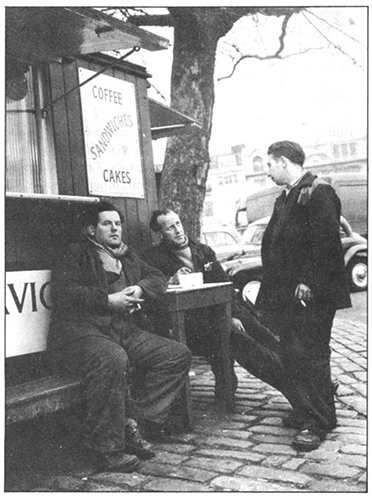
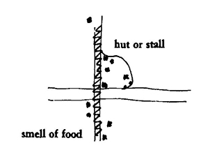

<section class="pattern-plate" aria-labelledby="t-food-stands">
<a href="/patterns">A Pattern Language</a> · <a href="/patterns#towns">Towns</a> · Pattern 93 · p. 454 · *
<h1 class="pattern-title" id="t-food-stands">Food Stands</h1><figure class="pattern-figure pl-figure"></figure><nav class="pattern-links" aria-label="Connections"><h2>Links to</h2><ul><li><a href="/patterns/nine-per-cent-parking">22 Nine Per Cent Parking</a></li><li><a href="/patterns/activity-nodes">30 Activity Nodes</a></li><li><a href="/patterns/network-of-paths-and-cars">52 Network Of Paths And Cars</a></li><li><a href="/patterns/road-crossing">54 Road Crossing</a></li><li><a href="/patterns/raised-walk">55 Raised Walk</a></li><li><a href="/patterns/small-public-squares">61 Small Public Squares</a></li><li><a href="/patterns/individually-owned-shops">87 Individually Owned Shops</a></li><li><a href="/patterns/bus-stop">92 Bus Stop</a></li><li><a href="/patterns/activity-pockets">124 Activity Pockets</a></li><li><a href="/patterns/canvas-roofs">244 Canvas Roofs</a></li></ul><h2>Linked from</h2><ul><li><a href="/patterns/activity-nodes">30 Activity Nodes</a></li><li><a href="/patterns/work-community">41 Work Community</a></li><li><a href="/patterns/road-crossing">54 Road Crossing</a></li><li><a href="/patterns/carnival">58 Carnival</a></li><li><a href="/patterns/dancing-in-the-street">63 Dancing In The Street</a></li><li><a href="/patterns/childrens-home">86 Children’s Home</a></li><li><a href="/patterns/bus-stop">92 Bus Stop</a></li><li><a href="/patterns/activity-pockets">124 Activity Pockets</a></li></ul></nav></section><article class="pattern-text" aria-label="The text of Food Stands">
455… throughout the neighborhood there are natural public gathering places—<a class="pl-ref" href="/patterns/activity-nodes">ACTIVITY NODES (30)</a>, <a class="pl-ref" href="/patterns/road-crossing">ROAD CROSSINGS (54)</a>, <a class="pl-ref" href="/patterns/raised-walk">RAISED WALKS (55)</a>, <a class="pl-ref" href="/patterns/small-public-squares">SMALL PUBLIC SQUARES (61)</a>, <a class="pl-ref" href="/patterns/bus-stop">BUS STOPS (92)</a>. All draw their life, to some extent, from the food stands, the hawkers, and the vendors who fill the street with the smell of food.

◆ ◆ ◆

<strong>Many of our habits and institutions arc bolstered by the fact that we can get simple, inexpensive food on the street, on the way to shopping, work, and friends.</strong>

The food stands which make the best food, and which contribute most to city life, are the smallest shacks and carts from which individual vendors sell their wares. Everyone has memories of them.

But in their place we now have shining hamburger kitchens, fried chicken shops, and pancake houses. They are chain operations, with no roots in the local community. They sell “plastic,” mass-produced frozen food, and they generate a shabby quality of life around them. They are built to attract the eye of a person driving: the signs are huge; the light is bright neon. They are insensitive to the fabric of the community. Their parking lots around them kill the public open space.

If we want food in our streets contributing to the social life of the streets, not helping to destroy it, the food stands must be made and placed accordingly.

We propose four rules:

1. The food stands are concentrated at <a class="pl-ref" href="/patterns/road-crossing">ROAD CROSSINGS (54)</a> of the <a class="pl-ref" href="/patterns/network-of-paths-and-cars">NETWORK OP PATHS AND CARS (52)</a>. It is possible to see them from cars and to expect them at certain kinds of intersections, but they do not have special parking lots around them—see <a class="pl-ref" href="/patterns/nine-per-cent-parking">NINE PER CENT PARKING (22)</a>.

2. The food stands are free to take on a character that is compatible with the neighborhood around them. They can be 456freestanding carts, or built into the corners and crevices of existing buildings; they can be small huts, part of the fabric of the street.

3. The smell of the food is out in the street; the place can be surrounded with covered seats, sitting walls, places to lean and sip coffee, part of the larger scene, not sealed away in a plate glass structure, surrounded by cars. The more they smell, the better.

4. They are never franchises, but always operated by their owners. The best food always comes from family restaurants; and the best food in a foodstand always comes when people prepare the food and sell it themselves, according to their own ideas, their own recipes, their own choice.

Therefore:

<strong>Concentrate food stands where cars and paths meet—either portable stands or small huts, or built into the fronts of buildings, half-open to the street.</strong>

<figure class="pl-figure"></figure>
◆ ◆ ◆

Treat these food stands as <a class="pl-ref" href="/patterns/activity-pockets">ACTIVITY POCKETS (124)</a> when they are part of a square; Use canvas roofs to make a simple shelter over them—<a class="pl-ref" href="/patterns/canvas-roofs">CANVAS ROOF (244)</a>; and keep them in line with the precepts of <a class="pl-ref" href="/patterns/individually-owned-shops">INDIVIDUALLY OWNED SHOPS (87)</a>: the best food always comes from people who are in business for themselves, who buy the raw food, and prepare it in their own style….
</article>

Christopher Alexander, Sara Ishikawa and Murray Silverstein, with Max Jacobson, Ingrid Fiksdahl-King and Shlomo Angel, <cite>A Pattern Language</cite> (Oxford University Press, 1977), pattern 93, pp. 454–456. Text and illustrations from the <a href="https://github.com/natureoforder/sources">Nature of Order sources</a> reading edition, transcribed from the 1977 printing; report errors on <a href="https://github.com/natureoforder/alexander-wiki/issues">GitHub</a>.

<a href="/patterns/bus-stop">← 92 Bus Stop</a> · <a href="/patterns">All 253 patterns</a> · <a href="/patterns/sleeping-in-public">94 Sleeping In Public →</a>

