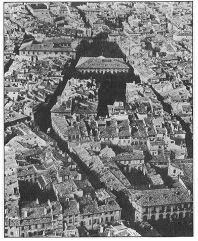
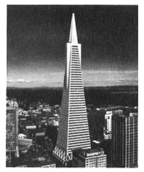
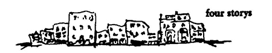

<section class="pattern-plate" aria-labelledby="t-four-story-limit">
<a href="/patterns">A Pattern Language</a> · <a href="/patterns#towns">Towns</a> · Pattern 21 · p. 114 · **
<h1 class="pattern-title" id="t-four-story-limit">Four-Story Limit</h1><figure class="pattern-figure pl-figure"></figure><nav class="pattern-links" aria-label="Connections"><h2>Links to</h2><ul><li><a href="/patterns/city-country-fingers">3 City Country Fingers</a></li><li><a href="/patterns/lace-of-country-streets">5 Lace Of Country Streets</a></li><li><a href="/patterns/magic-of-the-city">10 Magic Of The City</a></li><li><a href="/patterns/density-rings">29 Density Rings</a></li><li><a href="/patterns/housing-hill">39 Housing Hill</a></li><li><a href="/patterns/high-places">62 High Places</a></li><li><a href="/patterns/office-connections">82 Office Connections</a></li><li><a href="/patterns/building-complex">95 Building Complex</a></li><li><a href="/patterns/number-of-stories">96 Number Of Stories</a></li></ul><h2>Linked from</h2><ul><li><a href="/patterns/magic-of-the-city">10 Magic Of The City</a></li><li><a href="/patterns/mini-buses">20 Mini-Buses</a></li><li><a href="/patterns/eccentric-nucleus">28 Eccentric Nucleus</a></li><li><a href="/patterns/housing-hill">39 Housing Hill</a></li><li><a href="/patterns/high-places">62 High Places</a></li><li><a href="/patterns/office-connections">82 Office Connections</a></li><li><a href="/patterns/number-of-stories">96 Number Of Stories</a></li><li><a href="/patterns/building-fronts">122 Building Fronts</a></li></ul></nav></section><article class="pattern-text" aria-label="The text of Four-Story Limit">
115… within an urban area, the density of building fluctuates. It will, in general, be rather higher toward the center and lower toward the edges—<a class="pl-ref" href="/patterns/city-country-fingers">CITY COUNTRY FINGERS (3)</a>, <a class="pl-ref" href="/patterns/lace-of-country-streets">LACE OF COUNTRY STREETS (5)</a>, <a class="pl-ref" href="/patterns/magic-of-the-city">MAGIC OF THE CITY (10)</a>. However, throughout the city, even at its densest points, there are strong human reasons to subject all buildings to height restrictions.

◆ ◆ ◆

<strong>There is abundant evidence to show that high buildings make people crazy.</strong>

High buildings have no genuine advantages, except in speculative gains for banks and land owners. They are not cheaper, they do not help create open space, they destroy the townscape, they destroy social life, they promote crime, they make life difficult for children, they are expensive to maintain, they wreck the open spaces near them, and they damage light and air and view. But quite apart from all of this, which shows that they aren’t very sensible, empirical evidence shows that they can actually damage people’s minds and feelings.

<figure class="pl-figure"></figure>
<strong><em>“The Ministry of Truth—Minitrue, m Newspeak—Was startlingly different from any other object in sight. It was an enormous pyramidal structure of glittering white concrete, soaring up terrace after terrace 300 metres in the air.” (George Orwell</em>, 1984)</strong>

116There are two separate bodies of evidence for this. One shows the effect of high-rise housing on the mental and social well being of families. The other shows the effect of large buildings, and high buildings, on the human relations in offices and workplaces. We present the first of these two bodies of evidence in the text which follows. The second, concerning offices and workplaces, we have placed in <a class="pl-ref" href="/patterns/building-complex">BUILDING COMPLEX (95)</a>, since it has implications not just for the height of buildings but also for their total volume.

We wish to stress, however, that the seemingly one-sided concern with housing in the paragraphs which follow, is only apparent. The underlying phenomenon—namely, mental disorder and social alienation created by the height of buildings—occurs equally in housing and in workplaces.

The strongest evidence comes from D. M. Fanning (“Families in Flats,” <em>British Medical Journal</em>, November 18, 1967, pp. 382–86). Fanning shows a direct correlation between incidence of mental disorder and the height of people’s apartments. The higher people live off the ground, the more likely are they to suffer mental illness. And it is not simply a case of people prone to mental illness choosing high-rise apartments. Fanning shows that the correlation is strongest for the people who spend the most time in their apartments. Among the families he studied, the correlation was strongest for women, who spend the most time in their apartments; it was less strong for children, who spend less time in the apartments; and it was weakest for men, who spend the least amount of time in their apartments. This strongly suggests that sheer time spent in the high-rise is itself what causes the effect.

A simple mechanism may explain this: high-rise living takes people away from the ground, and away from the casual, everyday society that occurs on the sidewalks and streets and on the gardens and porches. It leaves them alone in their apartments. The decision to go out for some public life becomes formal and awkward; and unless there is some specific task which brings people out in the world, the tendency is to stay home, alone. The forced isolation then causes individual breakdowns.

Fanning’s findings are reinforced by Dr. D. Cappon’s clinical experiences reported in “Mental Health and the High Rise,” Canadian Public Health Association, April 1971:

117There is every reason to believe that high-rise apartment dwelling has adverse effects on mental and social health. And there is sufficient clinical, anecdotal and intuitive observations to back this up. Herewith, in no particular order ranking, a host of factors:

In my experience as Mental Health Director in a child guidance clinic in York Township, Toronto, for <em>5</em> years, I saw numerous children who had been kinetically deprived •.. and kinetic deprivation is the worst of the perceptual, exploratory kinds, for a young child, leaving legacies of lethargy, or restlessness, antisocial acting out or withdrawal, depersonalization or psychopathy.

Young children in a high-rise are much more socially deprived of neighborhood peers and activities than their S.F.D. (Single Family Dwelling) counterparts, hence they are poorly socialized and at too close quarters to adults, who are tense and irritable as a consequence. Adolescents in a high-rise suffer more from the “nothing-to-do” ennui than those of a S.F.D., with enhanced social’ needs for “drop in centres” and a greater tendency to escapism….

Mothers are more anxious about their very young ones, when they can’t see them in the street below, from a convenient kitchen window. There is higher passivity in the high-rise because of the barriers to active outlets on the ground; such barriers as elevators, corridors; and generally there is a time lapse and an effort in negotiating the vertical journey. TV watching is extended in the high-rise. This affects probably most adversely the old who need kinesia and activity, in proportion, as much as the very young do. Though immobility saves them from accidents, it also shortens their life in a high-rise….

A Danish study by Jeanne Morville adds more evidence (<em>Borns Brug af Friarsaler</em>, Disponering Af Friarsaler, Etageboligomrader Med Saerlig Henblik Pa Borns Legsmuligheder, S.B.I., Denmark, 1969) :

Children from the high blocks start playing out of doors on their own at a later age than children from the low blocks: Only 2 % of the children aged two to three years in the high point blocks play on their own out of doors, while 27% of the children in the low blocks do this.

Among the children aged five years in the high point blocks 29% do not as yet play on their own out of doors, while in the low blocks all the children aged.five do so…. The percentage of young children playing out of doors on their own decreases with the height of their homes; 90% of all the children from the three lower <em>Hoors</em> in the high point blocks play on their own out of doors, while only 59 % of the children from the three upper <em>Hoors</em> do so….

Young children in the high blocks have fewer contacts with playmates than those in the low blocks: Among children aged one, two and three years, 86% from the low blocks have daily contact with playmates; this applies to only 29% from the high blocks.

118More recently, there is the evidence brought forward by Oscar Newman in <em>Defensible Space</em>. Newman compared two adjacent housing projects in New York—one high-rise, the other a collection of relatively small three-story walk-up buildings. The two projects have the same overall density, and their inhabitants have roughly the same income. <em>But Newman found that the crime rate in the high-rise was roughly twice that in the walk-ups</em>.

At what height do the effects described by Fanning, Cappon, Morville, and Newman begin to take hold? It is our experience that in both housing and office buildings, the problems begin when buildings are more than four stories high.

At three or four stories, one can still walk comfortably down to the street, and from a window you can still feel part of the street scene: you can see details in the street-the people, their faces, foliage, shops. From three stories you can yell out, and catch the attention of someone below. Above four stories these connections break down. The visual detail is lost; people speak of the scene below as if it were a game, from which they are completely detached. The connection to the ground and to the fabric of the town becomes tenuous; the building becomes a world of its own: with its own elevators and cafeterias.

We believe, therefore, that the “four-story limit” is an appropriate way to express the proper connection between building height and the health of a people. Of course, it is the spirit of the pattern which is most essential. Certainly, a building five stories high, perhaps even six, might work if it were carefully handled. But it is difficult. On the whole, we advocate a four-story limit, with only occasional departures, throughout the town.

Finally, we give the children of Glasgow the last word.

To fling a “piece,” a slice of bread and jam, from a window down to a child in the street below has been a recognised custom in Glasgow’s tenement housing….

THE JEELY PIECE SONG

by Adam McNaughton

I’m a skyscraper wean, I live on the nineteenth flair, On’ I’m no’ gaun oot tae play ony mair, For since we moved tae oor new hoose I’m wastin’ away, ‘Cos I’m gettin’ wan less meal ev’ry day,

<em>Refrain</em>

119Oh, ye canny fling pieces oot a twenty-storey flat, Seven hundred hungry weans will testify tae that, If it’s butter, cheese or jeely, if the breid is plain or pan, The odds against it reachin’ us is ninety-nine tae wan.

We’ve wrote away tae Oxfam tac try an’ get some aid, We’ve a’ joined thegither an’ formed a “piece” brigade, We’re gonny march tae London tae demand oor Civil Rights, Like “Nae mair hoosea ower piece filngin’ heights.”

Therefore:

<strong>In any urban area, no matter how dense, keep the majority of buildings four stories high or less. It is possible that certain buildings should exceed this limit, but they should never be buildings for human habitation.</strong>

<figure class="pl-figure"></figure>
◆ ◆ ◆

Within the framework of the four-story limit the exact height of individual buildings, according to the area of floor they need, the area of the site, and the height of surrounding buildings, is given by the pattern <a class="pl-ref" href="/patterns/number-of-stories">NUMBER OF STORIES (96)</a>. More global variations of density are given by <a class="pl-ref" href="/patterns/density-rings">DENSITYRINGS (29)</a>. The horizontal subdivision of large buildings into smaller units, and separate smaller buildings, is given by <a class="pl-ref" href="/patterns/building-complex">BUILDING COMPLEX (95)</a>. <a class="pl-ref" href="/patterns/housing-hill">HOUSING HILL (39)</a> and <a class="pl-ref" href="/patterns/office-connections">OFFICE CONNECTIONS (82)</a> help to shape multi-storied apartments and offices within the constraints of a four-story limit. And finally, don’t take the four-story limit too literally. Occasional exceptions from the general rule are very important—<a class="pl-ref" href="/patterns/high-places">HIGH PLACES (62)</a>….
</article>

Christopher Alexander, Sara Ishikawa and Murray Silverstein, with Max Jacobson, Ingrid Fiksdahl-King and Shlomo Angel, <cite>A Pattern Language</cite> (Oxford University Press, 1977), pattern 21, pp. 114–119. Text and illustrations from the <a href="https://github.com/natureoforder/sources">Nature of Order sources</a> reading edition, transcribed from the 1977 printing; report errors on <a href="https://github.com/natureoforder/alexander-wiki/issues">GitHub</a>.

<a href="/patterns/mini-buses">← 20 Mini-Buses</a> · <a href="/patterns">All 253 patterns</a> · <a href="/patterns/nine-per-cent-parking">22 Nine Per Cent Parking →</a>

