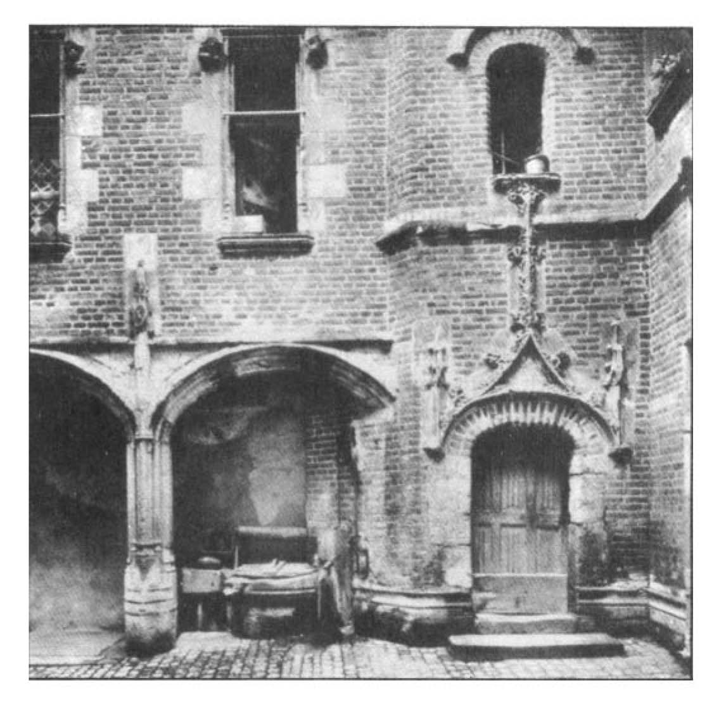
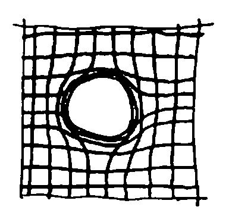
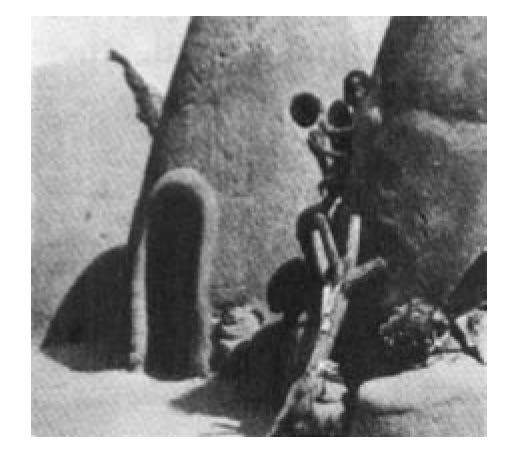
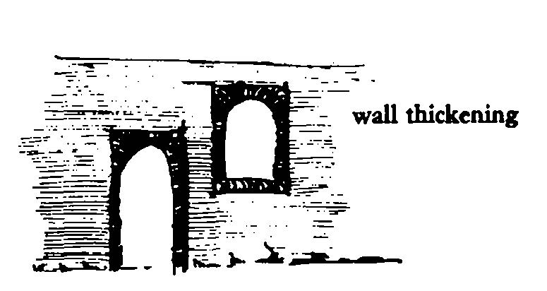

<section class="pattern-plate" aria-labelledby="t-frames-as-thickened-edges">
<a href="/patterns">A Pattern Language</a> · <a href="/patterns#construction">Construction</a> · Pattern 225 · p. 1059 · **
<h1 class="pattern-title" id="t-frames-as-thickened-edges">Frames As Thickened Edges</h1><figure class="pattern-figure pl-figure"></figure><nav class="pattern-links" aria-label="Connections"><h2>Links to</h2><ul><li><a href="/patterns/efficient-structure">206 Efficient Structure</a></li><li><a href="/patterns/gradual-stiffening">208 Gradual Stiffening</a></li><li><a href="/patterns/wall-membrane">218 Wall Membrane</a></li><li><a href="/patterns/natural-doors-and-windows">221 Natural Doors And Windows</a></li><li><a href="/patterns/deep-reveals">223 Deep Reveals</a></li><li><a href="/patterns/column-place">226 Column Place</a></li><li><a href="/patterns/stair-vault">228 Stair Vault</a></li><li><a href="/patterns/duct-space">229 Duct Space</a></li><li><a href="/patterns/radiant-heat">230 Radiant Heat</a></li><li><a href="/patterns/dormer-windows">231 Dormer Windows</a></li><li><a href="/patterns/roof-caps">232 Roof Caps</a></li><li><a href="/patterns/windows-which-open-wide">236 Windows Which Open Wide</a></li><li><a href="/patterns/solid-doors-with-glass">237 Solid Doors With Glass</a></li><li><a href="/patterns/small-panes">239 Small Panes</a></li></ul><h2>Linked from</h2><ul><li><a href="/patterns/corner-doors">196 Corner Doors</a></li><li><a href="/patterns/efficient-structure">206 Efficient Structure</a></li><li><a href="/patterns/low-sill">222 Low Sill</a></li><li><a href="/patterns/deep-reveals">223 Deep Reveals</a></li><li><a href="/patterns/low-doorway">224 Low Doorway</a></li><li><a href="/patterns/column-connections">227 Column Connections</a></li><li><a href="/patterns/dormer-windows">231 Dormer Windows</a></li><li><a href="/patterns/small-panes">239 Small Panes</a></li><li><a href="/patterns/half-inch-trim">240 Half-Inch Trim</a></li><li><a href="/patterns/ornament">249 Ornament</a></li></ul></nav></section><article class="pattern-text" aria-label="The text of Frames As Thickened Edges">
1060… assume that columns and beams are in and that you have marked the exact positions of the doors and windows with string or pencil marks—<a class="pl-ref" href="/patterns/natural-doors-and-windows">NATURAL DOORS AND WINDOWS (221)</a>. You are ready to build the frames. Remember that a well made frame needs to be continuous with the surrounding wall, so that it helps the building structurally—<a class="pl-ref" href="/patterns/efficient-structure">EFFICIENT STRUCTURE (206)</a>, <a class="pl-ref" href="/patterns/gradual-stiffening">CRADUAL STIFFENING (208)</a>.

◆ ◆ ◆

<strong>Any homogeneous membrane which has holes in it will tend to rupture at the holes, unless the edges of the holes are reinforced by thickening.</strong>

The most familiar example of this principle at work is in the human face itself. Both eyes and mouth are surrounded by extra bone and flesh. It is this thickening, around the eyes and mouth, which gives them their character and helps to make them such important parts of human physiognomy,

A building also has its eyes and mouth: the windows and the doors. And following the principle which we observe in nature, almost every building has its windows and doors elaborated, made more special, by just the kind of thickening we see in eyes and mouths.

The fact that openings in naturally occurring membranes are invariably thickened can be easily explained by considering how the lines of force in the membrane must flow around the hole.

<figure class="pl-figure"><figcaption><em>The density of the lines ref resent increasing stress concentrations</em>.</figcaption></figure>

1061The increasing density of lines of force around the perimeter of the hole requires that additional material be generated there to prevent tearing.

Consider a soap film. When you prick the film, the tension pulls the film apart, and it disintegrates. But if you insert a ring of string into the film, the hole will hold, because the tensile forces which accumulate around the opening can be held by the thicker ring. This is in tension. The same is true for buckling and compression. When a thin plate is functioning in compression and a hole is made in it, the hole needs stiffening. It is important to recognize that this stiffening is not only supporting the opening itself against collapse, but it is taking care of the stresses in the membrane which would normally be distributed in that part of the membrane which is removed. Familiar examples of such stiffening in plates are the lips of steel around the portholes in a ship or in a locomotive cab.

<figure class="pl-figure"><figcaption><em>A door frame as a thickening</em>.</figcaption></figure>

The same is true for doors and windows in a building. Where the walls are made of wood planks and lightweight concrete fill—see <a class="pl-ref" href="/patterns/wall-membrane">WALL MEMBRANES (218)</a>—the thickened frames can be made from the same wood planks, placed to form a bulge, and then filled to be continuous with the wall. If other types of skin are used in the wall membranes, there will be other kinds of thickening: edges formed with chicken wire, burlap, and resin, filled with concrete; edges formed with chicken wire filled with rubble, and then mortar, plaster; edges formed with brick, filled, then plastered.

1062More general examples of frames as thickened edges exist all over the world. They include the thickening of the mud around the windows of a mud hut, the use of stone edges to the opening in a brick wall because the stone is stronger, the use of double studs around an opening in stud construction, the extra stone around the windows in a gothic church, the extra weaving round the hole in any basket hut.

Therefore:

<strong>Do not consider door and window frames as separate rigid structures which are inserted into holes in walls. Think of them instead as thickenings of the very fabric of the wall itself, made to protect the wall against the concentrations of stress which develop around openings.</strong>

<strong>In line with this conception, build the frames as thickenings of the wall material, continuous with the wall itself, made of the same materials, and poured, or built up, in a manner which is continuous with the structure of the wall.</strong>

<figure class="pl-figure"></figure>
◆ ◆ ◆

In windows, splay the thickening, to create <a class="pl-ref" href="/patterns/deep-reveals">DEEP REVEALS (223)</a>; the form of doors and windows which will fill the frame, is given by the later patterns—<a class="pl-ref" href="/patterns/windows-which-open-wide">WINDOWS WHICH OPEN WIDE (236)</a>, <a class="pl-ref" href="/patterns/solid-doors-with-glass">SOLID DOORS WITH GLASS (237)</a>, <a class="pl-ref" href="/patterns/small-panes">SMALL PANES (239)</a>….

1063<strong><em>as you build the mam frame and its openings, put in the following subsidiary patterns where they are apfrofriate;</em></strong>

<a class="pl-ref" href="/patterns/column-place">226. COLUMN PLACE</a>

227.     COLUMN CONNECTION

<a class="pl-ref" href="/patterns/stair-vault">228. STAIR VAULT</a>

<a class="pl-ref" href="/patterns/duct-space">229. DUCT SPACE</a>

<a class="pl-ref" href="/patterns/radiant-heat">230. RADIANT HEAT</a>

<a class="pl-ref" href="/patterns/dormer-windows">231. DORMER WINDOWS</a>

<a class="pl-ref" href="/patterns/roof-caps">232. ROOF CAPS</a>
</article>

Christopher Alexander, Sara Ishikawa and Murray Silverstein, with Max Jacobson, Ingrid Fiksdahl-King and Shlomo Angel, <cite>A Pattern Language</cite> (Oxford University Press, 1977), pattern 225, pp. 1059–1063. Text and illustrations from the <a href="https://github.com/natureoforder/sources">Nature of Order sources</a> reading edition, transcribed from the 1977 printing; report errors on <a href="https://github.com/natureoforder/alexander-wiki/issues">GitHub</a>.

<a href="/patterns/low-doorway">← 224 Low Doorway</a> · <a href="/patterns">All 253 patterns</a> · <a href="/patterns/column-place">226 Column Place →</a>

