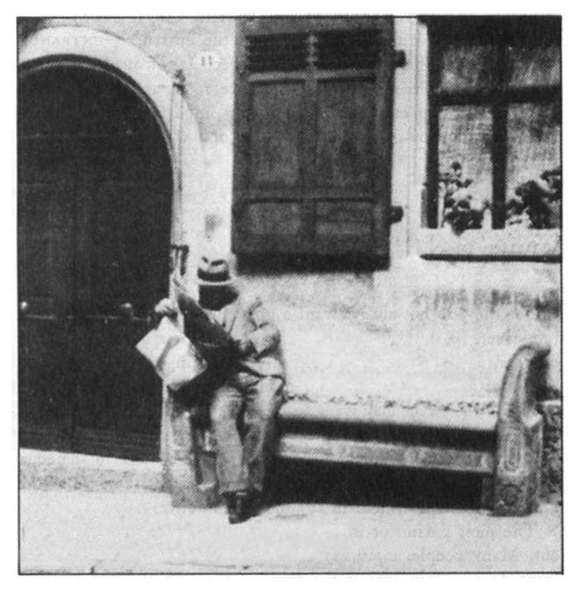
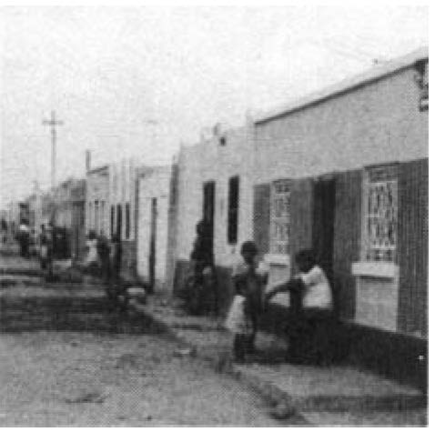
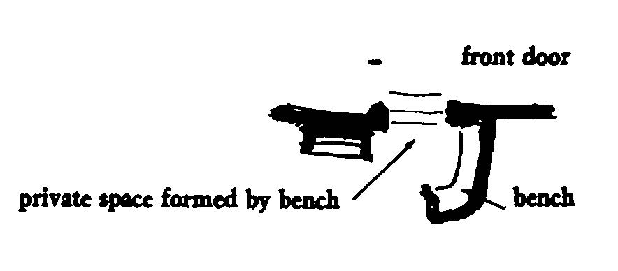

<section class="pattern-plate" aria-labelledby="t-front-door-bench">
<a href="/patterns">A Pattern Language</a> · <a href="/patterns#construction">Construction</a> · Pattern 242 · p. 1121 · *
<h1 class="pattern-title" id="t-front-door-bench">Front Door Bench</h1><figure class="pattern-figure pl-figure"></figure><nav class="pattern-links" aria-label="Connections"><h2>Links to</h2><ul><li><a href="/patterns/main-entrance">110 Main Entrance</a></li><li><a href="/patterns/arcades">119 Arcades</a></li><li><a href="/patterns/entrance-room">130 Entrance Room</a></li><li><a href="/patterns/old-age-cottage">155 Old Age Cottage</a></li><li><a href="/patterns/building-edge">160 Building Edge</a></li><li><a href="/patterns/connection-to-the-earth">168 Connection To The Earth</a></li><li><a href="/patterns/seat-spots">241 Seat Spots</a></li><li><a href="/patterns/sitting-wall">243 Sitting Wall</a></li><li><a href="/patterns/raised-flowers">245 Raised Flowers</a></li></ul><h2>Linked from</h2><ul><li><a href="/patterns/building-fronts">122 Building Fronts</a></li><li><a href="/patterns/entrance-room">130 Entrance Room</a></li><li><a href="/patterns/old-age-cottage">155 Old Age Cottage</a></li><li><a href="/patterns/building-edge">160 Building Edge</a></li><li><a href="/patterns/half-inch-trim">240 Half-Inch Trim</a></li><li><a href="/patterns/seat-spots">241 Seat Spots</a></li><li><a href="/patterns/sitting-wall">243 Sitting Wall</a></li></ul></nav></section><article class="pattern-text" aria-label="The text of Front Door Bench">
1122… <a class="pl-ref" href="/patterns/seat-spots">SEAT SPOTS (241)</a>, acting within several larger patterns, creates an atmosphere around the edge of the building which invites lingering—<a class="pl-ref" href="/patterns/arcades">ARCADES (119)</a>,<a class="pl-ref" href="/patterns/building-edge">BUILDING EDGE (160)</a>, SUNNY PLACE (l6l), <a class="pl-ref" href="/patterns/connection-to-the-earth">CONNECTION TO THE EARTH (168)</a>; it is most marked and most important near the entrance—<a class="pl-ref" href="/patterns/entrance-room">ENTRANCE ROOM (130)</a>. This pattern defines a special <a class="pl-ref" href="/patterns/seat-spots">SEAT SPOT (241)</a>: a bench which helps to form the entrance room and the building edge around the entrance. It is always important; but perhaps most important of all, at the door of an <a class="pl-ref" href="/patterns/old-age-cottage">OLD ACE COTTAGE (155)</a>.

◆ ◆ ◆

<strong>People like to watch the street.</strong>

But they do not always want a great deal of involvement with the street. The process of hanging out requires a continuum of degrees of involvement with the street, ranging all the way from the most private kind to the most public kind. A young girl watching the street may want to be able to withdraw the moment anyone looks at her too intently. At other times people may want to be watching the street, near enough to it to talk to someone who comes past, yet still protected enough so that they can withdraw into their own domain at a moment’s notice.

The most public kind of involvement with the street is sitting out. Many people, especially older people, pull chairs out to the front door or lean against the front of their houses, either while they are working at something or just for the pleasure of watching street life. But since there is some reluctance to be too public, this activity requires a bench or seat which is clearly private, even though in the public world. It is best of all when the bench is placed so that people are sitting on the edge of <em>their</em> world on private land—yet so placed that the personal space it creates overlaps with land that is legally public.

<figure class="pl-figure"><figcaption><em>Front door benches in Peru</em>.</figcaption></figure>

1123Therefore:

<strong>Build a special bench outside the front door where people from inside can sit comfortably for hours on end and watch the world go by. Place the bench to define a half-private domain in front of the house. A low wall, planting, a tree, can help to create the same domain.</strong>

<figure class="pl-figure"></figure>
◆ ◆ ◆

The bench may help to make the entrance visible—<a class="pl-ref" href="/patterns/main-entrance">MAIN ENTRANCE (20)</a>; it can be part of a wall—<a class="pl-ref" href="/patterns/sitting-wall">SITTING WALL (243)</a>, with flowers in the sunshine next to it—<a class="pl-ref" href="/patterns/raised-flowers">RAISED FLOWERS (245)</a>. Place it with care, according to the rules given in <a class="pl-ref" href="/patterns/seat-spots">SEAT SPOTS (241)</a>….
</article>

Christopher Alexander, Sara Ishikawa and Murray Silverstein, with Max Jacobson, Ingrid Fiksdahl-King and Shlomo Angel, <cite>A Pattern Language</cite> (Oxford University Press, 1977), pattern 242, pp. 1121–1123. Text and illustrations from the <a href="https://github.com/natureoforder/sources">Nature of Order sources</a> reading edition, transcribed from the 1977 printing; report errors on <a href="https://github.com/natureoforder/alexander-wiki/issues">GitHub</a>.

<a href="/patterns/seat-spots">← 241 Seat Spots</a> · <a href="/patterns">All 253 patterns</a> · <a href="/patterns/sitting-wall">243 Sitting Wall →</a>

